# Changelog

All notable changes to the Fuel Supply Intelligence & Resilience Platform are
recorded here.

The format follows [Keep a Changelog](https://keepachangelog.com/en/1.1.0/),
and the project uses [Semantic Versioning](https://semver.org/spec/v2.0.0.html).

## About the versions

The project has one release tag, `v1.0.0`, which points at commit `426b574`
(`fix(day7): stop the platform serving a world that has ended`). Everything
before it is the build log of a seven-day hackathon: seven daily milestones,
each one a set of commits, each recorded below as a dated entry.

The `backend` package version in
[`backend/pyproject.toml`](backend/pyproject.toml) is `0.1.0` and the frontend
package version in [`frontend/package.json`](frontend/package.json) is `0.1.0`.
Neither was bumped to match the `v1.0.0` tag — that was an omission, not a
decision. The tag is the release of record.

## The conventions used here

* **Added / Changed / Fixed / Removed / Security** — the Keep a Changelog
  categories.
* Entries are grouped by the day they were built, because the day is the unit
  of work in this project. The dates are the commit dates from `git log`.
* Every number in an entry comes from a run recorded in
  [`docs/progress/`](docs/progress/). Where a claim was later corrected, the
  correction is stated in the same entry rather than quietly dropped.
* Links are relative, and every one of them points at a file in this
  repository.

---

## [Unreleased]

Nothing yet. The `v1.0.0` tag is the current release.

## [1.0.0] — 2026-11-25

The submission. Seven days, complete. The platform reads the BUP fuel supply
simulator, forecasts demand, recommends explainable allocations for a human to
approve, and stays observable and usable when parts of it fail.

**Result, as recorded on the tag:**

| Measure | Value |
|---|---|
| Crisis, fault and dependency scenarios recovered | **17 of 17** |
| Load paths run to 50 users at 0.00 % errors | **3 of 3** |
| Backend tests | **583** passing |
| Frontend tests | **22** Vitest, **12** Playwright |
| Coverage | **85 %** overall |
| Load-test p99 | **30 030 ms → 286 ms** |
| Demo dry run | **5 consecutive clean runs**, 32–43 s |

> **Discrepancy.** The tag message and
> [`docs/progress/day7.md`](docs/progress/day7.md) both say coverage is
> **85 %**. The measurement reconciled from the test files themselves, in
> [`docs/testing-strategy-and-report.md`](docs/testing-strategy-and-report.md),
> is **84.4 %**. The two round to the same figure at the precision either
> document uses, but the exact measured value is **84.4 %** and that is the
> one to quote.

**Day-by-day milestones** are listed below, oldest first. Each links to the
progress log for that day, which is the raw record.

```mermaid
flowchart LR
    D1["Day 1<br/>skeleton"] --> D2["Day 2<br/>data + sync"]
    D2 --> D3["Day 3<br/>intelligence"]
    D3 --> D4["Day 4<br/>decisions"]
    D4 --> D5["Day 5<br/>dashboard"]
    D5 --> D6["Day 6<br/>resilience"]
    D6 --> D7["Day 7<br/>release"]
    D7 --> TAG["v1.0.0<br/>tagged"]

    D1 -. "60 tests" .-> D2
    D2 -. "107 unit" .-> D3
    D3 -. "213 unit" .-> D4
    D4 -. "+82" .-> D5
    D5 -. "317 backend" .-> D6
    D6 -. "17 of 17 drills" .-> D7
    D7 -. "583 backend" .-> TAG
```

---

### Day 1 — 2026-11-19 · Running skeleton

[Progress log](docs/progress/day1.md)

**Added**

- Monorepo layout: `backend/`, `frontend/`, `infra/`, `docs/`, `scripts/`,
  `tests/`.
- Docker Compose stack of six services — the published simulator image
  (starting paused), the backend, Postgres, the frontend, Prometheus and
  Grafana. Every credential and host port comes from the environment.
- Async simulator client covering the **entire** documented simulator surface:
  11 read endpoints plus their single-entity variants, allocation create and
  cancel, and 10 admin actions.
- Strict Pydantic models and typed errors for every simulator payload.
- FastAPI service exposing `/health` and `/api/state`.
- React + Vite + TypeScript operator dashboard skeleton.
- GitHub Actions CI with 5 jobs — lint, test, frontend, docker build, compose
  validation. It grew to 8 by the end of the build.
- Cross-service smoke and integration checks against a live stack.

**Fixed**

- The dashboard could not reach the backend from the browser.
- The CI image smoke test asserted dependencies the image did not have.
- The integration suite hard-coded target URLs instead of reading them from
  the environment.

**Documentation**

- [`docs/simulator-notes.md`](docs/simulator-notes.md) — what the running
  simulator actually does, and the **10** places it disagrees with the guide.
- Day 1 progress log and screenshots.

**Verified:** 6 services up and healthy, `/health` returning `HTTP 200` with
all three components `"ok"`, **60** backend unit tests and **6** integration
tests passing.

---

### Day 2 — 2026-11-20 · Data layer, live state sync, logging and metrics

[Progress log](docs/progress/day2.md)

**Added**

- Postgres schema owned by Alembic — 8 tables plus `alembic_version`.
- The background sync service: REST poll as the source of truth, with SSE
  treated as a hint that triggers a targeted re-read.
- The state cache and the degraded contract — every read path goes through the
  cache, so `stale`, `degraded` and `age_seconds` always travel with the
  payload.
- Structured JSON logging with correlation IDs on every line.
- Prometheus metrics for all 7 series.
- 8 new read endpoints over the stored state.
- SSE parser with auto-reconnect and backoff; a full refetch after every
  reconnect.

**Fixed**

- Alembic autogenerate skipped tables created by `create_all` — the tables
  existed in the database but were missing from the migration history. Written
  up in [`docs/postmortems/05-alembic-autogenerate-skipped-tables.md`](docs/postmortems/05-alembic-autogenerate-skipped-tables.md).

**Verified:** `alembic upgrade head` applied cleanly; 108 rows in Postgres
across 108 distinct `(station, fuel, tick)` keys after repeated cycles; the
backend degraded in **5 s** and recovered in **5 s** while the simulator was
stopped; `degraded: true`, `age_seconds: 46.301`; **3** SSE reconnects during
the drill; **107** unit, **14** integration and **10** fault checks passing.

---

### Day 3 — 2026-11-22 · Intelligence layer

[Progress log](docs/progress/day3.md)

**Added**

- The intelligence layer as four small modules — forecasting, risk, detection
  and the dispatcher.
- Two predictors and a selector that picks between them: a profile baseline
  and a learned model, both scored on the same split.
- Explainable risk scores — every score carries its signals.
- Hours-to-stockout, stockout probability, and risk levels `OK` / `WATCH` /
  `CRITICAL` with thresholds at 8 h and 24 h of cover.
- Demand anomaly detection by z-score against the profile plus EWMA drift;
  abnormal inventory change that is tick-span aware and accounts for
  deliveries.
- Bottleneck detection across five kinds — dispatch capacity, route disrupted,
  supply delayed, depot low stock, station outage — each firing only when it
  is actually binding.
- A model-unavailable fallback to the rule-based predictor, with
  `reason="not_trained"` and `reason="worse_than_baseline"`.
- Low confidence sets `needs_human_review=true` on every forecast.
- 10 new endpoints; 9 new Prometheus series.
- The dispatcher that moves fuel.

**Fixed**

- The benchmark leaked the future to the baseline, so the platform lost and
  correctly threw its own model away. Three bugs in the benchmark, written up
  in [`docs/postmortems/07-benchmark-leaked-the-future.md`](docs/postmortems/07-benchmark-leaked-the-future.md).

**Verified:** a 600-tick stepped run — 6.25 simulated days; a `demand_spike`
detected **1 tick** after the spike, risk level `OK` → `WATCH` in **2 ticks**,
fuel dispatched in **4**; **213** backend unit tests passing.

---

### Day 4 — 2026-11-22 · Decision engine

[Progress log](docs/progress/day4.md)

**Added**

- The decision layer as eight small modules, with the validator at its centre.
- A constraint-aware, priority-greedy optimizer over the network.
- All **8** validation rules pre-checked locally, in the guide's order.
- Route choice between alternatives, falling back from Gazipur to Patiya →
  Mirpur when Gazipur is disrupted.
- Splitting a deficit that exceeds the route's `max_shipment` into several
  shipments, each with its own idempotency key.
- Transit-time accounting — the projection credits fuel only from its arrival
  tick.
- Recommendations that explain themselves: risk before and after, the signals
  used, the constraints considered, confidence, and 1–2 ranked alternatives
  with the reason each lost.
- The what-if simulation — proven to write nothing to the simulator.
- The human approval flow: `PROPOSED → APPROVED → SUBMITTED → ARRIVED/FAILED`,
  with a reject endpoint.
- A deterministic idempotency key, `rec-{station}-{fuel}-{tick}-{quantity}`,
  so a retry is a replay rather than a second shipment.
- Every simulator 409 handled with a plain-language reason.
- The decision history table and the audit trail.
- The auto-mode toggle, **off by default**.
- The fallback policy for when the intelligence layer is down — lowest
  days-of-cover first, confidence capped at 0.4.
- 8 new Prometheus series.

**Fixed**

- The fallback never engaged, because a stale forecast was served to the
  decision layer as if it were current. Written up in
  [`docs/postmortems/08-fallback-never-engaged-stale-forecast.md`](docs/postmortems/08-fallback-never-engaged-stale-forecast.md).

**Verified:** **82** new tests, all 8 conflict codes reproduced; the policy
reached a service level of **1.000** against a naive baseline's **0.657**;
the fallback proven live by `scripts/day4_fallback_drill.py`. The policy
comparison is in [`docs/policy-comparison.md`](docs/policy-comparison.md).

---

### Day 5 — 2026-11-23 · Operator dashboard

[Progress log](docs/progress/day5.md)

**Added**

- Nine screens over the live API: Overview, Network, Inventory, Risk & alerts,
  Recommendations, Supply & events, Decision history, Service health, and
  Simulation.
- A hand-drawn SVG network board with live status colours.
- A hand-drawn SVG forecast chart with a shaded confidence band.
- A sticky explanation drawer carrying the signals, the chart and the
  constraints.
- A before → after projection on every recommendation card, the alternatives
  behind a toggle, and a what-if preview.
- The banner "Simulated environment. Human review required." on every
  recommendation card.
- 3 new backend routes the dashboard needed — including
  `GET /api/service-health`, which reads the Prometheus registry so the panel
  and Grafana cannot disagree.
- Simulation controls — run, pause, step and crisis injection, labelled
  "simulation only" in three places.
- Live updates by polling every 5 s.
- Loading, error and empty states for every view.
- A responsive layout — the sidebar collapses under 860 px, the drawer stacks
  under 1080 px.
- The frontend in docker-compose, served on `:5173`.

**Verified:** **22** Vitest, **12** Playwright and **317** backend tests, all
passing; **11** screenshots in [`docs/screenshots/`](docs/screenshots/).

---

### Day 6 — 2026-11-24 · Resilience and observability

[Progress log](docs/progress/day6.md) — in three parts.

**Added**

- Two compose profiles — `core` and `monitoring` — under a hard memory budget.
- `mem_limit` and `cpus` on all seven services, and log rotation on all seven
  (`json-file`, `10m × 3`).
- Prometheus retention bounded to `2d` / `500MB`.
- Prometheus and Grafana provisioned as code — a datasource, **5** dashboards
  and **21** alert rules, all from the repository.
- A circuit breaker around the simulator, with per-call timeouts (10 s
  request, 3 s connect, 2 s health).
- The crisis drill harness, which runs scenarios one at a time and measures
  detection and recovery instead of asserting them.
- Guarded async load generation and log filters for the load test.
- The **17**-scenario drill set: crisis, fault and dependency failures, each
  with a detection time, a recovery time and the recommendation made during
  the incident.

**Changed**

- cAdvisor was removed completely and replaced with **node-exporter** — 32 MB,
  scraping, 15 panels on the System dashboard.
- The platform's polling load on the simulator was reduced by **52 %** of
  requests per minute, with no errors and the breaker closed.

**Fixed**

- The platform exhausted the simulator's connection pool. Written up in
  [`docs/postmortems/04-simulator-connection-pool-exhaustion.md`](docs/postmortems/04-simulator-connection-pool-exhaustion.md).
- The SSE reader was dropped by the simulator's queue, which produced a
  **silent dead feed** — no error, no reconnect, no data. Written up in
  [`docs/postmortems/01-silent-dead-sse-feed.md`](docs/postmortems/01-silent-dead-sse-feed.md).
- The unbounded in-memory recommendation store was bounded.
- A Postgres deadlock between the sync service and the approval path lost
  writes. Written up in
  [`docs/postmortems/06-postgres-deadlock-lost-writes.md`](docs/postmortems/06-postgres-deadlock-lost-writes.md).
- The `prediction_evaluations` aggregate OOM-killed the container and gave a
  p99 of **30 030 ms**. Written up in
  [`docs/postmortems/03-oom-kill-prediction-evaluations.md`](docs/postmortems/03-oom-kill-prediction-evaluations.md).
- The audit endpoint's full-text search combined with an entity filter
  returned a 500.

**Verified:** **17 of 17** scenarios recovered automatically; all 3 load paths
ran to 50 users at **0.00 %** errors; p99 fell from **30 030 ms** to
**286 ms**; the alerts were fired, not just written — simulator down at t+40 s,
fallback active, stale data at t+140 s; a crash-looping container reached
`RestartCount=7`; graceful shutdown with `ExitCode=0`, `OOMKilled=false`;
**53** malformed-data rejections per endpoint. The load test is in
[`docs/load-test-report.md`](docs/load-test-report.md) and the drills in
[`docs/resilience-report.md`](docs/resilience-report.md).

---

### Day 7 — 2026-11-25 · The release and the self-checking demo

[Progress log](docs/progress/day7.md)

**Added**

- A demo dry run that executes every step and checks every claim it makes —
  **5 consecutive clean runs**, 32–43 s.
- The release: the `v1.0.0` tag, the release workflow, and the image tags.
- The documentation set — the API reference, the data model, the runbook, the
  observability guide, the security and threat model, the testing strategy and
  report, the CI/CD and rollback guide, the configuration reference, the
  known limitations and roadmap, and the operator's user guide.

**Fixed**

- The platform served a world that had ended. After a simulator reset it kept
  serving the old world's state, and the stale snapshot looked healthy.
  Written up in
  [`docs/postmortems/02-stale-snapshot-after-reset.md`](docs/postmortems/02-stale-snapshot-after-reset.md).
- A probe measured the same thing twice.
- The demo claimed something it did not do.

**Verified:** the fresh-clone test against the tagged commit, recorded in the
addendum to the Day 7 log.

---

## The commits after the tag

The `v1.0.0` tag sits **21 commits** behind `main`. Everything after it is
documentation and a release fix; no feature changed after the tag. The two
that touched behaviour are listed first.

| Commit | Date | What it did |
|---|---|---|
| `426b574` → `b5dbcdc` | 2026-11-25 | `fix(day7): stop the platform serving a world that had ended`, then the fresh-clone test recorded against the tagged commit |
| `ba36b5d` | 2026-11-25 | Refreshed the evidence screenshots |
| `26d86cb` | 2026-11-25 | Fixed a broken README link in the Day 6 log |
| `ba69f25` … `357bb9c` | 2026-11-26 | The 18 `docs: add` commits, which produced the 19 documents listed in the table below |

`v1.0.0` is the only tag in the repository.

---

## The documentation set

Added on 2026-11-26, after the tag, as separate `docs:` commits. They document
`v1.0.0` rather than change it.

| Document | What it holds |
|---|---|
| [`docs/bug-catalog.md`](docs/bug-catalog.md) | All **70** defects, grouped by root-cause pattern |
| [`docs/postmortems/`](docs/postmortems/) | Eight incidents written up in full |
| [`docs/requirements-traceability.md`](docs/requirements-traceability.md) | Every requirement mapped to its proof, with a Done / Partial / Not done status |
| [`docs/project-summary.md`](docs/project-summary.md) | The one-page version |
| [`docs/demo-qa.md`](docs/demo-qa.md) | Twenty-five questions judges are likely to ask |
| [`docs/adr/`](docs/adr/) | Thirteen Architecture Decision Records |
| [`docs/intelligence-methodology.md`](docs/intelligence-methodology.md) | The model card |
| [`docs/decision-engine.md`](docs/decision-engine.md) | The allocation engine |
| [`docs/api-reference.md`](docs/api-reference.md) | All 35 routes |
| [`docs/data-model.md`](docs/data-model.md) | All 12 tables |
| [`docs/runbook.md`](docs/runbook.md) | Operating the platform |
| [`docs/observability-guide.md`](docs/observability-guide.md) | All 46 metrics, 5 dashboards, 21 alerts |
| [`docs/security-and-threat-model.md`](docs/security-and-threat-model.md) | Assets, boundaries, controls, threats |
| [`docs/testing-strategy-and-report.md`](docs/testing-strategy-and-report.md) | Eight test layers, the counts, 12 known gaps |
| [`docs/cicd-release-and-rollback.md`](docs/cicd-release-and-rollback.md) | Both workflows, 9 jobs, the rollback procedure |
| [`docs/configuration-reference.md`](docs/configuration-reference.md) | All 37 backend settings |
| [`docs/known-limitations-and-roadmap.md`](docs/known-limitations-and-roadmap.md) | Every known limitation, and 14 roadmap items |
| [`docs/operator-user-guide.md`](docs/operator-user-guide.md) | The dashboard, screen by screen |
| [`docs/project-journey.md`](docs/project-journey.md) | The build log as a narrative |

---

## Links

[Unreleased]: https://github.com/TanimStu068/fuel-supply-intelligence-platform/compare/v1.0.0...HEAD
[1.0.0]: https://github.com/TanimStu068/fuel-supply-intelligence-platform/releases/tag/v1.0.0
