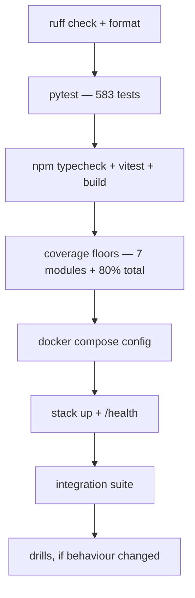

# Contributing

Thanks for reading. This file explains how to get the project running, how the
code is laid out, and the conventions the repository already follows — so that
a change you make looks like the ones already there.

The project is the **Fuel Supply Intelligence & Resilience Platform**, built for
the BUP CSE Fest 2026 hackathon. It reads the organizer's fuel supply
simulator, forecasts demand, recommends explainable allocations for a human to
approve, and stays observable and usable when parts of it fail.

**Before you start:** the authoritative context for what the platform does and
why is in [`docs/`](docs/README.md). The architecture decisions and their
rejected alternatives are in [`docs/adr/`](docs/adr/README.md).

---

## 1. Prerequisites

| Tool | Version | Needed for |
|---|---|---|
| Docker + Compose plugin | Current | Running the stack — the normal way |
| Python | 3.12+ | Running or testing the backend outside a container |
| Node.js | 20+ | Frontend development and the frontend tests |

Python 3.12 is a hard floor: the backend's `pyproject.toml` sets
`requires-python = ">=3.12"`, and the ruff config targets `py312`.

The backend has a virtual environment committed at
[`backend/.venv/`](backend/.venv) — it is a local artifact, not part of the
repository. Create your own if it is missing:

```bash
cd backend
python3.12 -m venv .venv
.venv/bin/pip install -e ".[dev]"
```

## 2. Getting the stack running

```bash
cp .env.example .env      # then edit the two passwords in it
docker compose up --build
```

`COMPOSE_PROFILES=core` lives in `.env`, so a plain `docker compose up` starts
the **platform only** — four containers, about 380 MB. Add the observability
profile explicitly when you need it:

```bash
docker compose --profile monitoring up -d --wait
```

| Service | URL |
|---|---|
| Operator dashboard | http://localhost:5173 |
| Backend API | http://localhost:8001 |
| Simulator | http://localhost:8000 |
| Prometheus | http://localhost:9090 |
| Grafana | http://localhost:3000 |

Ports are remapped locally to avoid collisions with other projects. Check
what is actually published with `docker compose ps`.

`.env` is gitignored. `.env.example` is the contract and is committed — if
you add a setting, add it to `.env.example` too, with a safe default.

## 3. Running the backend locally

Useful when you are editing backend code and want a fast edit-run cycle
instead of a container rebuild.

```bash
cd backend
.venv/bin/uvicorn app.main:app --reload --port 8001
```

The backend waits for the simulator and the database to report healthy before
it starts, and it runs the Alembic migrations on boot.

## 4. Running the frontend locally

```bash
cd frontend
npm install
npm run dev          # http://localhost:5173
```

The dashboard reaches the backend through a configurable base URL — see
[`frontend/src/config.ts`](frontend/src/config.ts). The bug where it could not
reach the backend from the browser is written up in
[`docs/bug-catalog.md`](docs/bug-catalog.md).

## 5. The tests

There are three suites. They are separate on purpose: the unit suite is fast
and needs nothing running, the integration suite needs the whole stack, and
the end-to-end suite needs the frontend.

### 5.1 Backend unit tests

```bash
cd backend
.venv/bin/pytest -q
```

**583** tests. No database, no simulator, no Docker — every dependency is
faked at the boundary. `pytest.ini` sets `asyncio_mode = auto`, so async test
functions need no decorator.

### 5.2 Coverage

```bash
cd backend
.venv/bin/pip install pytest-cov
.venv/bin/pytest -q --cov=app --cov-report=term-missing --cov-report=json:coverage.json
python3 ../scripts/check_coverage.py coverage.json
```

`scripts/check_coverage.py` enforces **seven** per-module floors and one
total floor:

| Module | Floor |
|---|---:|
| `app/decision/optimizer.py` | 90 % |
| `app/decision/service.py` | 90 % |
| `app/decision/validator.py` | 90 % |
| `app/decision/fallback.py` | 90 % |
| `app/intelligence/engine.py` | 90 % |
| `app/intelligence/forecasting.py` | 85 % |
| `app/simulator_client.py` | 90 % |
| **Total** | **80 %** |

The last measured total is **84.4 %** —
[`docs/testing-strategy-and-report.md`](docs/testing-strategy-and-report.md)
reconciles it from the test files themselves. If you lower a floor, say why
in the same commit; the floors exist because the brief names these four
modules as the ones that must hold.

### 5.3 Cross-service integration tests

These need the stack running.

```bash
docker compose up -d --wait
python -m pytest tests/ -m integration -q
```

The suite resolves its target URLs from the environment, so it works against
a stack on non-default ports.

### 5.4 Frontend tests

```bash
cd frontend
npm run test           # Vitest — 22 tests
npm run typecheck      # tsc --noEmit
npm run lint           # eslint, --max-warnings 0
npm run build          # tsc -b && vite build
```

### 5.5 End-to-end tests

```bash
cd frontend
npm run test:e2e:install   # once — installs Chromium
npm run build
npm run test:e2e           # Playwright — 12 tests
```

Playwright needs the stack up. The screenshot suite
(`npm run screenshots`) regenerates [`docs/screenshots/`](docs/screenshots/).

## 6. Linting and formatting

The backend uses **ruff** for both linting and formatting. The config lives
in [`backend/pyproject.toml`](backend/pyproject.toml).

```bash
cd backend
.venv/bin/ruff check .          # lint
.venv/bin/ruff format --check . # formatting
.venv/bin/ruff format .         # apply formatting
```

The lint rules are `E`, `F`, `I`, `UP`, `B`, `C4`, `SIM`, `RUF` with a line
length of **100**. `I` enforces import sorting; `UP` enforces modern syntax.

The frontend uses **ESLint** with `--max-warnings 0`, so a warning fails the
build, and **TypeScript** in strict mode.

## 7. The checks CI runs

[`.github/workflows/ci.yml`](.github/workflows/ci.yml) has **8** jobs. The
release workflow adds a ninth, so the project has nine jobs across the two
workflows. The local equivalent of CI, in order:

```bash
# 1. Lint
cd backend && .venv/bin/ruff check . && .venv/bin/ruff format --check .

# 2. Backend tests
cd backend && .venv/bin/pytest -q

# 3. Frontend typecheck, unit tests and build
cd frontend && npm run typecheck && npm run test && npm run build

# 4. Coverage floors
cd backend && .venv/bin/pytest -q --cov=app --cov-report=json:coverage.json \
  && python3 ../scripts/check_coverage.py coverage.json

# 5. Compose validation and smoke test
docker compose config --quiet
cp .env.example .env && docker compose up -d --wait --wait-timeout 300
curl -fsS http://localhost:8001/health
python -m pytest tests/ -m integration -q
docker compose down -v
```

The order matters: the cheap checks come first, so a formatting mistake does
not cost you a container start.



The full list of jobs, from the workflow file:

| Job | What it does |
|---|---|
| Lint (ruff) | `ruff check` and `ruff format --check` |
| Test (pytest) | The unit suite, with a JUnit artifact |
| Frontend (typecheck + build) | `tsc --noEmit`, Vitest, `vite build` |
| Frontend e2e (playwright) | Builds, starts the stack, runs Playwright |
| Docker build | Builds both images and smoke-tests the backend image |
| Validate docker-compose | `docker compose config --quiet` |
| Compose smoke test (`/health`) | Starts the stack and checks the health endpoint |
| Test coverage | Measures coverage and enforces the floors |

The cross-service integration suite runs as a step inside the compose smoke
job, not as a job of its own.

The release workflow is separate —
[`.github/workflows/release.yml`](.github/workflows/release.yml) — and runs on
a `v*` tag. The rollback target is the `-sha-<commit>` image tag; the
procedure is in
[`docs/cicd-release-and-rollback.md`](docs/cicd-release-and-rollback.md).

## 8. The layout

```
backend/    FastAPI service, the intelligence and decision layers, unit tests
frontend/   React + Vite + TypeScript operator dashboard
infra/      Prometheus and Grafana provisioning, alert rules, dashboards
docs/       Everything documented, indexed in docs/README.md
scripts/    Verification and drill scripts, load-test harness
tests/      Cross-service integration suite (needs the stack)
```

Inside `backend/app/`:

| Directory | What is in it |
|---|---|
| `app/` root | The simulator client, the sync service, the state cache, the API, metrics, logging, the circuit breaker |
| `app/intelligence/` | Forecasting, risk, detection, the dispatcher, the engine |
| `app/decision/` | The validator, the optimizer, the fallback, the service, the models |

The layering rule: **`app/intelligence/` and `app/decision/` do not import
from each other.** The decision layer reads the world through the engine's
published interface. This keeps the fallback possible — the decision layer
has to work when the intelligence layer is broken.

## 9. The code conventions

These are the conventions the existing code already follows.

**Python**

* Type hints on every public function. `from __future__ import annotations` at
  the top of every module.
* `ruff format` is the formatter — do not hand-format around it.
* Comments explain **why**, not what. The existing code comments the
  non-obvious reasons: why a key is deterministic, why a bound exists, why a
  check is skipped. Match that.
* Small, focused functions. The intelligence layer is four modules and the
  decision layer is eight, deliberately, rather than two large ones.
* Prefer composition over inheritance.
* No premature abstraction. The codebase has one place that reads a latency
  summary out of the Prometheus registry, not three that each do it slightly
  differently.

**TypeScript**

* Strict mode. `any` needs a comment saying why.
* The number formats live in one file — [`frontend/src/format.ts`](frontend/src/format.ts).
  Do not add a second place that formats a number.
* The data layer is explicit — [`frontend/src/api.ts`](frontend/src/api.ts) —
  rather than a generic fetch wrapper.

**Tests**

* Every test name states the behaviour, not the function. `test_a_healthy_network_has_no_bottlenecks`
  says what is true; `test_detect` says nothing.
* A test that fixes a bug is named after the bug, so the test suite reads as
  a list of things that are now true.
* Prefer testing behaviour at the boundary over testing internals.

## 10. Commit messages

The repository uses **Conventional Commits**. The observed prefixes:

| Prefix | Used for |
|---|---|
| `feat` | A new capability |
| `fix` | A defect fix |
| `perf` | A performance change |
| `test` | Tests only |
| `docs` | Documentation only |
| `ci` | The workflows |
| `build` | Build and packaging |
| `chore` | Everything else — dependencies, housekeeping |
| `revert` | A revert |

The scope is optional and names the area: `feat(backend)`, `fix(sync)`,
`docs(day6)`, `perf(api)`, `feat(drill)`.

The commit subject is written in the imperative mood and says what the commit
does. The observed style is a full sentence with a dash — it explains *why*
the change was needed, not just what changed:

```
fix(sync): stop the platform from exhausting the simulator's connection pool
```

```
feat(drill): let the model earn its way back before calling it recovered
```

```
perf(intelligence): read forecast points in the database, not in Python
```

Keep the subject under about 72 characters. Add a body when the *reason* is
not obvious from the subject — the "why", the trade-off, or what was measured.
The bodies in this repository are worth imitating.

**Commit body convention.** Two forms appear in the history:

* `Fixes #123` or a reference to the issue it closes.
* `Co-Authored-By: Claude Opus 4.8 <noreply@anthropic.com>` where an AI
  assistant wrote the change.

## 11. Branching

The repository has one branch, `main`, and `origin/main`. There were no
feature branches during the build — the seven days were a sequence of daily
milestones, each landing on `main` behind a green CI.

For a change that is more than a single fix, use a branch:

```bash
git switch -c feat/<short-description>
git switch -c fix/<short-description>
git switch -c docs/<short-description>
```

Open a pull request against `main`. The pull request should say what changed
and how it was verified — ideally with the command that verifies it and its
output.

**Direct commits to `main`** are acceptable for a one-line documentation fix
or a small, obviously-correct change. Everything else goes through a branch.

## 12. Before you push

Run these:

```bash
cd backend
.venv/bin/ruff check . && .venv/bin/ruff format --check .
.venv/bin/pytest -q

cd ../frontend
npm run typecheck && npm run test && npm run build
```

And if your change touches how the platform behaves under failure — the sync
service, the cache, the circuit breaker, the fallback, the approval path —
run the drills too. They are the reason the platform's resilience claims are
real, and they are checked by scripts rather than by assertion:

```bash
python3 scripts/crisis_drill.py            # the scenario suite
python3 scripts/day4_fallback_drill.py     # the fallback, live
python3 scripts/demo_dry_run.sh            # the demo, end to end
```

## 13. Documentation

**Every change that alters behaviour needs a documentation change in the same
commit.** The documentation is not a follow-up task.

| If you changed | Update |
|---|---|
| An endpoint | [`docs/api-reference.md`](docs/api-reference.md) |
| A setting | [`docs/configuration-reference.md`](docs/configuration-reference.md) |
| A table or column | [`docs/data-model.md`](docs/data-model.md) |
| The decision algorithm | [`docs/decision-engine.md`](docs/decision-engine.md) |
| The forecasting or the model | [`docs/intelligence-methodology.md`](docs/intelligence-methodology.md) |
| A metric or an alert | [`docs/observability-guide.md`](docs/observability-guide.md) |
| How to operate it | [`docs/runbook.md`](docs/runbook.md) |
| A defect | [`docs/bug-catalog.md`](docs/bug-catalog.md) |

Add any new document to [`docs/README.md`](docs/README.md). It is the index
of the `docs/` tree, and an unindexed document is invisible.

**The house rules for these documents:**

* Every number comes from a run that a named script reproduces. Nothing is
  estimated and nothing is rounded in the platform's favour.
* Where two documents disagree, the newer verified value wins and the
  conflict is stated in the document's **Discrepancies** section.
* Where something was not verified, write **not verified** rather than
  leaving a gap.
* Link with relative paths, and check that the file exists before you commit.

## 14. Reporting a problem

For a security problem, read [`SECURITY.md`](SECURITY.md) — it has its own
process, and it is not the same as opening an issue.

For a defect, open an issue with what happened, how to reproduce it, and what
you expected instead. If you have the log line with its `correlation_id`, it
will make the problem much faster to find — the search instructions are in
[`docs/observability-guide.md`](docs/observability-guide.md).

## 15. A note on the record

This project keeps a detailed log. Every day of the build has a file in
[`docs/progress/`](docs/progress/) that records what was built, what the
verification caught, and the numbers that were **measured** rather than the
numbers that were hoped for. The catalog of defects is in
[`docs/bug-catalog.md`](docs/bug-catalog.md), and the eight incidents written
up in full are in [`docs/postmortems/`](docs/postmortems/README.md).

If you find a new defect, it belongs in that catalogue. The catalogue is
more valuable than a defect count in a README, because it records *why* the
defect happened and what now pins it.
