<div align="center">

# Fuel Supply Intelligence & Resilience Platform

**Intelligent decision-support and resilience platform for a simulated fuel supply network.**

Built for the BUP CSE Fest 2026 Hackathon Finals · in association with Poridhi.io

[](https://github.com/TanimStu068/fuel-supply-intelligence-platform/actions/workflows/ci.yml)
[](https://github.com/TanimStu068/fuel-supply-intelligence-platform/actions/workflows/release.yml)
[](docs/progress/day7.md)
[](backend/tests)
[](backend/app)
[](frontend/src/components/components.test.tsx)
[](#17-rules-we-hold-ourselves-to)

</div>

---

Table of contents

1. [What this project is](#1-what-this-project-is)
2. [Screenshots](#2-screenshots)
3. [Architecture](#3-architecture)
4. [The operating loop](#4-the-operating-loop)
5. [Tech stack](#5-tech-stack)
6. [Repository layout](#6-repository-layout)
7. [Quick start](#7-quick-start)
8. [Configuration](#8-configuration)
9. [The API](#9-the-api)
10. [Simulator integration](#10-simulator-integration)
11. [Testing and CI](#11-testing-and-ci)
12. [Deployment and rollback](#12-deployment-and-rollback)
13. [The demo](#13-the-demo)
14. [7-day build plan](#14-7-day-build-plan)
15. [Required deliverables map](#15-required-deliverables-map)
16. [Reference material](#16-reference-material)
17. [Rules we hold ourselves to](#17-rules-we-hold-ourselves-to)
18. [Documentation](#documentation)

---

## 1. What this project is

The organizers provide a deterministic **BUP Fuel Supply Simulator**: 2 regions,
2 depots, 4 stations, 6 routes, 3 fuel types (Diesel, Petrol, Octane) and a
tick-based clock. The simulator is the *world*. It does not predict, optimize or
decide.

This platform is the *brain and cockpit* built on top of it. It:

* observes the fuel network — inventory, demand, supply, routes, events;
* detects emerging shortages and operational risks;
* predicts stockouts, with a confidence band and the signals behind every score;
* recommends valid, explainable allocations that **a human approves**;
* responds to disruptions — demand spikes, shipment delays, route and depot problems;
* stays observable and usable when parts of the system fail.

Every number the dashboard shows comes from the live simulator through the
backend. Nothing is fabricated, and nothing reaches the simulator without an
explicit human approval.

> **Status:** **v1.0.0 released.** Seven days, complete.
> Submission deadline: **26 November 2026**.
> Final report: [`docs/progress/day7.md`](docs/progress/day7.md)

---

## 2. Screenshots

The operator dashboard — React, Vite and TypeScript, served by `docker compose up`.

| Overview | Network |
|---|---|
| 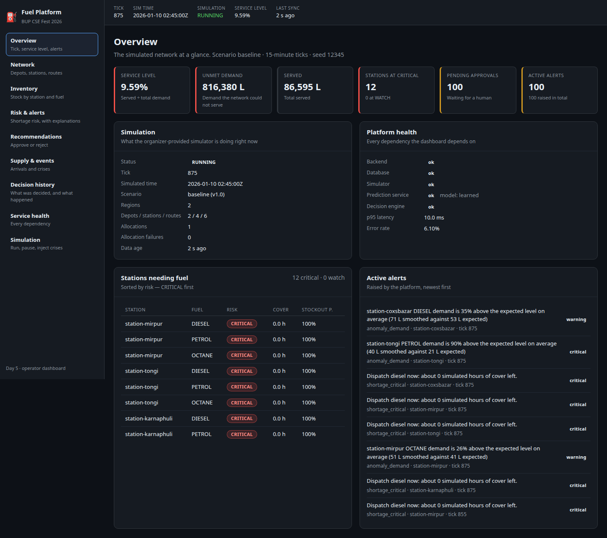 | 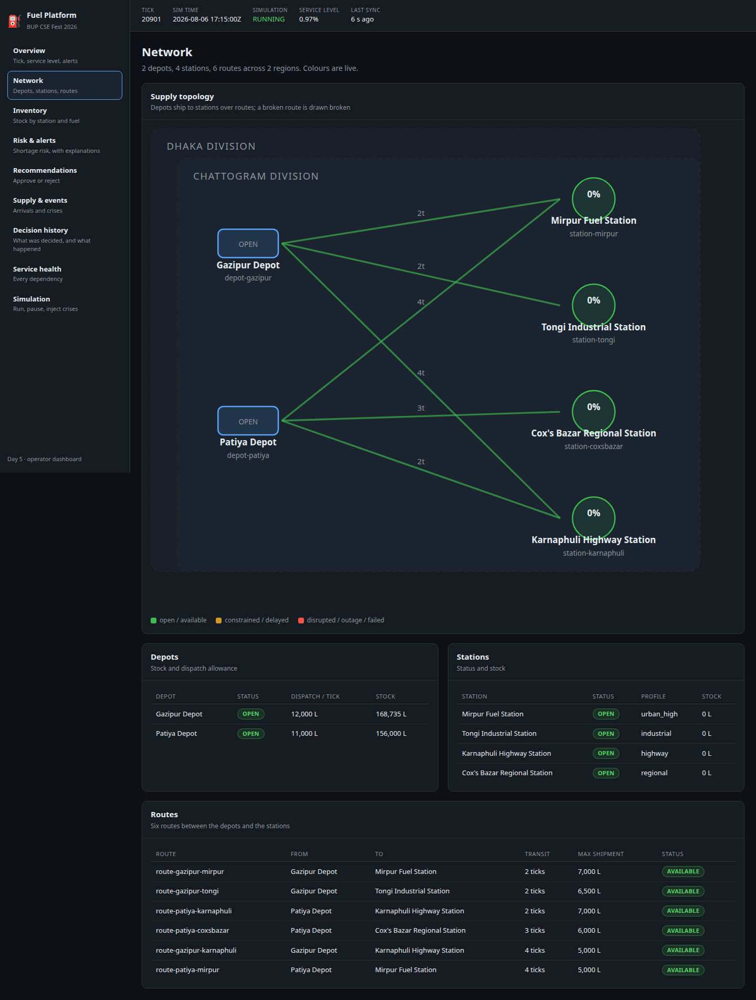 |
| **Overview** — the clock, the service level, unmet demand, the health banner and the active alerts | **Network** — 2 regions, 2 depots, 4 stations and 6 routes with live status colours |

| Inventory | Risk & alerts |
|---|---|
| 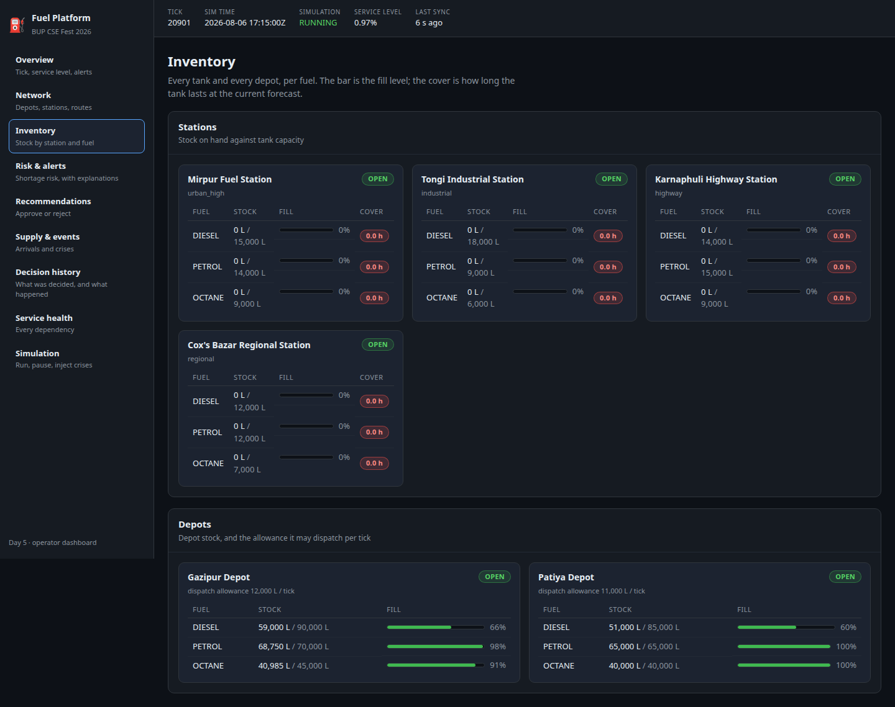 | 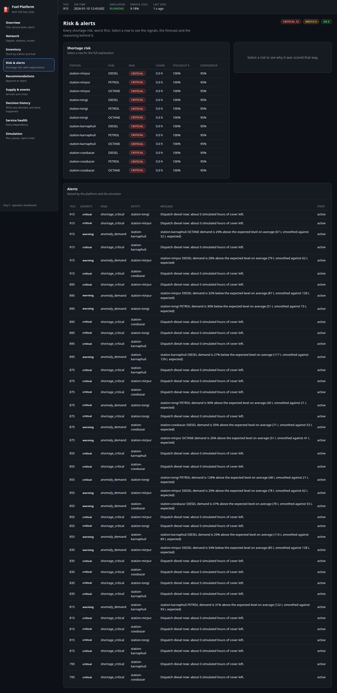 |
| **Inventory** — every tank and depot, per fuel, with fill bars and hours-to-stockout | **Risk & alerts** — sorted worst first, with the alert ledger below |

| Recommendations | Risk explanation |
|---|---|
| 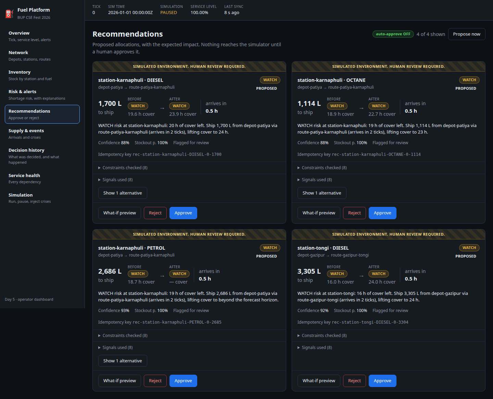 | 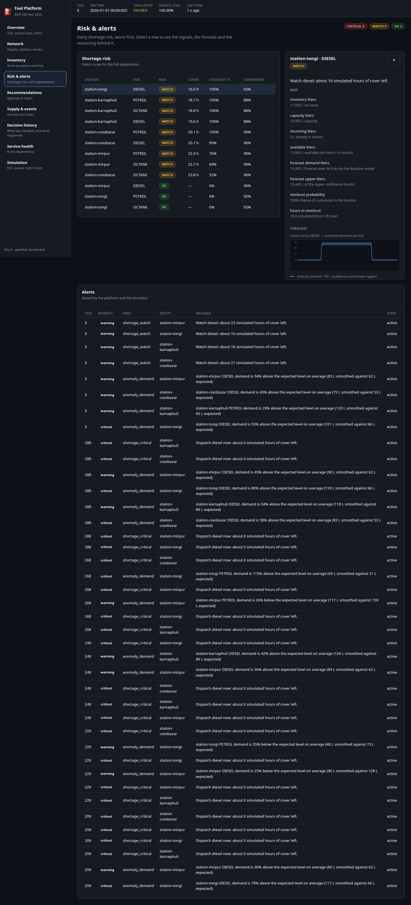 |
| **Recommendations** — before → after impact, constraints, signals, approve or reject | **Explanation drawer** — the signals, the forecast with its confidence band, and the constraints |

| Supply & events | Decision history |
|---|---|
| 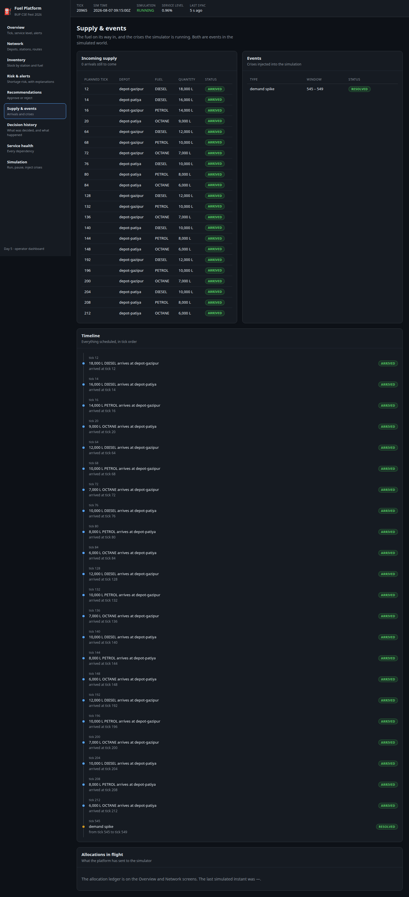 | 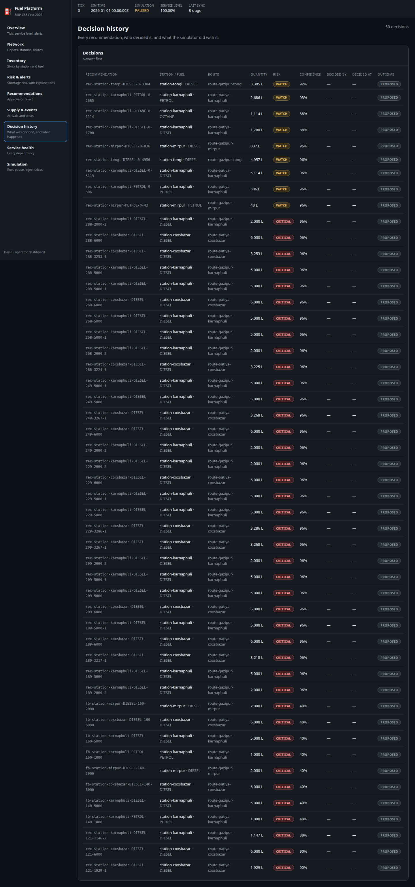 |
| **Supply & events** — incoming arrivals and active crises on one axis | **Decision history** — what was decided, by whom, and what happened to it |

| Service health | Simulation |
|---|---|
| 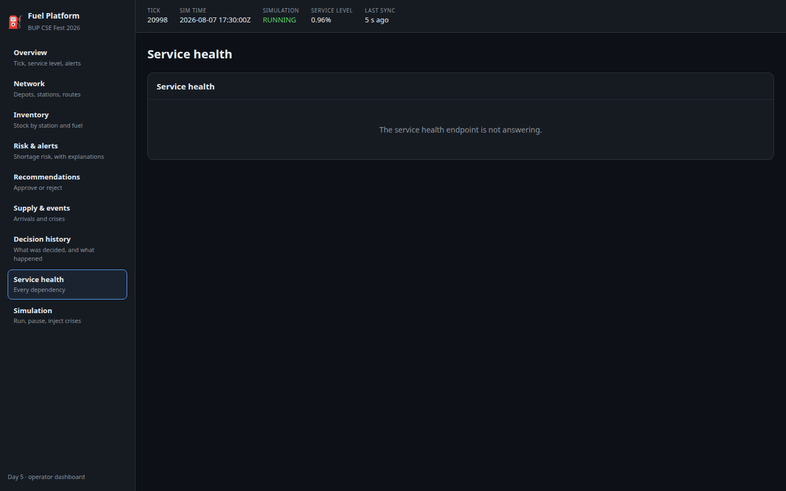 | 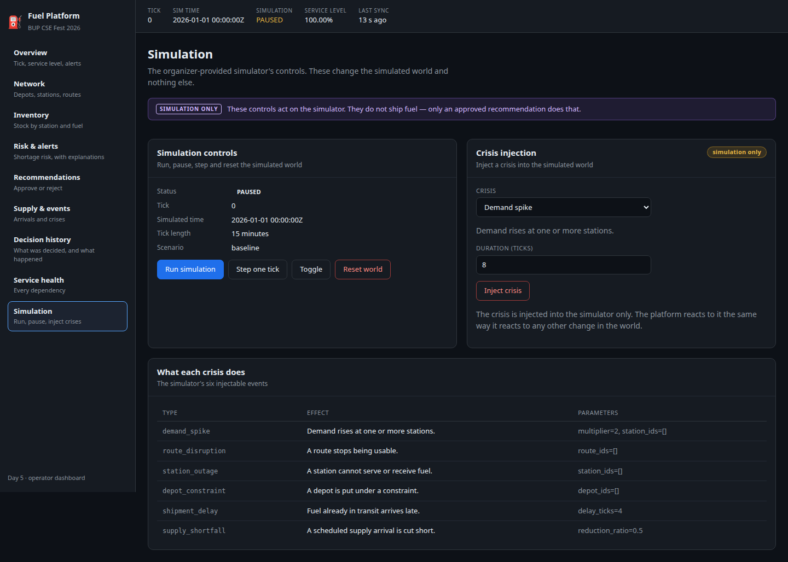 |
| **Service health** — every dependency, the p95 latency, the error rate, the fallback state | **Simulation** — run, pause, step and inject a crisis, clearly labelled *simulation only* |

### Responsive

The layout holds on a phone: the sidebar collapses behind the menu button and
every grid stacks into a single column.

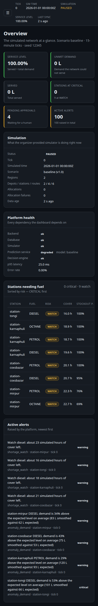

**Responsive** — the same dashboard at 430 px, captured full page.

### Day 1

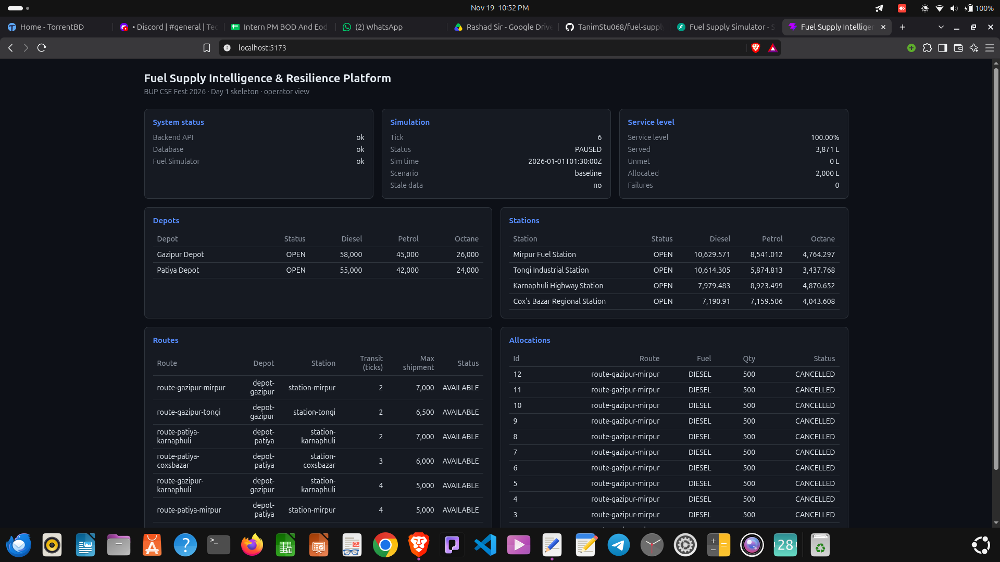

**Day 1** — the foundation: the simulator client and the first API routes.

---

## 3. Architecture

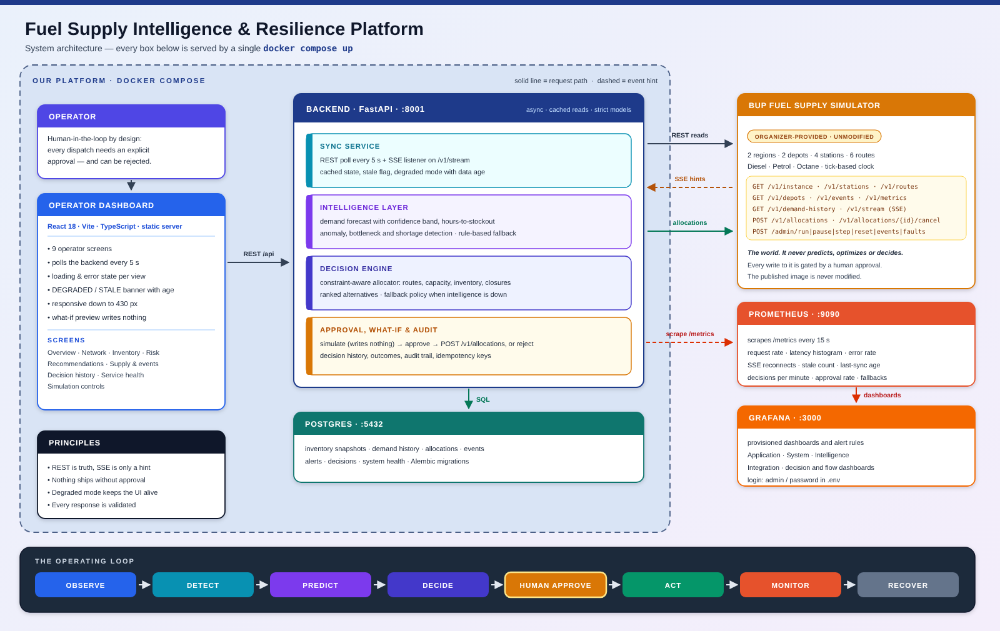

The diagram is a single image at
[`docs/assets/architecture.png`](docs/assets/architecture.png).

### What each box does

| Component | Port | Responsibility |
|---|---|---|
| **Operator dashboard** — React 18, Vite, TypeScript | `:5173` | Nine operator screens. Polls the backend every 5 s. Loading and error state on every view. The `DEGRADED` / `STALE` banner shows the age of the cached data. Responsive down to 430 px. |
| **Backend** — FastAPI, async | `:8001` | Every read, write and decision endpoint. Strict Pydantic models with `extra="forbid"`. |
| ↳ Sync service | | REST poll every 5 s plus an SSE listener on `/v1/stream`. SSE is a *hint* — every event triggers a re-fetch of the affected resource. Owns the state cache, the stale flag and the degraded mode. |
| ↳ Intelligence layer | | Demand forecasting with a confidence band, hours-to-stockout, stockout probability, and detection of anomalies, bottlenecks and shortages. Falls back to a rule-based predictor when the model cannot be trusted. |
| ↳ Decision engine | | A constraint-aware allocator that pre-validates every simulator rule, ranks alternatives, and falls back to a days-of-cover policy when the intelligence layer is down. |
| ↳ Approval, what-if & audit | | `simulate` writes nothing. `approve` sends the allocation. `reject` records the reason. Every decision keeps its outcome and its audit trail. |
| **Postgres** | `:5432` | Inventory snapshots, demand history, the allocation mirror, events, alerts, decisions and system health. Alembic migrations. |
| **Simulator** — organizer-provided, unmodified | `:8000` | The world. It never predicts, optimizes or decides. |
| **Prometheus** | `:9090` | Scrapes `/metrics` every 15 s. |
| **Grafana** | `:3000` | Provisioned dashboards and alert rules. |

### Key principles

* **REST is the source of truth, SSE is only a hint.** Every event triggers a
  re-fetch of the affected resource.
* **Human in the loop.** Recommendations start as `PROPOSED` and are sent to the
  simulator only after an operator approves them.
* **Fail safe.** Cached state, fallback policies and degraded mode keep the
  operator informed when a dependency fails.
* **Everything is validated.** Every simulator response is checked against a
  closed Pydantic model before it reaches the rest of the platform.

---

## 4. The operating loop

```
Observe → Detect → Predict → Decide → Simulate → Act → Monitor → Recover
```

| Stage | Where it lives | What it produces |
|---|---|---|
| Observe | `backend/app/sync_service.py` | A cached snapshot of the whole network, with a freshness age |
| Detect | `backend/app/intelligence/detection.py` | Demand anomalies, abnormal inventory change, bottlenecks |
| Predict | `backend/app/intelligence/forecasting.py`, `risk.py` | A demand forecast with a confidence band, hours-to-stockout and a stockout probability |
| Decide | `backend/app/decision/optimizer.py` | A ranked, constraint-valid allocation with alternatives |
| Simulate | `POST /api/recommendations/{id}/simulate` | A what-if preview that writes nothing |
| Act | `POST /api/recommendations/{id}/approve` | The allocation, after a human said yes |
| Monitor | `backend/app/intelligence/dispatcher.py`, the dashboard | Live risk, live service level, live alerts |
| Recover | `backend/app/decision/fallback.py`, the degraded-mode cache | A rule-based policy and a dashboard that keeps working |

---

## 5. Tech stack

| Layer | Choice |
|---|---|
| Backend | Python 3.12, FastAPI, httpx (async), Pydantic, SQLAlchemy (async), Alembic |
| Frontend | React 18, Vite 5, TypeScript 5, Vitest, Playwright |
| Database | Postgres 16 (Alembic migrations) |
| Observability | Prometheus, Grafana, structured JSON logs with correlation IDs |
| Delivery | Docker Compose, GitHub Actions |
| Load testing | k6 or Locust — a standalone `httpx` harness, plus a Locust file |

---

## 6. Repository layout

```
.
├── backend/                       FastAPI service
│   ├── app/
│   │   ├── main.py                every route: /health, /api/state, /metrics, …
│   │   ├── config.py              env-driven settings (no secrets in code)
│   │   ├── simulator_client.py    async httpx client for every simulator endpoint
│   │   ├── simulator_models.py    strict Pydantic models for every response
│   │   ├── simulator_errors.py    typed exception hierarchy, one class per 409
│   │   ├── sync_service.py        background sync: REST poll + SSE listener
│   │   ├── state_cache.py         the cached snapshot, its age and its staleness
│   │   ├── sse.py                 the SSE reconnect loop
│   │   ├── repository.py          every database query lives here
│   │   ├── db.py / models.py      async SQLAlchemy engine and tables
│   │   ├── metrics.py             Prometheus instrumentation
│   │   ├── logging_config.py      structured JSON logging
│   │   ├── intelligence/          forecasting · risk · detection · dispatcher
│   │   └── decision/              allocator · constraints · validator · fallback
│   ├── migrations/                Alembic revisions
│   ├── tests/                     pytest suite (all simulator responses mocked)
│   └── Dockerfile
│
├── frontend/                      React + Vite + TypeScript operator dashboard
│   ├── src/
│   │   ├── api.ts                 one typed client; every failure becomes an ApiError
│   │   ├── types.ts               the shapes the backend serves
│   │   ├── format.ts              one place for every number and every colour rule
│   │   ├── hooks/usePolled.ts     the polling loop
│   │   ├── components/            AppShell · ui · ForecastChart
│   │   ├── views/                 one file per screen (9 screens)
│   │   └── test/                  fixtures and the Vitest setup
│   ├── e2e/                       Playwright smoke tests + the screenshot capture
│   └── Dockerfile
│
├── infra/
│   ├── prometheus/prometheus.yml
│   └── grafana/provisioning/      datasources and dashboards, as code
│
├── scripts/                       drills, evaluations and one-off probes
├── tests/                         cross-service checks against the live stack
│
├── docs/
│   ├── assets/architecture.png    the architecture diagram
│   ├── progress/                  the daily log — day1.md … day7.md
│   ├── screenshots/               evidence screenshots per day
│   ├── reference/                 the two organizer PDFs + plain-text extracts
│   ├── simulator-notes.md         observed simulator behavior vs. the guide
│   ├── model-evaluation.md        forecast accuracy, the 4 defects it exposed
│   ├── policy-comparison.md       the decision policy vs. a naive baseline
│   └── fault-tests.md             the fault-injection transcripts
│
├── docker-compose.yml             the whole stack: 7 services, memory-limited
├── infra/
│   ├── prometheus/                the scrape config and the 15 alert rules
│   └── grafana/                   the four dashboards, provisioned as code
├── scripts/
│   ├── crisis_drill.py            14 scenarios, measured and written to a report
│   ├── loadtest/                  the load harness and its raw results
│   ├── search_logs.py             search the structured JSON logs
│   └── stack_guard.sh             keep the host usable alongside other stacks
├── .env.example                   every configuration key, with defaults
└── .github/workflows/ci.yml       lint, test, build, compose validation
```

---

## 7. Quick start

### Prerequisites

* Docker with the Compose plugin
* Python 3.12+ *(only to run the backend outside a container)*
* Node 20+ *(only for frontend development)*

### Run the stack

```bash
cp .env.example .env          # then edit the passwords in .env
docker compose up --build
```

| Service | URL | Notes |
|---|---|---|
| Operator dashboard | http://localhost:5173 | The main interface |
| Backend API | http://localhost:8001 | `/health`, `/api/state`, `/docs`, `/metrics` |
| Simulator | http://localhost:8000 | Organizer image; `/admin` console, `/docs` |
| Prometheus | http://localhost:9090 | Scrapes the backend `/metrics` |
| Grafana | http://localhost:3000 | Provisioned dashboard, login `admin` / `.env` |

Ports are remapped locally to avoid conflicts. Check the real ones with
`docker compose ps`.

#### Running it on a busy machine

This stack is seven containers. On a laptop that is already running other
Docker projects, that is enough to make the machine unresponsive — so every
service here has a **memory limit**, a **CPU limit** and **log rotation**,
and the three observability services sit behind a profile:

```bash
docker compose up -d --wait                                       # the platform: 4 containers, ~380 MB
docker compose --profile core --profile monitoring up -d --wait   # + Prometheus, Grafana, node-exporter
```

To start monitoring alongside the default core profile explicitly:

```bash
docker compose --profile monitoring up -d --wait
```

The whole stack is capped at **1.5 GB** of memory in total, and measures
**~380 MB** in use for the core profile. `COMPOSE_PROFILES=core` lives in
`.env`, so a plain `docker compose up` starts the platform alone.

If the machine is already struggling, `scripts/stack_guard.sh` is the
one-stop shop:

```bash
scripts/stack_guard.sh status        # what is running, and how much memory it uses
scripts/stack_guard.sh stop-all      # stop every container on the host
scripts/stack_guard.sh harden         # a 1 GB limit and no restart loop on all of them
scripts/stack_guard.sh start-fuel     # this stack, light, with the monitoring profile
```

`harden` also writes `docs/host-tuning/daemon.json`, the daemon
configuration for log rotation — copy it to `/etc/docker/daemon.json` (with
`sudo`) and restart the Docker daemon to apply it host-wide.

Verify:

```bash
curl -s http://localhost:8001/health | jq
curl -s http://localhost:8001/api/state | jq '.instance, .metrics'
```

The simulator starts **paused**. Advance it deterministically — from the
dashboard's **Simulation** screen, or from the shell:

```bash
curl -s -X POST http://localhost:8000/admin/step      # one tick
curl -s -X POST http://localhost:8000/admin/run       # start ticking
curl -s -X POST http://localhost:8000/admin/pause     # stop
curl -s -X POST http://localhost:8000/admin/reset     # wipe and reload scenario
```

### Develop the backend locally

```bash
cd backend
python -m venv .venv && source .venv/bin/activate
pip install -e ".[dev]"
SIMULATOR_BASE_URL=http://localhost:8000 uvicorn app.main:app --reload
```

### Develop the frontend locally

```bash
cd frontend
npm install
npm run dev          # http://localhost:5173
```

---

## 8. Configuration

All configuration is environment-driven; **no secret is hard-coded**. Copy
`.env.example` to `.env` and change the passwords there. `.env` is gitignored.

| Variable | Default | Purpose |
|---|---|---|
| `SIMULATOR_IMAGE` | `asifmahmoud414/bup-fuel-supply-simulator:1.0.0` | Organizer image |
| `SIMULATOR_START_MODE` | `paused` | `paused` or `running` |
| `SIMULATION_SPEED` | `8` | Wall-clock ticks per second while running |
| `TICK_MINUTES` | `15` | Simulated minutes per tick |
| `SIMULATOR_BASE_URL` | `http://simulator:8000` | Backend to simulator |
| `SIMULATOR_REQUEST_TIMEOUT` | `10` | Per-request timeout (seconds) |
| `SIMULATOR_MAX_RETRIES` | `3` | Retries on `503 FAULT_INJECTED` and transport errors |
| `SIMULATOR_RETRY_BASE_DELAY` | `0.2` | Exponential backoff base (seconds) |
| `DATABASE_URL` | `postgresql+asyncpg://…@postgres:5432/fuel` | Postgres DSN |
| `LOG_LEVEL` | `INFO` | Backend log level |
| `SYNC_POLL_INTERVAL` | `5` | Seconds between REST poll cycles |
| `SSE_RECONNECT_BASE_DELAY` | `1` | SSE reconnect backoff base (seconds) |
| `SSE_RECONNECT_MAX_DELAY` | `30` | SSE reconnect backoff ceiling (seconds) |
| `DEMAND_HISTORY_LIMIT` | `500` | Demand rows pulled per ingest cycle |
| `FORECAST_HORIZON_TICKS` | `96` | Forecast horizon (one simulated day) |
| `FORECAST_MIN_CONFIDENCE` | `0.35` | Below this the rule-based predictor answers |
| `FORECAST_MIN_TRAINING_ROWS` | `30` | Below this the learned model is not trusted |
| `MODEL_TRAIN_INTERVAL` | `300` | Seconds between model retrains |
| `DISPATCH_ENABLED` | `true` | Whether the dispatcher submits shipments |
| `CORS_ALLOWED_ORIGINS` | `http://localhost:5173,…` | Origins the browser may call from |
| `POSTGRES_USER` / `POSTGRES_PASSWORD` / `POSTGRES_DB` | `fuel` / *change-me* / `fuel` | Database credentials |

The frontend's API address is **runtime** configuration, not build-time: Vite
inlines `import.meta.env` at build time, so a value baked into the image could
not be changed without a rebuild. The container's entrypoint rewrites
`dist/config.js` from `API_BASE_URL` at start-up, so one image works against
any backend address.

---

## 9. The API

Every route the backend serves. The interactive reference is at
`http://localhost:8001/docs`.

### Operational

| Method | Path | What it does |
|---|---|---|
| `GET` | `/health` | **Readiness.** 200 only when the backend, the simulator and the database are all ok; 503 otherwise. |
| `GET` | `/ready` | Liveness — the process is up. |
| `GET` | `/metrics` | The Prometheus exposition format. |

### The network

| Method | Path | What it does |
|---|---|---|
| `GET` | `/api/state` | The whole network in one document: the instance, the stations, the depots, the routes, the events, the metrics. |
| `GET` | `/api/stations` | Every station with its inventory, capacity and status. |
| `GET` | `/api/depots` | Every depot with its stock and dispatch allowance. |
| `GET` | `/api/routes` | Every route with its transit time, limit and status. |
| `GET` | `/api/events` | The active crises. |
| `GET` | `/api/supply-arrivals` | The incoming shipments. |
| `GET` | `/api/allocations` | The allocation mirror. |
| `GET` | `/api/history/{station_id}` | The demand history for one station. |

### The intelligence

| Method | Path | What it does |
|---|---|---|
| `GET` | `/api/risk` | Every risk assessment, with the signals behind each score. |
| `GET` | `/api/alerts` | The alert ledger. |
| `GET` | `/api/forecast` | The demand forecast with its confidence band. |
| `GET` | `/api/anomalies` | The detected anomalies. |
| `GET` | `/api/model-status` | Which model is active, how well it has done, and whether it is trusted. |
| `POST` | `/api/model/train` | Retrain the learned model now. |
| `POST` | `/api/model/kill-switch` | Turn the learned model off — the platform falls back to the rule-based predictor. |
| `POST` | `/api/model/fault` | Inject a prediction fault, to prove the fallback works. |

### The decisions

| Method | Path | What it does |
|---|---|---|
| `GET` | `/api/recommendations` | The proposals. Filterable by status and station; paged. |
| `GET` | `/api/recommendations/{id}` | One proposal, in full. |
| `POST` | `/api/recommendations/propose` | Ask for a fresh set of proposals. |
| `POST` | `/api/recommendations/{id}/simulate` | The what-if preview. **Writes nothing.** |
| `POST` | `/api/recommendations/{id}/approve` | Approve, and send it to the simulator. |
| `POST` | `/api/recommendations/{id}/reject` | Reject, and record why. |
| `GET` | `/api/decisions` | The current decision counters and settings. |
| `GET` | `/api/decision-settings` | The auto-mode state and the page size. |
| `POST` | `/api/decision-settings` | Change the auto-mode state and the page size. |
| `GET` | `/api/decision-history` | Every decision, with its outcome. |
| `GET` | `/api/audit` | The searchable audit trail over three tables. |

### The simulation and the health

| Method | Path | What it does |
|---|---|---|
| `GET` | `/api/simulation` | The simulator's clock, its state and the active events. |
| `POST` | `/api/simulation/{action}` | `run`, `pause`, `toggle`, `step`, `reset` — the same five the simulator's own admin console has. |
| `POST` | `/api/simulation/crisis` | Inject a crisis: a demand spike, a shipment delay, a depot constraint, a route disruption. |
| `GET` | `/api/service-health` | Every dependency, the p95 latency, the error rate, the fallback state. |
| `POST` | `/admin/reset` | Put the platform back to a known state: clears the working set, the counters, any injected fault, the kill-switch and the cached world. |

---

## 10. Simulator integration

`backend/app/simulator_client.py` covers the entire documented API surface:

* **Reads:** `/v1/health`, `/v1/instance`, `/v1/regions`, `/v1/depots`,
  `/v1/stations`, `/v1/routes`, `/v1/supply-arrivals`, `/v1/events`,
  `/v1/allocations`, `/v1/demand-history`, `/v1/metrics`
* **Writes:** `POST /v1/allocations`, `POST /v1/allocations/{id}/cancel`
* **Admin:** `run`, `pause`, `toggle`, `step`, `reset`, `events`, `faults`,
  `faults/clear`, `audit`
* **Stream:** `GET /v1/stream` (SSE, consumed since Day 2)

Design guarantees:

* **Strict validation.** Every response is validated against a Pydantic model
  with `extra="forbid"` and closed enums. Malformed payloads are rejected and
  logged, never passed downstream.
* **Typed errors.** Both documented envelope shapes, `{"error": {...}}` and
  `{"detail": {...}}`, map onto one exception hierarchy. Every 409 code has its
  own exception class.
* **Retry with backoff and jitter.** `503 FAULT_INJECTED` and transport errors
  are retried with full-jitter exponential backoff.
* **Staleness is visible.** The `X-Simulator-Stale: true` header is surfaced as
  a sticky flag that survives concurrent fan-out reads.
* **Idempotency is safe.** Both `200` and `201` are accepted on allocation
  writes, so a replay never looks like a failure.

The integration guide contradicts itself in places (tick size, speed, replay
status code). Observed behavior and all 10 discrepancies found so far are in
[`docs/simulator-notes.md`](docs/simulator-notes.md). The brief's "conceptual"
endpoints (`POST /simulate`, `POST /advance-time`) do not exist; the integration
guide is the real API.

### Recovering a wedged simulator

The simulator stores its world in SQLite behind a **connection pool of five
connections plus ten in overflow**. When that pool is exhausted — usually by
too many concurrent heavy reads — the simulator's own health endpoint cannot
get a connection either, so it stops answering for a while.

**The platform recovers on its own.** Once the burst stops, the pool drains —
slowly, because every request already queued on it waits out the pool's own
thirty-second timeout first — the breaker's probe succeeds, it closes, and the
next sync cycle restores a fresh world. In the recorded drill the platform
recovered by itself in **111 seconds**, with no restart of anything. If the
simulator does *not* come back, the fix is a restart followed by a reset:

```bash
# 1. Restart the simulator. This clears the wedged pool.
docker compose restart simulator

# 2. Wait for it to answer again.
until curl -fsS http://localhost:8100/v1/health > /dev/null; do sleep 1; done

# 3. Reload the scenario from scratch.
curl -s -X POST http://localhost:8100/admin/reset | jq

# 4. Start ticking again (the reset leaves it paused).
curl -s -X POST http://localhost:8100/admin/run | jq
```

The platform does **not** need to be restarted either way. Its circuit breaker
opens on the failed calls, and it closes again by itself once the simulator
answers: the breaker probes after `CIRCUIT_BREAKER_RECOVERY_SECONDS`, the sync
succeeds, and the degraded flag clears. In the recorded drill the platform
was serving cached state within about ten seconds of the simulator coming back.

Two things worth knowing:

* **A restart alone is not enough.** The simulator comes back with its pool
  clean but its world mid-scenario. `POST /admin/reset` reloads the scenario
  from tick zero, so the platform and the simulator agree about what "now"
  means.
* **The reset leaves the simulation paused.** `POST /admin/run` is what starts
  it ticking again; without it the platform will look healthy but the world
  will never advance.

The platform's own behaviour during this window is deliberate: it keeps
serving the **last known state**, flagged `degraded` with the state's age and
a `degraded_reason`, and every dashboard endpoint keeps answering `200`. It
never crashes and never serves the cached state as if it were fresh.

The same procedure is exercised end-to-end by the connection-pool scenario in
`scripts/crisis_drill.py`, and the recorded evidence is in
[`docs/resilience-report.md`](docs/resilience-report.md).

---

## 11. Testing and CI

```bash
cd backend
.venv/bin/python -m pytest -q       # 583 tests
.venv/bin/ruff check .
.venv/bin/ruff format --check .
```

```bash
cd frontend
npm run typecheck                   # tsc
npm run test                        # vitest, 22 component tests
npm run build                       # the production bundle
npm run test:e2e                    # playwright, 12 tests (needs the stack up)
npm run screenshots                 # refresh docs/screenshots/
```

The cross-service suite needs the stack running:

```bash
docker compose up -d --wait
pytest tests/ -m integration        # checks against the live simulator
```

It resolves target URLs from the environment first, then `.env`, then the
committed defaults, so it follows a local port remapping.

**Current results:** 583 backend unit tests, 22 Vitest component tests and 12
Playwright end-to-end tests, all passing; lint clean; CI green; **85 %
coverage** overall, with every one of the seven modules the brief names
above 93 %.

GitHub Actions runs on every push to `main`: ruff lint and format check, pytest
with a JUnit report, frontend typecheck, unit tests and build, Playwright
end-to-end tests against the whole stack brought up with `docker compose up -d
--wait`, Docker image builds with a live backend health check against a real
simulator and Postgres, and a `docker compose config` validation.

## 12. Deployment and rollback

See the [deployment guide](docs/deployment.md) for publishing and post-deploy
checks, and the [CI/CD, release, and rollback guide](docs/cicd-release-and-rollback.md)
for the release workflow and rollback procedure.

## 13. The demo

The [demo script](docs/demo-script.md) documents the walkthrough and operator
actions. The [Day 7 progress report](docs/progress/day7.md) records the release
and demo verification.

---

## 14. 7-day build plan

Progress is logged daily in `docs/progress/dayN.md`. Each day ends with a push
to `main` and an update to the company.

| Day | Date | Focus | Status |
|---|---|---|---|
| 1 | 19 Nov | Foundation, simulator client, repo and CI skeleton | **Done** |
| 2 | 20 Nov | Data layer, live state sync, logging and metrics | **Done** |
| 3 | 21 Nov | Intelligence layer (forecast, shortage prediction, detection) | **Done** |
| 4 | 22 Nov | Decision engine, recommendations, simulate and act | **Done** |
| 5 | 23 Nov | Operator dashboard | **Done** |
| 6 | 24 Nov | Resilience, observability, crisis drills, load testing | **Done** |
| 7 | 25 Nov | CI/CD, tests, docs, demo prep, release `v1.0.0` | Planned |
| Buffer | 26 Nov | Fresh-clone test and submission only | Planned |

### Day 1 — Foundation, simulator client, repo and CI skeleton

* Monorepo layout: `backend`, `frontend`, `infra`, `docs`, `scripts`, `tests`
* Docker Compose stack, `.env.example`, no hard-coded secrets
* Async simulator client covering every `/v1` GET, `POST /v1/allocations`,
  cancel and all `/admin` endpoints
* Strict Pydantic models, retry with backoff and jitter on 503, both error
  shapes handled, stale-data flag, 200/201 idempotent replay, typed 409 errors
* `GET /health` and `GET /api/state`
* GitHub Actions: lint, test, frontend, docker build, compose-config
* [`docs/simulator-notes.md`](docs/simulator-notes.md) — observed behavior and
  10 documented discrepancies against the integration guide

### Day 2 — Data layer, live state sync, logging and metrics

* Postgres schema and Alembic migrations: inventory snapshots per tick, demand
  history, allocations mirror, events, alerts, decisions, system health
* Background sync service: REST polling as source of truth, SSE listener for
  `/v1/stream` (hint only, re-GET on every event), auto-reconnect with backoff,
  full refetch after reconnect, `stream_disconnect` fault handling
* Stale-data handling: invalidate the cache on `X-Simulator-Stale: true`
* Incremental `/v1/demand-history` ingest, de-duplicated by (station, fuel, tick)
* Cached-state fallback: serve the last-known state with a `degraded` flag and age
* Structured JSON logging with correlation IDs
* Prometheus `/metrics`: request rate, latency histogram, error rate, simulator
  call failures, SSE reconnects, stale count, last-sync age
* Read APIs: `/api/stations`, `/depots`, `/routes`, `/events`,
  `/supply-arrivals`, `/history/{station}`

### Day 3 — Intelligence layer

* Demand forecasting per (station, fuel): a profile baseline (daily demand ×
  hour factor × demand multiplier) combined with a learned model trained on
  demand history, with confidence intervals
* Shortage prediction: hours-to-stockout and stockout probability from
  inventory, forecast demand and in-transit arrivals; risk levels
  `OK / WATCH / CRITICAL`
* Detection: demand anomalies, abnormal inventory change, bottlenecks
* Model-unavailable fallback to a rule-based predictor; low confidence sets
  `needs_human_review=true`
* `GET /api/alerts` and `GET /api/risk` with the signals behind each score
* Multi-day stepped run for training and evaluation, documented in
  [`docs/model-evaluation.md`](docs/model-evaluation.md)

**Verified:** a ×2.0 demand spike is detected **1 tick** after it is injected. A
×3.0 spike moves the risk level `OK` → `WATCH` in **2 ticks** and has fuel
dispatched in **4**. The learned model beats the rule-based baseline by **34 %**
over the forecast horizon (78.1 L vs 118.1 L of total demand error). Over a
six-day run, **468,000 L were dispatched in 687 shipments with zero allocation
failures**, for a service level of **0.882**.

**A constraint worth knowing:** the simulator's own total supply is **25 % below**
its total demand over a multi-day run, so service level cannot approach 1.0 no
matter what the platform does.

### Day 4 — Decision engine, recommendations, simulate and act

* Constraint-aware allocator in `backend/app/decision/` that pre-validates all
  simulator rules: route mismatch, depot/station closed, route disrupted, route
  capacity, inventory, dispatch capacity, destination capacity
* Route choice among alternatives, shipment splitting above `max_shipment`,
  transit-time awareness
* Each recommendation carries before/after risk, signals, constraints,
  confidence and 1 to 2 ranked alternatives
* What-if endpoint `POST /api/recommendations/{id}/simulate` — no simulator write
* Approval flow: `PROPOSED` → approve (`POST /v1/allocations` with a
  deterministic idempotency key) or reject; every 409 handled with a clear reason
* Decision history and audit trail reconciled with the allocation outcome
* Optional auto-mode (default OFF) for low-risk, high-confidence actions
* Fallback policy (refill lowest days-of-cover first) if intelligence is down
* Policy vs naive baseline compared on `service_level` in
  [`docs/policy-comparison.md`](docs/policy-comparison.md)

**Verified:** `scripts/day4_dod_proof.py` drives the whole loop against the
running simulator — propose, what-if (no write), approve, `ARRIVED`, risk
improved. `scripts/day4_fallback_drill.py` breaks the intelligence layer inside
the running container and shows the rule-based policy taking over.

### Day 5 — Operator dashboard

* Overview: tick, time, status, service level, unmet demand, alerts, health banner
* Network board: regions, depots, stations, routes with live status colours
* Inventory view with fill bars and hours-to-stockout
* Risk and alerts list with an explanation drawer and a forecast chart with a
  confidence band
* Recommendation cards: impact, alternatives, confidence, Approve / Reject,
  what-if preview
* Incoming supply and event timeline; decision history with outcomes
* Service health panel (backend, database, simulator, prediction, decision
  engine, p95 latency, error rate, fallback state)
* Simulation controls (run / pause / step) and a clearly labelled crisis
  injection panel
* "Simulated environment. Human review required." banner on every recommendation
* Loading and error states, degraded-mode display with data age, responsive layout
* Frontend in Compose, smoke tests, screenshots in `docs/screenshots/`

**Verified:** nine screens over the live API, 22 Vitest component tests and 12
Playwright end-to-end tests against the running stack, all passing. The
dashboard is served by `docker compose up` on `:5173`. — **Proven live**; see
[`docs/progress/day5.md`](docs/progress/day5.md).

### Day 6 — Resilience, observability, crisis drills, load testing *(done)*

* Prometheus and Grafana provisioned as code: Application, System, Intelligence,
  Integration and Overview dashboards, plus 21 alert rules in 4 groups — six of
  them verified by **firing** them, not by reading them
* The stack now fits a shared machine: **380 MB in use** against a hard 1.5 GB
  budget, every service with a memory limit, a CPU limit and log rotation,
  cAdvisor replaced by node-exporter, and the observability half behind a
  profile — see [`docs/progress/day6.md`](docs/progress/day6.md)
* Circuit breaker, timeouts, malformed-data rejection with alert, ML kill
  switch, cached degraded mode, graceful shutdown, compose health checks
* `scripts/crisis_drill.py`: baseline, the six crises, the combined crisis,
  all five fault types, the simulator's connection-pool exhaustion, a stopped
  database and the prediction layer in three shapes;
  results in `docs/resilience-report.md` — **17 of 17 recovered automatically**
* Load tests on the dashboard API, the recommendation API and an end-to-end
  decision request; report in `docs/load-test-report.md`, with one bottleneck fix
  and before/after numbers — **p99 30 030 ms → 286 ms**, and the container
  stopped being OOM-killed
* Searchable audit, decision and event logs — `GET /api/audit` over three
  tables, and `scripts/search_logs.py` over the structured JSON logs

**Verified:** 17 of 17 crisis, fault and dependency scenarios recovered
automatically; the p99 of the dashboard read path went from 30 030 ms to
286 ms once the prediction-error aggregate moved into SQL; 382 backend tests,
22 Vitest tests, all passing. — **Proven live**; see
[`docs/progress/day6.md`](docs/progress/day6.md).

### Day 7 — CI/CD, tests, docs, demo prep, release *(done)*

* Fresh-clone test: the README followed exactly, one command plus a `.env` copy
* CI/CD: lint, backend tests, frontend tests and build, docker build, compose
  smoke test, tagged images, documented rollback
* Polished README and `docs/architecture.md`, assumptions, data sources,
  security notes and limitations
* `docs/demo-script.md` following the 14-step demo story, with a quick-reset
  script (`POST /admin/reset`)
* `docs/deliverables-checklist.md` mapping each deliverable to its proof
* Timed full demo dry run and UI polish
* Tag `v1.0.0`

**Verified:** the demo dry run executes every command in the demo, in order,
against the running stack, and checks that each one produced what the demo
claims — **five consecutive clean runs**, 32 to 43 seconds each. The day
found three real bugs, including one where the platform served the
**previous run's numbers as if they were current** after the world was
reset; it now answers 503 instead. 583 backend tests, 22 Vitest, 12
Playwright, all passing; **85 %** coverage. — **Proven live**; see
[`docs/progress/day7.md`](docs/progress/day7.md).

### Scope-cut order if time runs short

1. Auto-mode
2. Loki / extra log tooling
3. Extra Grafana panels

Never cut: the load test, the resilience report, or the fresh-clone test.

---

## 15. Required deliverables map

| # | Deliverable | Where it lives | Status |
|---|---|---|---|
| 1 | Working application | `docker compose up` | Skeleton + data layer + intelligence + decision engine + dashboard (Days 1–5), complete by Day 7 |
| 2 | Source repository | This repo | Ongoing |
| 3 | Simulator integration | `backend/app/simulator_client.py` | **Done** (Day 1) |
| 4 | Intelligence component | `backend/app/intelligence/` | **Done** (Day 3) — forecasting, shortage risk, detection, dispatch |
| 4b | Decision engine | `backend/app/decision/` | **Done** (Day 4) — constraint-aware allocation with human approval |
| 5 | Operator interface | `frontend/` | **Done** (Day 5) — nine screens over the live API |
| 6 | Architecture diagram | [`docs/assets/architecture.png`](docs/assets/architecture.png), §3 | **Done** — final Day 7 |
| 7 | Deployment | `docker-compose.yml`, `.github/workflows/ci.yml` | Compose done, CI/CD final Day 7 |
| 8 | Observability evidence | Grafana dashboards, `/metrics`, JSON logs | **Done** (Day 6) — 5 provisioned dashboards, 21 alert rules (6 fired and watched), 4 screenshots |
| 9 | Resilience demonstration | [`docs/fault-tests.md`](docs/fault-tests.md), [`docs/resilience-report.md`](docs/resilience-report.md) | **Done** (Day 6) — 17 of 17 scenarios recovered automatically |
| 10 | Load-test evidence | [`docs/load-test-report.md`](docs/load-test-report.md) | **Done** (Day 6) — 3 workloads, p99 30 030 ms → 286 ms |
| 11 | Final demo | `docs/demo-script.md` | Day 7 |

---

## 16. Reference material

* [`docs/reference/BUP_Fuel_Supply_Simulator_Integration_Guide_Final.pdf`](docs/reference/BUP_Fuel_Supply_Simulator_Integration_Guide_Final.pdf) — **the API source of truth**
* [`docs/reference/BUP_CSE_FEST_2026_Participant_Facing_Hackathon_Draft.pdf`](docs/reference/BUP_CSE_FEST_2026_Participant_Facing_Hackathon_Draft.pdf) — the brief and the deliverables
* `docs/reference/extracted/` — plain-text extracts and a read-only copy of the
  simulator's own source, used to verify the contract
* [`docs/README.md`](docs/README.md) — the index of everything in `docs/`
* [`docs/glossary.md`](docs/glossary.md) — the vocabulary: the simulator's terms, the platform's terms, and the evidence terms
* [`CHANGELOG.md`](CHANGELOG.md) — every release and every daily milestone
* [`CONTRIBUTING.md`](CONTRIBUTING.md) — setup, branching, commit style, tests, lint, and the checks CI runs
* [`SECURITY.md`](SECURITY.md) — what the platform protects, what it does not, and how to report an issue

---

## 17. Rules we hold ourselves to

* Operate **only** against the simulation environment: no real fuel
  infrastructure, no real credentials, no real dispatches.
* Never modify the simulator image. Judges run against the published image.
* Keep human operators in the loop for consequential decisions.
* Validate external input; reject it and raise an alert rather than crash.
* Keep every important decision inspectable.
* Clearly distinguish simulated results from real-world fuel conditions — every
  recommendation carries a **"Simulated environment. Human review required."**
  banner.

## Documentation

The [documentation index](docs/README.md) lists the project documents and
supporting evidence. Start with:

- [Project summary](docs/project-summary.md) — scope, reported results, and limitations.
- [Architecture](docs/architecture.md) — system components and data flow.
- [API reference](docs/api-reference.md) — backend routes and response contracts.
- [Runbook](docs/runbook.md) — operational procedures and incident responses.
- [Testing strategy and report](docs/testing-strategy-and-report.md) — test evidence and known gaps.

### PDF documents

- [Judging Evidence](docs/01-judging-evidence.pdf)
- [Technical Reference](docs/02-technical-reference.pdf)
- [Operations and Quality](docs/03-operations-and-quality.pdf)
- [Story and Repo Hygiene](docs/04-story-and-repo-hygiene.pdf)

---

<div align="center">

**Simulation only.** This platform operates against the organizer's simulated
fuel network. Every recommendation is a proposal, and every dispatch requires
a human approval.

<sub>Built for BUP CSE Fest 2026 · in association with Poridhi.io</sub>

</div>
