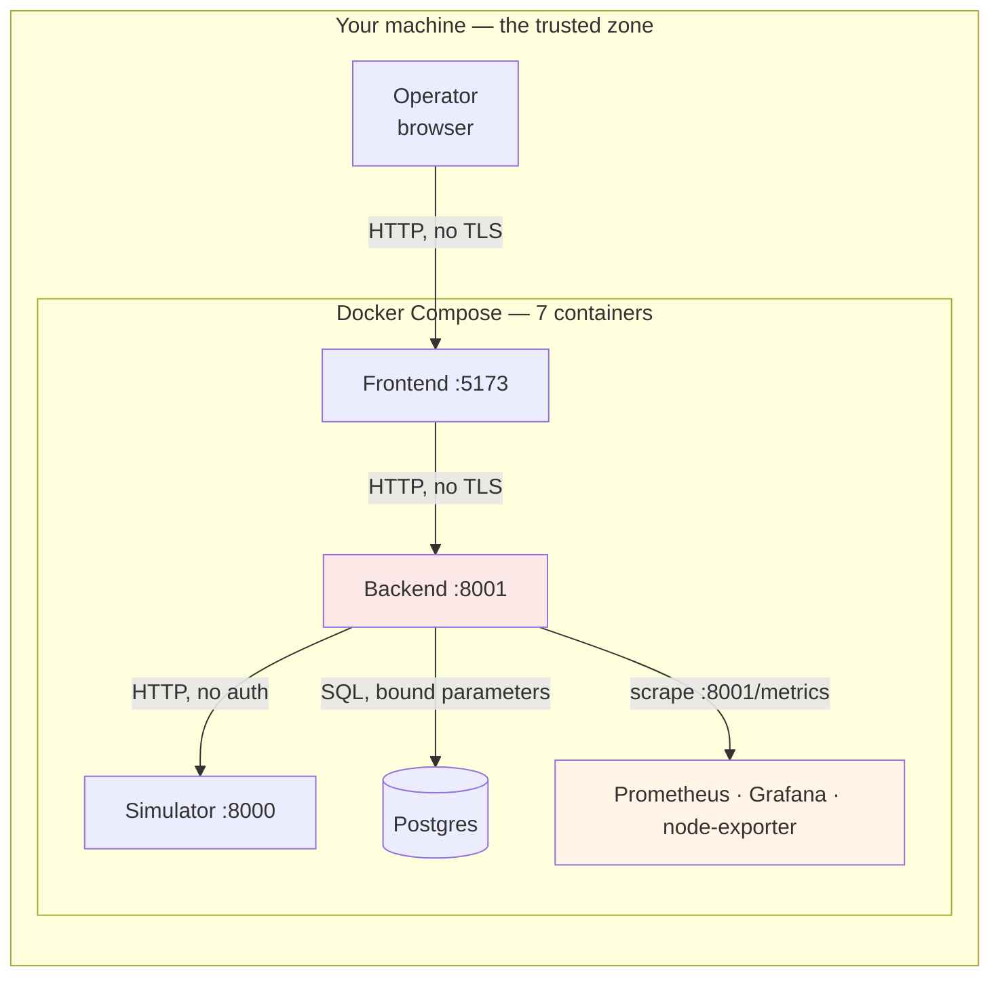

# Security Policy

## The short version

**This project is a simulation.** It runs on a judge's laptop, it holds no real
credentials, it moves no real fuel, and there is no personal, payment or
customer data anywhere in it.

It also has **no authentication and no authorization**. Every route is open to
every caller that can reach the port. That is stated here at the top rather
than left for someone to discover, because it is the single most important
fact about the platform's security posture.

What the platform *does* have is a set of real controls on the paths that
matter for a simulation: no secrets in the repository, strict validation on
every byte that arrives from outside the process, a human approval gate before
anything is dispatched, bounded blast radius on every container, and an audit
trail in Postgres.

The full analysis — assets, trust boundaries, a twenty-row threat table, and
an itemised list of what is *not* protected — is in
[`docs/security-and-threat-model.md`](docs/security-and-threat-model.md).

Everything inside the dashed line is defended the way a simulation can be
defended — validated input, a human approval gate, bounded containers, an
audit trail. The two edges worth noticing are the ones marked in red and
orange: **there is no TLS and no authentication on any of them**, and the
metrics endpoint is open to anything that can reach the port.

---

## 1. Scope

### What is in scope

| Area | Covered |
|---|---|
| The backend service | `backend/app/` — the API, the sync service, the intelligence layer, the decision layer |
| The operator dashboard | `frontend/src/` — the nine screens and the data layer |
| The container stack | `docker-compose.yml`, `docker-compose.release.yml`, both Dockerfiles |
| The CI and release workflows | `.github/workflows/` |
| The environment contract | `.env.example`, `.gitignore` |
| The integration surface with the simulator | `backend/app/simulator_client.py`, `backend/app/sse.py` |

### What is out of scope

| Area | Why |
|---|---|
| **The organizer's simulator image** | It is not part of this repository and is not modified by it. The platform's own copy of the simulator source is under `docs/reference/` and is read-only. The Day 6 work changed the *platform's* behaviour around the simulator, not the simulator |
| **Third-party images** | `postgres:16-alpine`, `prom/prometheus:v2.54.1`, `grafana/grafana:11.2.0`, `prom/node-exporter:v1.8.2` — reported to their own maintainers |
| **The host machine** | The platform assumes a trusted host. It does not defend against a compromised kernel or a hostile Docker daemon |
| **The organizer's infrastructure** | Out of our control entirely |
| **Production deployment** | There is no production deployment. See §6 |

### The threat model this codebase implements

This is a **reliability** model, not a security model. It assumes the
dependencies are honest and the operator is well-intentioned, and it defends
against their *failure*: "the simulator misbehaves, the database dies, an
operator mis-clicks". The scenarios it actually handles are the ones in
[`docs/resilience-report.md`](docs/resilience-report.md) — **17 of 17** crisis,
fault and dependency scenarios recovered automatically.

Against a **motivated** attacker there is very little here. The document says
so plainly rather than implying otherwise.

## 2. Supported versions

The project is a seven-day hackathon submission with a single release.

| Version | Supported | Notes |
|---|---|---|
| `v1.0.0` | Yes — the current release | The only tag in the repository. Points at commit `426b574` |
| Anything before the tag | No | There is no other release |
| `main` after the tag | Best effort | 21 commits of documentation and one release fix on top of `v1.0.0` |

There is no long-term-support branch and no backport policy, because there is
only one release.

## 3. Reporting a security issue

### Before you report

This platform is a simulation with no authentication and no real data. Before
filing anything, check whether what you found is a **known and documented**
property:

* **No authentication, no authorization, no TLS, no rate limiting, no security
  headers** — documented in §6.1 to §6.5 of
  [`docs/security-and-threat-model.md`](docs/security-and-threat-model.md),
  with the consequence of each stated. A report that says "the API has no
  authentication" restates a known limitation.
* **The containers run as root inside the container** — documented as threat
  **T-15**, with the reason the blast radius is bounded.
* **`GET /metrics` is unauthenticated** — documented as threat **T-13**.
* **Five endpoints interpolate a raw exception into the response `detail`** —
  documented as threat **T-08**.
* **There is no redaction filter on the logs** — documented as threat
  **T-09**.
* **`decided_by` is a client-supplied label, not an identity** — documented as
  threat **T-12**.

Those are not disclosures. They are the honest boundary of a simulation.

### What is worth reporting

Report anything that is **not** already in the threat table, and that could
matter if this were ever run somewhere real:

* A credential, secret or token committed to the repository, or baked into a
  published image.
* A way to inject code or a query through a request body, a path parameter, a
  query parameter or a header.
* A way to reach the host filesystem or escape a container.
* A way to make the platform write a shipment to the simulator **without** a
  human approval — bypassing the gate, or forging an approved state.
* A way to tamper with the audit trail — to alter, delete or forge a decision
  record.
* A way to make the platform report healthy while it is not — for example,
  serving a stale or rewound world as fresh, or reporting the fallback as
  active when it is not.
* Anything that leaks a credential into a log, an API response, an image layer
  or a metric label.

### How to report

This repository is at
[`github.com/TanimStu068/fuel-supply-intelligence-platform`](https://github.com/TanimStu068/fuel-supply-intelligence-platform).

**Use a GitHub private vulnerability report** on the Security tab of the
repository — this is the right channel because it keeps the discussion private
until a fix exists. If private reporting is unavailable, open a regular issue
and say so in the title; do not include a working exploit for a
denial-of-service issue in an open issue.

Please include:

| Field | Why |
|---|---|
| What you found | One sentence |
| The file and line, or the request | Where to look |
| How to reproduce | The exact command or request |
| What an attacker gains | The impact, in concrete terms |
| Whether it is already documented | Check §3 "Before you report" |

I will acknowledge a report, confirm whether it is a real issue, and say what
the fix will be. There is no published SLA — this is a hackathon project with
one maintainer — but a confirmed issue will be fixed and credited unless you
ask otherwise.

### What to expect

| Stage | What happens |
|---|---|
| Acknowledgement | I confirm I received it and that I have read it |
| Assessment | I confirm whether it is a real issue, and whether it is already documented |
| Fix | A commit, with a test that pins it |
| Credit | Your name in the commit, unless you prefer otherwise |
| Disclosure | No public issue until a fix exists, unless you ask for immediate disclosure |

**Please do not test against other people's deployments.** This platform is
designed to be run by one person on one machine.

## 4. The controls that exist

Each of these was checked against the code; the file is named so the claim can
be re-verified. The full list is in §4 of
[`docs/security-and-threat-model.md`](docs/security-and-threat-model.md).

### Secrets

| # | Control | Where |
|---|---|---|
| **S1** | No secret is hard-coded. Every credential comes from the environment | [`backend/app/config.py`](backend/app/config.py), [`docker-compose.yml`](docker-compose.yml) |
| **S2** | `.env` is gitignored | [`.gitignore`](.gitignore) |
| **S3** | `.env` has never been committed | `git log --all -- .env` returns nothing |
| **S4** | Only `.env.example` is tracked, and it holds defaults | [`.env.example`](.env.example) |
| **S5** | The default passwords are deliberately obviously fake — `change-me-in-env` — so a stack started without a `.env` is *loudly* insecure rather than quietly insecure | [`.env.example`](.env.example) |
| **S6** | The release workflow uses `secrets.GITHUB_TOKEN` and nothing else | [`.github/workflows/release.yml`](.github/workflows/release.yml) |
| **S7** | No credential is embedded in a published image — neither Dockerfile copies `.env` | [`backend/Dockerfile`](backend/Dockerfile), [`frontend/Dockerfile`](frontend/Dockerfile) |
| **S8** | The git history carries no hard-coded secret | Verified by scanning `git log --all -p` |

### Input validation

Every simulator payload is parsed into a **closed** Pydantic model — strict
types, closed enums, bounded numbers, no extra fields. A payload that does not
fit is rejected, counted and alerted rather than passed on. This is the
best-defended boundary in the system, and it is what makes a malformed
simulator response a logged event rather than a corrupted world.

On the platform's own side, every SQL statement uses bound parameters — no
f-string SQL anywhere in `backend/app/` — and the audit search escapes its
`LIKE` wildcards with a declared escape character.

### The human approval gate

| # | Control | Where |
|---|---|---|
| **O1** | **No allocation reaches the simulator without a human approval.** A proposal is not a dispatch — `approve()` is the only path that calls `_submit()` | [`backend/app/decision/service.py`](backend/app/decision/service.py) |
| **O2** | The what-if `simulate` writes nothing to the simulator | [`backend/app/decision/service.py`](backend/app/decision/service.py) |
| **O3** | A rejected proposal is recorded and never submitted | [`backend/app/decision/service.py`](backend/app/decision/service.py) |
| **O4** | The auto-approve mode is **off by default** | [`backend/app/decision/service.py`](backend/app/decision/service.py) |
| **O5** | The auto-mode's bar is deliberately high, and `CRITICAL` is excluded — it requires `WATCH` level, confidence ≥ 0.85, no human-review flag, not from the fallback policy, and every constraint satisfied | [`backend/app/decision/service.py`](backend/app/decision/service.py) |
| **O6** | A proposal is immutable once decided | [`backend/app/decision/service.py`](backend/app/decision/service.py) |
| **O7** | The idempotency key is **deterministic**, so a retried approval is a replay rather than a second shipment | [`backend/app/decision/optimizer.py`](backend/app/decision/optimizer.py) |

### The audit trail

Decisions are written to **Postgres**, not held only in memory. The in-memory
store is explicitly a *working set*; Postgres is the audit trail, and it
survives a backend restart and a simulation reset. Every decision, event and
alert is searchable through one query at `GET /api/audit`.

### Blast radius

Every container has a memory limit, a CPU limit, a PID ceiling and log
rotation. The whole stack is capped at **1.5 GB** and measures about **380 MB**
for the core profile. The database pool is bounded with `max_overflow=0`. The
simulator fan-out is bounded.

### Simulation-only labelling

The dashboard states on every screen that it is a simulation. The crisis
injection is labelled "simulation only" in three places. Every recommendation
card carries the banner "Simulated environment. Human review required."

## 5. What is not protected

Stated plainly, with the consequence. Each was checked and confirmed absent.

| # | Not protected | Consequence |
|---|---|---|
| 1 | **No authentication** — no login, no session, no token, no API key | Every route is open to every caller that can reach the port, including `POST /api/recommendations/{id}/approve`, `POST /api/model/kill-switch`, `POST /api/model/fault`, `POST /api/simulation/crisis` and `POST /admin/reset` |
| 2 | **No authorization** — no role, no permission, no capability check | A caller that can reach the API can approve an allocation, change the auto-mode settings, or reset the platform. `decided_by` is a free-text label the caller supplies; it is not an identity |
| 3 | **No TLS** | Every service speaks plain HTTP inside the Compose network and on the published ports |
| 4 | **No rate limiting** | No quota, no token bucket. The controls that exist are *ceilings* — the platform will be killed and restarted rather than fall over |
| 5 | **No security headers** | No CSP, no HSTS, no `X-Frame-Options`. React's default escaping is the only XSS defence, and there is no `dangerouslySetInnerHTML` anywhere in `frontend/src/` |
| 6 | **No log redaction** | `JsonFormatter` writes any `extra=` field verbatim, and the simulator-validation path logs the whole rejected payload |
| 7 | **Containers run as root inside the container** | Neither Dockerfile has a `USER` instruction. The blast radius is bounded by the container limits and by the fact that the only host mount is node-exporter's read-only `/` |
| 8 | **`GET /metrics` is unauthenticated** | Request rates, paths, latencies and error counts are exposed. It is excluded from the OpenAPI schema, which hides it from documentation but not from a request |
| 9 | **Five endpoints interpolate a raw exception into the response `detail`** | Unnecessary internal detail in a response. The URL carries the server, port and user — not the password |
| 10 | **The audit trail's attribution is spoofable** | `decided_by` is taken verbatim from the request body and stored. It is a label, not an identity |

### Why it is like this

This is a simulation on a judge's laptop. Adding a login screen would cost
demo time and protect nothing real. The platform defends against **mistakes
and failures**, which are the realistic threat here, and it does that well:
**17 of 17** scenarios recovered automatically, the audit trail is complete,
and no credential has ever touched the repository.

### What would have to change for a real deployment

In ascending order of effort:

1. **Put an authenticating reverse proxy in front.** TLS, an identity provider
   and rate limiting, without touching the application. This is the smallest
   change that fixes items 1, 2, 3 and 4 together.
2. **Add a `USER` instruction to both Dockerfiles.** One line each; fixes
   item 7.
3. **Add a redaction filter to the log formatter.** Closes item 6.
4. **Stop interpolating raw exceptions into `detail`.** Close item 9 with a
   generic message and keep the detail in the log, where the correlation ID
   ties it to the request.
5. **Add security headers at the proxy.** Closes item 5.

Items 1 and 2 are the ones that matter. The rest are hygiene.

## 6. Deployment posture

**There is no production deployment of this project, and none is intended.**

The platform is designed to run on one host, typically a laptop, on a trusted
network, with the operator present. It assumes:

* the host is not shared with untrusted users;
* the published ports are not reachable from an untrusted network;
* the `.env` file is written by the person running it, on that machine.

If you intend to expose it beyond localhost, read §5 first and put the
authenticating proxy in front of it. The application's own
[`docs/deployment.md`](docs/deployment.md) and
[`docs/runbook.md`](docs/runbook.md) describe the release and the operating
procedure; neither is a hardening guide, and neither should be read as one.

## 7. Simulated data only

The simulator generates the fuel network: the depots, the stations, the
routes, the inventory, the demand and the events. **None of it is real.**

| Data | Origin | Real? |
|---|---|---|
| Depots, stations, routes, regions | The organizer's simulator, from a baked scenario | No |
| Inventory, demand, supply arrivals | Simulated | No |
| Events, crises, faults | Simulated or injected by the operator | No |
| Forecasts, risk scores, recommendations | Computed by this platform over simulated data | No |
| Decisions, approvals, audit records | Produced by this platform over simulated data | No |

There is no personal data, no payment data, no real inventory and no real
customer. There is nothing here whose disclosure would harm a third party,
which is why the controls in §4 are proportionate and the ones in §5 are
stated rather than hidden.

## 8. Related documents

| Document | What it holds |
|---|---|
| [`docs/security-and-threat-model.md`](docs/security-and-threat-model.md) | The full analysis — assets, the five trust boundaries, every control with the file that proves it, the twenty-row threat table with impact and residual risk, and what is not protected |
| [`docs/adr/`](docs/adr/README.md) | The Architecture Decision Records behind the design choices, including the ones that shaped the security posture |
| [`docs/runbook.md`](docs/runbook.md) | Operating the platform: health checks, degraded mode, the kill-switch, a database outage, a backend crash |
| [`docs/known-limitations-and-roadmap.md`](docs/known-limitations-and-roadmap.md) | Every known limitation with its impact and its workaround, and the roadmap of what is still to be built |
| [`docs/bug-catalog.md`](docs/bug-catalog.md) | All 70 catalogued defects, grouped by root cause |
| [`docs/postmortems/`](docs/postmortems/README.md) | The eight incidents written up in full |
| [`docs/configuration-reference.md`](docs/configuration-reference.md) | Every environment variable, its default and its bounds |
| [`docs/observability-guide.md`](docs/observability-guide.md) | The metrics, the alerts, and the structured log format with its correlation IDs |
