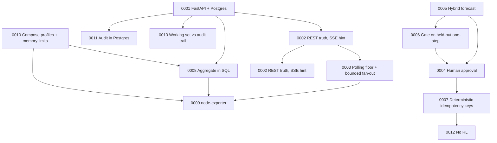

# Architecture Decision Records

Each record states a decision the team made, the context behind it, the
alternatives that were considered and rejected, and what the decision cost.
The reasons are taken from the project's own progress logs, load-test report
and code — not from general practice.

**Format:** Status · Context · Decision · Alternatives considered ·
Consequences.

**Status values:** Accepted (the decision stands), Superseded (a later record
replaces it).

---

## Index

| # | Title | Status | Decided on |
|---|---|---|---|
| [0001](0001-fastapi-postgres-stack.md) | FastAPI + Postgres as the backend stack | Accepted | Day 1 |
| [0002](0002-rest-source-of-truth-sse-as-hint.md) | REST is the source of truth; SSE is a hint | Accepted | Day 2 |
| [0003](0003-polling-floor-and-bounded-fanout.md) | Polling with a minimum interval and a bounded fan-out | Accepted | Day 6 |
| [0004](0004-human-approval-before-allocation.md) | Nothing reaches the simulator without a human approval | Accepted | Day 4 |
| [0005](0005-hybrid-forecast-with-rule-based-fallback.md) | Hybrid forecast: a profile baseline with a learned model on top | Accepted | Day 3 |
| [0006](0006-gate-model-on-held-out-one-step-comparison.md) | Gate the learned model on a held-out one-step comparison | Accepted | Day 7 |
| [0007](0007-deterministic-idempotency-keys.md) | Deterministic idempotency keys derived from the recommendation | Accepted | Day 4 |
| [0008](0008-aggregate-in-the-database.md) | Aggregate in the database, never in Python | Accepted | Day 6 |
| [0009](0009-node-exporter-instead-of-cadvisor.md) | node-exporter instead of cAdvisor | Accepted | Day 6 |
| [0010](0010-compose-profiles-and-memory-limits.md) | Compose profiles and hard per-service memory limits | Accepted | Day 6 |
| [0011](0011-no-loki-audit-in-postgres.md) | No Loki; the audit trail lives in Postgres | Accepted | Day 6 |
| [0012](0012-no-reinforcement-learning.md) | No reinforcement learning | Accepted | Day 3 |
| [0013](0013-in-memory-working-set-with-postgres-audit-trail.md) | An in-memory working set, with Postgres as the audit trail | Accepted | Day 5 |

---

## Decision dependencies

Not every record stands alone. These are the chains:

Two chains matter most to a reader who wants the reasoning rather than the
list:

- **0001 → 0002 → 0003.** The stack decided on Day 1 produced a cache on
  Day 2; that cache's read rate exhausted the simulator's connection pool on
  Day 5 and was bounded on Day 6. The reason for the bound is in the Day 6
  log's risk table, not in a style preference.
- **0005 → 0006.** The forecast was designed on Day 3 with a horizon gate;
  that gate was overturned on Day 7 when the benchmark was found to leak the
  future. ADR 0006 states the final decision and names the earlier one.

---

## Related documents

- [`docs/progress/`](../progress/) — the day-by-day logs these records cite
- [`docs/architecture.md`](../architecture.md) — the system as built
- [`docs/postmortems/`](../postmortems/) — the incidents behind several of
  these decisions
- [`docs/load-test-report.md`](../load-test-report.md) — the measurements
  behind ADR 0003, ADR 0008 and ADR 0010
- [`docs/model-evaluation.md`](../model-evaluation.md) — the evidence behind
  ADR 0005 and ADR 0006
