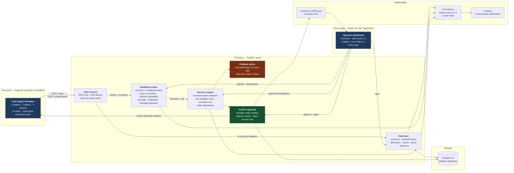

# Architecture

This document is the map of the platform: how the pieces fit together, what
each one assumes, where the data comes from, what the security posture is,
and what this system cannot do.

The short version: **the simulator is the world, the backend is the brain,
and the dashboard is the cockpit.** Nothing in the platform invents a number
that did not come from the simulator, and nothing reaches the simulator
without a human saying yes.

---

## 1. The system



Read it as a loop, not a pipeline:

```
Observe → Detect → Predict → Decide → Simulate → Act → Monitor → Recover
```

| Stage | Where it lives | What it produces |
|---|---|---|
| Observe | `backend/app/sync_service.py` | A cached snapshot of the whole network, with a freshness age |
| Detect | `backend/app/intelligence/detection.py` | Demand anomalies, abnormal inventory change, bottlenecks |
| Predict | `backend/app/intelligence/forecasting.py`, `risk.py` | A demand forecast with a confidence band, hours-to-stockout, stockout probability |
| Decide | `backend/app/decision/optimizer.py` | A ranked, constraint-valid allocation with alternatives |
| Simulate | `POST /api/recommendations/{id}/simulate` | A what-if preview that writes nothing |
| Act | `POST /api/recommendations/{id}/approve` | The allocation, after a human said yes |
| Monitor | `backend/app/intelligence/dispatcher.py`, the dashboard | Live risk, live service level, live alerts |
| Recover | `backend/app/decision/fallback.py`, the degraded-mode cache | A rule-based policy and a dashboard that keeps working |

---

## 2. The components

| Component | Port | Responsibility |
|---|---|---|
| **Operator dashboard** — React 18, Vite, TypeScript | `:5173` | Nine screens. Polls the backend every 5 s. Loading and error state on every view. The `DEGRADED` / `STALE` banner shows the age of the cached data. Responsive down to 430 px. |
| **Backend** — FastAPI, async | `:8001` | Every read, write and decision endpoint. Strict Pydantic models with `extra="forbid"`. |
| ↳ Sync service | | REST poll every 15 s plus an SSE listener on `/v1/stream`. SSE is a *hint* — every event triggers a re-fetch of the affected resource. Owns the state cache, the stale flag and the degraded mode. |
| ↳ Intelligence layer | | Demand forecasting with a confidence band, hours-to-stockout, stockout probability, and detection of anomalies, bottlenecks and shortages. Falls back to a rule-based predictor when the model cannot be trusted. |
| ↳ Decision engine | | A constraint-aware allocator that pre-validates every simulator rule, ranks alternatives, and falls back to a days-of-cover policy when the intelligence layer is down. |
| ↳ Approval, what-if & audit | | `simulate` writes nothing. `approve` sends the allocation. `reject` records the reason. Every decision keeps its outcome and its audit trail. |
| **Postgres** | `:5432` | Inventory snapshots, demand history, the allocation mirror, events, alerts, decisions and system health. |
| **Simulator** — organizer-provided, unmodified | `:8000` | The world. It never predicts, optimizes or decides. |
| **Prometheus** | `:9090` | Scrapes `/metrics` every 15 s. |
| **Grafana** | `:3000` | Provisioned dashboards and alert rules. |
| **node-exporter** | `:9100` | The host's own CPU and memory counters. |

### The four design rules

1. **REST is the source of truth; SSE is only a hint.** Every event
   triggers a re-fetch of the affected resource. If the stream dies, the
   platform loses a hint, not its data.
2. **Human in the loop.** Recommendations start as `PROPOSED` and are sent
   to the simulator only after an operator approves them. The auto-mode
   exists but is **off by default**, and its bar is deliberately high:
   `WATCH`-level only, confidence ≥ 0.85, no human-review flag, no
   fallback policy, every constraint satisfied.
3. **Fail safe.** Cached state, fallback policies and degraded mode keep
   the operator informed when a dependency fails. The platform never
   serves a stale cache *as if it were fresh* — it says so.
4. **Everything is validated.** Every simulator response is checked against
   a closed Pydantic model before it reaches the rest of the platform.

---

## 3. The API

Every route the backend serves. All of them are under `/api` except the
operational ones.

### Operational

| Method | Path | What it does |
|---|---|---|
| `GET` | `/health` | **Readiness.** 200 only when the backend, the simulator and the database are all ok; 503 otherwise. |
| `GET` | `/ready` | Liveness — the process is up. |
| `GET` | `/metrics` | The Prometheus exposition format. |
| `GET` | `/` | A short service description. |

### The network

| Method | Path | What it does |
|---|---|---|
| `GET` | `/api/state` | The whole network in one document: the instance, the stations, the depots, the routes, the events, the metrics. |
| `GET` | `/api/stations` | Every station with its inventory, capacity and status. |
| `GET` | `/api/depots` | Every depot with its stock and dispatch allowance. |
| `GET` | `/api/routes` | Every route with its transit time, limit and status. |
| `GET` | `/api/events` | The active crises. |
| `GET` | `/api/supply-arrivals` | The incoming shipments. |
| `GET` | `/api/allocations` | The allocation mirror. |
| `GET` | `/api/history/{station_id}` | The demand history for one station. |

### The intelligence

| Method | Path | What it does |
|---|---|---|
| `GET` | `/api/risk` | Every risk assessment, with the signals behind each score. |
| `GET` | `/api/alerts` | The alert ledger. |
| `GET` | `/api/forecast` | The demand forecast with its confidence band. |
| `GET` | `/api/anomalies` | The detected anomalies. |
| `GET` | `/api/model-status` | Which model is active, how well it has done, and whether it is trusted. |
| `POST` | `/api/model/train` | Retrain the learned model now. |
| `POST` | `/api/model/kill-switch` | Turn the learned model off — the platform falls back to the rule-based predictor. |
| `POST` | `/api/model/fault` | Inject a prediction fault, to prove the fallback works. |

### The decisions

| Method | Path | What it does |
|---|---|---|
| `GET` | `/api/recommendations` | The proposals. Filterable by status and station; paged. |
| `GET` | `/api/recommendations/{id}` | One proposal, in full. |
| `POST` | `/api/recommendations/propose` | Ask for a fresh set of proposals. |
| `POST` | `/api/recommendations/{id}/simulate` | The what-if preview. **Writes nothing.** |
| `POST` | `/api/recommendations/{id}/approve` | Approve, and send it to the simulator. |
| `POST` | `/api/recommendations/{id}/reject` | Reject, and record why. |
| `GET` | `/api/decisions` | The current decision counters and settings. |
| `GET` | `/api/decision-settings` | The auto-mode state and the page size. |
| `POST` | `/api/decision-settings` | Change the auto-mode state and the page size. |
| `GET` | `/api/decision-history` | Every decision, with its outcome. |
| `GET` | `/api/audit` | The searchable audit trail over three tables. |

### The simulation and the health

| Method | Path | What it does |
|---|---|---|
| `GET` | `/api/simulation` | The simulator's clock, its state and the active events. |
| `POST` | `/api/simulation/{action}` | `run`, `pause`, `toggle`, `step`, `reset` — the same five the simulator's own admin console has. |
| `POST` | `/api/simulation/crisis` | Inject a crisis: a demand spike, a shipment delay, a depot constraint, a route disruption. |
| `GET` | `/api/service-health` | Every dependency, the p95 latency, the error rate, the fallback state. |

---

## 4. Assumptions

These are the things the platform believes to be true. Where the belief is
wrong, the platform degrades rather than lies.

### About the simulator

1. **The simulator is deterministic.** The same seed and the same tick
   count produce the same world. Every measurement in
   [`docs/model-evaluation.md`](model-evaluation.md) relies on this.
2. **The simulator's own state is the truth.** The platform's Postgres is a
   *mirror* — it records what happened, it does not drive anything. If the
   two disagree, the simulator wins.
3. **The tick is 15 minutes of simulated time.** `TICK_MINUTES` is
   configurable, and every duration the platform reports is derived from
   it rather than assumed.
4. **The simulator's total supply is below its total demand.** Over a
   multi-day run the shortfall is about 25 %. This is a property of the
   supplied scenario, not of the platform: **service level cannot approach
   1.0 no matter what the allocator does.** The platform's job is to
   allocate scarce fuel well, not to conjure more.
5. **The documented API is the real API.** The brief's "conceptual"
   endpoints (`POST /simulate`, `POST /advance-time`) do not exist. All
   ten discrepancies found between the integration guide and the running
   simulator are in [`docs/simulator-notes.md`](simulator-notes.md).
6. **The simulator's connection pool is small** — five connections plus
   ten in overflow. The platform's fan-out is bounded to three concurrent
   calls so it cannot exhaust the pool it reads from.

### About the demand

7. **Demand follows a published daily profile.** Each station has a
   profile (`urban_high`, `urban_medium`, `rural`, `highway`) with a
   daily volume and an hour shape. The learned model learns the *level*;
   the profile supplies the *shape*.
8. **The region scales the station.** A region's demand factor multiplies
   the profile, so two stations of the same type in different regions draw
   different amounts.
9. **A demand multiplier is a crisis, not a baseline.** The anomaly
   detector compares against the *profile* and never against the current
   multiplier — comparing against the multiplier would explain the spike
   away with the very thing that caused it.
10. **Served fuel, not requested fuel, drains a tank.** A station that
    could not meet its demand never drew that fuel, so the inventory
    anomaly check is measured against *served* litres.
11. **Fuel in transit is cover.** A station that is about to be refuelled
    is not a station in trouble.

### About the decision

12. **The route's `max_shipment` is a per-allocation limit.** A deficit
    above it has to go out as several shipments, each with its own
    idempotency key.
13. **The depot's dispatch allowance is a per-tick total.** Two stations
    served from one depot cannot both be given the depot's whole
    allowance.
14. **The tank caps what it receives.** Splitting a shipment past the
    tank's free space promises fuel that cannot be delivered, so the split
    stops at the room in the tank.
15. **A `CONSTRAINED` depot can still ship.** It has stock and a route;
    refusing to ship from it would turn a soft problem into a hard one.

---

## 5. Data sources

| Source | What it provides | Where it goes |
|---|---|---|
| **The fuel supply simulator** (`asifmahmoud414/bup-fuel-supply-simulator:1.0.0`) | The entire world: regions, depots, stations, routes, inventory, demand, supply arrivals, events, allocations, the clock | Everything. The platform has no other source of truth about the network. |
| **The simulator's published demand profiles** | The daily demand volume and the hour shape for each station type | The baseline predictor, the anomaly detector's reference, and the fallback policy's daily demand rate. |
| **The platform's own Postgres** | Inventory snapshots per tick, demand history, the allocation mirror, events, alerts, decisions, system health | The forecast's training set, the audit trail, the decision history, the service-level metric. |
| **The platform's own measurements** | Request latency, error rate, simulator call failures, SSE reconnects, stale count, last-sync age, fallback activations | `/metrics`, the Prometheus alerts, the Grafana dashboards, the service-health panel. |
| **The simulator's own audit log** (`GET /admin/audit`) | The ground truth for what the simulator did | Cross-checked against the platform's audit trail in the drills. |

**There is no third-party data.** No maps, no weather, no price feeds, no
traffic. Everything the platform knows about the network comes from the
simulator, and everything it knows about itself comes from its own
instrumentation.

---

## 6. Security notes

This is a **simulation**. It operates against a fictional fuel network and
touches no real infrastructure, no real credentials and no real dispatches.
That said, the code is written the way operational software should be.

### No secrets in the repository

* Every credential is environment-driven. `.env` is gitignored and
  `.env.example` holds only the defaults.
* The database password, the Grafana password and every other secret come
  from the environment. There is no secret in the source, in the images, in
  the compose file, or in the CI configuration.
* `POSTGRES_PASSWORD` has a default of `change-me-in-env` rather than
  something that looks like a working password — a stack started without a
  `.env` is loudly insecure rather than quietly insecure.
* The CI workflow uses `secrets.GITHUB_TOKEN` for the registry and nothing
  else. There is no long-lived token in the repository.

### Input validation

* **Every simulator response is validated** against a closed Pydantic
  model (`extra="forbid"`, closed enums) before it reaches the rest of
  the platform. A malformed payload is rejected and counted, never passed
  downstream. A wrong number in a forecast is worse than an error.
* **Every request body is validated** the same way. An unknown field is a
  422, not something silently ignored.
* **Every simulator error is typed.** Both documented envelope shapes map
  onto one exception hierarchy, and each documented 409 code has its own
  exception class — so a caller can tell "the route is disrupted" from
  "the depot is closed" without parsing a string.
* **The CORS allow-list is explicit**, and the frontend's API address is
  runtime configuration rather than a build-time constant.

### Operator-action restriction

* **No allocation reaches the simulator without a human approval.**
  `simulate` writes nothing; `approve` writes; `reject` records the
  reason.
* **The auto-mode is off by default.** When it is on, its bar is high:
  `WATCH`-level only, confidence ≥ 0.85, no human-review flag, not from
  the fallback policy, and every constraint satisfied. Anything
  `CRITICAL` is left for a human — a critical station is exactly the case
  where a human should look.
* **The auto-mode is itself an operator action.** Turning it on is an
  explicit API call that is logged and counted.
* **The approval is idempotent.** Each proposal carries a deterministic
  idempotency key, so a retried approval is a replay rather than a second
  shipment.

### Blast radius

* Every container has an explicit memory limit, a CPU limit and a PID
  limit. A container that leaks is killed at its limit instead of eating
  the host.
* Every container rotates its logs. An unbounded log file fills a disk and
  takes the daemon down.
* The Prometheus retention is bounded to two days and 500 MB.
* The platform has **no database migration**, so a rollback never has to
  undo a schema change. The Postgres volume is preserved across a deploy,
  so the audit trail and the decision history survive.

### What is deliberately not here

* **No authentication.** The dashboard and the API are open on localhost.
  This is a simulation on a judge's laptop, and adding a login screen
  would cost demo time without protecting anything real. A deployment
  outside a trusted network would need an authenticating proxy in front —
  and that is stated here rather than left for someone to discover.
* **No authorization model.** Every caller that can reach the API can
  approve an allocation. Again: a local simulation.
* **No secrets manager.** The `.env` file is the whole story.

---

## 7. Limitations

What this platform does **not** do, stated plainly.

### The simulation

1. **It operates only on the simulated network.** No real fuel
   infrastructure, no real dispatches, no real consequences. Every
   recommendation carries a *"Simulated environment. Human review
   required."* banner.
2. **The simulator's supply is short by design.** Service level cannot
   reach 1.0. The platform allocates scarce fuel; it does not create it.
3. **The world is 2 regions, 2 depots, 4 stations and 6 routes.** Every
   rule, threshold and constraint is tuned against a network of that
   size. A larger network would need the fan-out, the cache and the
   page sizes re-tuned.
4. **The forecast horizon is one simulated day** (96 ticks at the
   default tick size). Anything beyond that is extrapolation, and the
   platform says so rather than pretending.

### The intelligence

5. **The learned model needs history.** Below `FORECAST_MIN_TRAINING_ROWS`
   (30 rows) the platform uses the rule-based predictor and says so. A
   cold start is a rule-based start, not a confident one.
6. **The demand model is per (station, fuel).** It does not learn across
   stations, so a station with unusual behaviour only learns from its own
   history.
7. **The anomaly detectors are thresholds, not models.** A demand change
   that is slow and steady will not raise an anomaly — it will show up as
   a slow decline in days-of-cover instead.
8. **The forecast accuracy is measured, not claimed.** The learned model
   beat the rule-based baseline by 34 % over the horizon in the recorded
   evaluation — but it is still wrong some of the time, which is why every
   forecast carries a confidence band and every decision carries its
   confidence score.

### The decision engine

9. **The allocator is greedy, not optimal.** It serves the most urgent
   station first and takes what it can. A full linear program would
   squeeze more service level out of the same shortage; the trade is
   speed and explainability, and the comparison is in
   [`docs/policy-comparison.md`](policy-comparison.md).
10. **Alternatives are capped at two.** The ranked list is a shortlist,
    not an exhaustive search.
11. **The fallback policy is deliberately simple.** Refill the lowest
    days-of-cover first. It is the right rule when there is no model, and
    it is *worse* than the model — which is why the platform tells the
    operator when it is in use.

### The platform

12. **The working set of recommendations is in memory.** Postgres holds
    the full history, and `/api/decision-history` serves it — but the
    endpoint the dashboard polls is bounded and evicts.
13. **The audit search is a bounded window.** The count and the page
    share the same window, and the summary reports its `scope`, so a
    count always says which rows it covers.
14. **The observability stack is behind a profile.** A plain
    `docker compose up` starts the platform and not the dashboards —
    deliberate, so a busy machine is never taken down by Prometheus.
15. **No authentication, no authorization.** See the security notes. It
    is a local simulation; a real deployment would need both.
16. **The CI compose smoke test is one architecture.** It runs on
    `ubuntu-latest` with Docker. It does not test ARM, does not test a
    multi-node deployment, and does not test the rollback procedure
    against a live registry.

---

## 8. Where to look next

| Question | File |
|---|---|
| How do I run it? | [`README.md`](../README.md) §7 |
| What does the brief's simulator actually do? | [`docs/simulator-notes.md`](simulator-notes.md) |
| How good is the forecast? | [`docs/model-evaluation.md`](model-evaluation.md) |
| Is the policy better than a naive one? | [`docs/policy-comparison.md`](policy-comparison.md) |
| What happens when things break? | [`docs/resilience-report.md`](resilience-report.md) |
| How fast is it? | [`docs/load-test-report.md`](load-test-report.md) |
| How do I deploy and roll back? | [`docs/deployment.md`](deployment.md) |
| What do I show in the demo? | [`docs/demo-script.md`](demo-script.md) |
| Where is each deliverable? | [`docs/deliverables-checklist.md`](deliverables-checklist.md) |
