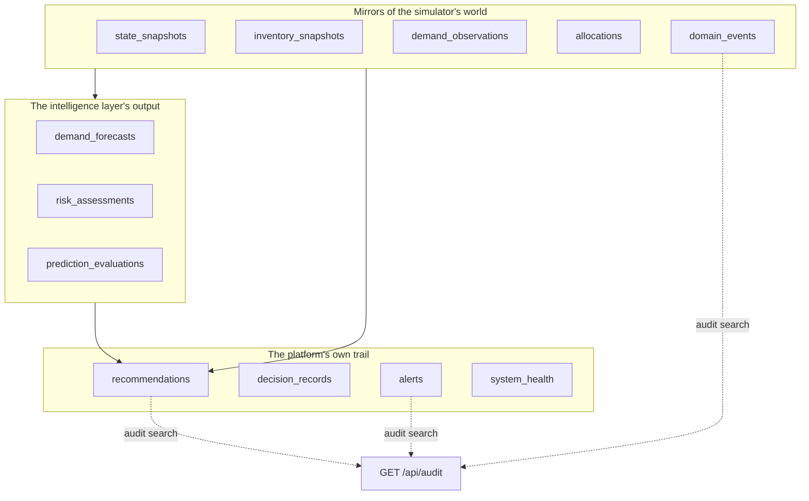
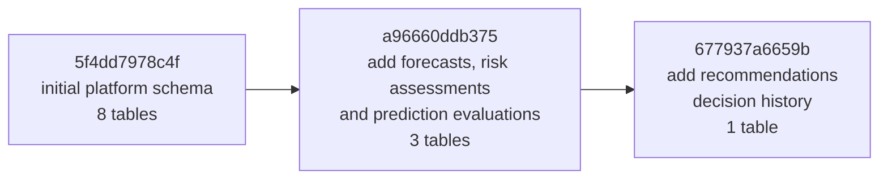

# The data model

Every table the platform owns, what it is for, which keys make the ingest
idempotent, and which of them are actually written.

**Code.** [`backend/app/models.py`](../backend/app/models.py) — the SQLAlchemy
declarative models, one class per table. The migrations are in
[`backend/migrations/versions/`](../backend/migrations/versions/).

---

## 1. The shape of the schema

Twelve tables, in four groups:



Two of the twelve are **mirrors** — read-optimised copies of what the
simulator already holds, so the dashboard and the decision engine never
block on it. Three are the intelligence layer's output. Four are the
platform's own trail. The other three are the raw material the intelligence
layer trains on.

**Everything is append-mostly.** The platform never mutates history. A tick
that has been observed stays observed, and the tables that can be
de-duplicated are keyed so a replayed tick updates the row in place instead
of adding another.

---

## 2. The tables

### `state_snapshots` — one row per sync cycle

The instance row and the metrics row, written every time the platform syncs.

| Column | Type | Notes |
|---|---|---|
| `id` | BigInteger | **PK**, autoincrement |
| `captured_at` | DateTime(tz) | Server default `now()`, **indexed** |
| `sim_tick` | Integer | **Indexed** |
| `sim_time` | DateTime(tz) | |
| `sim_status` | String(32) | |
| `scenario_id` | String(64) | |
| `service_level` | Float | |
| `unmet_demand_liters` | Float | |
| `served_demand_liters` | Float | |
| `allocation_liters` | Float | |
| `allocation_failures` | Integer | |
| `stale` | Boolean | Whether the simulator flagged the data |
| `payload` | Text | The full snapshot, as JSON |

**No unique constraint.** This table is a plain append — one row per sync
cycle, forever. The model docstring is explicit about why: *"Keeping a
history (rather than a single mutable row) gives us a replay trail for later
forecasting work and proves the Postgres dependency is genuinely exercised
by the read path."*

**Retention:** unbounded. One row per sync cycle.

### `inventory_snapshots` — station and depot inventory per tick

| Column | Type | Notes |
|---|---|---|
| `id` | BigInteger | **PK**, autoincrement |
| `captured_at` | DateTime(tz) | Server default `now()`, **indexed** |
| `entity_type` | String(16) | `station` or `depot`, **indexed** |
| `entity_id` | String(64) | **Indexed** |
| `sim_tick` | Integer | **Indexed** |
| `sim_time` | DateTime(tz) | |
| `fuel_type` | String(16) | |
| `quantity` | Float | |
| `capacity` | Float | Nullable |
| `status` | String(32) | Nullable |

| Key | Type | Columns |
|---|---|---|
| **PK** | primary key | `id` |
| **Unique** | `uq_inventory_snapshots_entity_tick_fuel` | `entity_type`, `entity_id`, `sim_tick`, `fuel_type` |
| **Index** | `ix_inventory_snapshots_entity` | `entity_type`, `entity_id`, `sim_tick` |

The unique constraint makes the ingest **idempotent**: replaying the same
tick updates nothing.

### `demand_observations` — the demand time series

| Column | Type | Notes |
|---|---|---|
| `id` | BigInteger | **PK**, autoincrement |
| `captured_at` | DateTime(tz) | Server default `now()`, **indexed** |
| `simulator_id` | BigInteger | Nullable, **indexed** |
| `station_id` | String(64) | **Indexed** |
| `fuel_type` | String(16) | |
| `tick` | Integer | **Indexed** |
| `sim_time` | DateTime(tz) | |
| `demand_liters` | Float | |
| `served_liters` | Float | |
| `unmet_liters` | Float | |

| Key | Type | Columns |
|---|---|---|
| **PK** | primary key | `id` |
| **Unique** | `uq_demand_observations_station_fuel_tick` | `station_id`, `fuel_type`, `tick` |
| **Index** | `ix_demand_observations_station_tick` | `station_id`, `tick` |

**This is the table the intelligence layer trains on.** It is read by
`GET /api/history/{station_id}` and by the forecaster's feature builder.

**Retention:** unbounded. One row per station, per fuel, per tick.

### `allocations` — a mirror of the simulator's ledger

| Column | Type | Notes |
|---|---|---|
| `id` | BigInteger | **PK**, autoincrement |
| `captured_at` | DateTime(tz) | Server default `now()`, **indexed** |
| `simulator_id` | Integer | **Unique**, **indexed** |
| `idempotency_key` | String(150) | **Indexed** |
| `source_depot_id` | String(64) | **Indexed** |
| `destination_station_id` | String(64) | **Indexed** |
| `route_id` | String(64) | **Indexed** |
| `fuel_type` | String(16) | |
| `quantity` | Float | |
| `created_tick` | Integer | **Indexed** |
| `departure_tick` | Integer | Nullable |
| `expected_arrival_tick` | Integer | Nullable |
| `actual_arrival_tick` | Integer | Nullable |
| `status` | String(32) | **Indexed** — `PENDING`/`IN_TRANSIT`/`ARRIVED`/`FAILED`/`CANCELLED` |
| `failure_reason` | Text | Nullable |

**De-duplication key:** `simulator_id`, which is unique. The simulator's
allocation id is its own primary key, so re-reading the ledger updates the
same row.

### `domain_events` — a mirror of the simulator's events

| Column | Type | Notes |
|---|---|---|
| `id` | BigInteger | **PK**, autoincrement |
| `captured_at` | DateTime(tz) | Server default `now()`, **indexed** |
| `simulator_id` | Integer | **Unique**, **indexed** |
| `type` | String(64) | **Indexed** — one of the six event types |
| `start_tick` | Integer | |
| `end_tick` | Integer | |
| `status` | String(32) | **Indexed** |
| `parameters` | Text | JSON, default `{}` |

**De-duplication key:** `simulator_id`, unique.

The audit trail's event filter reaches **into** this JSON — an event's
entity is `parameters->>'entity_id'`, not a column.

### `alerts` — the platform-generated alerts

| Column | Type | Notes |
|---|---|---|
| `id` | BigInteger | **PK**, autoincrement |
| `created_at` | DateTime(tz) | Server default `now()`, **indexed** |
| `kind` | String(64) | **Indexed** |
| `severity` | String(16) | **Indexed** — `warning` or `critical` |
| `entity_type` | String(32) | Nullable |
| `entity_id` | String(64) | Nullable, **indexed** |
| `sim_tick` | Integer | **Indexed** |
| `message` | Text | |
| `resolved` | Boolean | Default `false`, **indexed** |
| `payload` | Text | Nullable, JSON |

| Key | Type | Columns |
|---|---|---|
| **PK** | primary key | `id` |
| **Unique** | `uq_alerts_kind_entity_tick` | `kind`, `entity_id`, `sim_tick` |

**De-duplication key:** `(kind, entity_id, sim_tick)`. This is what stops a
poller running every few seconds from writing the same alert repeatedly.
Note that this is the **one** de-duplication in the schema that uses
`ON CONFLICT DO NOTHING` — the alert is skipped rather than updated,
because an alert's `created_at` should stay the moment it was first raised.

### `recommendations` — the decision history and the audit trail

The most important table in the schema. One row per proposed allocation,
and everything that happened to it.

| Column | Type | Notes |
|---|---|---|
| `id` | BigInteger | **PK**, autoincrement |
| `created_at` | DateTime(tz) | Server default `now()`, **indexed** |
| `recommendation_id` | String(150) | **Unique**, **indexed** — the engine's own id |
| `station_id` | String(64) | **Indexed** |
| `fuel_type` | String(16) | |
| `source_depot_id` | String(64) | |
| `route_id` | String(64) | |
| `quantity` | Float | |
| `status` | String(32) | **Indexed** — `PROPOSED`/`APPROVED`/`SUBMITTED`/`ARRIVED`/`FAILED`/`REJECTED` |
| `risk_level` | String(16) | |
| `hours_to_stockout` | Float | Nullable |
| `confidence` | Float | |
| `needs_human_review` | Boolean | Default `true` |
| `used_fallback_policy` | Boolean | Default `false` |
| `idempotency_key` | String(150) | |
| `rationale` | Text | |
| `sim_tick` | Integer | **Indexed** |
| `decided_by` | String(64) | Nullable |
| `decided_at` | DateTime(tz) | Nullable |
| `allocation_id` | Integer | Nullable, **indexed** — the simulator's id |
| `error_code` | String(64) | Nullable |
| `error_message` | Text | Nullable |
| `inputs_snapshot` | Text | JSON — the signals, constraints, projection and alternatives |
| `simulator_response` | Text | Nullable, JSON |

| Key | Type | Columns |
|---|---|---|
| **PK** | primary key | `id` |
| **Unique** | `uq_recommendations_id` | `recommendation_id` |
| **Index** | `ix_recommendations_status` | `status` |
| **Index** | `ix_recommendations_station` | `station_id`, `sim_tick` |

**`inputs_snapshot` is the important column.** It holds the signals and the
constraint checks exactly as the operator saw them, so a decision can be
explained months later without re-running the model.

**De-duplication key:** `recommendation_id`, updated in place on replay.

**Retention:** unbounded. The Day 4 log records the risk and its
mitigation: *"The decision history grows without bound → Storage growth
over a long run → The table is indexed on status, station and tick.
Pruning is Day 7 work."* **No pruning job was written.**

### `decision_records` — the legacy dispatch trail

| Column | Type | Notes |
|---|---|---|
| `id` | BigInteger | **PK**, autoincrement |
| `created_at` | DateTime(tz) | Server default `now()`, **indexed** |
| `sim_tick` | Integer | **Indexed** |
| `kind` | String(64) | **Indexed** |
| `idempotency_key` | String(150) | Nullable |
| `status` | String(32) | |
| `rationale` | Text | Nullable |
| `payload` | Text | Nullable, JSON |

**No unique constraint.** A plain append.

**This table is written but never read.** See §4.

### `system_health` — the latest health of each component

| Column | Type | Notes |
|---|---|---|
| `id` | BigInteger | **PK**, autoincrement |
| `checked_at` | DateTime(tz) | Server default `now()` |
| `component` | String(64) | **Unique**, **indexed** |
| `status` | String(32) | **Indexed** |
| `detail` | Text | Nullable |
| `correlation_id` | String(64) | Nullable |

**De-duplication key:** `component`, unique — so the table holds **one row
per component**, not a history. It is written on every sync cycle, and the
model docstring is explicit that this is deliberate: *"One row per component.
Written on every sync cycle so an operator can see, after the fact, when the
simulator started failing."*

**Retention:** bounded by the number of components. This is the only table
that does not grow.

### `demand_forecasts` — one forecast per (station, fuel, tick)

| Column | Type | Notes |
|---|---|---|
| `id` | BigInteger | **PK**, autoincrement |
| `created_at` | DateTime(tz) | Server default `now()`, **indexed** |
| `station_id` | String(64) | **Indexed** |
| `fuel_type` | String(16) | |
| `sim_tick` | Integer | **Indexed** |
| `sim_time` | DateTime(tz) | |
| `model` | String(16) | `baseline` or `learned` |
| `confidence` | Float | 0–1 |
| `needs_human_review` | Boolean | Default `false`, **indexed** |
| `fallback_reason` | Text | Nullable |
| `horizon_ticks` | Integer | |
| `total_demand_liters` | Float | |
| `lower_total_liters` | Float | |
| `upper_total_liters` | Float | |
| `payload` | Text | JSON — the forecast points and the interval |

| Key | Type | Columns |
|---|---|---|
| **PK** | primary key | `id` |
| **Unique** | `uq_demand_forecasts_station_fuel_tick` | `station_id`, `fuel_type`, `sim_tick` |
| **Index** | `ix_demand_forecasts_model` | `model` |

The forecast's points and its confidence interval are stored as JSON so the
exact numbers shown to an operator can be reproduced later.

### `risk_assessments` — one risk assessment per (station, fuel, tick)

| Column | Type | Notes |
|---|---|---|
| `id` | BigInteger | **PK**, autoincrement |
| `created_at` | DateTime(tz) | Server default `now()`, **indexed** |
| `station_id` | String(64) | **Indexed** |
| `fuel_type` | String(16) | |
| `sim_tick` | Integer | **Indexed** |
| `risk_level` | String(16) | **Indexed** — `OK`/`WATCH`/`CRITICAL` |
| `risk_score` | Float | |
| `hours_to_stockout` | Float | Nullable |
| `stockout_probability` | Float | |
| `needs_human_review` | Boolean | Default `false` |
| `recommendation` | Text | The one-line instruction |
| `payload` | Text | JSON — the signals that drove the score |

| Key | Type | Columns |
|---|---|---|
| **PK** | primary key | `id` |
| **Unique** | `uq_risk_assessments_station_fuel_tick` | `station_id`, `fuel_type`, `sim_tick` |
| **Index** | `ix_risk_assessments_level` | `risk_level` |

The signals are stored alongside the score, so a risk can be explained after
the fact without re-running the model.

### `prediction_evaluations` — a scored prediction against what happened

| Column | Type | Notes |
|---|---|---|
| `id` | BigInteger | **PK**, autoincrement |
| `created_at` | DateTime(tz) | Server default `now()`, **indexed** |
| `station_id` | String(64) | **Indexed** |
| `fuel_type` | String(16) | |
| `target_tick` | Integer | **Indexed** |
| `model` | String(16) | **Indexed** |
| `predicted_demand` | Float | |
| `actual_demand` | Float | |
| `absolute_error` | Float | |
| `lower_bound` | Float | |
| `upper_bound` | Float | |
| `within_interval` | Boolean | Default `false` — whether the actual landed inside the interval |

| Key | Type | Columns |
|---|---|---|
| **PK** | primary key | `id` |
| **Unique** | `uq_prediction_evaluations_station_fuel_tick` | `station_id`, `fuel_type`, `target_tick` |

**This is the table that grew without bound.** One row per station, per
fuel, per tick. See §5.

---

## 3. The entity-relationship diagram

```mermaid
erDiagram
    STATE_SNAPSHOTS {
        bigint id PK
        timestamptz captured_at
        int sim_tick
        timestamptz sim_time
        varchar sim_status
        varchar scenario_id
        float service_level
        float unmet_demand_liters
        float served_demand_liters
        float allocation_liters
        int allocation_failures
        boolean stale
        text payload
    }

    INVENTORY_SNAPSHOTS {
        bigint id PK
        timestamptz captured_at
        varchar entity_type
        varchar entity_id
        int sim_tick
        timestamptz sim_time
        varchar fuel_type
        float quantity
        float capacity
        varchar status
    }

    DEMAND_OBSERVATIONS {
        bigint id PK
        timestamptz captured_at
        bigint simulator_id
        varchar station_id
        varchar fuel_type
        int tick
        timestamptz sim_time
        float demand_liters
        float served_liters
        float unmet_liters
    }

    ALLOCATIONS {
        bigint id PK
        timestamptz captured_at
        int simulator_id UK
        varchar idempotency_key
        varchar source_depot_id
        varchar destination_station_id
        varchar route_id
        varchar fuel_type
        float quantity
        int created_tick
        int departure_tick
        int expected_arrival_tick
        int actual_arrival_tick
        varchar status
        text failure_reason
    }

    DOMAIN_EVENTS {
        bigint id PK
        timestamptz captured_at
        int simulator_id UK
        varchar type
        int start_tick
        int end_tick
        varchar status
        text parameters
    }

    ALERTS {
        bigint id PK
        timestamptz created_at
        varchar kind
        varchar severity
        varchar entity_type
        varchar entity_id
        int sim_tick
        text message
        boolean resolved
        text payload
    }

    RECOMMENDATIONS {
        bigint id PK
        timestamptz created_at
        varchar recommendation_id UK
        varchar station_id
        varchar fuel_type
        varchar source_depot_id
        varchar route_id
        float quantity
        varchar status
        varchar risk_level
        float hours_to_stockout
        float confidence
        boolean needs_human_review
        boolean used_fallback_policy
        varchar idempotency_key
        text rationale
        int sim_tick
        varchar decided_by
        timestamptz decided_at
        int allocation_id
        varchar error_code
        text error_message
        text inputs_snapshot
        text simulator_response
    }

    DECISION_RECORDS {
        bigint id PK
        timestamptz created_at
        int sim_tick
        varchar kind
        varchar idempotency_key
        varchar status
        text rationale
        text payload
    }

    SYSTEM_HEALTH {
        bigint id PK
        timestamptz checked_at
        varchar component UK
        varchar status
        text detail
        varchar correlation_id
    }

    DEMAND_FORECASTS {
        bigint id PK
        timestamptz created_at
        varchar station_id
        varchar fuel_type
        int sim_tick
        timestamptz sim_time
        varchar model
        float confidence
        boolean needs_human_review
        text fallback_reason
        int horizon_ticks
        float total_demand_liters
        float lower_total_liters
        float upper_total_liters
        text payload
    }

    RISK_ASSESSMENTS {
        bigint id PK
        timestamptz created_at
        varchar station_id
        varchar fuel_type
        int sim_tick
        varchar risk_level
        float risk_score
        float hours_to_stockout
        float stockout_probability
        boolean needs_human_review
        text recommendation
        text payload
    }

    PREDICTION_EVALUATIONS {
        bigint id PK
        timestamptz created_at
        varchar station_id
        varchar fuel_type
        int target_tick
        varchar model
        float predicted_demand
        float actual_demand
        float absolute_error
        float lower_bound
        float upper_bound
        boolean within_interval
    }
```



**There are no foreign keys.** The tables are not related by constraint.
The links are by convention — `station_id`, `fuel_type`, `route_id`,
`source_depot_id` and `allocation_id` are the simulator's own identifiers,
so a row can be joined to another without the database enforcing it.

That is deliberate for the mirrors: the simulator owns those ids, and the
platform must be able to ingest a row for an entity it has never seen.
It is also why `demand_forecasts` and `risk_assessments` are keyed on
`(station_id, fuel_type, sim_tick)` rather than on a foreign key into
`demand_observations` — the forecast is written before the observation
exists.

---

## 4. Which tables are actually written

Every one of the twelve has a writer in
[`backend/app/repository.py`](../backend/app/repository.py). But **written**
is not the same as **used**, and one table is written and never read.

| Table | Written by | Read by | Status |
|---|---|---|---|
| `state_snapshots` | `write_state_snapshot` | — | Write-only |
| `inventory_snapshots` | `write_inventory_snapshots` | — | Write-only |
| `demand_observations` | `write_demand_observations` | `read_demand_history`, the forecaster's feature builder | **Active** |
| `allocations` | `write_allocations` | — | Write-only |
| `domain_events` | `write_domain_events` | The audit trail's event source | **Active** |
| `alerts` | `write_alert` | `GET /api/alerts`, the audit trail | **Active** |
| `recommendations` | `write_recommendation` | `GET /api/decision-history`, the audit trail's decision source | **Active — the live audit trail** |
| `decision_records` | `write_decision_record` | **Nothing** | **Write-only, and orphaned** |
| `system_health` | `write_system_health` | — | Write-only |
| `demand_forecasts` | `write_demand_forecast` | `_score_previous_predictions` | **Active** — read back to score the forecast against what happened |
| `risk_assessments` | `write_risk_assessment` | — | Write-only |
| `prediction_evaluations` | `write_prediction_evaluation` | The in-SQL error aggregate | **Active** |

**"Write-only" is not the same as useless.** `state_snapshots`,
`inventory_snapshots`, `allocations` and `system_health` are the persisted
proof that the read path is genuinely exercised by Postgres — the platform's
contract is that the database is a real dependency, and a table that is
written every cycle is that proof. They are also the raw material a
future replay or audit feature would read.

The distinction that matters for a reader is between **write-only by
design** (the mirrors and the health table, which exist to prove the
dependency) and **write-only by accident** (`decision_records`, below).

### `decision_records` — the orphan

The `decision_records` table is written by
[`intelligence_service._persist_decisions`](../backend/app/intelligence_service.py),
with `kind="fuel_dispatch"` and a status of `submitted` or `rejected`. It is
the **legacy dispatcher's** trail.

It is read by **nothing**. There is no `read_decision_records` function, and
`DecisionRecord` appears in exactly three places: the model definition, the
repository's import, and the writer.

**This was the Day 6 bug.** The audit endpoint originally read
`decision_records` — a table that exists in the schema but that nothing ever
writes to. The platform's decisions go to `recommendations`, so the
"decision" half of the searchable trail was permanently empty, and a search
over it **silently returned nothing**. The endpoint now reads the table that
is actually written, and a test named
`test_the_decision_trail_reads_the_table_that_is_actually_written` fails if
it ever goes back.

> **Discrepancy.** [`docs/requirements-traceability.md`](requirements-traceability.md)
> says the decision audit history is *"Done — `GET /api/decision-history`,
> the `decision_records` table"*. The endpoint reads `recommendations`, not
> `decision_records`. The endpoint works; the **table name in that document
> is wrong**.

### The live audit trail is three tables

`GET /api/audit` presents three tables as one stream:

| Source | Table | Time column | Kind column | Status column | Entity column |
|---|---|---|---|---|---|
| `decision` | `recommendations` | `created_at` | `risk_level` | `status` | `station_id` |
| `event` | `domain_events` | `captured_at` | `type` | `status` | `parameters->>'entity_id'` |
| `alert` | `alerts` | `created_at` | `kind` | `severity` | `entity_id` |

The event trail's entity filter reaches **into the JSON document** rather
than into a column, because an event's entity is not a column on the table.

---

## 5. Retention

### No table has a retention job

A search of `backend/app/` and `scripts/` for `retention`, `prune`,
`pruning`, `vacuum` or a delete-old-rows path returns **nothing**. Every
table that grows does so forever.

| Table | Growth | Retention |
|---|---|---|
| `state_snapshots` | One row per sync cycle | **Unbounded** |
| `inventory_snapshots` | One row per entity, per fuel, per tick | **Unbounded** |
| `demand_observations` | One row per station, per fuel, per tick | **Unbounded** |
| `allocations` | One row per allocation | **Unbounded** |
| `domain_events` | One row per event | **Unbounded** |
| `alerts` | One row per distinct alert | **Unbounded** |
| `recommendations` | One row per proposal | **Unbounded** |
| `decision_records` | One row per dispatch | **Unbounded** |
| `system_health` | **One row per component** | **Bounded** |
| `demand_forecasts` | One row per station, per fuel, per evaluation tick | **Unbounded** |
| `risk_assessments` | One row per station, per fuel, per evaluation tick | **Unbounded** |
| `prediction_evaluations` | One row per station, per fuel, per tick | **Unbounded — see below** |

### `prediction_evaluations` — the one that mattered

This table was the platform's bottleneck at **257 MB** and **OOM-killed the
container nine times in a row** at its 670 MB limit.

The cause was not the table's size but the way it was read: the
prediction-error aggregate read **every row** into Python on every sync
cycle — **928,005 rows**. The load test's split-cycle timing showed it
exactly:

```
duration_seconds: 10.2513
  persist_seconds:      0.0260
  history_seconds:      0.1236
  alerts_seconds:       0.0000
  intelligence_seconds: 9.8901   ← the whole problem
```

The fix was to compute the aggregate **in SQL**, so growth no longer costs
latency or memory, and to move the evaluation off the event loop. p99 went
from **30,029.78 ms** to **286.13 ms**, and peak memory from **670 MB** to
**102 MB**.

**But the table still grows.** The Day 6 log states it as an open risk:

> *"`prediction_evaluations` grows without bound → The table was the
> platform's bottleneck at 257 MB and OOM-killed the container → The
> aggregate is now computed in SQL, so growth no longer costs latency or
> memory. The table still grows — a retention job would be the next step."*

The retention job **has not been written**. It is recorded as gap 10 in the
traceability document.

### The same for `recommendations`

The Day 4 log recorded the risk and its mitigation, and the mitigation was
pruning: *"The table is indexed on status, station and tick. Pruning is Day
7 work."* **No pruning job was written.**

The in-memory working set was bounded instead — see
[`docs/adr/0013-in-memory-working-set-with-postgres-audit-trail.md`](adr/0013-in-memory-working-set-with-postgres-audit-trail.md)
— but that bounds the *live list*, not the Postgres trail.

### One exception to the unbounded pattern

`system_health` has a unique constraint on `component` and is updated in
place, so it holds **one row per component** no matter how long the platform
runs.

---

## 6. De-duplication keys

Seven tables have a unique constraint, and each one makes the ingest
idempotent: replaying the same tick updates the row in place instead of
adding another.

| Table | De-duplication key | Constraint | Upsert |
|---|---|---|---|
| `inventory_snapshots` | `(entity_type, entity_id, sim_tick, fuel_type)` | `uq_inventory_snapshots_entity_tick_fuel` | `ON CONFLICT DO UPDATE` |
| `demand_observations` | `(station_id, fuel_type, tick)` | `uq_demand_observations_station_fuel_tick` | `ON CONFLICT DO UPDATE` |
| `allocations` | `simulator_id` | unique column | `ON CONFLICT DO UPDATE` |
| `domain_events` | `simulator_id` | unique column | `ON CONFLICT DO UPDATE` |
| `alerts` | `(kind, entity_id, sim_tick)` | `uq_alerts_kind_entity_tick` | **`ON CONFLICT DO NOTHING`** |
| `recommendations` | `recommendation_id` | `uq_recommendations_id` | `ON CONFLICT DO UPDATE` |
| `system_health` | `component` | unique column | `ON CONFLICT DO UPDATE` |
| `demand_forecasts` | `(station_id, fuel_type, sim_tick)` | `uq_demand_forecasts_station_fuel_tick` | `ON CONFLICT DO UPDATE` |
| `risk_assessments` | `(station_id, fuel_type, sim_tick)` | `uq_risk_assessments_station_fuel_tick` | `ON CONFLICT DO UPDATE` |
| `prediction_evaluations` | `(station_id, fuel_type, target_tick)` | `uq_prediction_evaluations_station_fuel_tick` | `ON CONFLICT DO UPDATE` |

**`alerts` is the exception.** It uses `DO NOTHING`, not `DO UPDATE`,
because an alert's `created_at` should stay the moment it was *first*
raised — updating it would move the timestamp every poll.

### The two tables without a de-duplication key

| Table | Why it is a plain append |
|---|---|
| `state_snapshots` | One row per sync cycle is the replay trail — every cycle is a distinct event, not a re-statement of the same one |
| `decision_records` | One row per dispatch decision; the legacy dispatcher's own trail |

All ten other tables are keyed so a replayed tick updates in place rather
than adding a second row.

---

## 7. The migration history

Three migrations, in one linear chain.



| # | Revision | Build day | Committed | Creates | Tables after |
|---:|---|---|---|---|---:|
| 1 | `5f4dd7978c4f` | Day 2 | 2026-11-20 | `state_snapshots`, `inventory_snapshots`, `demand_observations`, `allocations`, `domain_events`, `alerts`, `decision_records`, `system_health` | 8 |
| 2 | `a96660ddb375` | Day 3 | 2026-11-22 | `demand_forecasts`, `risk_assessments`, `prediction_evaluations` | 11 |
| 3 | `677937a6659b` | Day 4 | 2026-11-22 | `recommendations` | 12 |

The build-day column is the project's own numbering from
[`docs/progress/`](../docs/progress/); the commit date is from `git log`.

Plus Alembic's own `alembic_version` table, which records the current head.

The migration files live in
[`backend/migrations/versions/`](../backend/migrations/versions/):

| File | Revision |
|---|---|
| [`5f4dd7978c4f_initial_platform_schema.py`](../backend/migrations/versions/5f4dd7978c4f_initial_platform_schema.py) | `5f4dd7978c4f` |
| [`a96660ddb375_add_forecasts_risk_assessments_and_.py`](../backend/migrations/versions/a96660ddb375_add_forecasts_risk_assessments_and_.py) | `a96660ddb375` |
| [`677937a6659b_add_recommendations_decision_history.py`](../backend/migrations/versions/677937a6659b_add_recommendations_decision_history.py) | `677937a6659b` |

**The models and the migrations agree.** All seven named unique constraints
and all six composite indexes in `models.py` appear in the migrations, and
the twelve tables match exactly.

### The Day 2 bug: Alembic autogenerate skipping tables

The first migration was **missing two tables** — `state_snapshots` and
`decision_records`.

The cause was that Alembic autogenerates by **diffing against the live
database**, and those two tables already existed there — they had been
created by `create_all` on Day 1. Alembic saw nothing to create and left
them out. A fresh database would have been missing them entirely.

It was caught by running `alembic upgrade head` against an **empty**
schema. The fix was to drop the Day 1 tables, regenerate against an empty
schema, and verify all 8 tables exist after `upgrade head`.

The bug is recorded as **B4** in the bug catalog, and the postmortem is
[`docs/postmortems/05-alembic-autogenerate-skipped-tables.md`](postmortems/05-alembic-autogenerate-skipped-tables.md).

### Two schema paths still run

The container's command is:

```
python -m alembic upgrade head || true; exec uvicorn app.main:app --host 0.0.0.0 --port 8000
```

and the application **also** runs `Base.metadata.create_all` at startup, in
[`db.py::_create_schema`](../backend/app/db.py). The docstring explains
why: *"The schema is intentionally tiny and owned by us, so creating it at
startup is the simplest reproducible way to get from a fresh Postgres
volume to a working platform."*

The Alembic step is tolerant of failure (`|| true`), so a migration error
does not stop the container — `create_all` then ensures the tables exist
anyway. That is why the Day 2 bug was invisible until the schema was
checked against an empty database.

### The trigram indexes are not in a migration

The audit search's trigram indexes are created at startup rather than in a
migration, and deliberately so: *"The extension and the indexes are created
here rather than in a migration because the schema is created at startup
anyway, and a judge running a fresh volume gets the fast search without
running anything by hand."*

`pg_trgm` is required for them. Without it the search scanned every row of
every trail and took **10.4 seconds** across the three tables.

**Every** searched column needs an index, not just the large ones: the
search's WHERE clause is an `OR` across a trail's text columns, and
Postgres can only use an index for the whole clause when it has an index for
*every* branch of the `OR`. With one column left unindexed the planner
falls back to a sequential scan of the whole table.

The 14 indexed columns:

| Table | Columns |
|---|---|
| `alerts` | `message`, `kind`, `entity_id`, `payload` |
| `recommendations` | `rationale`, `recommendation_id`, `station_id`, `fuel_type`, `status`, `risk_level`, `inputs_snapshot` |
| `domain_events` | `type`, `status`, `parameters` |

The index names follow the table and the column — `ix_alerts_message_trgm` —
so a judge reading `\d alerts` sees why each one exists.

---

## 8. Limitations

1. **No retention job exists.** Eleven of the twelve tables grow without
   bound. `prediction_evaluations` is the one that has already caused an
   incident; `recommendations` and `demand_observations` are the next
   largest by row count.
2. **There are no foreign keys.** The relationships are by convention. A
   row can reference an entity that does not exist, and nothing enforces it.
   This is deliberate for the mirrors, but it means the database will not
   catch a bad `station_id`.
3. **`decision_records` is written and never read.** It is a legacy table
   kept alive by the old dispatcher. Nothing in the API surfaces it.
4. **Six tables are written and never read back** — `state_snapshots`,
   `inventory_snapshots`, `allocations`, `system_health`,
   `risk_assessments` and `decision_records`. Five of them exist to prove
   the Postgres dependency is real and to hold raw material for a future
   replay feature. The sixth, `decision_records`, is a legacy table whose
   data is now written to `recommendations` instead.
5. **The schema is created twice.** Alembic runs at startup *and*
   `create_all` runs at startup. The Alembic step swallows its errors, so a
   broken migration is invisible — the schema only appears correct because
   `create_all` papers over it.
6. **Six tables store JSON as `Text`,** not `JSONB`. The audit trail casts
   to `JSONB` where it needs to, but the columns themselves are untyped —
   Postgres cannot validate them and cannot index them without an explicit
   cast.
7. **The trigram indexes are not in a migration.** They exist only because
   the application creates them at startup. A schema built purely with
   Alembic would not have them.

---

## Related documents

- [`docs/architecture.md`](architecture.md) — the system these tables serve
- [`docs/adr/0013-in-memory-working-set-with-postgres-audit-trail.md`](adr/0013-in-memory-working-set-with-postgres-audit-trail.md)
  — the working set and the audit trail
- [`docs/adr/0008-aggregate-in-the-database.md`](adr/0008-aggregate-in-the-database.md)
  — why the aggregate moved into SQL
- [`docs/postmortems/03-oom-kill-prediction-evaluations.md`](postmortems/03-oom-kill-prediction-evaluations.md)
  — the OOM kill
- [`docs/postmortems/05-alembic-autogenerate-skipped-tables.md`](postmortems/05-alembic-autogenerate-skipped-tables.md)
  — the migration bug
- [`docs/postmortems/06-postgres-deadlock-lost-writes.md`](postmortems/06-postgres-deadlock-lost-writes.md)
  — the deadlock that lost writes
- [`docs/bug-catalog.md`](bug-catalog.md) — B4 and B55
- [`docs/api-reference.md`](api-reference.md) — the endpoints that read these
  tables
