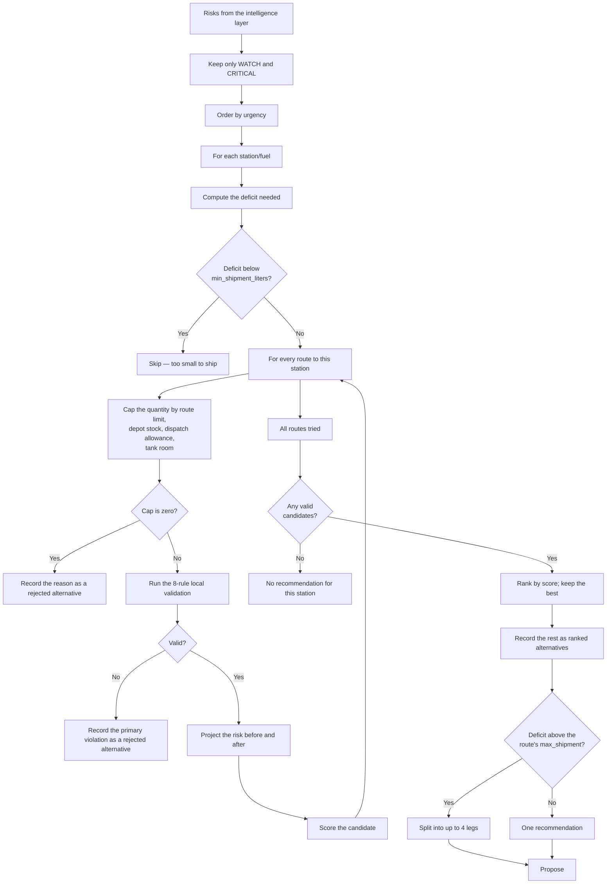
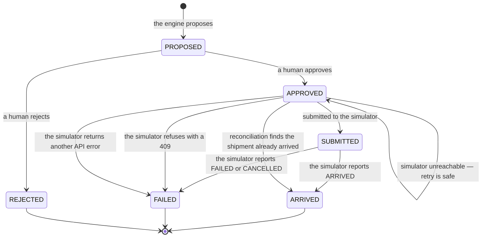

# The decision engine

How the platform decides where to send fuel, what it validates before it
asks, and what it does when the simulator says no.

**Code.** [`backend/app/decision/`](../backend/app/decision/) — `optimizer.py`
(the policy), `validator.py` (the pre-flight checks), `fallback.py` (the
rule-based policy), `constraints.py` (the rule model), `models.py` (the
recommendation and its lifecycle), `service.py` (the approval flow), and
`world.py` (the snapshot the engine reasons over).

---

## 1. The allocation algorithm

### It is a heuristic, and it says so

The engine is a **priority-greedy heuristic**. It does not solve an
optimisation problem, and it does not pretend to. The module docstring is
explicit:

> *"The allocation policy is a greedy heuristic, not a solver. It is
> deterministic, explainable, and it explains itself — which matters more
> here than optimality, because every recommendation carries its
> reasoning, and an operator has to be able to disagree with it."*

The greedy approach has a known weakness, and it is stated in the code rather
than hidden: a greedy policy *"can spend a depot's allowance on the wrong
station"*, leaving a later, more urgent station with nothing. **Urgency
ordering mitigates it** — the most urgent station gets first claim on the
fuel. The Day 4 log is blunter: *"The greedy policy **is** suboptimal in the
classic sense: it can spend a depot's dispatch allowance on a station that a
later, more urgent station needed. The urgency ordering mitigates this; it
does not remove it."*

### Why not an LP

The reason is **not** that an LP is too hard.

> *"The problem is not really an optimisation problem — it is a **sequencing**
> problem, and the scoring function is the judgement, not the solver. The
> simulator's constraint set is small and local (eight rules, all O(1)),
> while the thing that actually needs judgement — which station deserves
> fuel first — is a priority judgement that an LP objective would only
> obscure. A reviewer asking 'why did this station get fuel and that one
> not?' gets an answer here that points at a risk score and a cover
> calculation. With an LP they would get a dual price and a tie-break
> rule."*

That is the argument in full: **explainability is the requirement**, and the
constraint set is already O(1) per candidate, so an LP would buy nothing and
cost the operator the ability to understand a decision.

### The algorithm in prose

The engine serves stations in order of **projected hours to stockout**,
computes the **deficit over a 24-hour target cover**, walks the candidate
routes, and takes the **largest quantity that passes every constraint**.

### The algorithm



### The tunables

From [`OptimizerConfig`](../backend/app/decision/optimizer.py):

| Setting | Value | Meaning |
|---|---:|---|
| `target_cover_hours` | 24.0 | How much simulated cover a station should have |
| `min_shipment_liters` | 500.0 | The smallest shipment worth proposing |
| `max_alternatives` | 3 | How many ranked alternatives to keep |
| `max_split_legs` | 4 | How many shipments a deficit may be split across |
| `actionable_levels` | `WATCH`, `CRITICAL` | Only stations at this level or worse are considered |

### Urgency ordering

The sort key, in order:

```python
(
    0 if risk.risk_level is RiskLevel.CRITICAL else 1,   # critical first
    risk.hours_to_stockout if not None else 999.0,       # then least cover
    -risk.stockout_probability,                          # then most likely
    risk.station_id,                                     # then stable
    risk.fuel_type,                                      # then stable
)
```

The last two keys are there to make the order **deterministic** — two runs
over the same world produce the same proposals in the same order.

The **fuel is spent as it is allocated**: a `spent` dict tracks what each
depot has already committed this cycle, and every proposal reduces the
depot's remaining dispatch allowance. The first station in the order gets
first claim; a later one may get less, or nothing.

### Scoring a candidate route

```python
cover = projection.hours_to_stockout_after if not None else 48.0
score = round(cover - route.transit_ticks * 0.5, 4)
```

**More cover is better; earlier arrival is better.** The two are combined
into one number so the ranking is explicit and inspectable.

---

## 2. Pre-validating all nine simulator rules

### Why the engine validates locally

> *"Pre-validating locally is not a micro-optimisation. Every avoidable 409
> is a request the simulator has to parse, log and reject, and — more
> importantly — an allocation that looks approved but was refused. The engine
> treats a constraint violation as a **reason not to propose**, not as an
> error to recover from."*

So the engine does not propose an allocation it already knows will be
rejected. It computes the violation, and the violation becomes an
**alternative with a reason** — visible to the operator, not swallowed.

### The nine codes, in the guide's order

The Integration Guide (§5.2) validates an allocation in a **fixed order**, and
**the first failure wins**. That order is not cosmetic: it decides which
reason an operator sees when a request is wrong in several ways at once. The
engine applies the rules in exactly the documented order, so a recommendation
that passes local validation is a recommendation the simulator should accept.

| # | Code | Rule | Checked against |
|---:|---|---|---|
| 1 | `ROUTE_MISMATCH` | The route must connect the depot and station named in the request | `route.source_depot_id` / `route.destination_station_id` |
| 2 | `DEPOT_CLOSED` | The depot must be `OPEN` or `CONSTRAINED` | `depot.status` |
| 3 | `STATION_CLOSED` | The station must be `OPEN` | `station.status` |
| 4 | `ROUTE_DISRUPTED` | The route must be `AVAILABLE` | `route.status` |
| 5 | `ROUTE_CAPACITY_EXCEEDED` | The quantity must not exceed the route's limit | `quantity <= route.max_shipment` |
| 6 | `INSUFFICIENT_INVENTORY` | The depot must hold that much fuel | `depot.inventory[fuel] >= quantity` |
| 7 | `DISPATCH_CAPACITY_EXCEEDED` | The depot's per-tick allowance must not be exceeded | `quantity <= world.remaining_dispatch(depot, tick)` |
| 8 | `DESTINATION_CAPACITY_EXCEEDED` | The station's tank must not overflow | `quantity <= capacity[fuel] - inventory[fuel]` |
| 9 | `IDEMPOTENCY_KEY_MISMATCH` | Same key, different body | Simulator-side only — see below |

> **Discrepancy.** The platform's **local** validator checks **eight** of
> these — rules 1 to 8. `IDEMPOTENCY_KEY_MISMATCH` (rule 9) is by nature
> **not locally checkable**: it is the simulator comparing the submitted body
> against the body it already stored under that key, and the platform cannot
> know what the simulator stored. It is therefore handled on the response
> side, as an exception. The simulator client maps it to a dedicated
> `IdempotencyKeyMismatchError`.

**`CONSTRAINED` depots can still ship.** That is the simulator's rule, and
the platform matches it: `SHIPABLE_DEPOT_STATUSES = frozenset({"OPEN",
"CONSTRAINED"})`. Refusing a `CONSTRAINED` depot would stop the platform
shipping exactly when the network is under pressure.

**The dispatch allowance is per depot, per tick.** Every allocation created
on the *current* tick counts against it until the tick advances — an
allocation created on an earlier tick does not. The platform matches this
exactly:

```python
allocation.source_depot_id == depot_id
and allocation.created_tick == tick
and allocation.status in {"PENDING", "IN_TRANSIT"}
```

Every check is **recorded**, not just the failures — the report carries all
eight with their observed value, their limit, and a human-readable detail.
`ConstraintReport.primary_violation` returns the **first** one in the
documented order, which is the one the simulator would report.

### The order is tested

[`test_decision.py::test_the_first_failure_is_the_one_reported`](../backend/tests/test_decision.py)
asserts that a request which breaks several rules at once is reported for
the *first* one in the guide's order, not for whichever happens to be
easiest to detect locally.

---

## 3. Route choice and backup routes

For each actionable station/fuel, the engine considers **every route** to
that station. A route that cannot carry the shipment becomes a **rejected
alternative** carrying the reason:

```python
Alternative(
    route_id=route.id,
    source_depot_id=depot_id,
    transit_ticks=route.transit_ticks,
    quantity=0.0,
    reason=self._why_empty(world, depot_id, route, fuel_type),
)
```

A route that fails validation becomes a rejected alternative carrying the
**primary violation**:

```python
reason=f"{violation.code.value}: {violation.detail}"
```

So the operator sees *why* each rejected route was rejected — closed depot,
disrupted route, not enough stock — and not merely that it lost.

**The backup route is the next candidate.** The routes are ranked by score,
the best becomes the recommendation, and the rest become ranked alternatives
with a one-line reason: either *"arrives N tick(s) later than {best}"*, or
*"a smaller improvement in projected cover"*.

The fallback policy takes the same shape but sorts by arrival time — fastest
first — and falls back to the backup route when the fast one is disrupted
([`test_decision_fallback.py::test_the_fallback_uses_the_backup_route_when_the_fast_one_is_disrupted`](../backend/tests/test_decision_fallback.py)).

---

## 4. Splitting above `max_shipment`

The simulator's `max_shipment` is a **per-allocation** limit, so a deficit
above it has to go out as several shipments.

> *"Each leg is a separate recommendation with its own idempotency key,
> because the operator approves and submits them one at a time."*

The legs are bounded by the same caps the single shipment was:

```
ceiling = min(tank_room, dispatch_left, stock)
```

The **tank space matters most** — the simulator caps what a tank actually
*receives* on arrival, so splitting past the tank's room would promise fuel
that cannot be delivered.

The loop:

```python
while remaining > 0 and index < max_split_legs:      # max_split_legs = 4
    leg_quantity = round(min(remaining, route.max_shipment), 3)
    report = validator.validate(..., quantity=leg_quantity)
    if not report.is_valid:
        break
    legs.append(build_recommendation(..., leg=index))
    remaining = round(remaining - leg_quantity, 3)
    index += 1
```

Each leg is **re-validated** before it is kept. The alternatives are
attached to the **first** leg only, because they are the routes that were
considered *instead of* this one.

The `max_split_legs` cap of 4 exists so that *"a pathological deficit does
not become a flood of proposals"*.

> This was a bug that the verification caught. The Day 4 log records it:
> *"A deficit above `max_shipment` was capped, not split → The brief asks
> for the split, and the simulator refuses any single allocation above the
> route's limit → The optimizer splits it into several shipments, each with
> its own idempotency key."*

---

## 5. Transit-time accounting

Transit time is **not** a display detail — it changes the score, the
projection and the recommendation.

| Quantity | How it is computed |
|---|---|
| `arrival_tick` | `world.tick + route.transit_ticks` |
| `hours_until_arrival` | `route.transit_ticks × (tick_minutes / 60)` |
| Score penalty | `route.transit_ticks × 0.5` |

The projection replays the forecast **from the tick the fuel would arrive**:

```python
before = self._replay(forecast, available_before, arrival_tick=None, ...)
after  = self._replay(forecast, available_before, arrival_tick=arrival_tick,
                      extra=quantity, ...)
```

> *"Before that tick the shipment cannot help, which is what makes a slow
> route score honestly."*

A slow route that would deliver the fuel too late to prevent the stockout
projects almost no improvement, and therefore loses to a faster route even
if the faster one delivers less fuel. This is the mechanism by which
**transit time is accounted for**, rather than being reported and ignored.

The projection also counts fuel **already in transit** to the same station
and fuel, but only allocations whose `expected_arrival_tick` falls inside
the forecast horizon — a truck arriving after the horizon does not help
inside it.

---

## 6. The recommendation fields

A recommendation is *"not a number — it is an argument"*. From
[`models.py`](../backend/app/decision/models.py):

| Field | What it is |
|---|---|
| `id` | The engine's stable identifier |
| `station_id`, `fuel_type` | What it is for |
| `source_depot_id`, `route_id` | Where it comes from and how |
| `quantity` | How much, in litres |
| `status` | Where it is in the lifecycle |
| `risk_level`, `hours_to_stockout`, `stockout_probability` | The risk that prompted it |
| `projection` | The projected effect — risk before and after |
| `signals` | The intelligence-layer signals that drove the decision |
| `constraints` | The eight checks that were made, and whether they passed |
| `alternatives` | The routes considered and rejected, with reasons |
| `confidence` | 0–1, how much the engine trusts it |
| `needs_human_review` | True when a human must look before it is sent |
| `used_fallback_policy` | Whether the fallback produced it |
| `idempotency_key` | The key the submission will use |
| `rationale` | One line explaining it |
| `created_at`, `decided_at`, `decided_by` | Who decided, and when |
| `simulator_response`, `error_code`, `error_message` | What the simulator said |
| `allocation_id`, `sim_tick` | The simulator's id, and the tick it was made against |

### The projection

[`RiskProjection`](../backend/app/decision/models.py) carries
`risk_level_before` / `risk_level_after`,
`hours_to_stockout_before` / `after`,
`stockout_probability_before` / `after`, `inventory_before` / `after`,
`available_before` / `after`, `arrival_tick` and `hours_until_arrival`.

### A live example

From the Day 4 log — a real recommendation the platform produced:

```jsonc
{
  "station_id": "station-coxsbazar", "fuel_type": "OCTANE",
  "source_depot_id": "depot-patiya", "route_id": "route-patiya-coxsbazar",
  "quantity": 949.0,
  "risk_level": "WATCH",
  "projection": {
    "risk_level_before": "WATCH", "risk_level_after": "WATCH",
    "hours_to_stockout_before": 19.25, "hours_to_stockout_after": 24.0,
    "stockout_probability_before": 1.0, "stockout_probability_after": 0.5,
    "arrival_tick": 238, "hours_until_arrival": 0.75
  },
  "signals": [ /* the risk assessment's signals */ ],
  "constraints": [ /* all 8 checks, with observed and limit */ ],
  "alternatives": [ /* the routes that lost, and why */ ],
  "confidence": 0.9,
  "needs_human_review": true,
  "rationale": "WATCH risk at station-coxsbazar: 19 h of cover left. Ship 949 L ..."
}
```

Note the shape of the projection: the cover goes from 19.25 h to exactly the
**24-hour target**, and the arrival is **0.75 simulated hours** away — one
tick. The `constraints` array carries all eight checks, not only the
failures.

---

## 7. The state machine



**Seven states in the code:** `PROPOSED`, `APPROVED`, `SUBMITTED`, `ARRIVED`,
`FAILED`, `REJECTED`, `STALE`.

> **Discrepancies with the state list in the request.**
>
> - **`IN_TRANSIT` does not exist.** The code's in-flight state is
>   **`SUBMITTED`** — the allocation has been accepted by the simulator and
>   is in motion. `SUBMITTED` is what the platform records; the simulator
>   has its own richer ledger (`PENDING`, `IN_TRANSIT`, `ARRIVED`, …), and
>   the platform reads that ledger to reconcile.
> - **`STALE` is declared but never assigned.** `RecommendationStatus.STALE`
>   exists in the enum, but no code path in the backend ever sets it. It is
>   **not verified** that any state transition reaches it.

### The terminal states

```python
@property
def is_terminal(self) -> bool:
    return self in {ARRIVED, FAILED, REJECTED}
```

### Reconciliation

The **simulator is the source of truth** for what happened to a shipment.
On every sync the platform walks the simulator's allocation ledger and
closes the loop on recommendations that are still open:

| The simulator's allocation status | The recommendation becomes |
|---|---|
| `ARRIVED` | `ARRIVED` |
| `FAILED` or `CANCELLED` | `FAILED`, with the simulator's `failure_reason` |

Reconciled recommendations are counted, and the simulator's response is
stored on the recommendation.

### The retryable path

If the simulator **cannot be reached**, the recommendation goes back to
`APPROVED`, not to `FAILED`:

```python
recommendation.status = RecommendationStatus.APPROVED
recommendation.error_code = "SIMULATOR_UNREACHABLE"
recommendation.error_message = (
    f"The simulator could not be reached: {exc}. Retry the approval — "
    f"the idempotency key makes a repeat safe."
)
```

That is the payoff of the deterministic idempotency key: a retry after a
network failure is a **replay**, not a second shipment.

---

## 8. The what-if simulation

`POST /api/recommendations/{id}/simulate` projects what would happen if the
recommendation were approved.

**It is a local projection.** It replays the forecast against the fuel the
shipment would deliver. **Nothing is written to the simulator, and no
recommendation status changes.** The response says so explicitly with
`"writes_to_simulator": false`.

The real output from the Day 4 proof script:

```
=== 2. The operator inspects it (what-if, no write) ===
  writes_to_simulator : False
  before : {'risk_level': 'WATCH', 'hours_to_stockout': 19.25, 'stockout_probability': 1.0}
  after  : {'risk_level': 'WATCH', 'hours_to_stockout': 24.0,  'stockout_probability': 0.5}
  improvement : {'hours_to_stockout_gained': 4.75, 'stockout_probability_reduction': 0.5}
  ✓ the simulation wrote nothing to the simulator
```

A recommendation with no projection returns `{"simulated": false, "reason":
"this recommendation has no projection to simulate"}` rather than failing.

Two tests hold it to its promise:
[`test_decision_approval.py::test_the_simulation_does_not_touch_the_simulator`](../backend/tests/test_decision_approval.py)
and
[`::test_the_simulation_shows_the_improvement`](../backend/tests/test_decision_approval.py).

---

## 9. The idempotency key

```
rec-{station}-{fuel}-{tick}-{quantity}
```

A retried approval is therefore a **replay** rather than a second shipment
— the simulator returns the original allocation.

**The quantity is part of the key** because the simulator's key is
permanently occupied once used: a changed body needs a new key, and a
mismatch comes back as `IDEMPOTENCY_KEY_MISMATCH`.

Split legs get a `-{leg}` suffix, because two legs can carry the same
quantity and would otherwise collide:

```
rec-station-mirpur-PETROL-42-3000
rec-station-mirpur-PETROL-42-3000-1
```

The fallback policy has its **own** namespace — `fb-{station}-{fuel}-{tick}-{quantity}` —
so a fallback-proposed allocation and a model-proposed one cannot collide.

See [`docs/adr/0007-deterministic-idempotency-keys.md`](adr/0007-deterministic-idempotency-keys.md)
for the full reasoning.

---

## 10. Handling each 409

Every documented 409 is handled and explained. The recommendation records
the code and the explanation, so the operator can see why the shipment did
not go, and the counter is incremented so the failure mode is visible in
the metrics.

### The codes

The simulator client maps every code to a dedicated exception class
([`simulator_errors.py`](../backend/app/simulator_errors.py)):

| 409 code | Exception | Explanation given to the operator |
|---|---|---|
| `ROUTE_MISMATCH` | `RouteMismatchError` | "The route does not connect that depot and station. The world changed since the proposal was made." |
| `DEPOT_CLOSED` | `DepotClosedError` | "The depot is closed and cannot ship. Wait for the depot constraint to resolve, or use another depot." |
| `STATION_CLOSED` | `StationClosedError` | "The station is closed. It cannot receive fuel until the outage resolves." |
| `ROUTE_DISRUPTED` | `RouteDisruptedError` | "The route is disrupted. Use an alternative route, or wait for the disruption to clear." |
| `ROUTE_CAPACITY_EXCEEDED` | `RouteCapacityExceededError` | "The shipment is larger than the route allows. Split it into smaller shipments." |
| `INSUFFICIENT_INVENTORY` | `InsufficientInventoryError` | "The depot no longer holds that much fuel. Wait for the next supply arrival, or ship less." |
| `DISPATCH_CAPACITY_EXCEEDED` | `DispatchCapacityExceededError` | "The depot's dispatch allowance for this tick is used up. Try again on the next tick." |
| `DESTINATION_CAPACITY_EXCEEDED` | `DestinationCapacityExceededError` | "The station's tank is full. Wait for the station to draw fuel down." |
| `CANNOT_CANCEL` | `CannotCancelError` | "The allocation is no longer pending and cannot be cancelled." |
| `IDEMPOTENCY_KEY_MISMATCH` | `IdempotencyKeyMismatchError` | **No platform-specific explanation** — falls through to the simulator's own message |

> **Discrepancy.** `CONFLICT_EXPLANATIONS` holds **nine** codes; the
> exception map holds **ten**. `IDEMPOTENCY_KEY_MISMATCH` has **no** entry
> in `CONFLICT_EXPLANATIONS`, so
> `CONFLICT_EXPLANATIONS.get(exc.code or "", exc.message)` falls back to the
> simulator's raw message. The test
> [`test_decision_approval.py::test_every_conflict_code_has_an_explanation`](../backend/tests/test_decision_approval.py)
> enumerates the same nine codes, so the gap is **not caught by the test
> suite**. The Day 4 log describes the state as *"all 10 codes explained"*,
> which does not match the code.

### The handling path

```python
except ConflictError as exc:
    recommendation.status = RecommendationStatus.FAILED
    recommendation.error_code = exc.code
    recommendation.error_message = CONFLICT_EXPLANATIONS.get(exc.code or "", exc.message)
    self._counters["conflicts"] += 1
    if exc.code:
        self._conflicts_by_code[exc.code] = self._conflicts_by_code.get(exc.code, 0) + 1
```

A conflict is a **domain answer**, not a transport failure — the simulator is
healthy and the request conflicts with the current state. The platform
counts it as `SIMULATOR_REQUESTS{outcome="conflict"}` rather than as an
error.

The two transport failures are handled differently:

| Failure | Status | Why |
|---|---|---|
| `SimulatorConnectionError` | Back to **`APPROVED`** | The operator can retry, and the idempotency key makes the retry safe |
| `SimulatorAPIError` | **`FAILED`** | The simulator answered, and the answer was an error |
| Any other exception | Back to **`APPROVED`**, `UNKNOWN_ERROR` | Retryable |

### The stale-recommendation problem

A recommendation can go stale between proposing and approving — the world
moves, and the approval hits a 409. The platform's answer is that every 409
is handled with a clear explanation, the recommendation records the code, and
**the operator can re-propose**. The Day 4 risk table states the trade
plainly: *"The world moves; the approval can hit a 409."*

---

## 11. The auto-mode and its guards

The auto-mode is **off by default** and `POST /api/decision-settings` turns
it on. When it is on, it still only approves a recommendation that is **all**
of:

| Guard | Value | Why |
|---|---|---|
| Risk level | `WATCH` only — **never `CRITICAL`** | A critical station is exactly where a human should look |
| Confidence | ≥ 0.85 | A low-confidence forecast is not worth dispatching |
| `needs_human_review` | must be **false** | The explicit request for a human overrides the mode |
| `used_fallback_policy` | must be **false** | The fallback caps its own confidence at 0.4 |
| Constraints | **all** satisfied | Nothing blocked may be sent |

The implementation is `_auto_eligible` in
[`decision/service.py`](../backend/app/decision/service.py), and it returns
`False` on the first failing condition.

**Nothing reaches the simulator without a human** unless one of these five
conditions holds. The fallback policy **never** auto-approves and says so in
its rationale: *"the forecast model is unavailable"*.

See [`docs/adr/0004-human-approval-before-allocation.md`](adr/0004-human-approval-before-allocation.md).

---

## 12. The fallback policy

When the intelligence layer cannot produce forecasts, the **fallback
policy** takes over. It is *"deliberately the simplest policy that could
work, because a rule you can read in one glance is a rule you can trust
when the clever machinery is broken."*

### The rule

1. **Rank** the (station, fuel) pairs by **days of cover** — how long the
   station's stock would last at the demand rate it is actually drawing. The
   lowest days of cover gets the fuel.
2. **Size** the shipment to reach a **24-hour target cover**, net of what is
   on hand and what is already in transit.
3. **Route** by arrival time, fastest first, falling back to the backup route
   when the fast one is disrupted.

### Where the demand rate comes from

Without a forecast there is no learned estimate, so the rate comes from the
**published profile** — the same daily litres the simulator itself uses —
scaled by the hour-of-day factor and the station's own demand multiplier.
That is the simulator's own model, minus the noise.

### How it differs from the optimizer

| | Optimizer | Fallback |
|---|---|---|
| Ranking | By urgency (critical first, then least cover, then probability) | By days of cover, lowest first |
| Demand rate | The learned forecast | The published profile |
| Confidence | The forecast's confidence | Capped at **0.4** |
| `needs_human_review` | Inherited from the risk engine | **Always true** |
| `used_fallback_policy` | `false` | **`true`** |
| Key namespace | `rec-` | `fb-` |
| Rationale | Names the risk and the projection | Says *"the forecast model is unavailable"* |

The fallback's confidence is capped at 0.4 because *"the rule has no model
behind it, so it does not claim more confidence than it deserves."*

### Three paths, one entry point

The fallback engages on three paths, all through
`IntelligenceService.propose_now`:

| Path | Trigger |
|---|---|
| The engine raised | The evaluation failed outright |
| No forecast | The evaluation produced no forecast |
| No risk assessment | The evaluation produced no risk assessment |

The fallback's recommendation is **shaped exactly like the optimizer's**, so
the operator sees the same thing either way — except that it is marked as
having used the fallback policy and carries a confidence that reflects it.

---

## 13. The audit trail

### Two stores, two lifetimes

| | Live working set | Audit trail |
|---|---|---|
| **Where** | In-memory, in the decision service | Postgres |
| **Bound** | `DECISION_HISTORY_LIMIT` | Unbounded |
| **Served by** | `/api/recommendations` | `/api/decision-history` |

The in-memory store is a **working set**, not the audit trail — the audit
trail is Postgres. The decision history is written **even when nobody
approves anything**.

### The `recommendations` table

The audit trail is the `recommendations` table, indexed on status, station
and tick, with a unique constraint on `recommendation_id`:

| Column group | Columns |
|---|---|
| Identity | `recommendation_id`, `station_id`, `fuel_type`, `source_depot_id`, `route_id`, `quantity` |
| Decision | `status`, `risk_level`, `hours_to_stockout`, `confidence`, `needs_human_review`, `used_fallback_policy`, `rationale` |
| Submission | `idempotency_key`, `allocation_id`, `error_code`, `error_message` |
| Audit | `created_at`, `decided_by`, `decided_at`, `sim_tick` |
| Snapshots | `inputs_snapshot` (the signals, constraints, projection and alternatives, as JSON), `simulator_response` (the simulator's answer, as JSON) |

### The `decision_records` table

A second audit table, with `kind`, `idempotency_key`, `status`, `rationale`
and a JSON `payload`.

**It is written — but by the old dispatcher, not by the decision engine.**
[`intelligence_service._persist_decisions`](../backend/app/intelligence_service.py)
writes one row per dispatch decision with `kind="fuel_dispatch"` and a
status of `submitted` or `rejected`.

That is the resolution of the Day 6 bug. The log recorded that the table
existed *"in the schema but that nothing ever writes to"*, and that *"the
platform's decisions go to `recommendations`"*, leaving the "decision" half
of the searchable trail empty. The audit endpoint was changed to read the
table that is **actually written** — `recommendations` — and a test named
`test_the_decision_trail_reads_the_table_that_is_actually_written` fails if
it ever goes back.

So the current state is: **`recommendations` is the live audit trail**, and
`decision_records` holds the legacy dispatcher's rows.

### The endpoints

| Endpoint | Purpose |
|---|---|
| `GET /api/recommendations` | The live working set, paginated, filterable by status and station |
| `GET /api/recommendations/{id}` | One recommendation, with everything |
| `POST /api/recommendations/{id}/simulate` | The what-if projection |
| `POST /api/recommendations/{id}/approve` | Approve, and submit |
| `POST /api/recommendations/{id}/reject` | Reject, with a reason |
| `POST /api/recommendations/propose` | Ask for recommendations now |
| `GET /api/decision-settings` | The auto-mode's state |
| `POST /api/decision-settings` | Turn the auto-mode on or off |
| `GET /api/decision-history` | The audit trail, from Postgres |

### The write is retryable

The write goes through a **retrying helper** rather than a plain session.
It writes several rows in one transaction while an operator may be approving
a recommendation at the same time, and that pair is exactly what deadlocks:
both hold a lock the other wants, and Postgres kills one side with `40001`.
The helper retries the whole unit of work, which the SQL standard asks for.

---

## 14. The policy against the baseline

240 ticks per run (2.5 simulated days), paced at 1.2 s per tick, over the
same world from the same seed.

| Metric | Platform (priority-greedy) | Naive baseline | Difference |
|---|---|---|---|
| **`service_level`** | **1.000000** | **0.656634** | **+0.3434 (+52.3 %)** |
| `served_demand_liters` | 230,780 | 151,538 | +79,242 L |
| `unmet_demand_liters` | **0** | 79,242 | −79,242 L |
| `allocation_liters` | 240,939 | 105,000 | +135,939 L |
| `allocation_failures` | 0 | 0 | — |
| Shipments created | 339 | 21 | +318 |
| Approvals | 362 (1 failed) | — | — |
| Stations left at `CRITICAL` | **0** | 8 | −8 |

**The platform served every litre of demand.** The naive baseline left
**79,242 L** unmet — 34 % of everything the network asked for.

**The platform shipped 16× more fuel** (339 shipments against 21) and still
had **zero** allocation failures. The naive policy's problem was not that it
shipped too much; it was that it shipped to the wrong places. Its 21
shipments of a fixed 5,000 L went to whichever station had the lowest
inventory *at that moment*, which left 8 station/fuel pairs sitting at
`CRITICAL` at the end of the run.

**Why the naive policy is so much worse.** Three of its rules compound:

1. *Lowest inventory* is not the same as *closest to stockout*. A station
   with a small tank and modest demand can have less fuel in it than a
   station that is about to run dry.
2. *Fastest route, always* means it picks a **disrupted** route as readily
   as a working one — the shipment is then rejected or fails in transit.
3. *Fixed 5,000 L* ignores the tank's remaining room, so it either overfills
   (a 409) or underfills, and it never accounts for the depot's per-tick
   dispatch allowance.

**The 1 approval failure** was one proposal the simulator refused. The
platform recorded the code and the reason and moved on — which is the
behaviour the 409 handling exists for.

### The caveat, stated plainly

The naive baseline only shipped **21 times in 240 ticks** against the
platform's 339, even though both policies were held to the same sync
cadence. Part of that gap is the naive policy *choosing* not to ship — it
requires 5,000 L of diesel in the depot and refuses to ship when a station
already has fuel; part of it is the simulator refusing shipments the naive
policy should not have made. The comparison is therefore a comparison of two
complete policies, not of two shipping schedules, and the numbers should be
read with that in mind.

A service level of exactly 1.0 is also worth a caveat: the platform
front-ran the demand by having fuel already in place, so it never hit a
moment where fuel was missing.

### What the comparison does and does not show

**It shows** that the decision engine's ordering, sizing and route choice
produce a **materially** better service level than a reasonable rule-based
policy over the same world: **1.000 against 0.657**, with 79,242 L of demand
met that the baseline left unmet, and 8 station/fuel pairs left at `CRITICAL`
that the platform brought back to `OK`.

**It does not show** that the platform is optimal. The greedy policy is
suboptimal in the classic sense: it can spend a depot's dispatch allowance on
a station that a later, more urgent station needed. The urgency ordering
mitigates this; it does not remove it. A future version could compare
against a local-search or LP variant to measure how much that costs.

**It does not show** anything about the human-in-the-loop decision itself.
Both runs use the same **"approve everything"** policy, because measuring
the *operator's* judgement would need a different experiment.

**It does not compare two identical shipping schedules.** The naive baseline
made 21 shipments against the platform's 339. The policies differ in how
much they ship as well as in how they choose.

### The ceiling, stated honestly

The simulator's total supply is about **25 % below** its total demand, so
**absolute service level is not a meaningful comparison** under these
conditions — the comparable numbers are per-station rates and unmet litres.

A service level of exactly 1.0 needs its own caveat: the platform
**front-ran the demand**, having fuel already in place, so it never hit a
moment where fuel was missing. It was able to keep up with demand *"by
shipping earlier and more often than the naive policy allowed itself to"* —
not because the supply was adequate.

A separate six-day run against the same shortfall reached a service level of
**0.882**, with **73,859 L** of **627,759 L** demanded unmet; see
[`docs/intelligence-methodology.md`](intelligence-methodology.md) §11.

---

## 15. Limitations

1. **The policy is greedy, not optimal.** It can spend a depot's allowance
   on the wrong station, leaving a later, more urgent station with nothing.
   Urgency ordering mitigates it; the limitation is stated in the module
   docstring rather than hidden.
2. **There is no search over alternatives.** The engine produces one
   recommendation per station/fuel. The alternatives are recorded as
   *context* — they are ranked and explained, but not evaluated as competing
   plans.
3. **The projection is local.** It replays the forecast against the fuel the
   shipment would deliver. It never asks the simulator what would happen, so
   it cannot know about a disruption that has not reached the platform's
   cache yet.
4. **A recommendation can go stale between proposing and approving.** The
   world moves, and the approval can hit a 409. The platform handles the 409
   and explains it; it does not prevent it.
5. **The `STALE` status exists but is never assigned.** No code path
   reaches it.
6. **`IDEMPOTENCY_KEY_MISMATCH` has no platform explanation.** It falls
   through to the simulator's message, and the test that claims to check every
   code does not enumerate it.
7. **`decision_records` is written by the legacy dispatcher, not by the
   decision engine.** It holds `kind="fuel_dispatch"` rows from the old
   shipping path; `recommendations` is the live audit trail.
8. **The audit trail grows without bound.** The table is indexed on status,
   station and tick; pruning was named as Day 7 work and **no retention job
   was written**.
9. **The API has no authentication.** Every operator endpoint — including
   `approve`, which writes to the simulator — is reachable on the container's
   port. The *behaviour* is restricted; the *endpoints* are not.
10. **The policy comparison measures the policy, not the operator.** Both
    runs used the same "approve everything" policy, so the comparison says
    nothing about how good a human's judgement is.

---

## Related documents

- [`docs/policy-comparison.md`](policy-comparison.md) — the full comparison
  and the reading of the numbers
- [`docs/intelligence-methodology.md`](intelligence-methodology.md) — the
  forecasts and risk assessments this engine consumes
- [`docs/adr/0004-human-approval-before-allocation.md`](adr/0004-human-approval-before-allocation.md)
  — why nothing ships without a human
- [`docs/adr/0007-deterministic-idempotency-keys.md`](adr/0007-deterministic-idempotency-keys.md)
  — the idempotency key
- [`docs/adr/0013-in-memory-working-set-with-postgres-audit-trail.md`](adr/0013-in-memory-working-set-with-postgres-audit-trail.md)
  — the working set and the audit trail
- [`docs/progress/day4.md`](progress/day4.md) — the day the decision engine
  was built
- [`docs/bug-catalog.md`](bug-catalog.md) — the bugs the engine's
  verification caught
