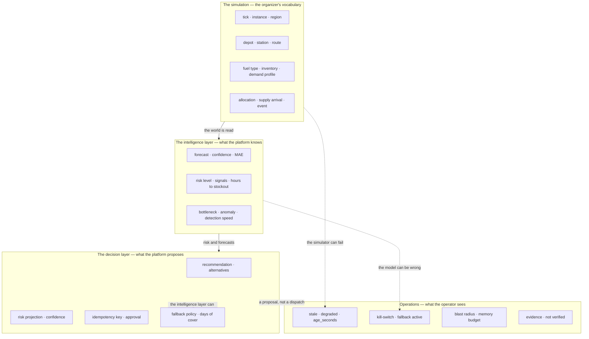

# Glossary

The vocabulary of the Fuel Supply Intelligence & Resilience Platform — the
domain terms the simulator uses, the terms this platform adds on top, and the
operational words that appear in the dashboards, the alerts and the reports.

Every definition below points at the code that implements it. Where a term has
two senses — one from the organizer's simulator and one from this platform —
both are given, because they are not always the same thing.

---

## How the vocabulary fits together

The four layers of terms, and where each one lives.

**The one rule that runs through all of it:** a *recommendation* is a proposal
and an *allocation* is a shipment. The words are not interchangeable, and the
platform keeps them apart in code, in the API and in the database.

---

## The simulation

| Term | Meaning | Where |
|---|---|---|
| **Tick** | The simulator's clock unit. One tick is **15 minutes** of simulated time. The world advances one tick at a time, and every forecast, risk score and allocation is expressed against a tick number. A 96-tick forecast horizon is 24 simulated hours. | [`backend/app/simulator_models.py`](../backend/app/simulator_models.py) |
| **Instance** | The running simulation itself — its status (`RUNNING` / `PAUSED`), its current tick, its seed and its simulated time. One instance at a time. | [`backend/app/simulator_models.py`](../backend/app/simulator_models.py) |
| **Simulated time** | The world's clock, which runs at 15 minutes per tick and is **not** wall-clock time. A 600-tick run is 6.25 simulated days, which takes far less than 6.25 real days. | [`docs/progress/day3.md`](progress/day3.md) |
| **Region** | The top of the network's geography. Two regions in the scenario, each with a `demand_factor` that scales its stations' demand. | [`backend/app/simulator_models.py`](../backend/app/simulator_models.py) |
| **Depot** | A fuel store that holds inventory and dispatches it. It has a `capacity` and an `inventory` per fuel type, a `dispatch_capacity_per_tick` limit, and a status — `OPEN` or `CONSTRAINED`. | [`backend/app/simulator_models.py`](../backend/app/simulator_models.py) |
| **Station** | A fuel retailer that consumes fuel and needs replenishing. It has a `demand_profile`, a `demand_multiplier`, a `capacity` and an `inventory` per fuel type, and a status — `OPEN` or `OUTAGE`. | [`backend/app/simulator_models.py`](../backend/app/simulator_models.py) |
| **Route** | A link from a depot to a station, carrying fuel. It has a `transit_ticks` — how many ticks the fuel takes to arrive — a `max_shipment` limit and a status, `AVAILABLE` or `DISRUPTED`. | [`backend/app/simulator_models.py`](../backend/app/simulator_models.py) |
| **Supply arrival** | A scheduled inbound delivery to a depot, with a `planned_tick` and a status — `SCHEDULED`, `DELAYED` or `ARRIVED`. | [`backend/app/simulator_models.py`](../backend/app/simulator_models.py) |
| **Allocation** | A shipment that the platform has submitted to the simulator. Its status moves `PENDING` → `IN_TRANSIT` → `ARRIVED`, or to `FAILED` or `CANCELLED`. | [`backend/app/simulator_models.py`](../backend/app/simulator_models.py) |
| **Fuel type** | One of `DIESEL`, `PETROL`, `OCTANE`. Every forecast, risk assessment and recommendation is per (station, fuel) pair. | [`backend/app/simulator_models.py`](../backend/app/simulator_models.py) |
| **Event** | Something the simulator has scheduled or is running — a `demand_spike`, a `route_disruption`, a `station_outage`, a `depot_constraint`, a `shipment_delay` or a `supply_shortfall`. | [`backend/app/simulator_models.py`](../backend/app/simulator_models.py) |
| **Scenario** | The baked starting state the simulator loads on reset — the depots, stations, routes and inventory the whole run is built on. | [`docs/simulator-notes.md`](simulator-notes.md) |
| **Fault injection** | The simulator's own mechanism for failing on demand: `latency`, `unavailable`, `error_rate`, `stale_data` and `stream_disconnect`. The platform's drills use it rather than mocking failures. | [`backend/app/simulator_models.py`](../backend/app/simulator_models.py), [`docs/fault-tests.md`](fault-tests.md) |
| **Crisis injection** | Raising a simulated event on demand through the platform's own endpoint, labelled "simulation only" in three places in the dashboard. | [`backend/app/main.py`](../backend/app/main.py) |

## Fuel and risk

| Term | Meaning | Where |
|---|---|---|
| **Days of cover** | How long a station's current stock will last at its current demand rate — `available / daily_demand`. The fallback policy ranks by it and ships to the lowest first. A station with 0.4 days of cover is the most urgent. | [`backend/app/decision/fallback.py`](../backend/app/decision/fallback.py) |
| **Hours to stockout** | The forecast time at which a station's projected inventory reaches zero. The central risk number. | [`backend/app/intelligence/risk.py`](../backend/app/intelligence/risk.py) |
| **Stockout probability** | The chance that the station runs dry before the next replenishment can arrive. | [`backend/app/intelligence/risk.py`](../backend/app/intelligence/risk.py) |
| **Risk level** | The band a (station, fuel) pair sits in: **`OK`**, **`WATCH`** or **`CRITICAL`**. The thresholds are **8 hours** and **24 hours** of cover. | [`backend/app/intelligence/risk.py`](../backend/app/intelligence/risk.py) |
| **Signals** | The individual measurements behind a risk score — each with a value and a plain-language reading. Every risk assessment carries its signals, which is what makes the score explainable rather than a bare number. | [`backend/app/intelligence/risk.py`](../backend/app/intelligence/risk.py) |
| **Risk score** | A number built from the signals. The platform does not use a black box here: the score is explainable by construction. | [`backend/app/intelligence/risk.py`](../backend/app/intelligence/risk.py) |
| **Service level** | The simulator's own metric — `served / (served + unmet)`, between 0 and 1. It is computed by the simulator, not by this platform, so the platform cannot game it. Read it against the **supply ceiling**. | [`backend/app/simulator_models.py`](../backend/app/simulator_models.py) |
| **Supply ceiling** | The maximum service level any policy could reach, because the simulator's total supply is about **25 % below** its total demand — **468,000 L** of supply against **627,759 L** of demand. No policy can serve fuel that is not there. | [`docs/intelligence-methodology.md`](intelligence-methodology.md) §11 |
| **Unmet demand** | Fuel that was demanded and not delivered. The other half of the service-level ratio. | [`backend/app/simulator_models.py`](../backend/app/simulator_models.py) |
| **Allocation failure** | A shipment the simulator refused. It should be zero. | [`backend/app/simulator_models.py`](../backend/app/simulator_models.py) |
| **Demand profile** | The per-station demand shape — how its consumption varies through the day. The profile baseline forecast is this shape scaled to the station's own level. | [`backend/app/intelligence/profiles.py`](../backend/app/intelligence/profiles.py) |
| **Demand multiplier** | The station's scale relative to its profile. It is the thing a demand spike moves. | [`backend/app/simulator_models.py`](../backend/app/simulator_models.py) |
| **Bottleneck** | A constraint that is actually binding, in one of five kinds: `dispatch_capacity`, `route_disrupted`, `supply_delayed`, `depot_low_stock`, `station_outage`. Each kind fires only when it is binding. | [`backend/app/intelligence/detection.py`](../backend/app/intelligence/detection.py) |
| **Anomaly** | An abnormal change — a `demand` anomaly found by z-score against the profile plus EWMA drift, or an `inventory` anomaly that is tick-span aware and accounts for deliveries. | [`backend/app/intelligence/detection.py`](../backend/app/intelligence/detection.py) |
| **Dispatch capacity** | The number of litres a depot can dispatch per tick. A shipment that exceeds it is refused by the simulator with a 409. | [`backend/app/simulator_models.py`](../backend/app/simulator_models.py) |
| **Max shipment** | The largest load a route can carry. A deficit above it is split into several shipments, each with its own idempotency key. | [`backend/app/simulator_models.py`](../backend/app/simulator_models.py) |
| **Transit ticks** | How many ticks fuel takes to travel a route. The projection credits fuel only from its arrival tick, not from the moment it is shipped. | [`backend/app/simulator_models.py`](../backend/app/simulator_models.py) |

## Forecasting and the model

| Term | Meaning | Where |
|---|---|---|
| **Baseline predictor** | The deterministic, rule-based forecast built from the demand profile. It needs no training data and never fails to produce a number. | [`backend/app/intelligence/forecasting.py`](../backend/app/intelligence/forecasting.py) |
| **Learned model** | A gradient-boosting model over twelve features. It has to earn its place: it is used only if it beats the baseline on held-out data. | [`backend/app/intelligence/forecasting.py`](../backend/app/intelligence/forecasting.py) |
| **Model kind** | Which predictor produced a forecast — `baseline` or `learned`. Returned on every forecast so the caller knows which one is answering. | [`backend/app/intelligence/forecasting.py`](../backend/app/intelligence/forecasting.py) |
| **Selector** | The component that chooses between the two predictors, and that decides when neither can be trusted. | [`backend/app/intelligence/forecasting.py`](../backend/app/intelligence/forecasting.py) |
| **Held-out one-step comparison** | The gate the learned model must pass: on data it has never seen, its error must beat the baseline's. The tolerance is `BEAT_TOLERANCE = 0.05` — the model must be **5 % better**, not merely equal. | [`backend/app/intelligence/forecasting.py`](../backend/app/intelligence/forecasting.py) |
| **Beat tolerance** | That 5 % margin. Without it, a model that ties the baseline would be allowed to serve forecasts, and the platform would gain nothing for the added complexity. | [`backend/app/intelligence/forecasting.py`](../backend/app/intelligence/forecasting.py) |
| **MAE** | Mean absolute error — the average litres by which a forecast misses. The platform's primary accuracy measure. | [`docs/model-evaluation.md`](model-evaluation.md) |
| **Confidence interval** | The band around a forecast point, drawn from the forecast's own error. It is the shaded band on the dashboard's forecast chart. | [`backend/app/intelligence/forecasting.py`](../backend/app/intelligence/forecasting.py) |
| **Confidence** | A 0–1 score on how much to trust a forecast. It falls when the model is not trusted, when the forecast is far out, or when the kill-switch is on. | [`backend/app/intelligence/forecasting.py`](../backend/app/intelligence/forecasting.py) |
| **Fallback reason** | Why the learned model is not in use — `"the ml kill-switch is on"`, `"the learned model is not trained"`, `"the learned model has only N training rows"`, `"the learned model is worse than the baseline"`. `None` means the model is in service. | [`backend/app/intelligence/forecasting.py`](../backend/app/intelligence/forecasting.py) |
| **needs_human_review** | The flag set on any forecast the platform will not act on automatically. Every fallback forecast carries it. | [`backend/app/intelligence/forecasting.py`](../backend/app/intelligence/forecasting.py) |
| **Forecast horizon** | How far ahead the platform forecasts — **96 ticks**, which is 24 simulated hours. It is the platform's *sight line*: beyond it, the model cannot see. | [`backend/app/config.py`](../backend/app/config.py) |
| **Retraining** | Re-fitting the learned model as new history arrives. The model is trained once it has enough rows (`min_training_rows`), and the training cost is measured rather than assumed. | [`backend/app/intelligence/forecasting.py`](../backend/app/intelligence/forecasting.py) |
| **Prediction evaluation** | A recorded comparison between a forecast and what actually happened. It is the evidence the model is judged on — and, until it was bounded, the table that OOM-killed the container. | [`docs/postmortems/03-oom-kill-prediction-evaluations.md`](postmortems/03-oom-kill-prediction-evaluations.md) |

## Decisions and allocations

| Term | Meaning | Where |
|---|---|---|
| **Recommendation** | A proposed allocation: which station, which fuel, from which depot, over which route, how much, and why. It is a *proposal*, not a dispatch. | [`backend/app/decision/models.py`](../backend/app/decision/models.py) |
| **Allocation** | A shipment. In this platform the word is used for the simulator's own record of a submitted shipment; a recommendation becomes one only after approval. | [`backend/app/simulator_models.py`](../backend/app/simulator_models.py) |
| **Recommendation lifecycle** | `PROPOSED` → `APPROVED` → `SUBMITTED` → `ARRIVED` or `FAILED`, with `REJECTED` and `STALE` as the other terminal states. A proposal is immutable once decided. | [`backend/app/decision/models.py`](../backend/app/decision/models.py) |
| **Idempotency key** | The deterministic string that identifies a shipment: `rec-{station}-{fuel}-{tick}-{quantity}` (and `fb-…` for fallback proposals), with a leg suffix for split shipments. The same inputs always produce the same key, so a retried approval is a **replay**, not a second shipment. The quantity is part of the key because the simulator's key is permanently occupied once used. | [`backend/app/decision/optimizer.py`](../backend/app/decision/optimizer.py) |
| **Approval** | A human's decision to send. `approve()` is the only path that calls `_submit()`, and `_submit()` is the only path that creates an allocation. | [`backend/app/decision/service.py`](../backend/app/decision/service.py) |
| **Auto-mode** | The optional automatic approval path. **Off by default.** It requires `WATCH` level, confidence ≥ 0.85, no human-review flag, not from the fallback policy, and every constraint satisfied. `CRITICAL` is deliberately excluded. | [`backend/app/decision/service.py`](../backend/app/decision/service.py) |
| **Validator** | The eight local pre-check rules that run before the optimizer proposes anything, in the guide's order. | [`backend/app/decision/validator.py`](../backend/app/decision/validator.py) |
| **Optimizer** | The priority-greedy allocator. It ranks candidate (station, fuel) pairs by risk and ships to the worst first, under the validator's constraints. It is deliberately **not** an LP. | [`backend/app/decision/optimizer.py`](../backend/app/decision/optimizer.py) |
| **Risk projection** | The before-and-after view: what a station's risk would be if this recommendation were approved, computed by replaying a stored projection. | [`backend/app/decision/models.py`](../backend/app/decision/models.py) |
| **Alternatives** | The 1–2 ranked runners-up, each with the reason it lost. | [`backend/app/decision/models.py`](../backend/app/decision/models.py) |
| **What-if simulation** | A dry run of a proposal that returns the projected outcome and writes **nothing** to the simulator. | [`backend/app/decision/service.py`](../backend/app/decision/service.py) |
| **Fallback policy** | The rule-based allocation used when the intelligence layer cannot be trusted. It ranks by **days of cover**, ships to the lowest first, and caps confidence at **0.4**. | [`backend/app/decision/fallback.py`](../backend/app/decision/fallback.py) |
| **409** | The simulator's conflict response — a dispatch that would violate a constraint. The platform explains every documented code in plain language. | [`backend/app/decision/service.py`](../backend/app/decision/service.py) |
| **decided_by** | The free-text label recorded against a decision. It is **not** an identity and is not verified against anything. | [`docs/security-and-threat-model.md`](security-and-threat-model.md) |
| **Audit trail** | Every decision, event and alert, written to **Postgres** — not held only in memory — and searchable through one query at `GET /api/audit`. | [`backend/app/audit.py`](../backend/app/audit.py) |
| **Working set** | The in-memory store of live recommendations. It is explicitly a working set, not the record; Postgres is the audit trail, and the trail survives a restart and a reset. | [`backend/app/decision/service.py`](../backend/app/decision/service.py) |

## State, freshness and failure

| Term | Meaning | Where |
|---|---|---|
| **State cache** | The last successfully fetched snapshot of the world plus the metadata that says how much to trust it. Every read path in the API goes through it, so the freshness fields always travel with the payload. | [`backend/app/state_cache.py`](../backend/app/state_cache.py) |
| **Stale** | The simulator served the data with `X-Simulator-Stale: true`. The flag is **sticky** — it stays set until a fresh fetch clears it. | [`backend/app/state_cache.py`](../backend/app/state_cache.py) |
| **Degraded** | The simulator is unreachable and the platform is serving **last-known state**. Every response carries the flag and the reason. | [`backend/app/state_cache.py`](../backend/app/state_cache.py) |
| **age_seconds** | How long ago the cached state was fetched. The number that tells an operator whether the data on screen is still worth acting on. | [`backend/app/state_cache.py`](../backend/app/state_cache.py) |
| **Sync** | The background service that polls the simulator and writes what it finds into the cache and the database. | [`backend/app/sync_service.py`](../backend/app/sync_service.py) |
| **Sync interval** | The floor on how often the platform reads the world — `SYNC_MIN_INTERVAL`, default **3.0 s**. It is the floor on latency and the ceiling on load. | [`backend/app/config.py`](../backend/app/config.py) |
| **SSE** | Server-sent events — the simulator's `/v1/stream`. The platform treats an event as a **hint to re-read**, never as the data itself. | [`backend/app/sse.py`](../backend/app/sse.py) |
| **Circuit breaker** | The guard around the simulator client. It opens after consecutive failures, lets one probe call through after a cooldown, and closes when the probe succeeds. | [`backend/app/circuit_breaker.py`](../backend/app/circuit_breaker.py) |
| **Kill-switch** | The switch that stops the learned model being used at all — every forecast falls back to the rule-based predictor and is flagged for human review. It is checked **before everything else**, so it can stop a model that still looks healthy on every metric the platform tracks. | [`backend/app/intelligence/forecasting.py`](../backend/app/intelligence/forecasting.py) |
| **Injected fault** | A deliberate break in the prediction layer, distinct from the kill-switch. The kill-switch is a *decision* — the model is healthy and is being held back. An injected fault is a *broken* model. The two are not the same. | [`backend/app/main.py`](../backend/app/main.py) |
| **Fallback active** | The platform is using the rule-based policy because the intelligence layer is down. Visible on the dashboard and counted in the metrics. | [`backend/app/main.py`](../backend/app/main.py) |
| **Fresh-clone test** | Starting from a clean clone at the tagged commit and running the whole thing — the check that the release works for someone who has never seen the repository. | [`docs/progress/day7.md`](progress/day7.md) |
| **Demo dry run** | The self-checking demo: it executes every step and verifies every claim it makes, so a demo cannot claim something it did not do. | [`scripts/demo_dry_run.sh`](../scripts/demo_dry_run.sh) |
| **Recovery drill** | A scenario run end to end, with the detection time, the recovery time and the recommendation made during the incident measured rather than asserted. | [`scripts/crisis_drill.py`](../scripts/crisis_drill.py) |
| **Silent dead feed** | An SSE connection that stays open but stops delivering — no error, no reconnect, no data. The failure mode that looks healthy from the outside. | [`docs/postmortems/01-silent-dead-sse-feed.md`](postmortems/01-silent-dead-sse-feed.md) |
| **Stale snapshot after reset** | Serving the old world's state after the simulator has been reset to a new one. The freshness fields looked healthy, because the fetch had succeeded — just against the wrong world. | [`docs/postmortems/02-stale-snapshot-after-reset.md`](postmortems/02-stale-snapshot-after-reset.md) |
| **Core profile** | The compose profile with the platform only — simulator, backend, Postgres, frontend. About 380 MB in use. | [`docker-compose.yml`](../docker-compose.yml) |
| **Monitoring profile** | The compose profile adding Prometheus, Grafana and node-exporter. It is **off during load tests**. | [`docker-compose.yml`](../docker-compose.yml) |
| **Memory budget** | The hard cap on the whole stack — **1.5 GB** across all seven containers, each with its own `mem_limit`, `cpus` and `pids_limit`. | [`docker-compose.yml`](../docker-compose.yml) |
| **Blast radius** | How much a single component can take down with it. The reason every container is bounded and the database pool cannot grow without limit. | [`docs/security-and-threat-model.md`](security-and-threat-model.md) |
| **Correlation ID** | The `cid-{12 hex chars}` value carried through the sync service and the request handler, tying one request to its log lines. | [`backend/app/logging_config.py`](../backend/app/logging_config.py) |
| **Deadlock** | Two transactions waiting on each other. The platform detects SQLSTATE `40001`, rolls the whole transaction back and retries it, bounded by `DB_DEADLOCK_RETRIES` (default 3). Note that the setting is read by the code but **not** passed into the container by Compose, so under the stack the effective value is always the default. | [`backend/app/db.py`](../backend/app/db.py), [`docs/configuration-reference.md`](configuration-reference.md) §5.2 |
| **Retention** | How long a table keeps its rows. Prometheus is bounded to `2d` / `500MB`; the `prediction_evaluations` table is **not** — it is a known gap. | [`docs/known-limitations-and-roadmap.md`](known-limitations-and-roadmap.md) |

## Evidence and process

| Term | Meaning | Where |
|---|---|---|
| **Evidence** | A number that came from a run that a named script reproduces. Nothing in this project is estimated, and nothing is rounded in the platform's favour. | [`docs/README.md`](README.md) |
| **not verified** | The word used where something was claimed but never measured. It appears in the documents rather than a gap. | [`docs/README.md`](README.md) |
| **Discrepancies** | The section a document uses when two sources disagree. The newer verified value wins and the conflict is listed. | [`docs/README.md`](README.md) |
| **Bug catalog** | All the defects found during the build, grouped by root-cause pattern, each with the day, the symptom, the fix and the test that pins it. | [`docs/bug-catalog.md`](bug-catalog.md) |
| **Postmortem** | A full write-up of an incident: summary, impact, timeline, root cause, detection, resolution, what went well, what went badly, and action items marked done or not done. | [`docs/postmortems/`](postmortems/README.md) |
| **ADR** | An Architecture Decision Record — status, context, decision, alternatives considered, consequences. | [`docs/adr/`](adr/README.md) |
| **Coverage floor** | The minimum coverage a specific module must hold, enforced in CI. Seven modules have one; the total floor is 80 %. | [`scripts/check_coverage.py`](../scripts/check_coverage.py) |
| **p99** | The latency below which 99 % of requests fell. The number the load test is judged on. | [`docs/load-test-report.md`](load-test-report.md) |

---

## Related documents

* [`docs/simulator-notes.md`](simulator-notes.md) — what the running simulator
  actually does, and the ten places it disagrees with the guide
* [`docs/intelligence-methodology.md`](intelligence-methodology.md) — the model
  card: the baseline formula, the learned model's twelve features, the risk
  thresholds, the evaluation method and the supply ceiling
* [`docs/decision-engine.md`](decision-engine.md) — the allocation engine, the
  eight validator rules, the lifecycle state machine and the fallback
* [`docs/api-reference.md`](api-reference.md) — all 35 routes
* [`docs/configuration-reference.md`](configuration-reference.md) — all 37
  backend settings
* [`docs/operator-user-guide.md`](operator-user-guide.md) — the dashboard,
  screen by screen, and what each banner means
* [`docs/known-limitations-and-roadmap.md`](known-limitations-and-roadmap.md) —
  every known limitation with its impact and its workaround
