# Known limitations and roadmap

Every limitation this platform has, collected in one place, with its impact
and what you can do about it today.

This document is the honest counterweight to the rest of `docs/`. It does not
describe what the platform might do. It describes what the platform cannot
do, what the measurements do not prove, and which shortcuts were taken on
purpose.

**How the numbers here were obtained.** Every number is taken from the
repository: the [seven day logs](progress/day1.md), the
[model evaluation](model-evaluation.md), the [load test report](load-test-report.md),
the [resilience report](resilience-report.md), the
[testing report](testing-strategy-and-report.md), the
[requirements traceability](requirements-traceability.md), and the code
itself. Where a source is cited, it is linked. Where something was not
measured, this document says **not verified** rather than estimating it.

---

## 1. The simulation

| # | Limitation | Impact | Workaround today |
|---|---|---|---|
| 1.1 | **Supply is 25 % below demand.** The simulator's total supply is about 25 % below its total demand, so service level cannot reach 1.0. | The headline **0.882** service level is measured against a deliberately short world. It is not a fair test of the policy, and a judge comparing it to 1.0 will be comparing against an impossible target. | The platform allocates scarce fuel; it does not create it. Read 0.882 as *"how much of a hard shortfall did the platform actually serve"*, and compare it against the naive baseline in [policy-comparison.md](policy-comparison.md) rather than against 1.0. The simulator does not offer an adequate-supply scenario on demand. |
| 1.2 | **The network is 2 regions, 2 depots, 4 stations, 6 routes.** | Every threshold, constraint and page size is tuned against a network of that size. A larger network would need the fan-out, the cache and the pagination re-tuned. | Treat the constants as small-network constants. The bounds that would break first are the bounded fan-out (`SYNC_MAX_CONCURRENCY`, default 3) and the in-memory working set. |
| 1.3 | **One scenario, one seed.** The model is trained and evaluated on a single scenario and a single seed. | The results show the platform learns *this* world's demand model. They do **not** show generalisation to another seed. | Not verified — a multi-seed evaluation was never run. Treat every accuracy number as seed-specific. |
| 1.4 | **The forecast horizon is one simulated day** — 96 ticks at the default tick size. | Anything beyond that is extrapolation, and the platform says so rather than pretending. | The platform publishes the horizon it was given, not the horizon it wished it had. |
| 1.5 | **The simulator's own docs disagree with the guide in ten places.** | Any rule implemented from the guide rather than from the running simulator can be wrong in ways the tests do not catch. | The discrepancies are catalogued in [simulator-notes.md](simulator-notes.md), and the platform is built to the *running* simulator's behaviour. |

## 2. The intelligence

| # | Limitation | Impact | Workaround today |
|---|---|---|---|
| 2.1 | **The model's advantage is modest and narrower than the headline suggests.** The headline is **34 %** improvement over the baseline (78.1 L vs 118.1 L of horizon error over 96 ticks). The one-step validation MAE is **0.0512** against the baseline's **0.0589** — a much smaller margin. | Both measures favour the model, but neither margin is large, and the headroom above the baseline is small in absolute terms. A judge asking "is the model better than the baseline?" gets: yes on both measures, but by a modest margin on a baseline that was already strong. | The gate is documented in [ADR 0006](adr/0006-gate-model-on-held-out-one-step-comparison.md). The published verdict — with both wins and losses — is in [model-evaluation.md](model-evaluation.md) §3. |
| 2.1a | **The honest horizon score is *worse* than the rule.** Measured against the stored history after the leak was fixed, the model's error is **170.5 L** and it scores **+3.7 % worse** than the baseline, winning only 25 of 48 window/pair comparisons. The leaky version of the same measurement claimed **−60.7 % better** at 64.6 L. | This is the score that says the learned model is *not* better than a well-tuned rule over the horizon in this scenario. The platform does not use it as the gate, and the reason is in [ADR 0006](adr/0006-gate-model-on-held-out-one-step-comparison.md). | The gate carries a **5 % tolerance** (`BEAT_TOLERANCE`): a model more than 5 % worse than the rule on the held-out split is rejected. The horizon score is still computed and still published, as a diagnostic that does not veto — `GET /api/model-status` reports `beats_baseline_at_horizon: false` when that is the truth. |
| 2.2 | **The baseline is close to exact, by construction.** The simulator's demand is largely deterministic given the profile, the hour and the multiplier, and the rule-based baseline uses the current multiplier. | There is not much headroom above the baseline, which bounds how large *any* improvement can be — and bounds the value of the learned model in this scenario. | Do not read the 34 % as "the model is 34 % better than it could have been". It is 34 % better than a baseline that was already strong. |
| 2.3 | **The model is a gradient booster on a ratio.** It has no notion of price, weather, holidays or competition. | It learns the station's own recent behaviour and the calendar — which is most of what this simulator generates — but it would not survive a real market. | The rule-based fallback is the answer when the learned model is unavailable or loses the gate. It is deliberately simpler and the platform tells the operator when it is in use. |
| 2.4 | **A single tick's forecast is a point estimate with a symmetric interval.** The interval comes from a mean absolute error scaled by the known shape. | It is **not** a calibrated predictive distribution, and the stockout probability derived from it inherits that. | Confidence bands are shown, and every decision carries its confidence score, so an operator can see when the platform is unsure. |
| 2.5 | **The anomaly detectors are unlabelled thresholds, not models.** | There is no ground truth for "is this an anomaly", so the thresholds are set from judgement and the **false-positive rate is not verified**. A slow, steady demand change will not raise an anomaly at all — it shows up as a slow decline in days-of-cover. | The platform publishes the raw evidence behind every anomaly (the z-score, the bound) so the threshold can be argued with rather than trusted blindly. |
| 2.6 | **The `WATCH_HOURS` band is documented but not implemented.** The 24-hour WATCH boundary in [model-evaluation.md](model-evaluation.md) §4.1 is not what the code does. | A reader comparing the document to the behaviour will find a mismatch. | The implementation is the truth; the discrepancy is recorded in the model card's §5 and in [requirements-traceability.md](requirements-traceability.md). |
| 2.7 | **The leaky-vs-honest horizon score is published with two different sets of magnitudes.** The progress log says leaky **64.6 L / −60.7 %** and honest **170.5 L / +3.7 %** (leaky wins 37 of 48, honest 25 of 48). The `HorizonValidator` docstring says leaky **4,341 L / 13.7 % better** and honest **5,035 L / 0.1 % better** (11 of 12 against 4 of 12). | It is the one place where the platform's own numbers disagree with each other. Working backwards from the percentages, the two sets imply *different baselines* and count *different populations*. A judge who cross-checks will find it. | The [`day7.md`](progress/day7.md) figures are the ones quoted, because they are in the published progress log and in the commit (`426b574`, 2026-11-25). The docstring's figures are **not verified** against a stored probe output — none is committed. The **qualitative conclusion is identical in both**: the leaky score flattered the model, and removing the leak made the model look worse. Written up in full in [postmortem 07](postmortems/07-benchmark-leaked-the-future.md) and in [requirements-traceability.md](requirements-traceability.md) §Discrepancies. |
| 2.8 | **The horizon error is measured on a small number of replay windows.** 96 ticks is a single simulated day. | There is no confidence interval on the error itself — the number a dispatcher would most want quoted. | Not verified — a rolling multi-window evaluation was never run. |

## 3. The decision engine

| # | Limitation | Impact | Workaround today |
|---|---|---|---|
| 3.1 | **The allocator is greedy, not optimal.** It serves the most urgent station first and takes what it can. | A full linear program would squeeze more service level out of the same shortage. The trade is speed and explainability. | The comparison against the alternatives is in [decision-engine.md](decision-engine.md) and [policy-comparison.md](policy-comparison.md). A judge asking "is this an optimizer?" gets "a well-engineered heuristic with all eight simulator rules pre-validated", not "an LP". |
| 3.2 | **The ranked alternatives are capped at three.** | The ranked list is a shortlist, not an exhaustive search. | The cap is `max_alternatives` on the optimizer's config — a code-level constant, **not** an environment setting, so changing it means a code change. See [decision-engine.md](decision-engine.md). |
| 3.3 | **The fallback policy is deliberately simple** — refill the lowest days-of-cover first. | It is the right rule when there is no model and it is *worse* than the model. | The platform reports when the fallback is in use and requires human review ([decision-engine.md](decision-engine.md)). |
| 3.4 | **No allocation happens without a human.** | An operator must approve every shipment; there is no unattended path by default. This is the point of the design, but it means the platform cannot run itself. | The auto-mode exists and is **off by default**, and its bar is deliberately high: `WATCH`-level only, confidence ≥ 0.85, no `needs_human_review` flag, no fallback policy, and every constraint passed. Anything CRITICAL is left for a human — a critical station is exactly the case where a human should look. See [ADR 0004](adr/0004-human-approval-before-allocation.md). |
| 3.5 | **The model is per (station, fuel).** | It does not learn across stations, so a station with unusual behaviour only learns from its own history. | A cold start is a rule-based start, not a confident one — below `FORECAST_MIN_TRAINING_ROWS` (30 rows) the platform uses the rule-based predictor and says so. |
| 3.6 | **No generative AI anywhere.** No LLM produces the incident explanations, the state summaries or the decision rationales. | One of the five capability families the brief offers is not covered at all. The rationales are rule-generated: deterministic and inspectable, which is the opposite of what an LLM gives you. | Recorded as gap 1 in [requirements-traceability.md](requirements-traceability.md). |

## 4. The platform and its dependencies

| # | Limitation | Impact | Workaround today |
|---|---|---|---|
| 4.1 | **`prediction_evaluations` grows without bound.** One row per station, per fuel, per tick. | It is the table that OOM-killed the container once. The aggregate is now computed in SQL so growth costs no latency and no memory, but **there is no retention job**, so the table keeps growing. The recorded measurement was **928,005 rows, 257 MB**. | The fix that landed was *"never read the table"*, not *"use more memory"*. A retention job is the next step and has not been written. Recorded in [postmortem 03](postmortems/03-oom-kill-prediction-evaluations.md) and [data-model.md](data-model.md). |
| 4.2 | **The simulator's connection pool is small and cannot be changed from here.** The organiser's image sets `QueuePool limit of size 5 overflow 10` — fifteen connections with a 30 s `pool_timeout`. | Sustained polling exhausts the pool, and an exhausted pool is a simulator that answers 500 until it is restarted. This is a property of a dependency the platform does not own. | The platform fits inside it: the throttle floor and a bounded fan-out (`SYNC_MAX_CONCURRENCY`, default 3) keep concurrency at nine. If the pool does fill, the documented procedure is `docker compose restart simulator` ([runbook.md](runbook.md) §4). Recorded in [postmortem 04](postmortems/04-simulator-connection-pool-exhaustion.md). |
| 4.3 | **The platform's polling has a latency floor, and it is deliberate.** The simulator publishes `simulation.tick` several times a second; each event triggers a read of the world, and a read is nine endpoints. | Sustained polling exhausts the pool (see 4.2). The cost is that a change in the world is not acted on instantaneously. | The throttle is a **floor on time, not a filter on events**: the platform still reacts to a hint at once when it has been idle, and simply does not re-read the world until the floor has passed. The two settings are `SYNC_POLL_INTERVAL` (default 5 s, the safety net) and `SYNC_MIN_INTERVAL` (default 3 s, the throttle floor), with jitter on the poll. See [ADR 0003](adr/0003-polling-floor-and-bounded-fanout.md). |
| 4.4 | **The simulator's 500s are indistinguishable from each other** in some paths. | A fault can look like a bug in the platform. | The error shapes the platform and the simulator use are both documented in [api-reference.md](api-reference.md). |
| 4.5 | **The working set of recommendations is in memory.** Postgres holds the full history and `/api/decision-history` serves it, but the endpoint the dashboard polls is bounded and evicts. | A long-running deployment keeps a bounded working set, which is the point; it also means the live view is not the full history. | The bounded limit is `DECISION_HISTORY_LIMIT`. See [ADR 0013](adr/0013-in-memory-working-set-with-postgres-audit-trail.md). |
| 4.6 | **The audit search is a bounded window.** The count and the page share the same window. | A count is never the total number of rows in the table. | The summary reports its `scope`, so a count always says which rows it covers. |
| 4.7 | **No authentication, no authorization.** The dashboard and the API are open on the container's port. | Every operator endpoint — including `approve`, which writes to the simulator — is reachable without credentials. The *behaviour* is restricted (no allocation without a human; auto-mode off by default and its bar is high) but there is no identity layer. | This is a local simulation, and the brief asks for hygiene rather than enterprise security. The controls that do exist, and what is explicitly **not** protected, are in [security-and-threat-model.md](security-and-threat-model.md). |
| 4.8 | **No TLS and no rate limiting.** | Not reachable safely outside localhost. | Same as 4.7 — bind to localhost and treat the platform as a single-operator tool. |
| 4.9 | **Single-tenant by design.** One backend instance, one simulator world, one operator. | Multi-replica contention and the poll-interval jitter between replicas are untested in anger. Listed as a gap in [fault-tests.md](fault-tests.md) with a Day 6 target; it was not closed. | The jitter exists so that replicas would not hit the simulator in lockstep, but only one instance is ever deployed. |
| 4.10 | **The observability stack sits behind a profile.** A plain `docker compose up` starts the platform and not the dashboards. | Deliberate, so a busy machine is never taken down by Prometheus — but the dashboards are not there by default. | `docker compose --profile monitoring up -d`. See [ADR 0010](adr/0010-compose-profiles-and-memory-limits.md). |

## 5. The measurements themselves

These are limits on the *evidence*, not on the platform. They matter because
the numbers in the reports are only as good as the runs behind them.

| # | Limitation | Impact | Workaround today |
|---|---|---|---|
| 5.1 | **Five of the seven recorded load-test runs were stopped by the safety guard**, not completed: the backend's CPU stayed above 90 % of its 1.00-core limit. | The scenario results from those runs are truncated. The headline figures come from the final run of **2026-11-25T09:48:00Z**, whose raw results record `stop_reason: null` for all three workloads. | The raw results are committed at `scripts/loadtest/results/part3-async.json` and each run's stop reason is written up in [load-test-report.md](load-test-report.md). The stopped runs are recorded rather than discarded. |
| 5.2 | **The load test is a measurement, not a gate.** Nothing in CI fails when the p99 regresses. | A regression would be found by a person reading the report, not by a build. | The raw results are committed and the comparison is written up. Adding a gate is future work (see §7). |
| 5.3 | **The p99 improvement (30,029.78 ms → 286.13 ms) came from one workload, and the "before" p99 was a timeout, not a latency.** The comparison is the dashboard's read path on a 1.00-core quota, at 31,700 requests and 335.39 req/s. The "before" p99 of 30,029.78 ms *is the harness's thirty-second timeout* — those requests were not being answered at all, not merely slow. | It is a large number with a narrow scope, and the "before" figure measures a stall rather than a latency distribution. Note also that the **p50 got worse**: 7.96 ms → 53.24 ms. The before-run answered most requests fast and let a few hang until the timeout; the after-run answers everything, so the median moved. The p99 improvement and the p50 regression are the same fact seen from two ends. | The separate 50-user ramp tells a different story: at 50 virtual users the dashboard p99 was **1,023.94 ms** (5 users: 58.42 ms), because the ramp adds load the fixed scenario does not. Both are in [load-test-report.md](load-test-report.md) and in the raw `scripts/loadtest/results/part3-async.json`. |
| 5.4 | **18 of the 70 catalogued defects have no dedicated regression test.** | Reverting those fixes would not be caught by the test suite. | The 18 are named — B2, B4, B8, B12, B21, B22, B29, B30, B32, B33, B39, B41, B47, B48, B54, B61, B69 and B70 — in [bug-catalog.md](bug-catalog.md). This is the list to work from next. |
| 5.5 | **The coverage floors are on statements, not branches.** `coverage.json` records `"branch_coverage": false`. | A statement can execute without every side of a conditional being taken, so **84.4 %** is weaker than branch coverage would be. | The seven enforced per-module floors are in [testing-strategy-and-report.md](testing-strategy-and-report.md). |
| 5.6 | **The lowest-coverage module is the orchestration layer.** `app/intelligence_service.py` is at **36.9 %** — 154 of 417 statements. | A wiring mistake inside it would not be caught by a unit test; it is covered only indirectly by the tests of the components it calls. | This is the single largest gap in the unit suite. |
| 5.7 | **The repository layer is barely unit-tested.** `app/repository.py` is at **49.5 %**. | The SQL writers need a real database, so `pytest -q` alone will not catch a broken repository layer. The CI `test` job runs with no database; the deadlock tests use a simulated `40001`. | The integration suite and the crash drill cover it. This means the integration suite is not optional. |
| 5.8 | **The malformed-payload path was never drilled live.** It is proven by unit tests, but no scenario injected a malformed response into the running simulator. | The scenario would need a fault the simulator does not offer, so it would need a proxy in front of it. | Recorded as gap 5 in [requirements-traceability.md](requirements-traceability.md). |
| 5.9 | **The load test never produced a sustained high-rate `error_rate` fault.** | The client retries with full jitter and the fault is in the drill, but the fault was not held at a high rate for an extended period. | Recorded as a gap in [testing-strategy-and-report.md](testing-strategy-and-report.md) §6.4. |
| 5.10 | **The frontend has no test for a backend error state, no accessibility check, and no performance budget.** | The Vitest suite covers the happy path for every component. The Playwright suite covers "every screen renders without an error state" — the opposite direction, and only against a healthy stack. | The layout is checked at 430 px by one Playwright test. The build is size-checked by nothing. |
| 5.11 | **No multi-replica testing.** | See 4.9. | Not verified. |
| 5.12 | **The release pipeline's remote half is not verified.** No image has been confirmed published to GHCR, no CI run record is committed, and the release workflow's empty `needs:` means it does not actually depend on the test workflow. | The rollback *target* is well-defined — the immutable `-sha-` tag — and the procedure is documented, but the end-to-end publish has not been observed. | The exact gaps are listed in [cicd-release-and-rollback.md](cicd-release-and-rollback.md). |

---

## 6. What the platform will not do, and why

Some of these are limitations *and* decisions. They are here so that the
roadmap in §7 is not read as a list of things that were forgotten.

| Decision | Why it is not a limitation to fix first | Evidence |
|---|---|---|
| **No reinforcement learning.** | The feedback loop is too slow (240 ticks per run is 2.5 simulated days, and an agent would need thousands of runs), the policy has to be safe on its first action, the supply is 25 % short so the reward has no clean ceiling, and every episode must be paced to the platform's own sync cycle. | [ADR 0012](adr/0012-no-reinforcement-learning.md) |
| **No Kubernetes, Helm, Terraform, canary, blue/green or GitOps.** | All optional, and the brief explicitly says not to introduce infrastructure complexity unless it improves the solution. | [requirements-traceability.md](requirements-traceability.md) gap 7 |
| **No model registry and no drift detection.** | The model is rescored on every evaluation and the horizon score is published, but nothing raises an alarm when the model's error grows. The kill-switch is the manual answer. | [requirements-traceability.md](requirements-traceability.md) gaps 8 and 9 |
| **No transport-delay prediction.** | The risk engine uses the simulator's own `expected_arrival_tick` and `transit_ticks` rather than predicting a delay. | [requirements-traceability.md](requirements-traceability.md) gap 2 |
| **The rollback is a manual action.** | The target is well-defined and the procedure is documented, but nothing performs it automatically. | [requirements-traceability.md](requirements-traceability.md) gap 11 |

---

## 7. Roadmap

Everything here is **future work**. Nothing in this section is implemented, and
nothing in this section is claimed to be implemented. The ordering is by
value against the limitations in §1–§5, not by effort.

```mermaid
flowchart TD
    A["Immediate — cheap, closes a real gap"] --> A1["Retention job for prediction_evaluations"]
    A --> A2["Regression tests for the 18 unpinned defects"]
    A --> A3["Pin the API 503 body after an external reset"]

    B["Next — measurable risk"] --> B1["Load test as a CI gate with a p99 budget"]
    B --> B2["Fix the release workflow's empty needs"]
    B --> B3["Drift detection on the model's live error"]

    C["Next — operator capability"] --> C1["Authentication and authorization"]
    C --> C2["Scheduled retraining with a model registry and rollback"]
    C --> C3["Multi-seed and multi-window evaluation"]

    D["Exploratory — research questions"] --> D1["Reinforcement learning experiment"]
    D --> D2["An LP or LP-relaxed allocator vs the greedy one"]
    D --> D3["Transport-delay prediction"]
    D --> D4["Generative-AI explanations with a deterministic fallback"]
```

### 7.1 Immediate

| # | Item | Closes | Note |
|---|---|---|---|
| R1 | **A retention job for `prediction_evaluations`.** Delete or archive rows older than a configured window, on a schedule, with the deletion counted so it is visible. | §4.1 | This is the only item that was explicitly written down as "the next step" in two separate documents and still not done. It is not the fix for the OOM — *"never read the table"* was — but it bounds the table. |
| R2 | **Regression tests for the 18 defects with no dedicated test** (B2, B4, B8, B12, B21, B22, B29, B30, B32, B33, B39, B41, B47, B48, B54, B61, B69, B70). | §5.4 | The bug catalog already names each one. This is mechanical work with a known target list. |
| R3 | **A test asserting the API's 503 response body** in the window between a simulator reset and the next sync. | §5.4, §5.8 | The behaviour is already pinned by the sync-service tests; only the API's own body is unasserted. Recorded as *Partly done* in [postmortem 02](postmortems/02-stale-snapshot-after-reset.md). |

### 7.2 Next — measurable risk

| # | Item | Closes | Note |
|---|---|---|---|
| R4 | **Make the load test a CI gate** with a p99 budget and an error-rate ceiling, so a regression fails a build instead of waiting to be noticed. | §5.2 | The raw results and the comparison are already committed; only the gate is missing. The load test needs Docker and a quiet host, so the gate belongs in the `compose-smoke` job rather than in `pytest`. |
| R5 | **Fix the release workflow's empty `needs:`** and observe the GHCR publish end to end. | §5.12 | The release workflow does not currently depend on the test workflow, so a red test does not block a publish. |
| R6 | **Drift detection**: raise an alarm when the model's live error grows over time, instead of relying on the manual kill-switch. | §2.1, §6 | The model is already rescored on every evaluation and the horizon score is published; the missing piece is the alarm. |
| R7 | **Multi-seed and multi-window evaluation**, so the accuracy numbers come with a confidence interval and are not seed-specific. | §1.3, §2.8 | This is the single change that would most improve the honesty of the headline results. |

### 7.3 Next — operator capability

| # | Item | Closes | Note |
|---|---|---|---|
| R8 | **Authentication and authorization** on the operator API, including `approve`. | §4.7 | The brief asks for hygiene rather than enterprise security, so this is a deliberate trade today. A real deployment would need it. The [security and threat model](security-and-threat-model.md) already lists exactly what is unprotected. |
| R9 | **Scheduled retraining with a model registry and a rollback to a previous model.** | §2.5, §6 | The retraining loop already runs on `MODEL_TRAIN_INTERVAL` (default 300 s, floored at 60 s). What is missing is the registry, the rollback, and a way to compare models across time. |
| R10 | **Multi-replica testing** for the poll jitter and sync contention. | §4.9, §5.11 | The jitter exists for this case but has never been exercised with more than one instance. |

### 7.4 Exploratory — research questions

| # | Item | Closes | Note |
|---|---|---|---|
| R11 | **A reinforcement-learning experiment.** | §6 | The reasons against RL are recorded in [ADR 0012](adr/0012-no-reinforcement-learning.md); the honest way to revisit the decision is to run the experiment, not to argue. It needs thousands of paced episodes. |
| R12 | **An LP or LP-relaxed allocator** compared against the greedy one on service level. | §3.1 | The comparison would tell us how much service level the greedy heuristic is leaving on the table. The current design chose speed and explainability. |
| R13 | **Transport-delay prediction.** | §6 | Would let the risk engine reason about late arrivals rather than only the simulator's stated `transit_ticks`. |
| R14 | **Generative-AI explanations with a deterministic fallback** for incident narratives and decision rationales. | §3.6 | Would cover the one uncovered capability family. The deterministic rationale generator stays as the fallback, because it is inspectable and the AI one would not be. |

---

## 8. Discrepancies

Conflicts found while collecting this document, resolved in favour of the most
recent verified value.

| Conflict | Sources | Resolution |
|---|---|---|
| **Five of seven load-test runs were stopped by the CPU guard, but the report's headline numbers read as complete.** | [load-test-report.md](load-test-report.md) §"Part 3 bounded asyncio/httpx run" × 7 | The report records each run's stop reason. The seven ramp runs are dated 2026-11-24T20:20:25Z through 2026-11-25T09:48:00Z; the first five were stopped, the last two completed. The **headline before/after p99** comes from the dedicated dashboard read-path scenario, which is a separate measurement from the ramp. The final ramp run's raw results (`scripts/loadtest/results/part3-async.json`) show `stop_reason: null` for all three workloads. The earlier five runs are reported as stopped, not discarded. |
| **The load-test "before/after" table shows a "—" in the p50 and p95 rows**, even though both columns moved (p50: 7.96 ms → 53.24 ms; p95: 70.71 ms → 196.80 ms). | [load-test-report.md](load-test-report.md) §"Before and after" | Both columns are quoted here, because the values are in the table. The "—" is the report declining to characterise them as an improvement or a regression. In fact **both medians got worse**, which is consistent: the "before" run answered most requests quickly and let a few hang until the 30 s timeout, so its median was low and its tail was catastrophic. The "after" run answers everything, so the median moved up while the tail collapsed. The p99 improvement and the median regression are the same fact seen from two ends. |
| **The leaky-vs-honest horizon score is published with two different sets of magnitudes.** | [progress/day7.md](progress/day7.md) (64.6 L / −60.7 % leaky, 170.5 L / +3.7 % honest) vs the `HorizonValidator` docstring in `backend/app/intelligence/forecasting.py` (4,341 L / 13.7 % leaky, 5,035 L / 0.1 % honest) | The [`day7.md`](progress/day7.md) figures are used, because they are in the published progress log and in commit `426b574` (2026-11-25). The docstring's figures are **not verified** against a stored probe output. The qualitative conclusion is identical in both. Recorded as D1 in [requirements-traceability.md](requirements-traceability.md) and in [postmortem 07](postmortems/07-benchmark-leaked-the-future.md). |
| **The `WATCH_HOURS` band is documented as a 24-hour boundary but the code does something else.** | [model-evaluation.md](model-evaluation.md) §4.1 vs `backend/app/intelligence/risk.py` | The implementation is the truth. Recorded in the model card §5 (limitation 6) and as a gap in [requirements-traceability.md](requirements-traceability.md). |
| **`DB_DEADLOCK_RETRIES` is documented but silently ignored.** | [configuration-reference.md](configuration-reference.md) | Documented as a known gap in [configuration-reference.md](configuration-reference.md). The deadlock is handled by the retry path in the repository layer instead. |
| **The alternatives cap is stated as two in one document and is three in the code.** | [architecture.md](architecture.md) §7 limitation 10 (*"Alternatives are capped at two"*) vs `backend/app/decision/optimizer.py` (`max_alternatives: int = 3`) and [decision-engine.md](decision-engine.md) (*"`max_alternatives` \| 3"*) | **Three** is the value in the code and in the decision-engine document, so three is used here. The architecture.md wording is a stale documentation defect. |

---

## 9. Related documents

- [architecture.md](architecture.md) — the system diagram and its own limitations section
- [requirements-traceability.md](requirements-traceability.md) — every requirement mapped to its proof, with a **Done / Partial / Not done** status and a gaps list
- [bug-catalog.md](bug-catalog.md) — all 70 catalogued defects, grouped by root cause
- [postmortems/](postmortems/) — the eight incidents written up in full
- [testing-strategy-and-report.md](testing-strategy-and-report.md) — the eight test layers, the counts, and the twelve known gaps
- [model-evaluation.md](model-evaluation.md) — the forecast accuracy and the model's own honest verdict
- [intelligence-methodology.md](intelligence-methodology.md) — the model card, including its ten limitations and the supply ceiling
- [decision-engine.md](decision-engine.md) — the allocation engine and why it is not an LP
- [load-test-report.md](load-test-report.md) — the workloads, the before/after, and the stop reasons
- [resilience-report.md](resilience-report.md) — 17 of 17 scenarios, with detection and recovery times
- [security-and-threat-model.md](security-and-threat-model.md) — what is protected and what is explicitly not
- [adr/](adr/) — the thirteen Architecture Decision Records behind the choices above
