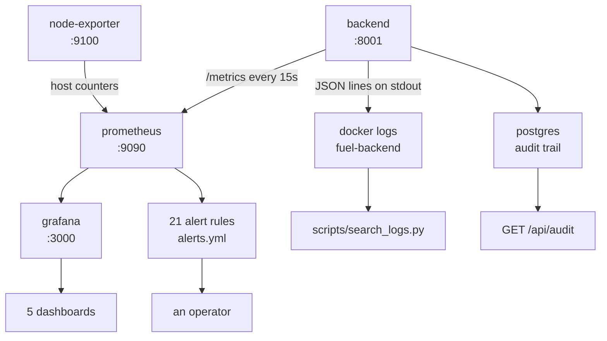
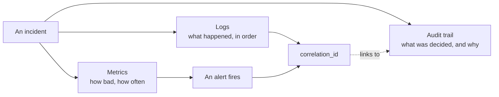

# The observability guide

Every metric the backend exposes, every dashboard, every alert rule, the
structured log format, and how to search both the audit trail and the logs.

**Code.**
[`backend/app/metrics.py`](../backend/app/metrics.py) — the metric
definitions.
[`backend/app/logging_config.py`](../backend/app/logging_config.py) — the JSON
formatter and the correlation IDs.
[`infra/prometheus/alerts.yml`](../infra/prometheus/alerts.yml) — the 21
alert rules.
[`infra/grafana/provisioning/dashboards/`](../infra/grafana/provisioning/dashboards/)
— the 5 dashboards.

---

## 1. The shape of it



Three observability surfaces, each answering a different question:

| Surface | Question it answers | Storage |
|---|---|---|
| **Metrics** | What is happening right now, and how fast? | Prometheus, 2 days / 500 MB |
| **Alerts** | What needs a human now? | Prometheus rules, as code |
| **Logs** | What exactly happened, in what order? | The container's stdout, rotated |
| **Audit trail** | What was decided, and why? | Postgres, permanently |

The split matters: **Prometheus is for signals, Postgres is for the
record.** The audit trail is not in Prometheus and the metrics are not in
Postgres.

### Prometheus's own configuration

| Setting | Value | Where |
|---|---|---|
| Scrape interval | 15 s | [`prometheus.yml`](../infra/prometheus/prometheus.yml) |
| Evaluation interval | 15 s | same |
| Retention (time) | **2 days** | `docker-compose.yml` |
| Retention (size) | **500 MB** | `docker-compose.yml` |

Three scrape jobs: `fuel-backend` (the platform's own `/metrics`),
`node` (the host's counters) and `prometheus` (its own scrape health). The
alert rules are mounted from the repository, so **a rule is code rather than
something clicked into the UI at 2am during a demo.**

---

## 2. The metric catalog

**46 metrics** in five groups. Every one is defined in
[`backend/app/metrics.py`](../backend/app/metrics.py); the descriptions below
are that file's own docstrings.

### 2.1 The backend's own HTTP surface

| Metric | Type | Labels | Meaning |
|---|---|---|---|
| `http_requests_total` | Counter | `method`, `path`, `status` | Total HTTP requests handled by the backend. |
| `http_request_duration_seconds` | Histogram | `method`, `path` | Backend HTTP request latency in seconds. |

**The `path` label is the route template, not the raw URL.** A request to
`/api/history/station-mirpur` and one to `/api/history/station-uttara` are
the same endpoint. Labelling by the raw URL made every station its own time
series, so the "request rate by path" panel filled with one-off lines that
no query could aggregate, and the metric's cardinality grew with the number
of stations rather than with the number of endpoints. A request that matched
no route falls back to the raw path — the honest answer for a 404.

### 2.2 The simulator integration

| Metric | Type | Labels | Meaning |
|---|---|---|---|
| `simulator_requests_total` | Counter | `outcome` | Requests issued to the fuel supply simulator, by outcome. |
| `simulator_request_duration_seconds` | Histogram | `endpoint` | Latency of calls to the fuel supply simulator. |
| `simulator_stale_responses_total` | Counter | — | Responses carrying the `X-Simulator-Stale` header. |
| `simulator_validation_rejections_total` | Counter | `endpoint` | Simulator responses rejected because they did not match the documented schema. |

The `outcome` label takes these values: `success`, `error`, `timeout`,
`unreachable`, `conflict`, `invalid`, `fault_injected`.

### 2.3 The circuit breaker

| Metric | Type | Labels | Meaning |
|---|---|---|---|
| `circuit_calls_refused_total` | Counter | `circuit` | Calls refused by a circuit breaker **without being sent**. |
| `circuit_calls_allowed_total` | Counter | `circuit` | Calls a circuit breaker let through. |
| `circuit_state_transitions_total` | Counter | `circuit`, `state` | Circuit breaker state transitions, by the new state. |
| `circuit_open` | Gauge | `circuit` | 1 when the circuit breaker is open, 0 otherwise. |

Only one circuit exists: `simulator`.

### 2.4 The sync service and the event stream

| Metric | Type | Labels | Meaning |
|---|---|---|---|
| `sync_cycles_total` | Counter | `outcome` | Background sync cycles, by outcome. |
| `sync_cycle_duration_seconds` | Histogram | — | Duration of a full background sync cycle. |
| `sync_cycles_coalesced_total` | Counter | — | Sync requests collapsed into a cycle that was already running. |
| `sse_connections_total` | Counter | — | SSE connections opened to the simulator event stream. |
| `sse_reconnects_total` | Counter | `reason` | SSE reconnect attempts, by reason. |
| `sse_events_total` | Counter | `event` | SSE events received from the simulator, by event name. |
| `degraded_mode_activations_total` | Counter | — | Times the backend served last-known state because the simulator was unreachable. |
| `degraded_mode` | Gauge | — | 1 when the backend is serving last-known state, 0 otherwise. |
| `stale_data` | Gauge | — | 1 when the cached state is marked stale, 0 otherwise. |
| `last_sync_age_seconds` | Gauge | — | Seconds since the last successful sync with the simulator. |
| `demand_observations_ingested_total` | Counter | `outcome` | Demand observations written to Postgres, by outcome. |

The sync `outcome` values are `success`, `failed`, `faulted` and `invalid`.

### 2.5 The intelligence layer

| Metric | Type | Labels | Meaning |
|---|---|---|---|
| `prediction_error_mae_liters` | Gauge | `model` | Mean absolute error of the demand forecast against the observed demand, by model. |
| `prediction_interval_coverage_ratio` | Gauge | `model` | Share of predictions where the actual demand fell inside the confidence interval. |
| `model_confidence` | Gauge | `model` | Mean confidence of the forecasts produced by the active model. |
| `forecasts_produced_total` | Counter | `model` | Forecasts produced, by the model that produced them. |
| `risk_assessments_total` | Counter | `level` | Risk assessments produced, by risk level. |
| `anomalies_detected_total` | Counter | `kind` | Anomalies detected, by kind. |
| `bottlenecks_detected_total` | Counter | `kind` | Bottlenecks detected, by kind. |
| `fallback_activations_total` | Counter | `reason` | Times the rule-based predictor replaced the learned model, by reason. |
| `needs_human_review_total` | Counter | `kind` | Forecasts and assessments flagged for human review, by kind. |

The `model` label is `learned` or `baseline`. The `level` label is `OK`,
`WATCH` or `CRITICAL`.

**The fallback reason labels are deliberately bounded.** A known reason keeps
its own name; anything else is bucketed as `intelligence_evaluation_failed`,
so the label cardinality stays bounded no matter what the failure text says.
The known set is:

```
intelligence_evaluation_failed
no_forecast
no_risk_assessment
intelligence_unavailable
```

### 2.6 The decision engine

| Metric | Type | Labels | Meaning |
|---|---|---|---|
| `decisions_proposed_total` | Gauge | — | Allocation recommendations proposed by the decision engine. |
| `decisions_approved_total` | Gauge | — | Allocation recommendations approved by an operator. |
| `decisions_rejected_total` | Gauge | — | Allocation recommendations rejected by an operator. |
| `decisions_submitted_total` | Gauge | — | Allocation recommendations submitted to the simulator. |
| `decisions_auto_approved_total` | Gauge | — | Allocation recommendations approved by the auto-mode, without a human. |
| `allocation_conflicts_total` | Gauge | — | Allocation submissions the simulator refused with a conflict. |
| `allocation_conflicts_by_code_total` | Gauge | `code` | Allocation submissions the simulator refused, by error code. |
| `decision_approval_rate` | Gauge | — | Share of proposed allocation recommendations that were approved. |
| `decision_fallback_activations_total` | Counter | `reason` | Times the decision engine used the rule-based fallback policy, by reason. |
| `decisions_per_minute` | Gauge | — | Allocation recommendations proposed in the last minute. |

The decision fallback's `reason` label uses the same bounded set as the
prediction fallback.

### 2.7 The kill-switch

| Metric | Type | Labels | Meaning |
|---|---|---|---|
| `ml_model_disabled` | Gauge | — | 1 when the ML kill-switch has disabled the learned model, 0 otherwise. |
| `ml_kill_switch_activations_total` | Counter | `enabled` | Times the ML kill-switch was flipped, by the new state. |
| `ml_kill_switch_fallbacks_total` | Counter | — | Forecasts served by the rule-based predictor **because the kill-switch was on**. |

`ml_kill_switch_activations_total` counts the *operator's action*.
`ml_kill_switch_fallbacks_total` counts its *consequence*. They answer
different questions and both matter.

### 2.8 The container's own memory

| Metric | Type | Labels | Meaning |
|---|---|---|---|
| `container_memory_limit_bytes` | Gauge | — | The memory limit the orchestrator enforces on this container. |
| `container_memory_usage_bytes` | Gauge | — | This container's memory working set. |
| `container_memory_fraction` | Gauge | — | This container's memory working set as a share of its limit. |

**These come from the container's own cgroup**, read directly from
`memory.max` and `memory.current` (cgroup v2) or `memory.limit_in_bytes` and
`memory.usage_in_bytes` (cgroup v1) — both are read, because which one is in
use depends on the host's kernel and not on this application.

The point of reading the cgroup rather than `docker stats` is that *these
are the numbers the orchestrator will actually use when it decides to kill
this process*. The load test used the same counter for the same reason.

### 2.9 The Python process's own metrics

The `prometheus_client` library exports its own default series, which the
System dashboard reads:

| Metric | Type | Meaning |
|---|---|---|
| `process_resident_memory_bytes` | Gauge | The process's resident memory. |
| `process_virtual_memory_bytes` | Gauge | The process's virtual memory. |
| `process_cpu_seconds_total` | Counter | CPU seconds consumed by the process. |
| `process_open_fds` | Gauge | Open file descriptors. |

`process_open_fds` has its own alert: a descriptor count that climbs without
bound is a connection leak, and leaking connections to the simulator is how
the platform ends up exhausting its pool.

---

## 3. The five dashboards

All five are provisioned from
[`infra/grafana/provisioning/dashboards/`](../infra/grafana/provisioning/dashboards/)
— 61 panels in total. The Grafana login is `admin` with the password from
`.env`.

| Dashboard | Panels | The question it answers |
|---|---|---|
| **Fuel Platform Overview** | 5 | *Is the platform up and roughly healthy?* The one-glance dashboard. |
| **Application** | 12 | *How is the backend's own HTTP surface behaving?* |
| **Integration** | 15 | *What is the platform's relationship with the simulator doing?* |
| **Intelligence** | 14 | *Is the model working, and is it trusted?* |
| **System** | 15 | *Is the machine healthy, and is the backend close to its limit?* |

### 3.1 Fuel Platform Overview — the one-glance dashboard

| Panel | Query |
|---|---|
| Backend up | `up{job="fuel-backend"}` |
| HTTP request rate by path | `sum by (path) (rate(http_requests_total[1m]))` |
| HTTP error rate (5xx) | `sum by (path) (rate(http_requests_total{status=~"5.."}[1m]))` |
| Simulator request latency (p95) | `histogram_quantile(0.95, sum by (le) (rate(simulator_request_duration_seconds_bucket[1m])))` |
| Simulator retries (fault injection) | `sum by (outcome) (rate(simulator_requests_total[1m]))` |

### 3.2 Application — the backend's own HTTP surface

**The question:** is the API fast, is it erroring, and where?

| Panel | Query |
|---|---|
| Availability | `1 - (sum(rate(http_requests_total{status=~"5.."}[5m])) / clamp_min(sum(rate(http_requests_total[5m])), 0.001))` |
| Request rate | `sum(rate(http_requests_total[1m]))` |
| Error rate | `sum(rate(http_requests_total{status=~"5.."}[5m])) / clamp_min(sum(rate(http_requests_total[5m])), 0.001)` |
| p95 latency | `histogram_quantile(0.95, sum by (le) (rate(http_request_duration_seconds_bucket[5m])))` |
| p99 latency | `histogram_quantile(0.99, sum by (le) (rate(http_request_duration_seconds_bucket[5m])))` |
| In-flight (degraded) | `degraded_mode` |
| Request rate by path | `sum by (path) (rate(http_requests_total[1m]))` |
| Latency percentiles | `histogram_quantile(0.50, sum by (le) (rate(http_request_duration_seconds_bucket[1m])))` · `histogram_quantile(0.95, sum by (le) (rate(http_request_duration_seconds_bucket[1m])))` · `histogram_quantile(0.99, sum by (le) (rate(http_request_duration_seconds_bucket[1m])))` |
| Errors by status | `sum by (path, status) (rate(http_requests_total{status=~"5.."}[1m]))` |
| Requests by status class | `sum by (status) (rate(http_requests_total[1m]))` |
| Circuit breaker | `circuit_open{circuit="simulator"}` |
| Circuit breaker calls | `sum by (circuit) (rate(circuit_calls_allowed_total[1m]))` · `sum by (circuit) (rate(circuit_calls_refused_total[1m]))` |

### 3.3 Integration — the platform and the simulator

**The question:** is the platform talking to the simulator successfully, and
what is it doing when it is not?

| Panel | Query |
|---|---|
| Simulator up | `1 - degraded_mode` |
| Simulator failures | `sum(rate(simulator_requests_total{outcome!="success"}[5m]))` |
| SSE reconnects | `sum(increase(sse_reconnects_total[15m]))` |
| Stale responses | `sum(increase(simulator_stale_responses_total[15m]))` |
| Last sync age | `last_sync_age_seconds` |
| Simulator calls by outcome | `sum by (outcome) (rate(simulator_requests_total[1m]))` |
| Simulator latency | `histogram_quantile(0.50, sum by (le) (rate(simulator_request_duration_seconds_bucket[1m])))` · `histogram_quantile(0.95, sum by (le) (rate(simulator_request_duration_seconds_bucket[1m])))` · `histogram_quantile(0.99, sum by (le) (rate(simulator_request_duration_seconds_bucket[1m])))` |
| SSE reconnects by reason | `sum by (reason) (rate(sse_reconnects_total[1m]))` |
| SSE events received | `sum by (event) (rate(sse_events_total[1m]))` |
| Sync cycles by outcome | `sum by (outcome) (rate(sync_cycles_total[1m]))` |
| Sync cycle duration | `histogram_quantile(0.95, sum by (le) (rate(sync_cycle_duration_seconds_bucket[1m])))` · `histogram_quantile(0.50, sum by (le) (rate(sync_cycle_duration_seconds_bucket[1m])))` |
| Degraded mode and stale data | `degraded_mode`, `stale_data` |
| Malformed simulator payloads | `sum by (endpoint) (rate(simulator_validation_rejections_total[5m]))` |
| Demand observations ingested | `sum by (outcome) (rate(demand_observations_ingested_total[1m]))` |
| Allocation conflicts | `allocation_conflicts_total`, `sum by (code) (allocation_conflicts_by_code_total)` |

### 3.4 Intelligence — the model

**The question:** is the learned model actually better than the baseline, and
is anything forcing it aside?

| Panel | Query |
|---|---|
| Prediction error (MAE) | `prediction_error_mae_liters{model="learned"}` · `prediction_error_mae_liters{model="baseline"}` |
| Model confidence | `model_confidence` |
| Interval coverage | `prediction_interval_coverage_ratio` |
| ML kill-switch | `ml_model_disabled` |
| Prediction error by model | `prediction_error_mae_liters` |
| Forecasts produced | `sum by (model) (rate(forecasts_produced_total[1m]))` |
| Risk assessments by level | `sum by (level) (rate(risk_assessments_total[1m]))` |
| Alert rate | `sum by (kind) (rate(anomalies_detected_total[1m]))` · `sum by (kind) (rate(bottlenecks_detected_total[1m]))` |
| Fallback activations | `sum by (reason) (rate(fallback_activations_total[5m]))` |
| Human review required | `sum by (kind) (rate(needs_human_review_total[1m]))` |
| Decision rate | `decisions_per_minute / 60` |
| Decision outcomes | proposed / approved / rejected / submitted |
| Decision fallback policy | `sum by (reason) (rate(decision_fallback_activations_total[5m]))` |
| Approval rate | `decision_approval_rate` |

The **Prediction error (MAE)** panel is the one to read first: it shows the
learned model's MAE next to the baseline's. The learned model is only in
service when it beats the baseline over the forecast horizon, and this panel
is how an operator sees that margin.

### 3.5 System — the machine

**The question:** is the host healthy, and is the backend near its ceiling?

| Panel | Query |
|---|---|
| Host CPU | `100 - (avg(rate(node_cpu_seconds_total{mode="idle"}[5m])) * 100)` |
| Host memory | `100 * (1 - (node_memory_MemAvailable_bytes / node_memory_MemTotal_bytes))` |
| Host load (1m) | `node_load1` |
| Backend memory | `container_memory_usage_bytes`, `container_memory_limit_bytes` |
| Backend memory used | `container_memory_fraction` |
| Host CPU by core | `100 - (rate(node_cpu_seconds_total{mode="idle"}[5m]) * 100)` |
| Host memory | `node_memory_MemTotal_bytes` · `node_memory_MemAvailable_bytes` · `node_memory_MemTotal_bytes - node_memory_MemAvailable_bytes` |
| Host memory in use | the percentage form |
| Backend memory against its limit | usage vs the limit |
| Host disk usage | `100 * (1 - (node_filesystem_avail_bytes{fstype!="tmpfs"} / node_filesystem_size_bytes{fstype!="tmpfs"}))` |
| Host network | `sum by (device) (rate(node_network_receive_bytes_total{device!~"lo|veth.*|docker.*|br-.*"}[5m]))` · `sum by (device) (rate(node_network_transmit_bytes_total{device!~"lo|veth.*|docker.*|br-.*"}[5m]))` |
| Host uptime and load | `node_load1`, `node_load5`, `node_load15` |
| Backend process memory | `process_resident_memory_bytes`, `process_virtual_memory_bytes` |
| Backend CPU and file descriptors | `rate(process_cpu_seconds_total[5m])`, `process_open_fds` |
| Scrape health | `up` |

**node-exporter, not cAdvisor.** cAdvisor's `/api/v1.3/docker` endpoint
returns `{}` in this environment, so Prometheus received one host-level
series with the id `/` and no per-container breakdown. It also cost 384 MB.
node-exporter reads the kernel's own counters — the same numbers `free` and
`top` report — for 32 MB, and it works. It mounts the host's root read-only
and reads every path through it, so the numbers are the host's and not the
container's.

---

## 4. The 21 alert rules

All in [`infra/prometheus/alerts.yml`](../infra/prometheus/alerts.yml), in
five groups. The file opens with its own reasoning: *"a judge can read this
file and see exactly what the platform considers a failure worth waking
someone for."*

The four the brief names explicitly are `SimulatorDown`, `HighErrorRate`,
`FallbackActive` and `StaleData`.

### 4.1 The simulator and the integration with it

| Alert | Severity | Condition | For | What it means and what to do |
|---|---|---|---|---|
| `SimulatorDown` | critical | `up{job="fuel-backend"} == 0 or degraded_mode == 1` | 1m | The backend cannot reach the simulator and has switched to degraded mode. The dashboard keeps working and shows the age of the cached data, but nothing new is arriving. **Check** the simulator is up; the platform recovers on its own. |
| `CircuitBreakerOpen` | warning | `circuit_open{circuit="simulator"} == 1` | 2m | The platform has stopped calling the simulator to avoid exhausting its connection pool. Calls are refused without being sent. **Do nothing** — the simulator gets room to recover. If it persists, the pool is still full. |
| `SimulatorHighLatency` | warning | p95 of `simulator_request_duration_seconds_bucket[5m]` > 2 | 3m | The simulator is answering, but slowly. A warning rather than a page, because the platform is still inside its request timeout. **Check** for a host under load. |
| `SimulatorMalformedData` | warning | `increase(simulator_validation_rejections_total[5m]) > 0` | 0m | A simulator response was rejected by the schema check. The platform refuses malformed data rather than storing it, so this appears as a **gap** in the data rather than as corrupted state. **Check** the backend log. |

### 4.2 The backend's own health

| Alert | Severity | Condition | For | What it means and what to do |
|---|---|---|---|---|
| `HighErrorRate` | critical | 5xx rate > 0.05 over 5m | 2m | More than 5 % of the backend's requests are failing. **Check** the backend logs for the correlation id of a failing request. |
| `BackendDown` | critical | `up{job="fuel-backend"} == 0` | 1m | The backend is down or not scrapeable. The dashboard shows its error state. **Restart** the backend. |
| `HighLatency` | warning | p95 of `http_request_duration_seconds_bucket[5m]` > 1 | 3m | The backend cannot answer the dashboard's ten-endpoint poll promptly. **Check** the aggregate path — the OOM kill looked exactly like this. |
| `BackendHighCPU` | warning | `rate(process_cpu_seconds_total[5m]) > 1.0` | 10m | Sustained high CPU usually means the platform is working hard against a dependency that is failing, or is retrying hard. **Check** the error rate and the breaker. |
| `FileDescriptorLeak` | warning | `process_open_fds > 200` | 10m | A descriptor count that climbs without bound is a connection leak. The simulator's pool is small, and leaking connections to it is how the platform exhausts it. **Check** the pool procedure. |

### 4.3 Degraded operation

| Alert | Severity | Condition | For | What it means and what to do |
|---|---|---|---|---|
| `FallbackActive` | warning | `increase(fallback_activations_total[5m]) > 0` | 0m | The learned model could not be used, so forecasts came from the rule-based profile predictor. Every forecast is flagged for human review. **Check** `/api/model-status` for the reason. |
| `DecisionFallbackActive` | warning | `increase(decision_fallback_activations_total[5m]) > 0` | 0m | There is no usable forecast, so allocations are proposed by the days-of-cover policy instead of the model-driven optimizer. Recommendations are capped in confidence and need a human. |
| `StaleData` | warning | `stale_data == 1` | 2m | The simulator served data with the stale header. The cached copy is **dropped** rather than relabelled, so the dashboard shows the gap instead of passing off old numbers as new ones. **Let** the next cycle catch up. |
| `SyncStalled` | warning | `last_sync_age_seconds > 60` | 1m | The background sync has not reached the simulator recently. The dashboard is showing cached data over a minute old. **Check** the simulator and the breaker. |
| `MLModelDisabled` | warning | `ml_model_disabled == 1` | 0m | An operator turned the learned model off. **This is a decision, not a fault.** If you did not turn it on, `POST /admin/reset` clears it. |

### 4.4 The machine

| Alert | Severity | Condition | For | What it means and what to do |
|---|---|---|---|---|
| `ContainerHighMemory` | warning | `container_memory_fraction > 0.85` | 5m | The backend is close to the memory ceiling Docker enforces, and will be killed if it keeps growing. This is the number the orchestrator uses, read from the container's own cgroup. **Free** memory on the host. |
| `HostMemoryHigh` | warning | Host memory above 90 % used | 5m | The machine is shared with other projects' stacks. At this level the next stack to start will push the host into swap, which is what makes the desktop feel frozen. **Stop** the monitoring profile first. |
| `HostDiskHigh` | warning | A filesystem above 85 % full | 5m | A full disk stalls the Docker daemon itself, and every service on the machine with it. Every container here rotates its logs, so this is more likely to be something outside this stack. |
| `HostLoadHigh` | warning | Load average above the core count | 10m | The scheduler is the bottleneck, not any one service. Every measurement taken at this load level is not comparable with one taken on an idle machine. **Stop** other stacks, then re-measure. |

### 4.5 The observability stack

| Alert | Severity | Condition | For | What it means and what to do |
|---|---|---|---|---|
| `PrometheusNotScraping` | critical | `up{job="prometheus"} == 0` | 2m | The observability stack is not working; the dashboards are blind. **Restart** Prometheus. |
| `NodeExporterDown` | warning | `up{job="node"} == 0` | 2m | node-exporter is not answering. The System dashboard has no host numbers, though the backend's own metrics are still being scraped. **Restart** node-exporter. |
| `PrometheusStorageHigh` | warning | `prometheus_tsdb_storage_blocks_bytes > 400 MB` | 5m | Prometheus keeps two days and 500 MB, so this is the retention limit approaching. It is bounded on purpose: an unbounded Prometheus fills the disk, and a full disk stalls the Docker daemon for every stack on the machine. |

### 4.6 Why `for:` matters

The `for` window is the time a condition must hold before the alert fires.
It is what separates a blip from a fault:

| `for` | Alerts | Meaning |
|---|---|---|
| `0m` | `SimulatorMalformedData`, `FallbackActive`, `DecisionFallbackActive`, `MLModelDisabled` | Fires on the first occurrence. These are *events*, not conditions — one malformed payload or one fallback is worth knowing about immediately. |
| `1m` | `SimulatorDown`, `BackendDown`, `SyncStalled` | A dependency is down. Long enough to not fire on a single dropped request, short enough to matter. |
| `2m` | `CircuitBreakerOpen`, `HighErrorRate`, `StaleData`, `PrometheusNotScraping`, `NodeExporterDown` | A sustained condition. The breaker being open for two minutes is a different problem from one blip. |
| `3m` | `SimulatorHighLatency`, `HighLatency` | Latency needs to persist to be a problem. |
| `5m` | `ContainerHighMemory`, `HostMemoryHigh`, `HostDiskHigh`, `PrometheusStorageHigh` | Resource exhaustion is slow. |
| `10m` | `HostLoadHigh`, `BackendHighCPU`, `FileDescriptorLeak` | These are trends, not blips. |

---

## 5. The structured logs

The backend emits **one JSON object per line** on stdout. There is no second
log store: `grep` and `jq` are enough.

### 5.1 The format

Every line has these five keys, from
[`logging_config.py`](../backend/app/logging_config.py):

| Key | What it is |
|---|---|
| `timestamp` | `%Y-%m-%dT%H:%M:%S%z` |
| `level` | `INFO`, `WARNING`, `ERROR`, … |
| `logger` | The Python logger's name — `app.sync_service`, `app.simulator_client`, … |
| `message` | The log message |
| `correlation_id` | The unit of work's ID, or `-` if there is none |

Anything passed through `extra=` becomes a **top-level key**, so a log line
is self-describing without a second parsing step. A traceback is added as
`exception` when there is one.

The JSON is dumped with `sort_keys=False`, so the five standard keys stay
first and the `extra=` keys follow in the order they were added.

### 5.2 Correlation IDs

A correlation ID is `cid-` plus 12 hex characters of a UUID4
(`f"{prefix}-{uuid.uuid4().hex[:12]}"`). The prefix names the kind of work:

| Prefix | Bound in | What it covers |
|---|---|---|
| `sync` | `sync_service.py` | One background sync cycle |
| `sse` | `sync_service.py` | One SSE event-stream session |
| `demand` | `sync_service.py` | One demand-ingest pass |

The ID lives in a `contextvars.ContextVar`, so **concurrent tasks never
overwrite each other's ID**. That is what makes a single sync cycle
reconstructable from the logs alone.

### 5.3 The structured fields

53 field names are used across the backend. The ones an operator reaches for:

| Field | Where | What it tells you |
|---|---|---|
| `correlation_id` | `sync_service` | The unit of work |
| `event` | `sync_service` | The event type |
| `kind` | `sync_service` | The alert kind |
| `severity` | `sync_service` | The alert severity |
| `entity_id` | `sync_service` | The station or depot concerned |
| `sim_tick`, `world_tick`, `current_tick`, `incoming_tick`, `stream_tick` | `sync_service`, `state_cache` | The clock — and the rewind detection |
| `cached_tick`, `stored_max_tick` | `state_cache`, `sync_service` | The clock comparison that detects a rewound world |
| `duration_seconds` | `sync_service` | The sync cycle's length |
| `history_seconds`, `persist_seconds`, `alerts_seconds`, `intelligence_seconds` | `sync_service` | The split of that cycle |
| `status_code`, `path`, `attempt`, `error` | `sync_service`, `simulator_client` | A failed simulator call |
| `component`, `error`, `stale` | `sync_service` | Which dependency failed |
| `code`, `payload` | `simulator_client`, `sync_service` | The simulator's error code and body |
| `critical` | `sync_service` | Whether an alert was critical |
| `circuit`, `circuit_state`, `previous_state`, `failure_count` | `circuit_breaker` | The breaker's transitions |
| `reason` | `intelligence_service` | Why the fallback engaged |
| `kill_switch`, `fault` | `forecasting`, `intelligence_service` | The model state |
| `station_id`, `fuel_type`, `quantity`, `route_id`, `allocation_id`, `recommendation_id`, `error_code` | `dispatcher`, `service` | A decision |
| `training_rows`, `validation_mae` | `forecasting`, `sync_service` | A training run |
| `horizon_total_mae_liters`, `baseline_horizon_total_mae_liters` | `forecasting` | The model's MAE over the forecast horizon, and the baseline's to compare it against |
| `models_used` | `sync_service` | Which models answered |
| `rows`, `rows_removed`, `limit`, `floor_seconds`, `waited_seconds`, `grace_seconds`, `cleared`, `watch` | `sync_service`, `main`, `service` | Retention and lifecycle bookkeeping |

**The four split timings are the ones worth knowing.** The sync cycle logs
`duration_seconds` alongside `history_seconds`, `persist_seconds`,
`alerts_seconds` and `intelligence_seconds`. That split is what found the
OOM kill in the first place — the intelligence evaluation was taking 9.9 s
of a 10.25 s cycle, which pointed straight at the aggregate.

### 5.4 What the logs deliberately do not contain

The **decision rationale is not in the logs** — it is in the audit trail, in
Postgres, with the full `inputs_snapshot`. The logs carry the correlation
ID that links to it. That split is why the audit trail exists: a log line
is a moment, an audit row is a decision.

---

## 6. Searching the audit trail

`GET /api/audit` presents **one search over three trails**. The platform
writes decisions, domain events and alerts to three separate tables; this
endpoint presents them as one stream, so an operator can ask "what happened
to this station?" once instead of joining three tables by hand.

### 6.1 The parameters

| Parameter | Type | What it does |
|---|---|---|
| `q` | string | Full-text search over the trail |
| `source` | `decision`, `event`, `alert` | Comma-separated; which trails to search |
| `kind` | string | Comma-separated kinds |
| `status` | string | Comma-separated statuses |
| `entity_id` | string | One station or depot |
| `since` / `until` | ISO-8601 datetime | The time window |
| `limit` | 1–1000, default 200 | How many entries to return |

Every filter is optional and they compose.

### 6.2 Example queries

```bash
# Everything about one station
curl -s "$BACKEND/api/audit?entity_id=station-karnaphuli" | jq

# Every critical alert in the last hour
curl -s "$BACKEND/api/audit?source=alert&status=critical&since=2026-11-24T10:00:00Z" | jq

# Every mention of "route" in any trail
curl -s "$BACKEND/api/audit?q=route" | jq

# Only the decision trail, for one station, newest first
curl -s "$BACKEND/api/audit?source=decision&entity_id=station-mirpur" | jq '.entries[:5]'

# How many entries matched
curl -s "$BACKEND/api/audit?q=allocation" | jq '.summary'
```

### 6.3 The response shape

The response carries the entries **and** a summary, so a search can be read
at a glance ("312 alerts, 47 of them critical") before drilling into
individual rows.

| Entry field | What it is |
|---|---|
| `source` | `decision`, `event` or `alert` |
| `id` | The row's own identifier |
| `at` | When it happened, ISO-8601 |
| `kind` | What kind of thing it is |
| `status` | The status it ended in |
| `entity_id` | The entity it concerns, if any |
| `message` | The human-readable explanation |
| `payload` | Everything else, as a JSON object |

### 6.4 The summary's scope

The summary says what it covers, and this is the part that was wrong once:

- A **facet query** (how many critical alerts) counts the **whole table**.
  Its `scope` is `"table"`.
- A **full-text search** (`?q=...`) counts the **newest slice** the search
  looked at. Its `scope` is `"window"`, with the size in `window_rows` — the
  same slice the page returned, so the total and the entries always describe
  the same rows.

The count query was left on the unbounded whole-table shape while the page
moved to a bounded window, so the two described different sets of rows — and
the unbounded count was the endpoint's dominant cost. The decision trail's
`inputs_snapshot` is a **2.4 KB JSON document per row — 63 MB across 61,951
rows** — so counting the matches meant reading all of it: **2,171 ms**. The
count now uses the same window as the page.

The endpoint now answers **every query shape in under 0.7 s, against 152,129
audit rows**.

### 6.5 The three trails

| Source | Table | Kind column | Status column | Entity column |
|---|---|---|---|---|
| `decision` | `recommendations` | `risk_level` | `status` | `station_id` |
| `event` | `domain_events` | `type` | `status` | `parameters->>'entity_id'` |
| `alert` | `alerts` | `kind` | `severity` | `entity_id` |

The event trail's entity filter reaches **into the JSON document** rather
than into a column, because an event's entity is not a column on the table.

---

## 7. Searching the logs

### 7.1 `scripts/search_logs.py`

The friendly front end to the JSON logs. It reads the container's log
stream and answers the questions an operator actually asks after an incident.

```bash
scripts/search_logs.py                       # the last 200 lines, summarised
scripts/search_logs.py --level ERROR         # only the errors
scripts/search_logs.py --correlation cid-abc # one unit of work
scripts/search_logs.py --event-type simulation.tick --since 2026-11-24T10:00:00Z
scripts/search_logs.py --contains "circuit"  # full-text search
scripts/search_logs.py --tail 5000 --json    # machine-readable output
```

| Flag | What it does |
|---|---|
| `--tail N` | How many lines to read (default 2000) |
| `--level` | Only this level (`INFO`, `WARNING`, `ERROR`) |
| `--correlation` | Only this correlation id |
| `--event-type` | Only this structured `event` / `event_type` / `kind` value |
| `--contains` | Full-text search over the whole record |
| `--since` / `--until` | ISO-8601 bounds |
| `--minutes N` | Only entries from the last N minutes |
| `--json` | Machine-readable output |
| `--limit N` | How many entries to print (default 50) |

Without `--json` it prints a summary: the total, a breakdown by level, the
top ten loggers, the ten most common messages, and the first twenty
correlation IDs found.

### 7.2 The raw form

The script is a convenience. The logs are plain JSON on stdout, so `docker
logs` and `jq` do the same job:

```bash
# the last 200 lines, as JSON
docker compose logs --no-color backend | tail -200 | jq -c .

# every error in the last 500 lines
docker compose logs --no-color backend | tail -500 | jq -c 'select(.level=="ERROR")'

# everything for one unit of work
docker compose logs --no-color backend | jq -c 'select(.correlation_id=="cid-abc123def456")'

# full-text search across the whole record
docker compose logs --no-color backend | jq -c 'select(tostring | test("circuit"))'

# just the timestamps and messages, for a quick read
docker compose logs --no-color backend | jq -r '"\(.timestamp) \(.level) \(.message)"'
```

A line that is not JSON is kept as a raw message rather than dropped —
the container's start-up banner is plain text, and dropping it would hide
the fact that the service just restarted.

### 7.3 The audit trail and the logs, together

They answer different questions, and the correlation ID is the bridge:



The alert gives you the `correlation_id` to search the logs with; the logs
give you the `recommendation_id` and `entity_id` to search the audit trail
with.

---

## 8. The resource budget

### 8.1 Per container

The machine has **7.1 GB of RAM** and about 2.5 GB free for Docker, and it
is shared with other projects' stacks. The compose file is the contract
with that machine.

| Service | Memory limit | CPUs | Actual usage | Profile |
|---|---|---|---|---|
| `fuel-simulator` | 384 MB | 0.75 | 65 MB | core |
| `fuel-backend` | 384 MB | 1.00 | 81 MB | core |
| `fuel-postgres` | 256 MB | 0.75 | 96 MB | core |
| `fuel-frontend` | 64 MB | 0.25 | 15 MB | core |
| `fuel-prometheus` | 192 MB | 0.50 | 99 MB | monitoring |
| `fuel-grafana` | 192 MB | 0.50 | 51 MB | monitoring |
| `fuel-node-exporter` | 32 MB | 0.10 | 10 MB | monitoring |
| **Total** | **1.5 GB** | | **417 MB** | |

Verified with `docker inspect` — every service carries `mem_limit`, `cpus`,
`pids_limit`, `restart: unless-stopped` and log rotation (`json-file`,
`10m × 3`).

The **core profile alone** is 4 containers and **281 MB**. The full stack
with monitoring is 7 containers and **417 MB**.

### 8.2 Why Postgres needed tuning

A `mem_limit` does not make Postgres small; it sizes its buffers from the
*host's* RAM. The database runs with `shared_buffers=64MB`,
`effective_cache_size=128MB`, `maintenance_work_mem=16MB`, `work_mem=2MB`
and `max_connections=30`, which is what actually puts it inside its 256 MB
budget.

### 8.3 Log rotation

Every container rotates its logs: `json-file`, `max-size: 10m`,
`max-file: 3`. A chatty service cannot fill the disk, which matters because
a full disk stalls the Docker daemon for **every** stack on the machine.

### 8.4 Prometheus's own budget

Prometheus keeps a time series per container, so it is the one service that
grows with the number of running containers. It is capped at **192 MB**,
lives behind the `monitoring` profile, and its retention is bounded at
**2 days and 500 MB**.

### 8.5 The backend's measured peak

Under the Day 6 load test, the backend's **peak memory was 102 MB** against
its 384 MB limit, and its peak CPU was **0.060 cores** against its 1.0-core
quota — on the dashboard's read path, the workload that drives every open
browser tab.

The load test read both from the container's own cgroup, the same counter
Docker enforces when it decides to kill a container.

---

## 9. Limitations

1. **No metric here has been scraped as part of writing this document.**
   The 46 definitions, their types, labels and docstrings were read out of
   `backend/app/metrics.py`. The 5 dashboards and their 61 panels and
   PromQL were read out of the provisioned JSON. The 21 alert rules were read
   out of `alerts.yml`. The budget table was read out of
   `docs/progress/day6.md`. None of it was re-measured against a running
   stack.

2. **The metric list is not the whole `/metrics` output.** The
   `prometheus_client` library exports its own default series on top of the
   46 defined here. §2.9 lists the four the System dashboard actually
   reads; the full default set is longer.

3. **The `path` label is a route template.** It only exists for requests
   that matched a route. A 404 falls back to the raw path, so a burst of
   404s can raise the metric's cardinality — the raw path is unbounded.

4. **Prometheus's retention is 2 days.** A question about something that
   happened three days ago cannot be answered from the metrics. The audit
   trail in Postgres is the durable record, and it has no such limit.

5. **The audit trail's full-text search is windowed, not exhaustive.** A
   `?q=` search counts and pages over the newest slice, and the summary says
   so through `scope: "window"`. The facet counts are whole-table. This is
   deliberate, and the reason is in §6.4.

6. **The logs are the container's stdout.** They are bounded by the log
   rotation — 30 MB per container — and are lost when the container is
   recreated. The audit trail is the durable record.

7. **`scripts/search_logs.py` needs Docker.** It reads
   `docker logs fuel-backend --tail N`. On a host where the backend runs
   outside a container, use the `docker compose logs` and `jq` form in §7.2
   instead.

8. **There is no Loki, and no second log store.** The decision was made on
   Day 6 and is recorded as ADR 0011: the audit trail lives in Postgres,
   where it is queryable with SQL and joins with the decision history. The
   cost is that the *logs* are not searchable by anything other than
   `grep`/`jq` over the rotated file.

---

## Related documents

- [`docs/runbook.md`](runbook.md) — the operating procedures and the alert actions
- [`docs/resilience-report.md`](resilience-report.md) — all 17 scenarios, measured
- [`docs/load-test-report.md`](load-test-report.md) — the load runs and the cgroup measurements
- [`docs/api-reference.md`](api-reference.md) — all 35 routes, including `/api/audit`
- [`docs/adr/0009-node-exporter-instead-of-cadvisor.md`](adr/0009-node-exporter-instead-of-cadvisor.md)
  — why node-exporter
- [`docs/adr/0011-no-loki-audit-in-postgres.md`](adr/0011-no-loki-audit-in-postgres.md)
  — why the audit lives in Postgres
- [`docs/bug-catalog.md`](bug-catalog.md) — the bugs these metrics were built to catch
- [`docs/progress/day6.md`](progress/day6.md) — the day the observability stack was built
