# Operator user guide

The dashboard, screen by screen.

This is the manual for the person sitting in front of the platform: what each
screen shows, how to read a risk level, how to approve or reject a
recommendation, what the `DEGRADED` and `STALE` banners mean, and how to do
the common tasks.

**Where the facts come from.** Every rule, threshold and label here was read
out of the running code: the nine view components in
[`frontend/src/views/`](../frontend/src/views/), the shell and banner in
[`frontend/src/components/AppShell.tsx`](../frontend/src/components/AppShell.tsx),
the API client in [`frontend/src/api.ts`](../frontend/src/api.ts), and the
backend that serves them. The screenshots are the ones the project's own
Playwright test captures
([`frontend/e2e/screenshots.spec.ts`](../frontend/e2e/screenshots.spec.ts)).

**The one rule that governs everything else.** The platform proposes; a human
disposes. Nothing reaches the simulator until someone presses **Approve**. Every
recommendation card carries the banner *"Simulated environment. Human review
required."* because this is a simulation and every shipment in it is a
simulation of a shipment.

---

## 0. Before you start

### 0.1 Opening the dashboard

```bash
cp .env.example .env      # then edit the passwords in .env
docker compose up --build
```

| Service | URL |
|---|---|
| Operator dashboard | http://localhost:5173 |
| Backend API | http://localhost:8001 |

The full procedure, including how to put the world back to a known state, is
in the [runbook](runbook.md). The [demo script](demo-script.md) is a
fourteen-step walkthrough of the same screens in a story order.

### 0.2 How the dashboard gets its data

The dashboard **polls**, it does not hold a stream open. The reasoning is in
[`frontend/src/hooks/usePolled.ts`](../frontend/src/hooks/usePolled.ts): the
backend's read paths are already served from the cache the background sync
keeps fresh, so a poll is cheap, and *a poll cannot leave the dashboard
showing a stale frame forever the way a dropped stream can*.

| Data | Poll interval |
|---|---|
| State, risk, alerts, recommendations, decision history, decision settings, simulation | **5 s** |
| Health, forecasts, service health | **10 s** |

The hook keeps three things apart, and that is why a failure shows as a
warning next to real data rather than as an empty screen:

- **the data** — survives a failed refresh, so you keep looking at the last
  known state, with its age;
- **the error** — shown beside the data, not instead of it;
- **loading** — true only before the *first* load.

### 0.3 The shell

Every screen sits inside the same frame.

- **Left rail** — the nine screens, each with a one-line hint.
- **Top bar** — the simulation's tick, its simulated time, its status, the
  service level, the age of the data, and a **Failed decisions** counter that
  appears only when it is non-zero.
- **Banner strip** — see [§10](#10-the-banners-degraded-stale-and-fallback).
  It is below the top bar and above the content, on every screen.

The top bar's status pill is colour-coded by the simulator's own status
(`RUNNING`, `PAUSED`, `STOPPED`, …). If it says `PAUSED`, the world is not
advancing — that is a simulator state, not a platform fault.

### 0.4 The narrow layout

Below roughly 430 px the rail collapses behind the **☰** button and the
screens stack into one column. The layout is checked at 430 px by one
Playwright test.

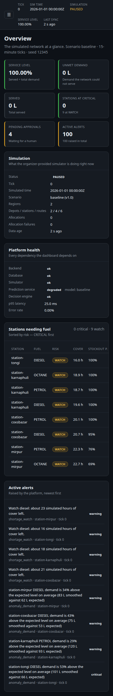

---

## 1. Overview

*The first screen. Where the simulation is, how well the network is serving
demand, what needs attention, and whether the platform itself is healthy.*

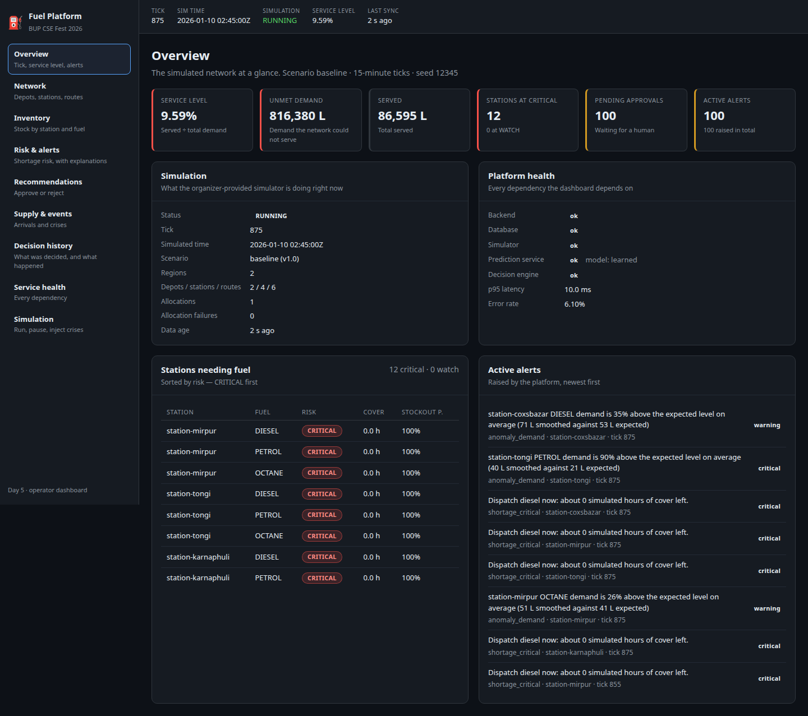

### 1.1 What it shows

**Six metric tiles** across the top:

| Tile | What it means | Tone |
|---|---|---|
| Service level | Served ÷ total demand | good ≥ 99 %, warn ≥ 90 %, else bad |
| Unmet demand | Demand the network could not serve | bad if above zero |
| Served | Total served | neutral |
| Stations at CRITICAL | Count, with the WATCH count as its hint | bad if above zero |
| Pending approvals | Waiting for a human | warn if above zero |
| Active alerts | With the total ever raised as its hint | warn if above zero |

Then two panels side by side:

- **Simulation** — the simulator's status, tick, simulated time, scenario id
  and version, how many regions / depots / stations / routes there are, the
  allocation count, the **allocation failures** count, and the age of the data.
- **Platform health** — backend, database, simulator, prediction service and
  decision engine, each with a status pill. The prediction service row also
  names the **active model** (`learned` or `baseline`). The panel closes with
  the p95 latency and the error rate.

Then two more panels:

- **Stations needing fuel** — the risk table, sorted by risk score, worst
  first, **top 8 only**. Columns: Station, Fuel, Risk, Cover, Stockout p.
- **Active alerts** — alerts that are not yet resolved, newest first, top 8.

### 1.2 How to read it

Start at the **Stations at CRITICAL** tile. If it is zero and **Pending
approvals** is not, your job today is the approvals queue, not the network.

**Service level** is the headline operational number, but read it with the
supply ceiling in mind: the simulator's total supply is about **25 % below**
its total demand, so service level cannot reach 1.0. A service level of
88.2 % is the measured result of the recorded six-day run — see
[model-evaluation.md](model-evaluation.md). Do not read it as a percentage of
what is achievable.

**Allocation failures** is the number that says the simulator refused a
write. It should be zero.

### 1.3 Common tasks

| Task | Where |
|---|---|
| Find out what needs fuel now | The **Stations needing fuel** table → then **Risk & alerts** for the explanation |
| See what is waiting on you | **Pending approvals** tile → then **Recommendations** |
| Check the platform is healthy | **Platform health** panel → then **Service health** |
| Check what is going wrong | **Active alerts** panel → then **Risk & alerts** |

---

## 2. Network

*The network as a picture: two depots on the left, four stations on the right,
and the six routes between them.*

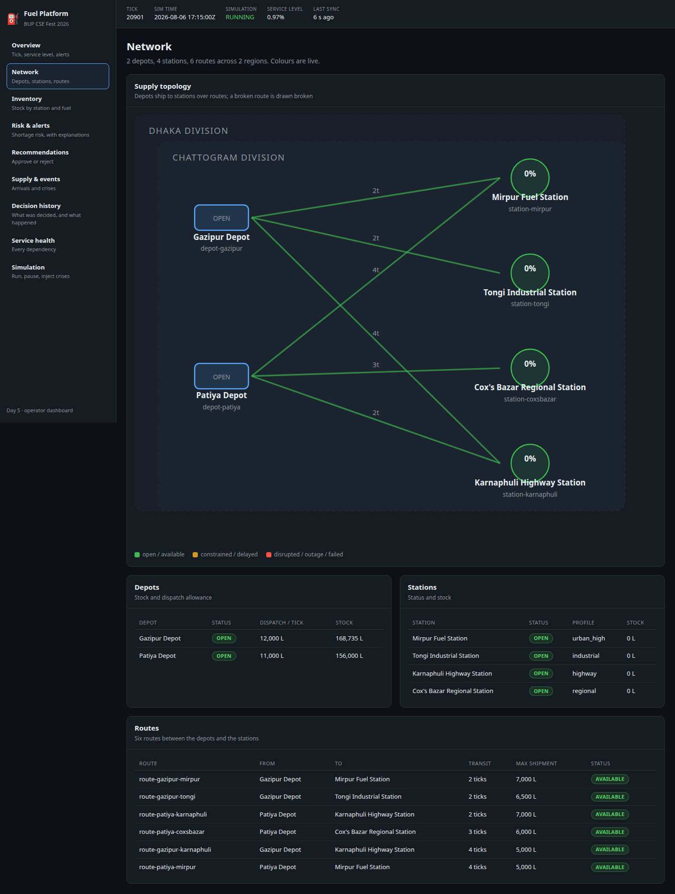

### 2.1 What it shows

A fixed-layout SVG board — **not** force-directed, because the topology is
known and small, and a stable picture is more readable than one that moves
every time a fuel level changes.

The board draws **live** state:

| Element | Drawn as | Means |
|---|---|---|
| Depot | Rectangle | Amber when `CONSTRAINED` |
| Station | Circle | **Hollow with a strike-through** when in `OUTAGE`; otherwise filled, with its fill percentage printed inside |
| Route | Line | **Dashed and struck through** when `DISRUPTED`; otherwise solid |
| Route label | Text | The transit time in ticks |
| Region | Bordered rectangle | The region the entities sit in |

Below the board is a legend: **open / available**, **constrained / delayed**,
**disrupted / outage / failed**.

Underneath, three tables:

- **Depots** — name, status, dispatch allowance per tick, total stock.
- **Stations** — name, status, demand profile, total stock.
- **Routes** — route id, from, to, transit in ticks, max shipment, status.

### 2.2 How to read it

The board answers one question quickly: **is the problem supply-side or
demand-side?**

- A **broken route** (dashed, struck) with a healthy station means the fuel
  exists but cannot get there. The platform's alternatives and backup routes
  matter here.
- A **station in outage** (hollow, struck) means it cannot serve or receive.
  No allocation to it will help until the outage clears.
- An **amber depot** means the depot is under a constraint — its dispatch
  allowance per tick is the limit on how fast anything can move.

The route **max shipment** column is the per-shipment ceiling. A demand spike
large enough to need more than one shipment gets **split** across several;
the engine handles that, and the recommendation card shows the split.

### 2.3 Common tasks

| Task | Where |
|---|---|
| Check whether a route is broken | The board's dashed edges → **Routes** table for the status |
| Check how fast a depot can ship | **Depots** table, *Dispatch / tick* column |
| Find out why a route was chosen | **Recommendations** → *Show N alternatives* |

---

## 3. Inventory

*Every tank and every depot, per fuel — with a fill bar and the hours of
cover left.*

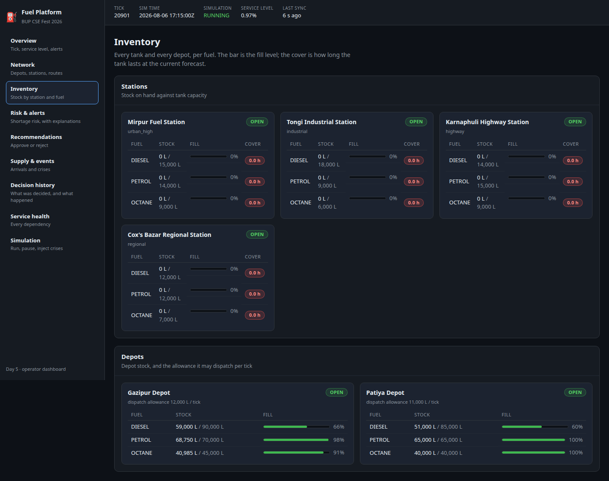

### 3.1 What it shows

Two panels.

**Stations** — one card per station. The header carries the station's name,
its demand profile and its status. Under it, one row per fuel type
(`DIESEL`, `PETROL`, `OCTANE`):

| Column | Meaning |
|---|---|
| Fuel | The fuel type |
| Stock | On hand ÷ tank capacity |
| Fill | A bar, plus the percentage |
| **Cover** | How long the tank lasts at the current forecast — as a coloured pill carrying the **risk level** |

**Depots** — one card per depot, one row per fuel, with stock and fill. The
depot's **dispatch allowance per tick** is in the card header. Depot fill bars
are coloured by fill fraction alone: red below 20 %, amber below 40 %, green
above.

### 3.2 How to read it — the number that matters is cover, not fill

> A tank at 40 % with three hours of cover is the tank that needs fuel now.

The two numbers disagree on purpose. **Fill** is how full the tank is.
**Cover** is how long it lasts at the forecast rate of consumption. A
low-capacity tank can be nearly empty and still have days of cover; a
high-capacity tank can be half full and still run dry in an hour if demand
spiked.

The cover pill is coloured by risk level, so the Inventory screen and the
Risk screen agree.

**Cover is `—`** when the stock survives the whole forecast horizon. That is
the good case: the platform reports no hours-to-stockout because there is
none.

### 3.3 Common tasks

| Task | Where |
|---|---|
| Find the tank that needs fuel first | Sort by eye: red cover pills first |
| Check a depot's dispatch capacity | **Depots** panel, card header |
| See why a tank is at risk | **Risk & alerts** → the station's row |

---

## 4. Risk & alerts

*Every shortage risk, worst first, with an explanation for every number.*

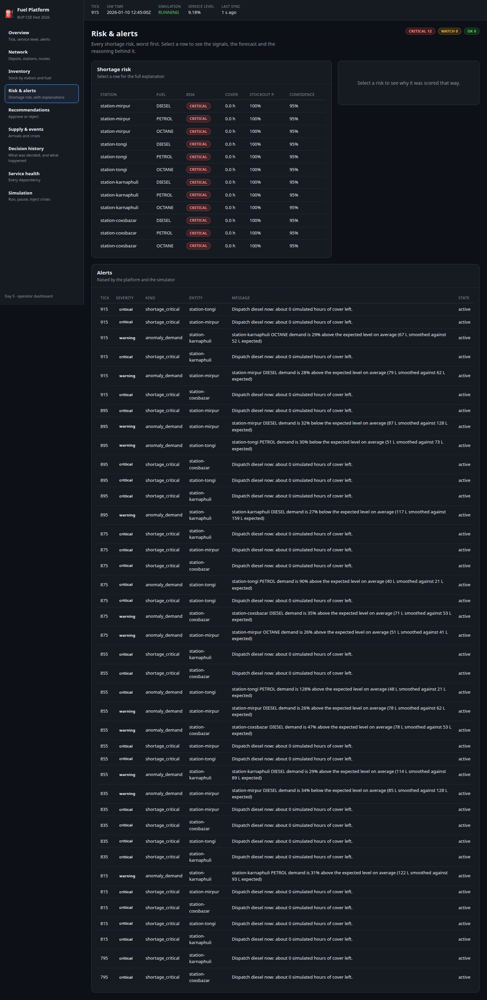

### 4.1 What it shows

Header pills count the rows: `CRITICAL n`, `WATCH n`, `OK n`.

The **Shortage risk** table is sorted worst-first — by risk level
(CRITICAL → WATCH → OK), then by hours-to-stockout ascending within a level.
Columns: Station, Fuel, Risk, Cover, Stockout p., Confidence.

Selecting a row opens the **explanation drawer** on the right.

Below both, the **Alerts** table — the last 40 alerts, with tick, severity,
kind, entity, message, and whether the alert is active or resolved.

### 4.2 The explanation drawer

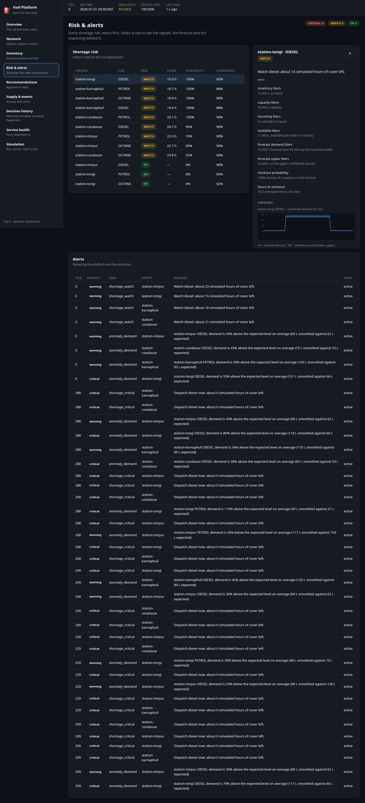

The drawer's purpose is that **no number on this screen is a black box**. It
has three sections:

| Section | What is in it |
|---|---|
| **Why** | The signals that drove the score — each with a name and a plain-language detail |
| **Forecast** | A chart of predicted demand per tick, plus the model name, the horizon in ticks, total demand, and the confidence interval (lower – upper) |
| **Numbers** | Hours to stockout, stockout probability, risk score, forecast demand, forecast upper bound, and whether it needs human review |

The drawer's lead line is the recommendation the intelligence layer would
make — the same sentence that appears on the recommendation card.

The drawer also reports the **model** used. If the forecast came from the
rule-based predictor, the drawer says `fallback: <reason>`. The reasons are
the platform's own words and they are listed in
[Service health](#8-service-health).

### 4.3 How to read a risk level

The bands come from
[`backend/app/intelligence/risk.py`](../backend/app/intelligence/risk.py).

| Level | When it applies |
|---|---|
| **CRITICAL** | The station **will run dry within 8 hours** (`CRITICAL_HOURS = 8.0`) |
| **WATCH** | It will run dry, but not imminently — between 8 and 24 hours (`WATCH_HOURS = 24.0`) |
| **WATCH** | Or it survives the horizon, but the stockout probability is at or above **25 %** (`WATCH_PROBABILITY = 0.25`) |
| **OK** | It survives the horizon with a probability below 25 % |

Two things are worth knowing:

**Time to stockout decides CRITICAL; probability only separates OK from
WATCH.** A certain stockout sixteen hours away is not the same emergency as
one two hours away, and a rule that cannot tell them apart produces alerts
nobody can act on. So probability is *not* what makes a station red — the
hours are.

**Available stock counts what is already in transit.** The available stock
used for the risk calculation is the station's on-hand inventory **plus**
fuel already in transit to that station, because an allocation that has
departed will arrive.

> **A caveat.** The `WATCH_HOURS = 24.0` constant exists in the code, but the
> 24-hour WATCH boundary documented in [model-evaluation.md](model-evaluation.md)
> §4.1 is **not** what the code does. The implementation is the truth. This is
> recorded as a discrepancy in
> [known-limitations-and-roadmap.md](known-limitations-and-roadmap.md) §2.6.

**Stockout probability** is derived from the forecast's confidence interval:
if the lower bound of cumulative demand exceeds the available stock, a
stockout is certain. The interval comes from a mean absolute error scaled by
the known shape — it is **not** a calibrated predictive distribution, and the
probability inherits that. Read a probability of 100 % as *"the forecast's own
lower bound says it runs out"*, not as a guarantee.

**Confidence** is the forecast's confidence, not the risk's. A low-confidence
forecast is why `needs_human_review` gets set.

### 4.4 Common tasks

| Task | Where |
|---|---|
| Understand why a station is red | Click the row → the **Why** section of the drawer |
| See the forecast behind the risk | The drawer's **Forecast** section |
| Find the alerts, not the risks | The **Alerts** table at the bottom |
| Act on a CRITICAL station | **Recommendations** → find the matching card |

---

## 5. Recommendations

*The decision queue. This is where the operator works.*

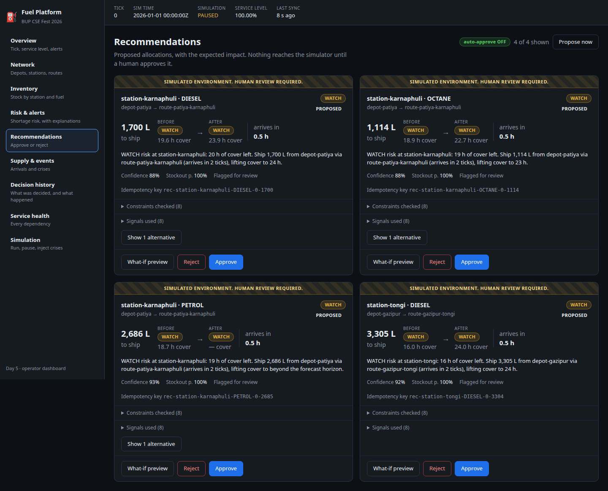

### 5.1 What it shows

The header carries three things:

- a pill reading **auto-approve ON** or **auto-approve OFF**;
- a count, *n of m shown*;
- a **Propose now** button, which asks the engine to produce a fresh set of
  proposals immediately rather than waiting for the next sync cycle.

If the rule-based policy is in use, a **FALLBACK** banner explains why.

Cards are shown **12 at a time**, with a *Show 12 more* button underneath.

### 5.2 One card, field by field

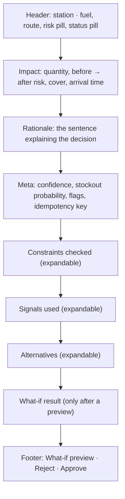

| Field | How to read it |
|---|---|
| **Banner** | *"Simulated environment. Human review required."* — on every card, always |
| **Route** | `depot → route`, e.g. `depot-patiya → route-patiya-karnaphuli` |
| **Risk pill** | The station's risk level now |
| **Status pill** | `PROPOSED`, `APPROVED`, `REJECTED`, `SUBMITTED`, `ARRIVED`, `FAILED` |
| **Quantity** | Litres to ship |
| **Before → After** | The risk level and hours of cover *before* and *after* this allocation, and when it arrives |
| **Rationale** | A generated sentence naming the station, the cover, the quantity, the depot, the route and the arrival |
| **Confidence** | The forecast's confidence. It is rarely 1.0, and the platform does not pretend otherwise |
| **Stockout p.** | The probability the tank runs out without this shipment |
| **Rule-based policy** | Present when the fallback produced this recommendation |
| **Flagged for review** | Present when the intelligence layer wants a human to look closely |
| **Idempotency key** | A deterministic key — see [§7](#7-decision-history) |
| **Constraints checked** | The eight simulator rules the platform pre-validated, each ✓ or ✗ with a reason — see [§5.3](#53-the-eight-constraints-checked) |
| **Signals used** | The inputs that drove the score |
| **Alternatives** | The routes that were considered and rejected, with reasons and transit times |
| **What-if result** | Appears only after a preview — see [§5.6](#56-the-what-if-preview) |

### 5.3 The eight constraints checked

The platform pre-validates every rule the simulator enforces, so a proposal
that would be rejected is caught before it is sent. They are checked in the
simulator's own order, and the first failure wins:

| # | Code | What it means |
|---|---|---|
| 1 | `ROUTE_MISMATCH` | The route does not connect the depot and the station |
| 2 | `DEPOT_CLOSED` | The depot is neither OPEN nor CONSTRAINED |
| 3 | `STATION_CLOSED` | The station is not OPEN |
| 4 | `ROUTE_DISRUPTED` | The route is not AVAILABLE |
| 5 | `ROUTE_CAPACITY_EXCEEDED` | The quantity is greater than the route's `max_shipment` |
| 6 | `INSUFFICIENT_INVENTORY` | The depot does not hold enough fuel |
| 7 | `DISPATCH_CAPACITY_EXCEEDED` | The depot's per-tick dispatch allowance does not cover it |
| 8 | `DESTINATION_CAPACITY_EXCEEDED` | The station's tank would overflow |

The codes are the simulator's own conflict codes, so a ✓ on the card means
the simulator would also have accepted it. If a proposal *does* fail at the
simulator, the code it failed on is one of these eight.

### 5.4 How to approve or reject

**Before anything else — run the what-if.** It is the step that separates a
dashboard from an autopilot, and it costs nothing.

**To approve:**

1. Read the **rationale** and the **before → after** impact.
2. Open **Constraints checked** and confirm every rule is ✓.
3. Open **Signals used** and check nothing surprising drove the decision.
4. Press **What-if preview** and read the projected cover.
5. Press **Approve**.

**To reject:**

Press **Reject**. Nothing is sent to the simulator. The recommendation's
status becomes `REJECTED`, it appears in the decision history, and the reason
is recorded.

**What happens on the wire.** Approve calls
`POST /api/recommendations/{id}/approve` with `submit: true`, which approves
the recommendation *and* submits the allocation to the simulator. Reject calls
`POST /api/recommendations/{id}/reject` and sends nothing.

**Errors you may see.** Both endpoints answer **409 Conflict** with a readable
`detail`, shown on the card in red:

| Message | What it means |
|---|---|
| `recommendation <id> is APPROVED, not PROPOSED` | Someone already decided it — usually the auto-mode |
| `no recommendation with id <id>` | It is no longer in the working set (it was evicted) |
| A simulator conflict | The simulator refused the allocation; the detail says why |

A failed approval does **not** lose the decision — the card keeps its error
and you can retry. Because the submission uses a deterministic idempotency
key, **approving twice is a replay, not a second shipment**: the simulator
returns the original allocation.

### 5.5 Auto-approve mode

The auto-mode is **off by default**, and the platform says so in the header
pill. When it is on, the bar is deliberately high — it approves only when
**all** of these hold:

| Condition | Value |
|---|---|
| Risk level | `WATCH` only — never `CRITICAL` |
| Confidence | ≥ 0.85 |
| `needs_human_review` | false |
| Rule-based fallback | not in use |
| Constraints | all passed |

Anything CRITICAL, anything uncertain, and anything that used the fallback is
left for a human — a critical station is exactly the case where a human should
look. The full decision is in
[ADR 0004](adr/0004-human-approval-before-allocation.md).

### 5.6 The what-if preview

Press **What-if preview** on a card and the platform projects the effect of
that allocation **without sending anything**.

The result appears on the card under the heading *"What-if (nothing was sent
to the simulator)"*:

| Row | What it tells you |
|---|---|
| Writes to simulator | `no` — always, for a preview |
| Cover before | The hours of cover now |
| Cover after | The hours of cover if this shipment is made |
| Stockout probability | The before → after probability |

The projection is **local**: nothing is written to the simulator and the
recommendation's status does not change. It is the same endpoint the demo
uses, `POST /api/recommendations/{id}/simulate`.

### 5.7 Common tasks

| Task | Where |
|---|---|
| Approve a shipment | **Approve** on the card |
| Find out what happens if I do nothing | **What-if preview** |
| See what else the engine considered | *Show N alternatives* |
| Check whether a rule blocked a plan | **Constraints checked** |
| Get proposals without waiting | **Propose now** |
| Understand why the platform used the rule instead of the model | The **FALLBACK** banner, or **Service health** |

---

## 6. Supply & events

*The fuel on its way in, and the crises the simulator is running.*

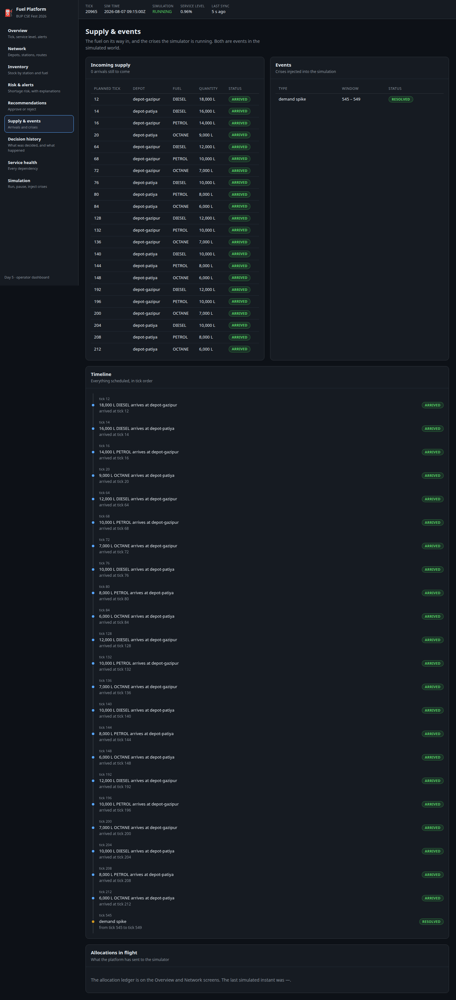

### 6.1 What it shows

Two panels side by side:

- **Incoming supply** — the count of arrivals still to come, then a table of
  every scheduled arrival: planned tick, depot, fuel, quantity, status.
- **Events** — the crises in the simulation: type, the tick window it runs
  from and to, and its status.

Then a **Timeline** — every arrival and every event merged and sorted by
tick, with a coloured dot for each kind and a status pill on the right.

Both streams are events **in the simulated world**, so they are shown against
the **tick**, not the wall clock.

### 6.2 How to read it

**Planned tick vs actual tick.** An arrival that has already happened shows
*arrived at tick N*; one still to come shows *due at tick N*. If the actual
tick is later than the planned tick, a shipment was delayed.

**A `DEMAND_SPIKE` event on this screen** is the platform's evidence that a
crisis was injected — it is not a fault. The platform did not cause it and
cannot stop it; it reacts to it the same way it reacts to any other change.

**The timeline is the story of the world.** When something goes wrong, this
screen usually shows *why*: a route disruption two ticks before a station's
cover collapsed, or a shipment delay that pushed an arrival past the point
where it mattered.

### 6.3 Common tasks

| Task | Where |
|---|---|
| See what fuel is coming | **Incoming supply** |
| See when the next arrival lands | **Timeline**, sorted by tick |
| Check whether a crisis is still running | **Events** — its window and status |
| Confirm the platform noticed a crisis | **Risk & alerts** → alerts table |

---

## 7. Decision history

*The audit trail: every recommendation, who decided it, and what the
simulator then did with it.*

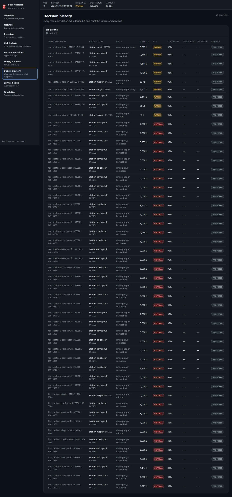

### 7.1 What it shows

One table, newest first, with a count in the header. Columns:

| Column | Meaning |
|---|---|
| Recommendation | The recommendation's id |
| Station / fuel | Which tank it was for |
| Route | The route chosen |
| Quantity | Litres |
| Risk | The risk level at the time of the decision |
| Confidence | The forecast's confidence |
| **Decided by** | Who decided it — the dashboard sends the literal name `operator`, or `auto-mode` when the auto-mode decided it |
| Decided at | The timestamp |
| **Outcome** | The status pill, plus the allocation id and any error code |

### 7.2 How to read it

The outcome column is the reconciled result: the decision *and* its
consequence.

| Outcome | Colour | Meaning |
|---|---|---|
| `ARRIVED` | green | The fuel reached the station |
| `FAILED` | red | The simulator refused or could not deliver it — the error code is shown beside it |
| `REJECTED` | muted | A human said no; nothing was sent |
| `SUBMITTED` / `APPROVED` | amber | Sent or approved, but the simulator has not reported the outcome yet |

`SUBMITTED` and `APPROVED` are **not** the same thing, and the difference is
worth knowing: `APPROVED` is the decision, `SUBMITTED` is the allocation
having been handed to the simulator. A row that stays `SUBMITTED` for a long
time is worth investigating.

The **idempotency key** on the recommendation card is deterministic — it is
derived from the recommendation's own content, so the same decision produces
the same key and a repeated submission is recognised as a replay rather than
a second shipment.

### 7.3 Common tasks

| Task | Where |
|---|---|
| Check what I decided and when | The **Decided by** and **Decided at** columns |
| Find a failed shipment | Filter for `FAILED`, read the error code |
| Confirm the auto-mode acted | Look for `auto-mode` in **Decided by** |
| Find the full audit trail | `GET /api/decision-history` — see [api-reference.md](api-reference.md) |

---

## 8. Service health

*Every dependency the platform has, in one place, with the numbers that say
whether it is behaving.*

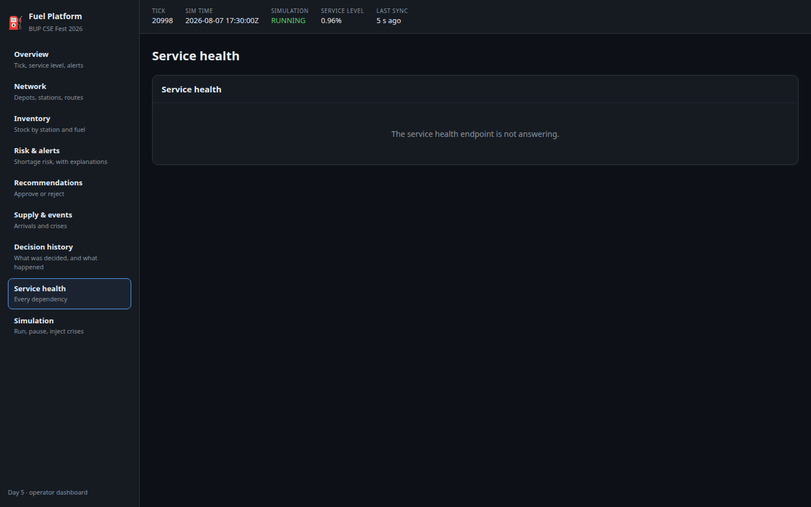

### 8.1 What it shows

Six metric tiles:

| Tile | Meaning |
|---|---|
| p95 latency | The backend's request latency |
| Error rate | With the count of errors out of the total requests |
| Decisions / min | Recommendations in the last minute |
| Approval rate | Approved ÷ proposed — warn below 50 % |
| Auto-approve | `ON` / `OFF`, off by default |
| **Fallback policy** | `ACTIVE` / `inactive`, with the reason when active |

Then two panels:

- **Dependencies** — backend, database, simulator, prediction service and
  decision engine, each with a status and a detail line. The prediction
  service's detail names the **active model**, how many forecasts it has
  made, when it was last evaluated, and — if the fallback is running — the
  reason in plain words.
- **Decision engine** — the raw counters behind the decision metrics.

### 8.2 The fallback reasons

When the platform is not using the learned model, it says why, in words rather
than codes:

| Code | What the screen says |
|---|---|
| `model_error` | the model raised on every forecast |
| `not_trained` | the model is not trained yet |
| `insufficient_history` | there is not enough history to trust the model |
| `worse_than_baseline` | the model is worse than the rule-based baseline |

A model needs `FORECAST_MIN_TRAINING_ROWS` (30 rows) before it is trusted at
all. Below that, the rule-based predictor answers every forecast and the
platform says so. A cold start is a rule-based start, not a confident one.

**The model has to earn its way back.** The gate is a held-out one-step
comparison against the rule-based predictor, with a 5 % tolerance. If the
model loses, the platform uses the rule and reports
`worse_than_baseline`. The full reasoning is in
[ADR 0006](adr/0006-gate-model-on-held-out-one-step-comparison.md) and
[intelligence-methodology.md](intelligence-methodology.md).

### 8.3 Common tasks

| Task | Where |
|---|---|
| Check whether the model is in use | **Prediction service** row → *active model* |
| Find out why the fallback is running | **Fallback policy** tile, or the prediction service detail |
| Check the platform is keeping up | **p95 latency** and **Error rate** tiles |
| See how many decisions failed | **Decision engine** counters |

---

## 9. Simulation controls and the crisis panel

*These drive the simulator, not the platform.*

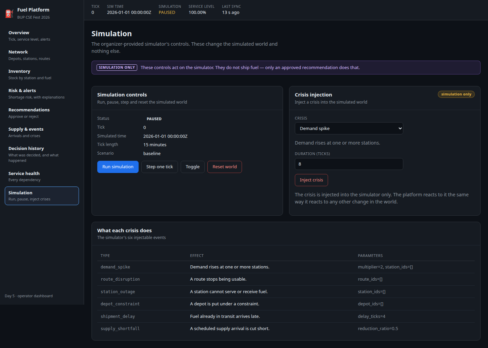

### 9.1 What it shows

A banner that says so explicitly, in three places — the heading, the banner
and the buttons — because an operator must never confuse *"run the simulation
forward"* with *"ship fuel"*:

> **SIMULATION ONLY** — These controls act on the simulator. They do not ship
> fuel — only an approved recommendation does that.

**Simulation controls** — the simulator's status, tick, simulated time, tick
length and scenario, plus four buttons:

| Button | Effect |
|---|---|
| **Run simulation** / **Pause simulation** | The button flips with the state |
| **Step one tick** | Advances exactly one tick |
| **Toggle** | The simulator's own toggle |
| **Reset world** | Resets the simulated world — destructive |

The last action taken is shown beneath the buttons.

**Crisis injection** — a dropdown of the six injectable crisis types, a
duration in ticks (1–200, default 8), and an **Inject crisis** button. The
hint under the dropdown changes with the selected type.

A third panel, **What each crisis does**, tables all six:

| Type | Effect | Parameters |
|---|---|---|
| `demand_spike` | Demand rises at one or more stations | `multiplier=2.0`, `station_ids=[]` |
| `route_disruption` | A route stops being usable | `route_ids=[]` |
| `station_outage` | A station cannot serve or receive fuel | `station_ids=[]` |
| `depot_constraint` | A depot is put under a constraint | `depot_ids=[]` |
| `shipment_delay` | Fuel already in transit arrives late | `delay_ticks=4` |
| `supply_shortfall` | A scheduled supply arrival is cut short | `reduction_ratio=0.5` |

### 9.2 How to read it

**Reset world is destructive, and it briefly takes the state endpoint away.**
It puts the whole simulated world back to its start. The platform notices the
rewind and **drops the cached world**, so `/api/state` answers **503 "no
simulator state available yet"** until the next cycle fetches the new world —
rather than showing you a coherent, confident, wrong network.

The window is bounded: the next sync cycle replaces it. And when the platform
does the resetting itself, through this button or `POST /admin/reset`, the
window does not open at all. It only appears when the reset comes from
**outside** — the simulator's own admin console — and even then the simulator
announces it on the event stream and the platform reacts within a couple of
seconds. The whole incident is written up in
[postmortem 02](postmortems/02-stale-snapshot-after-reset.md).

**The crisis is injected into the simulator only.** The platform reacts to it
the same way it reacts to any other change in the world — there is no
special-case path for a crisis the platform knows about in advance.

**The parameters are sent as the defaults shown in the table.** The dropdown
sets the type; the parameter values are those in the `CRISES` table in
[`frontend/src/views/SimulationView.tsx`](../frontend/src/views/SimulationView.tsx).

### 9.3 Common tasks

| Task | Where |
|---|---|
| Pause the world to inspect it | **Pause simulation** |
| Advance one tick at a time | **Step one tick** |
| Test the platform's reaction | **Inject crisis** with a duration |
| Put the world back to a known state | **Reset world** — then wait for the platform to re-sync |
| See the crisis in the world | **Supply & events** → the timeline |

---

## 10. The banners: DEGRADED, STALE and FALLBACK

The banner strip sits below the top bar on **every** screen. It is the one
piece of chrome that is always visible, because an operator has to be able to
see at a glance that the platform is degraded or that what they are looking
at is old.

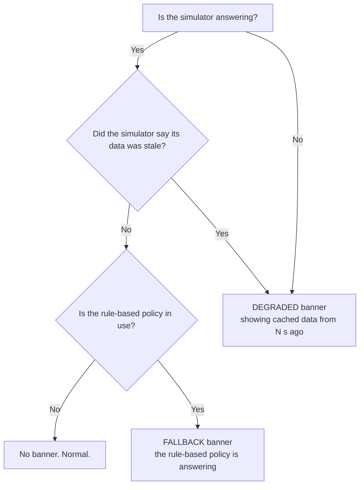

### 10.1 DEGRADED

> **DEGRADED — Showing cached data from 43 s ago.** The simulator is not
> answering right now.

The platform is **still serving**, on purpose. Serving slightly old state
beats serving nothing, as long as the response says how old it is.

| You see | It means |
|---|---|
| `Showing cached data from N s ago` | The age of the data, in seconds, and it grows |
| `The simulator is not answering right now.` | The default reason, when the platform has no more specific one |
| A specific reason | The platform's own explanation, when it has one |

**What to do.** Check **Service health** → the **Simulator** row. If the
simulator is down, the platform is waiting on it. The platform retries on its
own — it does not need you to do anything for it to recover.

**Why the platform does this.** The decision path when a dependency fails is
in [runbook.md](runbook.md) §5. The short version: the platform keeps the
last-known world, and after five consecutive failures the circuit breaker
opens so it stops sending calls to a dependency that is not answering. A
probe succeeds after 20 seconds and the breaker closes.

**A caveat worth knowing.** The banner tag reads `DEGRADED` whenever
*either* `degraded` or `stale` is set — the same tag is used for both. So a
`DEGRADED` banner does not, by itself, tell you whether the simulator is
down or whether it is serving stale data. Read the sentence beside the tag.
This is a labelling quirk of the banner component
([`frontend/src/components/ui.tsx`](../frontend/src/components/ui.tsx)), not
a platform fault.

### 10.2 STALE

There is **no separate `STALE` banner**. The simulator sets an
`X-Simulator-Stale: true` header while a `stale_data` fault is active; the
platform surfaces that as the `stale` flag, and the flag drives the *same*
`DEGRADED` banner.

The distinction that matters:

| Situation | `degraded` | `stale` | What you see |
|---|---|---|---|
| The simulator is up and fresh | false | false | Normal |
| The simulator says its data is stale | false | true | The `DEGRADED` banner, but the data is live |
| The simulator is down | true | false | The `DEGRADED` banner, and the age grows |

So a `DEGRADED` banner with a **small, non-growing** age means the simulator
is answering but flagged its own data as stale. A `DEGRADED` banner with a
**growing** age means the simulator is not answering at all.

### 10.3 FALLBACK

> **FALLBACK — The prediction service is unavailable, so the platform is using
> the rule-based policy — refilling the lowest days-of-cover first.**

The platform is healthy, but the **learned model** is not in use. It has
fallen back to the rule-based predictor. The recommendation cards are still
valid; they were produced by a different policy.

The fallback is **deliberately simple** and it is **worse** than the model —
which is why the platform tells you when it is in use. The reason is shown in
words on **Service health**; see [§8.2](#82-the-fallback-reasons).

A `FALLBACK` banner is **not** a failure. It is the platform being honest
about which policy produced the numbers in front of you.

### 10.4 Which banner should I worry about?

| Banner | Worry? | Why |
|---|---|---|
| None | — | Everything is fresh and the model is in use |
| **FALLBACK** | Not now | The platform is working as designed; the rule-based policy is answering |
| **DEGRADED**, small age | Watch | The simulator is answering but flagged its own data stale |
| **DEGRADED**, growing age | **Yes** | The simulator is not answering; the platform is serving cached state |

---

## 11. Common tasks

Recipes for the things an operator actually does.

### 11.1 "A station is red. What do I do?"

1. **Overview** → note the station under **Stations needing fuel**.
2. **Risk & alerts** → click the station's row. Read the drawer's **Why**
   section: is it low stock, or a forecast of rising demand?
3. **Inventory** → check the tank's **cover**. A tank at 40 % with 3 h of
   cover needs fuel now, whatever its fill percentage says.
4. **Network** → confirm the route to that station is not broken. A broken
   route means the problem is not the tank.
5. **Recommendations** → find the matching card, run the **what-if preview**,
   read the projected cover, then **Approve**.

### 11.2 "I want to know what happens if I do nothing."

**Recommendations** → **What-if preview** on the card. It runs locally and
writes nothing to the simulator — the card reports `writes to simulator: no`,
and the recommendation's status does not change. The endpoint is
`POST /api/recommendations/{id}/simulate`.

### 11.3 "The dashboard says DEGRADED."

1. Note the **age** in the banner. Growing, or small?
2. **Service health** → **Simulator** row, and the **Error rate** tile.
3. If the simulator is down: the platform will recover on its own. Watch the
   age stop growing.
4. If the simulator is answering but the platform still cannot reach it, the
   simulator's connection pool may be exhausted — the procedure is in
   [runbook.md](runbook.md) §4 (`docker compose restart simulator`).
5. If the data is simply old, **Supply & events** shows what happened in the
   world in the meantime.

### 11.4 "The recommendations say 'Rule-based policy'."

**Service health** → **Fallback policy** tile for the reason in words. The
common one is `not_trained` early in a run, or `insufficient_history` before
30 training rows exist. The trainer's own schedule is every
`MODEL_TRAIN_INTERVAL` seconds (default 300), so the model may take a few
minutes to appear. The how-to is in [demo-script.md](demo-script.md).

### 11.5 "I want to test the platform's reaction to a crisis."

**Simulation** → choose a crisis type, set a duration, **Inject crisis**. Then
watch **Supply & events** for the event, **Risk & alerts** for the alert, and
**Recommendations** for the platform's proposal. The full drill is in
[resilience-report.md](resilience-report.md) — **17 of 17** scenarios
recovered automatically.

### 11.6 "I need to find out what happened to a specific shipment."

**Decision history** → the row's **Outcome** column. `ARRIVED` is good,
`FAILED` shows the error code, `REJECTED` means a human said no. If the row
is stuck at `SUBMITTED`, the allocation was handed to the simulator and the
outcome has not come back — check the simulator's health.

### 11.7 "I want to prove what the platform did."

`GET /api/audit` is the searchable audit trail, and
`GET /api/decision-history` is the decision list. Both are documented in
[api-reference.md](api-reference.md). `scripts/search_logs.py` searches the
structured logs by correlation id.

---

## 12. What this dashboard does not do

Honest limits, so nothing here is a surprise.

| Limitation | What it means for you |
|---|---|
| **No authentication.** The dashboard and the API are open on the container's port. | Anyone who can reach the port can approve a shipment. Do not expose it beyond localhost. |
| **One operator, one world.** Single-tenant, single backend instance. | There is no per-user identity, so **Decided by** is always the literal `operator` for anything you approve. It does not record who you are. |
| **The working set is bounded.** Recommendations live in memory and the oldest are evicted; the full history is in Postgres. | A recommendation that vanishes from the queue may still be in the decision history. |
| **The audit search is a bounded window.** | A count says which rows it covers — the summary reports its `scope`. |
| **A forecast is a forecast.** The confidence interval is a scaled mean absolute error, not a calibrated distribution. | A stockout probability of 100 % means the forecast's own lower bound says it runs out. |
| **The supply is 25 % below demand.** | Service level cannot reach 1.0. Compare against the baseline, not against 1.0. |
| **The platform cannot create fuel.** | It allocates a shortage. It does not solve one. |

The full list, with the impact of each and the roadmap, is in
[known-limitations-and-roadmap.md](known-limitations-and-roadmap.md).

---

## 13. Related documents

| Document | What it holds |
|---|---|
| [runbook.md](runbook.md) | Operating the platform — starting and stopping, health checks, a clean reset, the simulator's connection-pool procedure, degraded mode, the ML kill-switch, a database outage, and all twenty-one Prometheus alerts |
| [demo-script.md](demo-script.md) | The fourteen demo steps, with the exact command or click for each and what to say while doing it |
| [api-reference.md](api-reference.md) | All 35 routes, the common freshness fields (`stale`, `degraded`, `age_seconds`), and every error shape |
| [decision-engine.md](decision-engine.md) | The allocation engine, the eight pre-validation rules, the recommendation fields, the lifecycle state machine, the idempotency key and every 409 |
| [architecture.md](architecture.md) | The system diagram, the assumptions, and the security notes |
| [model-evaluation.md](model-evaluation.md) | The forecast accuracy and the model's honest verdict |
| [intelligence-methodology.md](intelligence-methodology.md) | The model card — the profile baseline, the learned model, the confidence intervals, the risk thresholds, the fallback |
| [resilience-report.md](resilience-report.md) | 17 of 17 crisis, fault and dependency scenarios, with detection and recovery times |
| [known-limitations-and-roadmap.md](known-limitations-and-roadmap.md) | Every known limitation, with its impact and workaround, and the roadmap |
| [requirements-traceability.md](requirements-traceability.md) | Every requirement mapped to its implementation and its proof |
