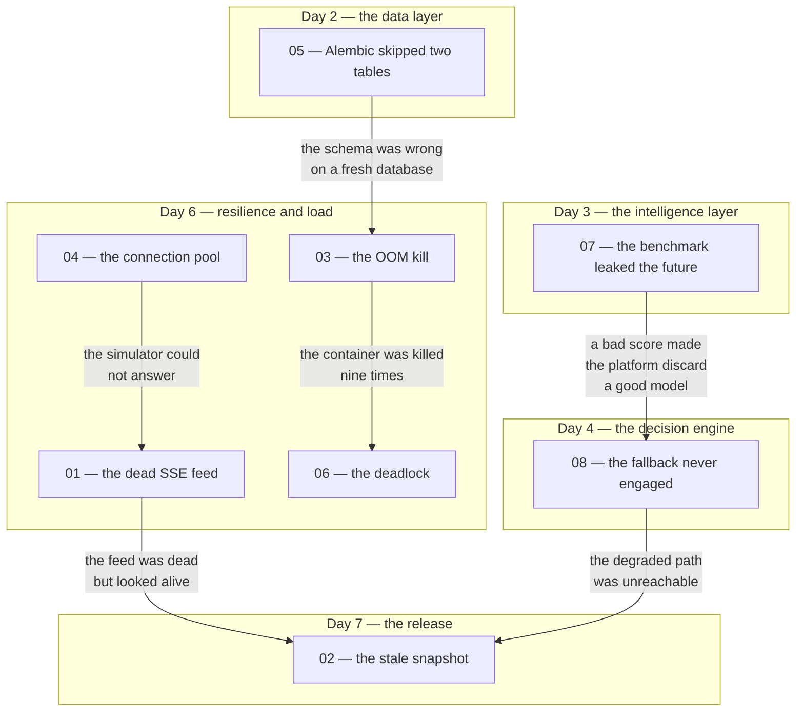

# Postmortems

Eight incidents from the seven-day build, written up in the same shape: what
happened, what it cost, what caused it, how it was found, what was done, and
what is still open.

Every number, date and code reference in these documents comes from the
repository — the daily logs in [`docs/progress/`](../progress/), the reports
([`resilience-report.md`](../resilience-report.md),
[`load-test-report.md`](../load-test-report.md),
[`model-evaluation.md`](../model-evaluation.md)), the source, the tests, and
the git history. Where two sources disagree, the conflict is listed in that
document's own **Discrepancies** section.

For the full defect list — every bug found during the project, with its
root cause and its pinning test — see
[`docs/bug-catalog.md`](../bug-catalog.md).

---

## The incidents

| # | Incident | Day | Severity | One line |
|---|---|---|---|---|
| 1 | [The platform believed it had a live event feed](01-silent-dead-sse-feed.md) | 6 | high | The SSE reader was dropped from the simulator's bus but kept reporting a live connection |
| 2 | [The platform served a world that had ended](02-stale-snapshot-after-reset.md) | 7 | high | After a simulator reset, the old run's numbers were served as 0.2 seconds old |
| 3 | [The OOM kill and the 30-second p99](03-oom-kill-prediction-evaluations.md) | 6 | high | A Python-side aggregate over 928,005 rows killed the container nine times |
| 4 | [The platform exhausted the simulator's connection pool](04-simulator-connection-pool-exhaustion.md) | 5–6 | high | The platform's own event stream knocked the simulator over with ~70 req/s |
| 5 | [Alembic autogenerate skipped two tables](05-alembic-autogenerate-skipped-tables.md) | 2 | high | The migration was generated against a dirty database, so a fresh one would have been missing two tables |
| 6 | [The Postgres deadlock that lost writes](06-postgres-deadlock-lost-writes.md) | 6 | high | 35 writes were lost because three call sites bypassed the retrying helper |
| 7 | [The benchmark that leaked the future to the baseline](07-benchmark-leaked-the-future.md) | 3 (and 7) | high | The platform discarded a good model because the comparison was rigged |
| 8 | [The fallback never engaged because the forecast was stale](08-fallback-never-engaged-stale-forecast.md) | 4 | high | A failed evaluation left the previous result in place, so the degraded path was unreachable |

---

## What the eight have in common

### The failures were silent

Not one of these eight produced an error message an operator would have seen.
The SSE reader reported a connection that was not delivering events. The
platform reported `degraded: false` for a world that had ended. The audit
endpoint answered 500 only on the one query an operator would type. The
fallback policy was implemented, tested, and never reached.

Every one was found by **looking at a counter, a table or a transcript** rather
than by reading an error.

### The instrument was often the thing that was wrong

| Incident | The instrument |
|---|---|
| 3 — OOM | The benchmark read the table it was measuring |
| 7 — Leaked benchmark | The baseline was read from the end of the window it was predicting |
| 5 — Alembic | The diff was against a dirty database |
| 1 — Dead SSE | The evidence of life was bytes arriving |

A measurement that flatters the incumbent is worse than no measurement, because
it does not merely mislead a reader — it makes the platform act on the
misinformation.

### The fix was an invariant, not a patch

The durable fixes state a property and enforce it in the component that owns it:

| Invariant | Enforced in |
|---|---|
| The cache never serves a world that no longer exists | `backend/app/state_cache.py` |
| A live stream can be lying; the REST view is the evidence | `backend/app/sync_service.py` |
| A write that hits a deadlock is retried, because the SQL standard says so | `backend/app/db.py` |
| Neither side of a comparison may see the rows it is judged on | `backend/app/intelligence/forecasting.py` |
| A failed evaluation leaves no result to act on | `backend/app/intelligence_service.py` |

### The work that found them was work, not review

| Incident | Found by |
|---|---|
| 1 — Dead SSE | The crisis drill, reading the backend's own counters |
| 2 — Stale snapshot | The demo dry run, which checks claims rather than exit codes |
| 3 — OOM | The load test, with the sync cycle split into four timed steps |
| 4 — Pool exhaustion | The load test, plus the simulator container being unhealthy on arrival |
| 5 — Alembic | Asking "does this migration work from nothing?" |
| 6 — Deadlock | Reading the backend's logs underneath a noisy harness summary |
| 7 — Leaked benchmark | A negative result that was investigated rather than accepted |
| 8 — Fallback | The fallback drill, which breaks the intelligence layer inside the running container |

---

## Reading order

* **A judge with ninety seconds** — [02 (the world that had ended)](02-stale-snapshot-after-reset.md)
  and [03 (the OOM kill)](03-oom-kill-prediction-evaluations.md). They are the
  two that most directly contradict the platform's central claims.
* **A reviewer checking the honesty of the numbers** — [07 (the leaked
  benchmark)](07-benchmark-leaked-the-future.md) and the honesty section of
  [`docs/model-evaluation.md`](../model-evaluation.md).
* **Someone joining the project** — [01 (the dead feed)](01-silent-dead-sse-feed.md)
  and [08 (the fallback)](08-fallback-never-engaged-stale-forecast.md), because
  they describe the two mechanisms the platform's resilience rests on.
* **A reviewer of the database layer** — [05 (Alembic)](05-alembic-autogenerate-skipped-tables.md)
  and [06 (the deadlock)](06-postgres-deadlock-lost-writes.md).

---

## How the incidents connect

The arrows are not causal claims about the code — they are the order in which
the same *kind* of mistake recurred, and what each one cost. The recurring
shape is the same in all eight: **a measurement or a cached value that was
believed without being checked**, and a platform that degraded gracefully
enough that nobody noticed.

---

## Discrepancies

One conflict was found across the repository while writing these documents. It
is recorded here, and in full in
[07's own Discrepancies section](07-benchmark-leaked-the-future.md#discrepancies).

| # | Discrepancy | Resolution |
|---|---|---|
| D1 | The **horizon-score leak** is published with two different sets of numbers. [`docs/progress/day7.md`](../progress/day7.md) says the leaky score was 64.6 L and **−60.7 %** against the baseline, and the honest one 170.5 L and **+3.7 %**. The docstring of `HorizonValidator` in [`backend/app/intelligence/forecasting.py`](../../backend/app/intelligence/forecasting.py) says the leaky score was **4 341 L** and 13.7 % better, and the honest one **5 035 L** and 0.1 % better. Both were added in commit `426b574` and neither has changed since. | The `day7.md` figures are quoted, because they are the ones in the published progress log and in the commit message. The code docstring's figures are **not verified** against a stored probe output — no probe results for this measurement are committed. The qualitative conclusion is identical in both: the leaky score flattered the model, and removing the leak made the model look worse. The magnitudes disagree by roughly two orders of magnitude, and the repository alone cannot say which is right. |

Two further things were checked and found **consistent**, so they are not
discrepancies:

* The resilience scenario count is **17 of 17** in
  [`day6.md`](../progress/day6.md), [`resilience-report.md`](../resilience-report.md)
  and the root README.
* The backend test counts in [`day6.md`](../progress/day6.md) — 365, 373, 382 —
  are cumulative counts at three points in the day, and Day 7 reports 583.

---

## Conventions used in these documents

* **Timeline** — the documented order of events. No timestamps are invented.
  Where the source records a timestamp (the crisis drill's scenario start
  times, the resilience report's generation time), it is quoted; otherwise the
  order is given without times.
* **Impact** — measured numbers, taken from the source document named in the
  same section. Both sides of a before/after are given where the source has
  both.
* **Action items** — every one is marked **Done** or **Not done**. The
  "Not done" entries are not a wish list; they are the items the project's
  own documents already acknowledge as outstanding, plus the gaps this
  postmortem identifies.
* **Severity** — the author's judgement of the impact on the platform's claims
  and on the operator, not a formal severity matrix. All eight are rated
  *high*, and the reasoning for each is in its Impact section.
