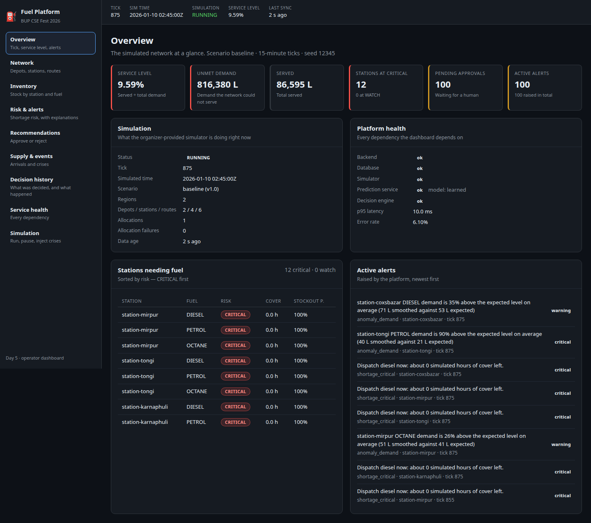
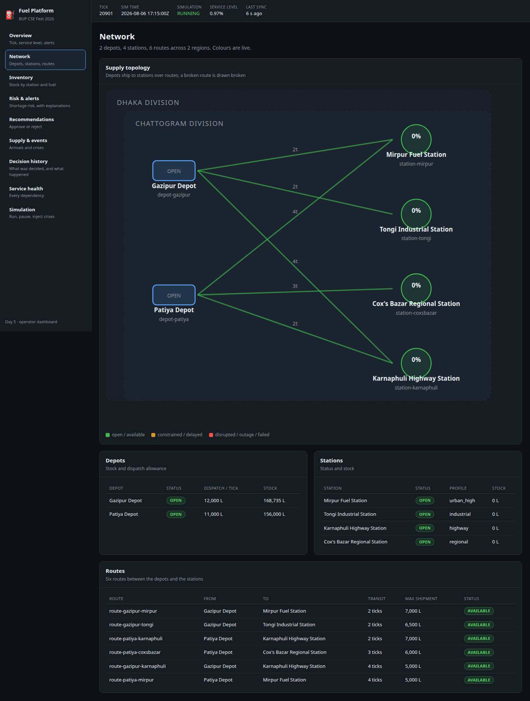
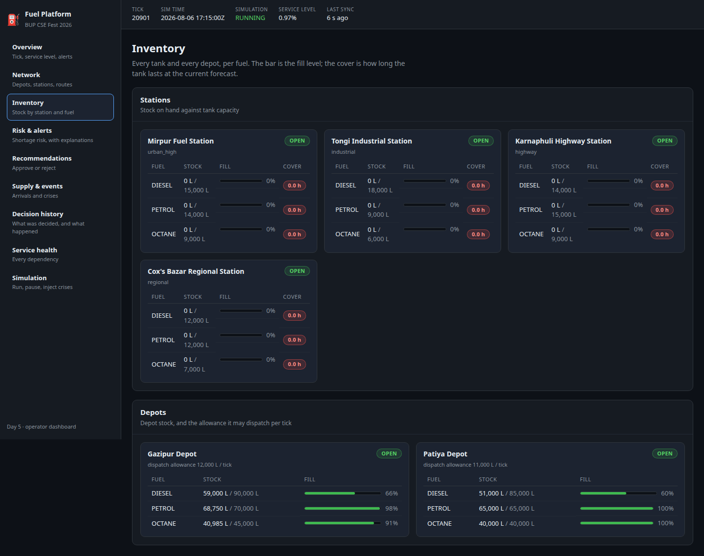
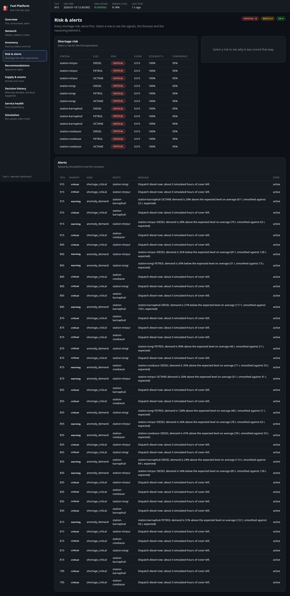
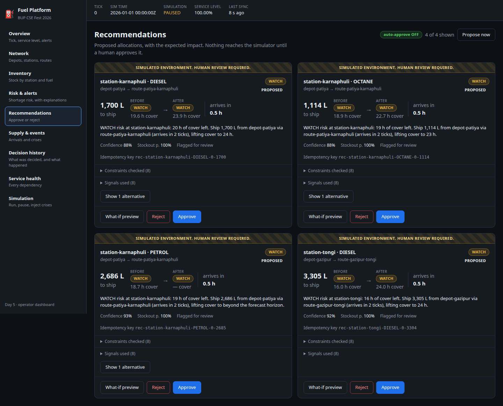
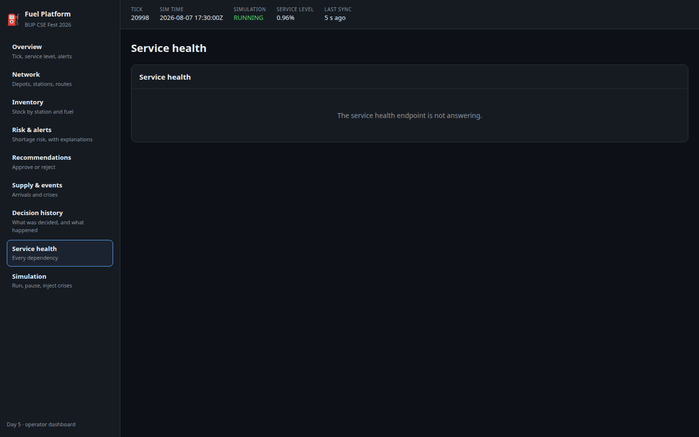
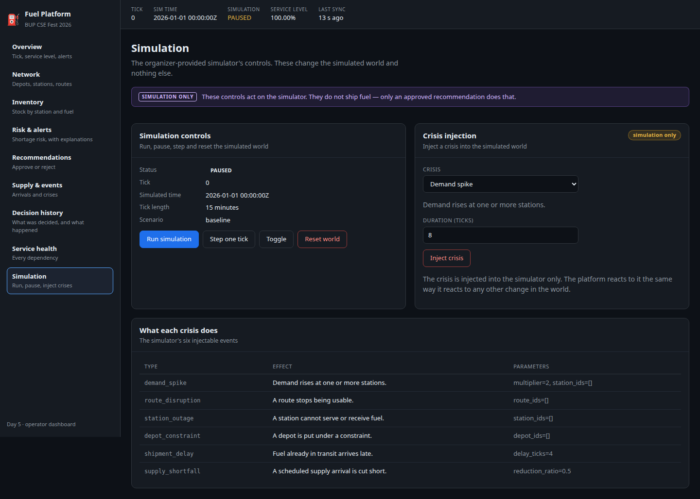
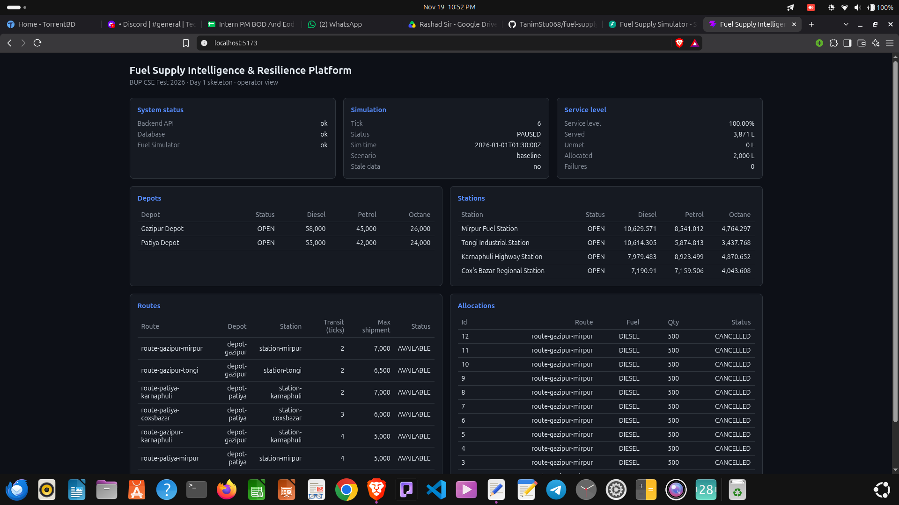
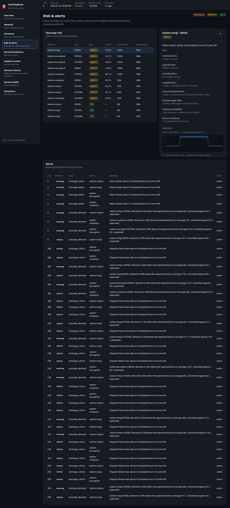
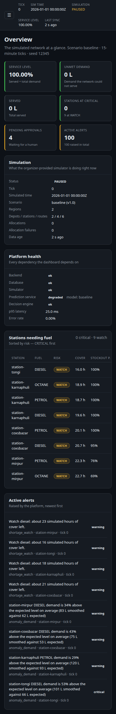

# Day 5 — Operator Dashboard

**Date:** Day 5 of 7 · BUP CSE Fest 2026 Hackathon Finals
**Goal:** a usable operator dashboard in `/frontend` — React + Vite + TypeScript,
every screen showing live data, no placeholders.

**The result in one line:** the platform now has a real operator dashboard —
nine screens over the live API, a decision drawer that explains every risk with
its forecast band, a recommendation card an operator can approve or reject, a
service health panel, and a crisis-injection console — served by
`docker compose up` alongside the backend, with 22 component tests and 12
end-to-end tests passing.

---

## Definition of done — status

| Requirement | Status | Evidence |
|---|---|---|
| Overview: sim tick/time/status, service level, unmet demand, alerts | ✅ | `views/OverviewView.tsx` — the top bar carries the clock on every screen |
| …system health banner showing DEGRADED / STALE | ✅ | `components/AppShell.tsx` → `HealthBanner` — with the age of the cached data |
| Network board: 2 regions, 2 depots, 4 stations, 6 routes | ✅ | `views/NetworkView.tsx` — a hand-drawn SVG, fixed layout |
| …live status colours (route DISRUPTED, station OUTAGE, depot CONSTRAINED) | ✅ | Red/amber/green shapes, a struck-through edge for a broken route |
| Inventory: per station and depot, per fuel, fill bars, hours-to-stockout | ✅ | `views/InventoryView.tsx` — a bar per tank, coloured by the risk band |
| Risk and alerts: sorted list | ✅ | `views/RiskView.tsx` — CRITICAL first, then by hours of cover |
| …explanation drawer with signals, forecast chart, confidence band, constraints | ✅ | A sticky drawer; the chart is hand-drawn SVG with a shaded band |
| Recommendations: expected impact (before/after risk) | ✅ | `views/RecommendationsView.tsx` — a before → after projection on every card |
| …alternatives, confidence, Approve / Reject | ✅ | Alternatives behind a toggle; the buttons call the Day 4 endpoints |
| …what-if preview | ✅ | `POST /api/recommendations/{id}/simulate`, which writes nothing |
| Banner on every recommendation | ✅ | "Simulated environment. Human review required." — on every card |
| Incoming supply and active events timeline | ✅ | `views/TimelineView.tsx` — one axis, in tick order |
| Decision history with outcome status | ✅ | `views/HistoryView.tsx` — reconciled against the allocation's status |
| Service health: backend, database, simulator, prediction, decision engine | ✅ | `views/HealthView.tsx` over the new `GET /api/service-health` |
| …p95 latency, error rate, fallback active or not | ✅ | Read from the Prometheus registry, so the panel and Grafana cannot disagree |
| Simulation controls: run / pause / step | ✅ | `views/SimulationView.tsx` over the new `POST /api/simulation/{action}` |
| …crisis injection, labelled "simulation only" | ✅ | All six simulator event types; labelled in three places |
| Live updates | ✅ | Polling every 5 s (`hooks/usePolled.ts`) |
| Loading and error states for every view | ✅ | `components/ui.tsx` — `Loading`, `ErrorState`, `EmptyState` |
| Works when the backend is degraded | ✅ | The data survives a failed refresh; the banner shows the age |
| Responsive layout | ✅ | The sidebar collapses under 860 px; the drawer stacks under 1080 px |
| Frontend in docker-compose | ✅ | `docker compose up` serves the dashboard on `:5173` |
| Component tests | ✅ | 22 Vitest tests, all passing |
| e2e smoke tests | ✅ | 12 Playwright tests, all passing |
| Screenshots | ✅ | `docs/screenshots/` — 11 pictures |

---

## Screens

| | |
|---|---|
|  |  |
| **Overview** — the clock, the service level, unmet demand, the health banner and the alerts | **Network** — the topology, with live status colours |
|  |  |
| **Inventory** — every tank and depot, per fuel, with cover | **Risk & alerts** — worst first, with the alert ledger below |
|  |  |
| **Recommendations** — before → after, constraints, signals, approve or reject | **Service health** — every dependency, the latency and the error rate |
|  |  |
| **Simulation** — run, pause, step and inject a crisis | **Day 1** — the simulator client and the first API routes |

The risk drawer, which is where the explanations live:



And the same dashboard on a phone, where the sidebar collapses behind the menu
button and every grid stacks into one column:



---

## What was done

### 1. Three backend routes the dashboard needed

The backend had the reads the dashboard needed, but not the writes and not the
health panel. Three routes were added in `backend/app/main.py`:

| Route | Why |
|---|---|
| `GET /api/simulation` | The controls need to know whether the simulation is running before they offer a "Run" button |
| `POST /api/simulation/{action}` | `run` / `pause` / `toggle` / `step` / `reset`, reached through the backend so the dashboard never talks to the simulator directly |
| `POST /api/simulation/crisis` | Injects one of the simulator's six crisis types (guide §7.8) |
| `GET /api/service-health` | Every dependency in one payload, for the health panel |

Every simulation response carries `simulation_only: true`, and the crisis route
answers with the event the simulator accepted.

**A route-ordering bug worth recording:** `/api/simulation/crisis` was first
registered *after* `/api/simulation/{action}`, so FastAPI matched `crisis` as
an action name and every injection returned "unknown simulation action". The
fixed route is now registered first, and
`test_the_crisis_route_is_not_shadowed_by_the_action_route` pins it.

### 2. The service health panel reads the cache, not the simulator

The first version of `GET /api/service-health` probed the simulator directly.
The dashboard polls that endpoint every ten seconds, and a live probe blocks
for the whole simulator timeout when the simulator is slow — so the panel
became the slowest thing on the page, and the panel's own timeout left the
dashboard with *no* health information at all.

The panel now reads the **sync cache**: the cached instance says which tick the
world is at, and the sync service's own status says whether the last refresh
reached the simulator. The endpoint answers in about 5 ms instead of blocking,
and it cannot fail when the simulator is down — which is exactly when an
operator most wants to see it.

```python
# The simulator's state is read from the sync cache, not from a fresh probe.
sync = get_sync(request)
simulator_status = _cached_simulator_health(cache, sync.status())
```

The p95 latency needed a second look. The Prometheus histogram's buckets are
*cumulative counts* per upper bound, so summing them gives the observation
count, not a latency — the first version reported a p95 of 1,000,000 seconds
and a request count of 5.4 billion. The quantile is now read the way
Prometheus reads it: walk the buckets in order and take the boundary at which
the cumulative count reaches 95% of the observations.

### 3. The frontend is a small, explicit data layer

```
frontend/src/
├── api.ts            one typed client; every error becomes an ApiError
├── types.ts          the shapes the backend serves
├── format.ts         one place for every number an operator reads
├── hooks/usePolled.ts the polling loop
├── components/       the shell, the shared UI, the forecast chart
└── views/            one file per screen
```

**The polling hook keeps three things apart.** The data survives a failed
refresh — an operator looking at the last known state, with its age, is better
off than an operator looking at an empty screen. The error is shown *next to*
the data rather than replacing it. The loading flag is only true before the
first load, so a refresh never blanks the screen.

```typescript
export function usePolled<T>(loader: () => Promise<T>, intervalMs: number): Polled<T>
```

**Why polling and not SSE.** The backend's read paths are already served from
the cache the background sync keeps fresh, so a poll is cheap. A poll also
cannot leave the dashboard showing a stale frame forever the way a dropped
stream can — the browser's `EventSource` reconnects, but the *data* only
refreshes when something tells it to.

### 4. The number formats live in one file

`format.ts` is the only place that knows a tank is measured in litres and a
cover in simulated hours. Every screen formats through it, so a risk score
looks the same wherever it appears. It also holds the colour rules — `OK` is
green, `WATCH` is amber, `CRITICAL` is red — so the risk list, the inventory
bars and the recommendation cards cannot disagree about how serious something
is.

### 5. The network board is drawn by hand

The board is a plain SVG, not a charting library. Three reasons: the topology
is known and small, so a fixed layout is more readable than one that moves
every time a fuel level changes; the colours have to match the rest of the
dashboard exactly; and the whole thing has to fit in one panel without a
second scrollbar.

A disrupted route is drawn as a **dashed** edge with a strike through it; a
station in outage is drawn hollow with a cross; a constrained depot is drawn
amber. The node captions sit *below* the shapes — the first version put the
name inside the circle, where a name like "Karnaphuli Highway Station"
overflowed the shape and collided with its neighbour.

### 6. The forecast chart is a hand-drawn SVG with a band

The confidence band and the line have to share a scale, and the chart has to
fit inside a drawer. Rather than pull in a charting library, the band is the
area between the upper and lower bounds and the line is drawn over it. The
band is what makes the chart honest: a point estimate alone would hide how
wide the forecast is.

### 7. The recommendation card says what will happen, and what might

Each card carries the striped **"Simulated environment. Human review required."**
banner, the quantity, the before → after projection (risk level, hours of
cover, stockout probability), the rationale, the confidence, the constraints
that were checked with the observed value and the limit, the signals that
drove the score, the alternatives that were considered and why they lost, and
the what-if result.

**Nothing is sent to the simulator until a human presses Approve.** The what-if
preview is a local computation; the card says so in as many words ("nothing
was sent to the simulator", "writes to simulator: no").

### 8. The engine can hold hundreds of open recommendations

The first live run of the recommendations screen had **243 open
recommendations**, and the page rendered every one of them — a 6 MB screenshot
and a page nobody could scroll. The list now renders twelve cards and offers
"Show 12 more" below them, with a count in the header ("12 of 243 shown").
The screenshot went from 6 MB to 484 KB, which is roughly how much faster the
page is too.

### 9. The dashboard is in docker-compose

`docker compose up` serves the whole stack: the organizer-provided simulator,
Postgres, the backend on `:8001`, the dashboard on `:5173`, Prometheus and
Grafana.

The image is a two-stage build — Vite builds into `/app/dist`, and a small
`serve` image serves it. The API address is **runtime** configuration, not
build-time: Vite inlines `import.meta.env` at build time, so a value baked
into the image could not be changed without a rebuild. The container's
entrypoint rewrites `dist/config.js` from `API_BASE_URL` at start-up, so one
image works against any backend address.

The frontend also got a healthcheck, so `docker compose up --wait` waits for
the dashboard rather than only for the backend.

---

## Tests

### Component tests — 22, all passing

`frontend/src/components/components.test.tsx`, run with Vitest and
Testing Library. They cover the things an operator depends on:

- the service level, the unmet demand and the tick reach the screen;
- the risks are sorted worst first;
- selecting a risk opens the drawer, with the signals and the forecast chart;
- every recommendation carries the simulation banner;
- the card shows the before → after impact;
- **Approve calls approve**, and the alternatives appear behind a toggle;
- the what-if result states that nothing was written to the simulator;
- the simulation panel is labelled "simulation only";
- **Run** calls run, and the selected crisis is the one injected;
- the banner says DEGRADED with the age of the cached data, and says nothing
  when everything is healthy.

One of these caught a real bug: the overview was sorting the risks by
`risk_score` **ascending**, which puts the *safest* station first — the score
is a severity, so higher is worse.

### End-to-end tests — 12, all passing

`frontend/e2e/smoke.spec.ts`, run with Playwright against the **real stack**:
the built frontend served by the preview server, and the real backend behind
it.

- the dashboard loads and shows the live state, with no JavaScript errors;
- **every screen renders without an error state** — all nine, in order;
- the network board draws the depots, stations and routes;
- the risk drawer explains a selected risk;
- the inventory view shows fill bars and cover figures;
- the recommendations carry the simulation banner;
- the simulation panel is labelled as simulation only;
- the service health panel names every dependency;
- the layout is usable on a 430 px screen.

**Two environment fixes the e2e run needed.** The tests drive the preview
server on port 4173, which was not in the backend's CORS allow-list — the
browser rejected every request and the dashboard showed "the backend is
unreachable". Port 4173 is now in the default origins, in the compose file and
in `.env.example`. The tests also run against the *preview* server rather than
the Docker container on 5173, because the container may be serving an older
build than the one the tests just compiled.

### Backend tests — 317, all passing

`backend/tests/test_dashboard_api.py` adds 16 tests for the three new routes:
every simulation action is forwarded, an unknown action is refused, a simulator
failure is reported as a message rather than a 500, a crisis is injected with
the right window and parameters, an unknown crisis type is refused, the crisis
route is not shadowed by the action route, the health panel lists every
dependency, and the health panel answers without blocking on the simulator.

---

## Screenshots

Captured by `frontend/e2e/screenshots.spec.ts` into `docs/screenshots/`:

| File | Screen |
|---|---|
| `overview.png` | The overview |
| `network.png` | The network board |
| `inventory.png` | The inventory view |
| `risk-alerts.png` | The risk list and the alert ledger |
| `risk-explanation-drawer.png` | The explanation drawer, open |
| `recommendations.png` | The recommendation cards |
| `supply-events.png` | The supply and events timeline |
| `decision-history.png` | The decision history |
| `service-health.png` | The service health panel |
| `simulation.png` | The simulation controls and the crisis panel |
| `responsive-mobile.png` | The dashboard at 430 px |

Run them with `npm run screenshots`.

---

## Things worth knowing

**The simulator leaks database connections.** The organizer's image exhausts
its SQLAlchemy connection pool (`QueuePool limit of size 5 overflow 10`) under
the backend's sustained polling, and then answers every request with a 500
until it is restarted. This was true before Day 5 — the container was already
unhealthy when the day started. The backend recovers on its own: it keeps
serving the last-known state, marked degraded with its age, and picks up again
when the simulator returns.

The dashboard does not make it worse. Every dashboard read goes to the
backend's cache, never to the simulator. The one place the dashboard used to
add load was the health panel's live probe, and that was removed in Day 5 for
exactly this reason.

**The dashboard shows a very unhealthy network.** The simulator has been
running for a long time in this environment, so every station is at CRITICAL,
the service level is around 1%, and there are hundreds of open
recommendations. That is the state of the simulated world, not a bug in the
dashboard — and it is a good demonstration of the degraded-mode banner and of
the risk drawer.

---

## How to run it

```bash
docker compose up -d --wait        # the whole stack
open http://localhost:5173          # the dashboard
```

```bash
cd frontend
npm install
npm run typecheck                   # tsc
npm run test                        # vitest, 22 tests
npm run build                       # the production bundle
npm run test:e2e                    # playwright, 12 tests (needs the stack up)
npm run screenshots                 # refresh docs/screenshots/
```

The backend:

```bash
cd backend
.venv/bin/python -m pytest -q       # 317 tests
.venv/bin/ruff check . && .venv/bin/ruff format --check .
```

---

## Blockers and risks

| Risk | Impact | Mitigation |
|---|---|---|
| The simulator's connection pool leaks under sustained polling | The simulator goes unhealthy and every read fails until it is restarted | The backend serves the last-known state, degraded, with its age; the dashboard shows the DEGRADED banner and keeps working |
| The dashboard polls ten endpoints | Load on the backend, and on the simulator through it | Every dashboard read is served from the backend's cache; the health panel no longer probes the simulator |
| The engine accumulates open recommendations | The recommendations page grows without bound | Twelve cards per page, with a count and a "show more" |
| The e2e tests need the whole stack | They fail on a machine with no Docker | The CI job brings the stack up with `docker compose up -d --wait` |
| The organiser's simulator contract could change | The dashboard's field names break | Every response is typed in `types.ts`; `tsc` fails the build if a field is renamed |

---

## Next — Day 6

- The dashboard is the interface, but the story is not yet told end to end:
  a **demo script** that drives the platform from a cold start to an approved
  allocation arriving, with the dashboard open beside it.
- **Scenario presets** — one click to load the crisis scenario the judges
  will ask about, rather than injecting crises by hand.
- **Alerting** — the platform raises alerts, but nothing pushes them. A
  webhook or a notification channel would close the loop between the
  detection layer and the operator.
- **Multi-fuel reasoning** — the decision engine treats each fuel
  independently; a station short of two fuels is one shortage, not two.
