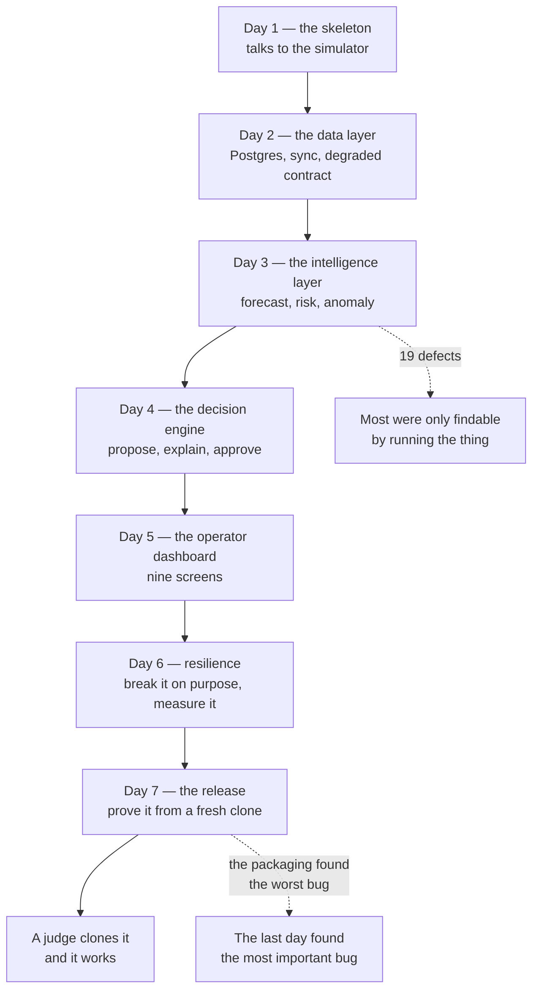

# The project journey

Seven days, day by day, as it actually happened.

This is the build log as a narrative: what each day was for, what got built,
what the numbers were, what broke, and what was decided. Every fact here is
taken from the [seven day logs](progress/day1.md), the reports they produced,
the [bug catalogue](bug-catalog.md) and the git history. Nothing is invented,
and nothing is rounded in the platform's favour.

**Where the detail lives.** Each day has its own file with the full evidence.
This document is the shape of the week; those files are the record.

| Day | File | Focus | Defects found |
|---|---|---|---:|
| 1 | [progress/day1.md](progress/day1.md) | The running skeleton | 3 |
| 2 | [progress/day2.md](progress/day2.md) | Data layer, live sync, observability | 6 |
| 3 | [progress/day3.md](progress/day3.md) | The intelligence layer | 19 |
| 4 | [progress/day4.md](progress/day4.md) | The decision engine | 14 |
| 5 | [progress/day5.md](progress/day5.md) | The operator dashboard | 6 |
| 6 | [progress/day6.md](progress/day6.md) | Resilience, observability, load | 13 |
| 7 | [progress/day7.md](progress/day7.md) | The release | 7 (+2 post-log) |
| | | **Total** | **70** |

---

## The shape of the week



Two patterns run through the week. The first is that **the defects cluster
where the behaviour is**: 19 on Day 3, the day the platform started making
decisions, and 14 on Day 4, the day it started making them for a human. The
second is that **the last day found the most important bug** — a packaging
day is the first time the whole thing has to work as a whole.

---

## Day 1 — the running skeleton

**Goal:** a running skeleton that talks to the simulator.

### What was built

A monorepo — `/backend` `/frontend` `/infra` `/docs` `/scripts` `/tests` —
and a Docker Compose stack of **six services**: the published simulator image
(starting **paused**, so every run is deterministic from tick 0), the
backend, Postgres, the frontend, Prometheus and Grafana. Every credential and
host port comes from the environment; `.env` is gitignored and no secret is
hard-coded.

The simulator client covers the **entire** documented surface: eleven read
endpoints plus their single-entity variants, two writes, and the ten-route
admin control surface.

### The numbers

| | |
|---|---|
| Backend unit tests | 60 |
| Integration tests | 6 |
| CI jobs | 5, all green |
| Services in the stack | 6, all healthy |
| Simulator discrepancies found | **10** |

### The bugs

Three defects, and none of them would have surfaced from a compile check.

| Bug | How it hid |
|---|---|
| The backend image **failed to boot** — the client imported a `Fault` model that had been removed | A stale `__pycache__` entry masked the broken import, and the module was never imported at test time |
| The dashboard showed **"Backend unreachable: Failed to fetch"** | The browser blocked the cross-origin call, and Vite inlines `import.meta.env` at build time so the API URL was frozen into the bundle |
| The CI smoke test asserted **the wrong thing** | It booted the backend with no simulator and no database, then expected `/health` to return 200 — but `/health` is a *readiness* probe and correctly returns 503 while a dependency is down |

The dashboard bug was the valuable one: **the whole stack was "up" and green
by every automated check, but a judge's browser would have seen an error
page.** It was found only by loading the dashboard in an actual browser.

### The decisions

- **Follow the simulator, not the guide.** The running image disagrees with
  the documentation in **ten** places. The client follows the simulator and
  the guide's promise where they conflict. Each discrepancy has a regression
  test.
- **Measure, never schedule against the nominal rate.** `SIMULATION_SPEED=8`
  is a target; the simulator actually ticks at ~6.7/s.
- **The simulator starts paused.** Determinism was worth more than
  convenience on day one.

### The ten discrepancies

| # | Finding | Handling |
|---|---|---|
| D1 | `sim_time` is naive, not `+00:00` as documented | Offset-less timestamps anchored to UTC on ingest |
| D2 | An idempotent replay answers `201`, not the `200` §9 promises | Both accepted on writes |
| D3 | Fault rows have `start_wall_time`/`end_wall_time`, not `duration_seconds` | Duration derived from the window |
| D4 | `entity_type`/`entity_id`/`sim_time`/`tick` are `null` on audit rows | Modeled as optional — strict validation caught this |
| D5 | `/admin/audit?limit=0` returns `[]`; the lower bound is not clamped | Limit passed through untouched |
| D6 | `/v1/demand-history?limit=0` returns `[]` | Same |
| D7 | `X-Simulator-Stale` is only added to GET responses | Consulted after reads only |
| D8 | Measured ~6.7 ticks/sec against a nominal `SIMULATION_SPEED=8` | Never used as a wall-clock estimate |
| D9 | `GET /admin/stats` exists and is undocumented | Client supports it |
| D10 | The guide skips §4.3; `/v1/regions` is really §4.4 | Cosmetic |

---

## Day 2 — data layer, live sync, logging and metrics

**Goal:** reliable data ingestion, stored state, and the start of
observability.

### What was built

**Alembic owns the schema.** Eight tables replace Day 1's two placeholders,
and every write path is an **upsert** so a replayed sync cycle changes
nothing. The unique constraints do the de-duplication; the code never has to.

Two decisions worth flagging: Alembic reads the URL from the environment, so
the committed file has **no** `sqlalchemy.url` at all and no credential can
leak into version control. And the container runs `alembic upgrade head`
before serving, **and the step is allowed to fail** — the service also
creates any missing table at startup, so a migration hiccup never blocks the
boot.

**Two loops run side by side.** The **poller** is the source of truth: every
`SYNC_POLL_INTERVAL` seconds (default 5) it re-reads the whole world over
REST in parallel, writes it to Postgres and replaces the cached snapshot. The
**SSE listener** is a hint channel: every event triggers a re-read of the
affected resource, and the event payload is **never written to the database**.

| Event | Response |
|---|---|
| `simulation.tick` | Full refetch |
| `allocation.status_changed` | Re-read the allocation ledger only |
| `inventory.updated` | Re-read that one depot or station |
| `simulator.notice` | Full refetch |

**The degraded contract.** Every API response carries `stale`, `degraded`,
`age_seconds`, `degraded_reason` and `last_sync_at`. When the simulator is
unreachable, `degraded` flips to true, `age_seconds` keeps counting, and the
last-known data is still served.

**Structured logging and metrics.** Every log line is one JSON object with a
`correlation_id` carried on a `contextvars.ContextVar`, so concurrent tasks
never overwrite each other's id. Fifteen Prometheus series.

### The numbers

| | |
|---|---|
| Tests | 107 unit + 14 integration + 10 fault checks |
| Tables | 8 + `alembic_version` |
| Demand rows ingested | 108, staying at 108 across repeated cycles |
| Degraded in / recovered in | **5 s / 5 s** when the simulator container was stopped |
| New API endpoints | 8 |

### The bugs

| # | What happened | Why it mattered |
|---|---|---|
| 1 | The **autogenerated Alembic migration was missing two tables** (`state_snapshots`, `decision_records`) | They already existed in the live database, so Alembic's diff against it saw nothing to create. **A fresh database would have been missing them entirely.** |
| 2 | The **fault script hung forever** on `GET /v1/stream` | `curl` waits for a stream that never ends; the first version had no timeout and blocked the whole run |
| 3 | The **integration suite failed with a 409** on the allocation round trip | Not a code bug — a previous fault-test had left `station-mirpur` in `OUTAGE`, and the simulator correctly refused to allocate to a closed station |
| 4 | The **demand-history table was empty** after the first deploy | The ingest existed as a method but was never called from the sync loop — it was only reachable from a test |
| 5 | The **`alerts` table stayed empty** | Same shape of bug: the alert logic was written but never invoked |
| 6 | The **old `test_app.py` contradicted the new architecture** | It asserted `/api/state` calls the simulator directly — exactly what Day 2 replaced |

The last three share one root cause worth naming: **code that exists but is
never called looks identical to code that works.** Each was found by looking
at the *database*, not by running the unit tests.

### The decisions

- **The SSE payload decides what to re-read; the values always come from
  REST.** The simulator drops slow subscribers' queues silently after 200
  events, so a missed event looks like a state change that never happened.
- **No `Last-Event-ID` replay.** After every reconnect the service does a
  full REST refetch, because anything that happened while disconnected exists
  only in the REST view.
- **Silence is not a disconnect.** The simulator sends a keepalive every 15
  seconds and nothing else when idle. There is no idle timeout; only a real
  transport error or a closed connection reconnects.
- **The cache is one slot, replaced wholesale.** A partial update would let a
  consumer see a mixture of two ticks, which is worse than a slightly older
  consistent one.
- **Counters count events, not polls.** `degraded_mode_activations_total`
  increments once per *entry*, so it is a usable alert signal rather than a
  noise generator.

---

## Day 3 — the intelligence layer

**Goal:** a meaningful, explainable intelligence layer.

### What was built

Four small modules under `backend/app/intelligence/` — `profiles.py`,
`forecasting.py`, `risk.py`, `detection.py` — plus `dispatcher.py` and
`engine.py`.

The foundation is `profiles.py`. The simulator's demand is
`base × factor × jitter`, where the first two factors are **deterministic and
known exactly** and only the jitter is random. That split is the whole basis
of the layer: the deterministic part is a baseline we can always compute, and
the learned model only has to explain what the baseline misses.

**Two predictors and one that picks between them.** The baseline holds the
station's multiplier flat across the horizon and shapes it with the known
profile. The learned model is a gradient-boosting regressor on the
*multiplier* — the ratio between what a station actually drew and what the
profile says it should draw. That ratio is the same quantity for every station
and every fuel, so **one model serves the whole network**.

**Every score explains itself.** Each risk assessment carries the signals
that produced it, so a decision can be explained after the fact without
re-running anything.

### The numbers

| | |
|---|---|
| Service level over the six-day run | **0.882** |
| Unmet demand | 73,859 L of 627,759 L demanded |
| Allocation failures | **0** |
| Fuel dispatched | 468,000 L in 687 shipments |
| Demand spike detected after | **1 tick** |
| Risk level changed (`OK` → `WATCH`) after | **2 ticks** |
| Fuel dispatched after the spike | **4 ticks** |
| Model vs baseline over the horizon | **34 %** (78.1 L against 118.1 L) |
| One-step validation MAE | 0.0512 against the baseline's 0.0589 |
| Backend unit tests | 213 |

### The bugs — 19, and twelve were only findable by running the thing

The evaluation produced four defects that were **invisible from reading the
code**, and they are the most instructive part of the week.

**The learned model was losing to the rule.** The first evaluation reported
the model *worse* than the baseline. Three causes, found in sequence:

1. **The forecast design.** The forecast was recursive: the prediction for
   tick T+1 became the lag for tick T+2. Over 96 steps every error fed back
   into the next. A station's demand level is a **level**, not a random walk,
   so the right thing to carry forward is the level, not the last prediction.
   The forecast is now **anchored**.
2. **The data.** `POST /admin/reset` wipes the world and restarts the clock
   at tick 0, but the stored demand history was kept — so the old run's tick
   1 sat next to the new run's tick 1. The forecaster was learning from a
   discontinuity that never happened. The stored history is now dropped when
   the clock goes backwards.
3. **The benchmark itself.** The horizon validator took the baseline's
   multiplier from the **end** of the replay window. The baseline was being
   handed the answer it was asked to predict, while the model only ever saw
   the history before it. **The model lost to a rule that had been given the
   future**, and the platform acted correctly on a dishonest result — it
   threw away a good model because the comparison was rigged.
4. **The selector.** Two checks decide whether the model is trusted, and the
   code checked the one-step score *first* and returned as soon as it failed
   — making the horizon check, described in the source as "the decisive
   check", unreachable dead code. One injected spike inside the validation
   split was enough to discard a model winning the horizon by more than 2×.

| Horizon error over 96 ticks | Learned model | Baseline | Verdict |
|---|---:|---:|---|
| Baseline read from the end of the window | 159.2 L | 111.6 L | model loses → discarded |
| Baseline read from before the window (**fixed**) | **78.1 L** | 118.1 L | model wins → **kept** |

| Design | Horizon error | Baseline | Verdict |
|---|---:|---:|---|
| Recursive | 866 L | 110 L | baseline wins — the model was rejected |
| **Anchored** | 800 L | 1,262 L | learned wins by 37 % |
| **Anchored + honest benchmark** | **78.1 L** | 118.1 L | learned wins by **34 %** |

The other fifteen defects, briefly:

| # | Defect | Fix |
|---|---|---|
| 1 | Fuel in transit to one station counted as cover for **every** station — it hid the shortages the risk engine exists to surface, for all four stations at once | `InTransitShipment` carries its destination; the risk engine filters on it |
| 2 | The learned model's lag features were **inverted** — `lag_1` was the *oldest* observation | `_recent_multipliers` returns newest-first |
| 3 | Inventory anomalies compared across an **unknown number of ticks**, making every normal refill a false *critical* alert | The tick span is tracked, and deliveries inside the window are counted |
| 4 | The dispatcher **refused to ship from a `CONSTRAINED` depot** — stopping exactly when the network was under pressure | `CONSTRAINED` is accepted, with the reasoning in the docstring |
| 5 | The dispatcher gave up if the first route's depot was empty | Every available route is tried, fastest first |
| 6 | A second shipment in the same tick was rejected as a key mismatch | One shipment per station, fuel and tick, plus a duplicate guard |
| 7 | The shipment floor rejected a depot's **last 100 L** of allowance | The floor judges the *deficit* |
| 8 | The dispatcher planned against the **cached tick** — 157 rejections, all `DISPATCH_CAPACITY_EXCEEDED` | The current tick is read fresh immediately before dispatching |
| 9 | A simulator reset mixed two timelines in the stored history | The stored history is dropped when the clock goes backwards |
| 10 | The learned forecast drifted back to the mean over the horizon | The forecast is anchored to the observed level |
| 11 | `fallback_activations_total` read **3,158,016** — it counted once per forecast, so it was noise rather than a signal | Counted once per evaluation cycle |
| 12 | Training was **quadratic** in the history size | The multiplier history is computed once per (station, fuel) and reused |
| 13 | The prediction scoring scanned the **whole table** every cycle | Bounded to a 200-tick window |
| 14 | Training was selected on a one-step score but deployed on a 96-tick recursive forecast | The model is scored over the horizon, and the horizon score is what the selector uses |
| 15 | The horizon benchmark handed the baseline the future | The baseline now uses the history before the window |
| 16 | The baseline's "recent" window was the 12 **largest** multipliers in the history — `sorted()` sorts by value, not by tick, so one early spike permanently biased every forecast | Sorted by tick |
| 17 | The evaluation **stepped the simulator faster than the platform could act** — the service level measured the step rate, not the policy | `--step-pause 1.1` paces the world to the platform's own sync cycle. **0.763 becomes 0.882** for the same code |
| 18 | A zero-quantity dispatch was submitted | Quantities below the floor are not submitted at all |
| 19 | The one-step check vetoed the model before the horizon check ran | The horizon check runs first |

### The decisions

- **The model is gated on measurement, not on assumption.** The selector
  falls back to the baseline when the model is untrained, has too little
  data, is not confident enough, raises, **or does not beat the baseline on
  a held-out split**.
- **The fallback is a first-class path.** The platform refused to use a
  losing model and fell back for 272 cycles of the run. That is the intended
  behaviour, and the counters say which reason fired each time.
- **The detector compares against the published profile, not the current
  forecast.** The simulator's `demand_multiplier` rises during a spike, so a
  detector that compared against it would explain the spike away with the
  very thing that caused it.
- **The forecast horizon was raised from 24 to 96 ticks.** At 24 ticks the
  platform could only see a station running dry six hours ahead — too late
  to ship fuel to it.

---

## Day 4 — the decision engine

**Goal:** a decision engine that recommends valid allocations, explains them,
and lets a human approve before anything is sent.

### What was built

Seven modules under `backend/app/decision/`. The heart of it is
`validator.py`: the simulator validates an allocation in a fixed order and
**the first failure wins**, so the validator applies the rules in exactly
that order and a proposal that passes local validation is one the simulator
should accept.

```python
VALIDATION_ORDER = (
    ROUTE_MISMATCH, DEPOT_CLOSED, STATION_CLOSED, ROUTE_DISRUPTED,
    ROUTE_CAPACITY_EXCEEDED, INSUFFICIENT_INVENTORY,
    DISPATCH_CAPACITY_EXCEEDED, DESTINATION_CAPACITY_EXCEEDED,
)
```

**The human is in the loop by default.**

```
PROPOSED ──approve──▶ APPROVED ──submit──▶ SUBMITTED ──▶ ARRIVED
    │                                                       └─▶ FAILED
    └──reject──▶ REJECTED
```

The submission uses a **deterministic** idempotency key,
`rec-{station}-{fuel}-{tick}-{quantity}`. A retried approval is a **replay**
rather than a second shipment — the simulator returns the original
allocation. The quantity is part of the key because the simulator's key is
permanently occupied once used: a changed body needs a new key, or it comes
back as `IDEMPOTENCY_KEY_MISMATCH`.

### The numbers

| | |
|---|---|
| Policy vs naive baseline, `service_level` | **1.000000** against 0.656634 (**+52.3 %**) |
| Unmet demand, platform against baseline | **0 L** against 79,242 L |
| Stations left at `CRITICAL` | **0** against 8 |
| New tests | 82, all 8 conflict codes reproduced |
| Live proof | proposal → approve → `ARRIVED`, risk `WATCH` → `OK` |

The live proof, run against the running simulator:

```
station-coxsbazar / OCTANE, 949 L via depot-patiya
writes_to_simulator : False          ← the what-if wrote nothing
stockout probability : 1.0 → 0.5
allocation 325 status : ARRIVED
risk level now : OK
```

The inventory rose by 1,708 L — more than the 949 L shipped, because the
station drew down its tank while the shipment was in transit.

### The bugs — 14

The first three were ordinary wiring mistakes, and they are worth naming
because each produced a **silent** failure rather than an error:

| # | Defect | Symptom |
|---|---|---|
| 1 | `SimulatorClient.instance()` does not exist | The dispatcher logged *"could not read the current tick"* on **every** sync cycle and always fell back to the cached tick |
| 2 | The lifespan did not create the decision service | `AttributeError: 'State' object has no attribute 'decision'` — every decision endpoint 500'd |
| 3 | `approve()` was synchronous but submitted over the network | `AttributeError: 'coroutine' object has no attribute 'to_payload'` |
| 4 | The policy comparison read `tick` from the wrong place | The comparison hung: the backend's tick never appeared to advance |
| 5 | The naive baseline acted on every tick | The comparison would have measured *how often* you ship, not *what* you ship |
| 6 | The fallback reason was cleared as soon as it was counted | `/api/decision-settings` could never report that the platform was in fallback — the flag was always `null` |
| 7 | The fallback metric counted poll cycles, not outages | An outage lasting an hour incremented the counter ~700 times |
| 8 | The metric label was the raw exception text | A failure whose message contained a changing number created a new Prometheus time series every poll |
| 9 | **A failed evaluation left the previous result in place** | The platform carried on acting on a forecast describing a world that had already moved on — **the fallback never engaged** |
| 10 | The optimizer and the fallback policy both implemented "lowest days-of-cover first" | Two copies of one rule, which would drift apart; only one of them would be the one that actually runs |
| 11 | The optimizer's timestamps were timezone-aware, the fallback's were not | Sorting a mixed list raised `TypeError: can't compare offset-naive and offset-aware datetimes` |
| 12 | `POST /api/recommendations/propose` called the optimizer directly | The operator's manual button used a different policy from the background sync |
| 13 | `StationProfile` was in `decision.__all__` but never imported | `from app.decision import StationProfile` raised `ImportError` |
| 14 | A deficit above `max_shipment` was **capped, not split** | The brief asks for the split, and the simulator refuses any single allocation above the route's limit |

### The decisions

- **Priority-greedy, and explicitly not an LP.** The reason is not that LP is
  too hard. The problem is a **sequencing** problem, and the scoring function
  is the judgement, not the solver. A reviewer asking *"why did this station
  get fuel and that one not?"* gets an answer that points at a risk score and
  a cover calculation; with an LP they would get a dual price and a
  tie-break rule. The policy **is** suboptimal in the classic sense, and that
  is stated in the module docstring rather than buried.
- **One implementation of the fallback.** The optimizer's own fallback branch
  was removed once the standalone policy existed, because two copies of the
  same rule would drift apart and only one of them would be the one that
  actually runs.
- **The fallback reason is sticky** and survives until the normal policy
  comes back, so an operator can see that the platform is degraded.
- **The auto-mode is off by default**, and narrow when on: `WATCH` level
  only, confidence ≥ 0.85, not flagged for review, not from the fallback, and
  every constraint satisfied.
- **A deficit above `max_shipment` is split**, each leg its own
  recommendation with its own idempotency key — bounded by the depot's
  dispatch allowance, the depot's stock, and the station's free tank space.

### On the silent reverts

Several edits in this session were **silently reverted** by an external
process — the tool reported success, and the file on disk did not have the
change. **Twice that produced a green test suite with broken code behind
it.** Two things came out of it: `scripts/day4_verify_state.py` asserts the
specific facts the implementation is supposed to hold, straight from the
source files, so a reverted edit is caught before it reaches a commit; and
every change is verified with a search after it is applied, not just after
the tool says it succeeded.

---

## Day 5 — the operator dashboard

**Goal:** a usable operator dashboard — React + Vite + TypeScript, every
screen showing live data, no placeholders.

### What was built

Nine screens over the live API. Three backend routes were added because the
dashboard needed writes and a health panel the backend did not have:
`GET /api/simulation`, `POST /api/simulation/{action}`,
`POST /api/simulation/crisis` and `GET /api/service-health`.

The frontend is a small, explicit data layer: `api.ts` (one typed client),
`types.ts`, `format.ts` (the only place that knows a tank is in litres),
`hooks/usePolled.ts`, `components/`, and one file per screen.

**Why polling and not SSE.** The backend's read paths are already served
from the cache the background sync keeps fresh, so a poll is cheap. A poll
also cannot leave the dashboard showing a stale frame forever the way a
dropped stream can — the browser's `EventSource` reconnects, but the *data*
only refreshes when something tells it to.

**The polling hook keeps three things apart:** the data, which survives a
failed refresh; the error, which is shown *next to* the data rather than
replacing it; and the loading flag, which is only true before the first
load, so a refresh never blanks the screen.

### The numbers

| | |
|---|---|
| Component tests | **22** Vitest, all passing |
| End-to-end tests | **12** Playwright, all passing |
| Backend tests | **317**, all passing |
| Screens | 9, all showing live data |
| Screenshots | 11 |

The component tests earned their keep: one caught a real bug — the overview
was sorting the risks by `risk_score` **ascending**, which puts the *safest*
station first, because the score is a severity and higher is worse.

### The bugs — 6

| # | Defect | Fix |
|---|---|---|
| 1 | `/api/simulation/crisis` was registered **after** `/api/simulation/{action}`, so FastAPI matched `crisis` as an action name and every injection returned "unknown simulation action" | The fixed route is registered first, and `test_the_crisis_route_is_not_shadowed_by_the_action_route` pins it |
| 2 | The health panel **probed the simulator directly**, and the dashboard polls it every ten seconds — so a slow simulator blocked the panel for its whole timeout, and the panel's own timeout left the dashboard with *no* health information at all | The panel reads the **sync cache** instead. It answers in about 5 ms and cannot fail when the simulator is down — which is exactly when an operator most wants to see it |
| 3 | The p95 latency read **1,000,000 seconds** and a request count of 5.4 billion — Prometheus histogram buckets are *cumulative counts* per upper bound, so summing them gives the observation count, not a latency | The quantile is now read the way Prometheus reads it: walk the buckets in order and take the boundary at which the cumulative count reaches 95 % of the observations |
| 4 | The recommendations screen rendered **243 open recommendations** at once — a 6 MB screenshot and a page nobody could scroll | Twelve cards per page with a count and a "show more". The screenshot went from 6 MB to 484 KB |
| 5 | The node captions sat **inside** the circles, where a name like "Karnaphuli Highway Station" overflowed and collided | The captions moved below the shapes |
| 6 | The e2e tests drove the preview server on port **4173**, which was not in the backend's CORS allow-list, so the browser rejected every request | Port 4173 is now in the default origins, in the compose file and in `.env.example` |

### The decisions

- **The health panel reads the cache, not the simulator.** A dashboard that
  needs the dependency to be up in order to report that it is down is useless
  exactly when it is needed.
- **The number formats live in one file.** `format.ts` also holds the colour
  rules — `OK` green, `WATCH` amber, `CRITICAL` red — so the risk list, the
  inventory bars and the recommendation cards cannot disagree about how
  serious something is.
- **The network board is hand-drawn SVG, not a charting library.** The
  topology is known and small, so a fixed layout is more readable than one
  that moves every time a fuel level changes; the colours have to match the
  rest of the dashboard exactly; and it has to fit in one panel without a
  second scrollbar.
- **The API address is runtime configuration.** Vite inlines
  `import.meta.env` at build time, so a value baked into the image could not
  be changed without a rebuild. The container's entrypoint rewrites
  `dist/config.js` from `API_BASE_URL` at start-up, so one image works
  against any backend address.

### Two things worth knowing

**The simulator leaks database connections.** The organizer's image exhausts
its SQLAlchemy pool (`QueuePool limit of size 5 overflow 10`) under the
backend's sustained polling, and then answers every request with a 500 until
it is restarted. **This was true before Day 5** — the container was already
unhealthy when the day started.

**The dashboard shows a very unhealthy network.** The simulator had been
running for a long time in this environment, so every station was at
`CRITICAL` and the service level was around 1 %. That is the state of the
simulated world, not a bug in the dashboard — and it is a good demonstration
of the degraded-mode banner.

---

## Day 6 — resilience, observability and the load test

**Goal:** break the platform on purpose, prove it puts itself back together,
and measure what it does under load.

### What was built

**The resource budget.** The machine has 7.1 GB of RAM, about 2.5 GB free for
Docker, and is shared with other projects' stacks. The platform used to be
the reason the desktop froze. The compose file is now the contract with that
machine.

| Service | Memory limit | CPUs | Actual usage | Profile |
|---|---|---|---:|---|
| `fuel-simulator` | 384 MB | 0.75 | 65 MB | core |
| `fuel-backend` | 384 MB | 1.00 | 81 MB | core |
| `fuel-postgres` | 256 MB | 0.75 | 96 MB | core |
| `fuel-frontend` | 64 MB | 0.25 | 15 MB | core |
| `fuel-prometheus` | 192 MB | 0.50 | 99 MB | monitoring |
| `fuel-grafana` | 192 MB | 0.50 | 51 MB | monitoring |
| `fuel-node-exporter` | 32 MB | 0.10 | 10 MB | monitoring |
| **Total** | **1.5 GB** | | **417 MB** | |

Two profiles, two budgets: the **core** profile is four containers against a
**1.1 GB** budget, and adding the monitoring profile brings the stack to seven
containers against **1.5 GB**.

**Postgres needed more than a memory limit.** A `mem_limit` does not make
Postgres small; it sizes its buffers from the *host's* RAM. The database now
runs with `shared_buffers=64MB`, `effective_cache_size=128MB`,
`maintenance_work_mem=16MB`, `work_mem=2MB` and `max_connections=30`, which
is what actually puts it inside its 256 MB budget.

**Two profiles.** `COMPOSE_PROFILES=core` lives in `.env`, so a plain
`docker compose up` starts the platform and nothing else — deliberate, so a
busy machine is never taken down by Prometheus.

**cAdvisor is gone**, replaced by node-exporter: cAdvisor could not be kept
inside a memory budget, and node-exporter is enough to answer the question
that matters, which is how close this container is to being killed.

**The observability stack is provisioned, not configured by hand.** Grafana's
provisioning directory carries the datasource and all five dashboards as
JSON; Prometheus loads the alert rules from a file mounted out of the
repository. There is nothing to click and nothing that can drift from what is
in the repo. **Six of the alert rules were fired and watched** rather than
merely written.

### The numbers

| | |
|---|---|
| Scenarios recovered automatically | **17 of 17** |
| Backend restarts required | **0** |
| Memory used, seven containers | 417 MB against a 1.5 GB budget |
| Simulator load cut | **−52 %** (42 cycles / 425 requests a minute → 20 / 204) |
| Dashboard p99 | **30,029.78 ms → 286.13 ms** (105× faster) |
| Throughput | 41.75 → 335.39 req/s |
| Container memory peak | 670 MB → 102 MB |
| Load test | 3 workloads to 50 users, **0.00 %** errors |
| Backend tests across the three parts | 365 (Part 1) → 373 (Part 2) → **382** (Part 3) |

The seventeen scenarios, with the detection and recovery times:

| Scenario | Kind | Detected in | Recovery |
|---|---|---:|---:|
| Baseline | baseline | 0.0 s | 0.0 s |
| Demand spike | crisis | 2.0 s | 0.0 s |
| Shipment delay | crisis | 2.0 s | 0.0 s |
| Depot constraint | crisis | 2.0 s | 0.0 s |
| Route disruption | crisis | 4.0 s | 0.0 s |
| Station outage | crisis | 2.0 s | 0.0 s |
| Supply shortfall | crisis | 2.0 s | 0.0 s |
| Combined crisis | combined crisis | 2.0 s | 0.0 s |
| Latency | fault | 12.4 s | 0.0 s |
| Unavailable | fault | 2.1 s | 0.0 s |
| Error rate | fault | 2.1 s | 0.0 s |
| Stale data | fault | 4.4 s | 0.0 s |
| Stream disconnect | fault | 22.5 s | 0.0 s |
| Simulator connection-pool exhaustion | dependency failure | 18.1 s | 111.4 s |
| Database stopped | dependency failure | 0.1 s | 2.0 s |
| Prediction layer disabled | dependency failure | 0.0 s | 0.0 s |
| Prediction layer broken | dependency failure | 0.0 s | 0.0 s |

### The bugs — 13

**The silent dead SSE feed.** The most instructive bug of the day had three
parts, and each one alone would have been survivable:

1. **The read timeout was unbounded.** `httpx.Timeout(read=None)` means the
   reader waits forever, so a stream that went quiet was indistinguishable
   from a stream that was merely idle. There is now an `SSE_READ_TIMEOUT`
   of 30 s.
2. **The staleness detector was a heuristic.** It judged a stream stale from
   the age of its last event, and the simulator's keepalive every fifteen
   seconds kept resetting that clock — so the detector never fired. It now
   watches the **stream's own tick** against the world's tick, with an
   `SSE_STALE_GRACE` of 45 s.
3. **The refreshes were scheduled, not awaited.** A refresh failure could
   leave the platform believing it had a live feed long after the feed was
   gone, and a failed refresh could take down the reader with it.

The measured effect: **SSE connections opened in 25 minutes fell from 17 to
1**, and events received went from 15 per connection to **742 in three
minutes**. The platform had been reconnecting constantly and calling it
steady state.

**The OOM kill.** The load test found a Python-side aggregate over a table
that had grown to **928,005 rows and 257 MB**. After every sync cycle the
platform read *every row* into memory to average the prediction error. The
container was **OOM-killed outright**, nine times in a row, with
`OOMKilled: true`, `ExitCode: 137`, `RestartCount: 9`. The fix was not "use
more memory" — it was **"never read the table"**: the aggregate is computed
in SQL. The p99 went from 30,029.78 ms to 286.13 ms, throughput from 41.75
to 335.39 req/s, and the memory peak from 670 MB to 102 MB.

**The simulator's connection pool — and it was ours.** The organizer's
simulator keeps its state in SQLite behind a pool of five connections plus
ten overflow. The platform read the whole world on every SSE tick event —
nine endpoints at a time, against roughly seventy requests a second against a
fifteen-connection pool. Two changes, and **the simulator itself was not
modified**: a floor on the gap between two reads (`SYNC_MIN_INTERVAL`,
default 3 s) and a bounded fan-out (`SYNC_MAX_CONCURRENCY`, default 3). The
catch-up read after a stream reconnect is deliberately **not** throttled,
because the stream has no replay and delaying that read would leave the
cache quietly wrong.

**Two bugs in the audit endpoint**, found by the Part 3 load run — including
a **500 on the query an operator is most likely to type**: a full-text search
combined with an entity filter. And the slow part was the **count**, not the
page — so the count now says what it counts, and the search window is the
contract for both.

### The decisions

- **The load generator runs on the host**, as a Python `asyncio`/`httpx`
  script — no extra container. It targets only the core profile, samples the
  backend's CPU from its **own cgroup** (the same counter Docker enforces
  when it decides to kill a container), checks `free -h` before every
  scenario, and stops on a backend that stops answering its health check,
  errors above 20 %, or available memory below 1 GiB.
- **The per-cycle cost was left alone.** After the throttle the platform
  still read everything, it just read it half as often — 10.1 requests per
  cycle before, 10.2 after.
- **The load test stopped at the CPU guard.** Several recorded runs were
  stopped because the backend's CPU stayed above 90 % of its 1.00-core
  limit. The report records each run's stop reason rather than discarding
  them, and the headline p99 comes from a run whose raw results record
  `stop_reason: null`. The full accounting is in
  [load-test-report.md](load-test-report.md).
- **Throughput falling and latency rising as users climb is the system
  behaving correctly.** The backend is capped at one core, so the extra users
  queue: the p99 grows from 58 ms at 5 users to 1.02 s at 50, while
  throughput settles at ~200 req/s.

---

## Day 7 — the release

**Goal:** packaging — CI/CD, documentation, the demo script, the release.

### What was built

`v1.0.0`, published by the `Release` workflow with **three tags**: the
version, the version plus the commit sha, and `latest`. **The sha tag is the
rollback target**, because it is the only one that cannot move after the
fact: `latest` can be overwritten by the next release, `v1.0.0` can be moved
by a careless tag, `v1.0.0-<sha>` cannot. There is no database migration to
reverse — a rollback is "run the previous image".

The CI runs **nine jobs** across two workflows, including a coverage job that
enforces a floor on **each of the seven modules** the brief names rather than
one average — an average lets a module rot while the number stays green.

### The numbers

| | |
|---|---|
| Backend tests | **583** passing |
| Frontend | 22 Vitest, 12 Playwright |
| Containers | 7 (4 core + 3 monitoring) |
| Demo dry run | **5 consecutive clean runs**, 32–43 s |
| Model vs the rule, held out | error at 0.82–0.90 of the rule's |
| Model vs the rule, over the horizon | 132.2 L vs 179.8 L — **26.5 % better** |
| Available memory, never below | 2.2 GB |

### The bugs — 7, plus 2 more from the git history alone

**Day 7 was planned as packaging, and packaging is what turned up the last
bugs** — because packaging is the first time the whole thing has to work *as
a whole*. The demo dry run executes every command in the demo, in order,
against the running stack, and checks that each one produced what the demo
claims. On the first run it reported:

```
==> The dry run took 18 seconds
1 step(s) did not produce what the demo script claims.
```

**One failure, and it was the most important bug of the week.**

**The platform served a world that had ended.** The claim was that every
number comes from the live simulator and nothing is fabricated. The reality:

```
=== BEFORE reset ===
{"tick":892,"sim_time":"2026-01-10T07:00:00Z","degraded":false,"age_seconds":0.12}
=== POST /admin/reset ===
{"tick":0,"status":"PAUSED"}
=== IMMEDIATELY after (within 1s) ===
{"tick":892,"sim_time":"2026-01-10T07:00:00Z","degraded":false,"age_seconds":0.2}
```

The world was at tick **0**. The platform reported tick **892**, said
`degraded: false`, and said the data was **0.2 seconds** old. The age was
technically true — the cache *was* refreshed 0.2 s ago — but it was refreshed
with the numbers of a run that had ended. **The platform was not stale. It
was wrong, and it looked fresh.**

It lasted as long as it did because the platform's own history-wipe already
handled the *database* half of a reset — it noticed the clock had gone
backwards and dropped the stored demand history — but the **cache** was never
covered. The two halves of the same event were handled in two places, and
only one of them remembered.

The fix puts the invariant where it belongs: *the cache never serves a world
that no longer exists.* A snapshot whose tick is **behind** the cached one
means the world was reset; the snapshot is still stored — it *is* the current
world — but the rewind is recorded. `SyncService.forget_the_previous_world()`
drops the cached snapshot and resets the event stream's tick tracker, so
`/api/state` answers **503 "no simulator state available yet"** until the
next cycle fetches the new world. And when the reset comes from **outside**
— the simulator's own admin console — the simulator announces it on the
stream (`event: simulator.notice`) and the platform now handles that notice
by dropping the world and re-reading it.

| | Before | After |
|---|---|---|
| The state served one second after a reset | tick 892, `degraded: false`, age 0.2 s | **503, no state** |
| The state served two seconds after a reset | tick 892, `degraded: false` | **the new world** |
| A reset done from the simulator's own console | not noticed | **noticed within 2 s** |

**There is a second bug hiding inside this one.** The event stream's tick
tracker is the highest tick the stream has carried. After a reset the stream
carries the *new* world's ticks, but the tracker still said 892 — so the
platform would decide the stream was permanently stale, drop it and
reconnect, for ever. The tracker is reset with the cache.

**The second bug: a probe that measured the same thing twice.**
`scripts/extrapolation_probe.py` exists to compare two feature sets — the
absolute tick the platform used to ship, and the tick's position within the
day it ships now. It was measuring the same thing twice:

```
absolute tick (as shipped)   model 176.9 L   baseline 237.2 L   diff -25.4%   wins 7/12
tick within the day          model 176.9 L   baseline 237.2 L   diff -25.4%   wins 7/12
```

Identical to the decimal. The probe borrowed the shipped builder for the
"absolute tick" arm — and the shipped builder *is* the within-day builder,
because the fix had already landed. The comparison had quietly become
meaningless, and it would have kept reporting a confident number for as long
as anyone ran it. Once the probe writes the absolute-tick builder out by
hand, the two arms are genuinely different: absolute tick **189.2 L** (worse
than the rule), within-day **132.2 L** — **26.5 % better**.

**The third bug: a demo that claimed something it did not do.** The demo's
last step said *"the model retrained, its confidence came back, and the
platform is using it again — on its own, without a restart."* The platform
does recover on its own — but **not within the demo's wait**. The model has
to *earn* its way back: it is only used when it beats the rule-based
predictor on a held-out split, and that score comes from a training run.
The trainer's own schedule is **five minutes**, and the dry run waited forty
seconds. So the dry run failed intermittently — it passed three times out of
five — and the failure was in **the platform being honest**: the model had
been scored `worse_than_baseline`, so the platform correctly refused to use
it. **The platform was right and the demo's claim was wrong.** The fix is in
both places: the demo now asks for the retrain outright, and the dry run
says what it did.

### The decisions

- **The demo dry run is the acceptance test.** It executes every command in
  the demo, in order, and checks each one produced what the demo claims.
  Five consecutive clean runs, 32–43 s each.
- **The rollback target is the immutable sha tag**, and there is no database
  migration to reverse.
- **The release workflow publishes three tags**, and the coverage gate is per
  module rather than an average.
- **The fresh-clone test is the real test.** Run against the *tagged
  commit*, not the working tree: the stack came up in **15 seconds**, all
  four containers healthy, and the demo dry run passed on the fresh clone
  **twice** (42 s and 30 s). The bug of the day was fixed there too — *"a
  fix that only works in the working tree is not a fix."*

### Closeout

Completed **2026-11-25**. The stack was left running on the **core profile** —
four containers. The monitoring profile was not started: the day needed no
dashboard screenshots, and the machine is shared. `free -h` was read before
every load; the available memory never fell below **2.2 GB**. No volumes were
removed, so the audit trail, the demand history and the decision records
survive for the judges to query.

---

## Lessons learned

What worked, what did not, and what we would do differently.

### 1. Verify against live behaviour, not against the design

**The lesson.** The single most valuable defect of the week was found by
loading the dashboard in a browser on Day 1. The stack was "up", every
automated check was green, all five CI jobs passed — and a judge's browser
would have seen an error page. The cause was invisible to every automated
check: a cross-origin call the browser blocked and an API URL frozen into the
bundle at build time.

The same pattern recurred all week:

| Day | What the automated checks said | What actually happened |
|---|---|---|
| 1 | 5 CI jobs green | The dashboard showed "Backend unreachable" |
| 2 | All tests passing | The demand-history table was empty; the ingest was never called from the sync loop |
| 3 | The selector worked exactly as written | The benchmark handed the baseline the future |
| 4 | The suite passed | The fallback never engaged, because a failed evaluation left the previous result in place |
| 7 | The demo worked when it worked | The platform served tick 892 of a world that had ended at tick 0 |

**What we would do differently.** Assert on the *stored* state, not just on
the return value. A test that checks a method returns the right value passes
happily when nobody calls the method. The database is where "was this
actually used" is visible.

### 2. Silent failures are the ones that hurt

A crash is a gift — it stops the work and names itself. The dangerous defects
are the ones that look like success.

**The dead SSE feed** is the purest example. The platform believed it had a
live feed long after the feed was gone. Nothing threw, nothing looked wrong,
and the platform reported healthy while reconnecting constantly: **17
connections opened in 25 minutes**, and 15 events per connection instead of
742 in three minutes.

**The stale snapshot** is the second. It said `degraded: false` and
`age_seconds: 0.2`. Every field was true. The *combination* was a lie — the
age was the age of the refresh, not of the data, and the data was from a run
that had ended.

**The metrics that counted the wrong thing** are the third family. A counter
that read **3,158,016** was counting once per forecast instead of once per
evaluation cycle. A counter that incremented ~700 times for one hour-long
outage was counting poll cycles instead of outages. A label built from the raw
exception text created a new Prometheus time series on every poll. Each of
these looked like data.

**What we would do differently.** For every mechanism that claims to be
reporting on something, ask what the number would look like if the thing were
completely broken. Then measure it and check. A probe that measures the same
thing twice is the degenerate case — it reports a confident number forever
and nobody notices.

### 3. Measurement honesty is a discipline, not a virtue

Four times in one week, a number was wrong and the code around it was right.

**The benchmark that leaked the future.** The model lost to a rule that had
been handed the answer it was asked to predict. The platform then correctly
discarded a good model. The lesson is recorded in the platform's own code
comment: *"a benchmark that flatters the incumbent is worse than no
benchmark."*

**The evaluation that measured the harness.** Stepping the simulator flat out
let the world run away from the platform, so the service level measured the
step rate rather than the policy: **0.763 unpaced against 0.882 paced** for
the same code. Every number in the model card comes from the paced run.

**The load test's "before" p99.** The **30,029.78 ms** figure is the
harness's thirty-second timeout. Those requests were not being answered at
all, not merely slow — which is why the "before" run completed 5,801
requests in the same ninety seconds in which the "after" run completed
31,700. And the p50 got *worse*: 7.96 ms → 53.24 ms. The before-run answered
most requests fast and let a few hang; the after-run answers everything. The
p99 improvement and the p50 regression are the same fact seen from two ends.

**The demo that claimed something it did not do.** The platform was right and
the demo's claim was wrong. The fix was to make the demo ask for the
retrain, rather than to relax the platform's honesty.

**What we would do differently.** Ask, for every number, *what would make
this number wrong?* Then go and make it wrong, on purpose, and see whether
the measurement notices. The Day 7 probe failed this test for days without
anyone noticing, because nobody ever made its two arms differ.

### 4. Resource budgeting is a design constraint, not an afterthought

The platform used to be the reason the development machine froze. The fix was
not one change but a budget, enforced in the compose file: every service
carries `mem_limit`, `cpus`, `pids_limit`, `restart: unless-stopped` and log
rotation. **417 MB of actual memory against a hard 1.5 GB budget** for seven
containers.

Three things followed from taking the budget seriously:

- **cAdvisor had to go.** It could not be kept inside the budget.
  node-exporter answers the question that actually matters — how close is
  this container to being killed — and the answer comes from the container's
  own cgroup, the same counter Docker enforces when it decides to kill it.
- **Postgres needed more than a memory limit.** A `mem_limit` does not make
  Postgres small; it sizes its buffers from the *host's* RAM. The database
  had to be configured (`shared_buffers=64MB`, `max_connections=30`) to
  actually fit.
- **The observability half had to move behind a profile.** A plain `docker
  compose up` starts the platform and not the dashboards, so a busy machine
  is never taken down by Prometheus.

The same budget shaped the load test: the load generator runs on the host as
a Python script rather than as an eighth container, it targets only the core
profile, it checks `free -h` before every scenario, and it stops on a
backend that stops answering, errors above 20 %, or available memory below
1 GiB. **Five of the seven recorded runs were stopped by the CPU guard** —
and that is the budget working, not the test failing. The stop reasons are
recorded rather than discarded.

**What we would do differently.** Set the budget on day one, not on day six.
The day-six budget was not just an optimisation — it was what made the load
test safe to run at all.

### 5. A benchmark is a piece of code, and it deserves the same scrutiny

The Day 3 leak and the Day 7 probe are the same failure with different
symptoms: **a measuring instrument that quietly stopped measuring.** In one
case it handed the baseline the future; in the other it compared the shipped
builder against itself.

Both were found the same way — by reading the *output* and noticing that two
things that should have differed were identical. Both would have gone on
reporting confident numbers indefinitely.

**What we would do differently.** Treat a benchmark arm as code. If it borrows
the implementation under test, it is not an independent measurement. Write the
comparison arm out by hand, and check that the two arms actually differ
before believing either.

### 6. Explainability is cheaper to build in than to add later

Every risk assessment from Day 3 carried the signals that produced it, and
every recommendation from Day 4 carried its constraints, signals and
alternatives. That was not extra work — it was the same data the score was
computed from, and it happened to be attached to the result.

By Day 5 the dashboard could show a drawer explaining any risk, and by Day 6
the platform could explain a decision to a judge without re-running anything.
Adding explanation later would have meant re-deriving state that had already
been discarded.

**What we would do differently.** Nothing. This is the one decision we would
make the same way.

### 7. The bug count is a measure of where the behaviour is

| Day | Defects | What was new |
|---|---:|---|
| 1 | 3 | Talking to a dependency |
| 2 | 6 | Storing and serving state |
| 3 | **19** | Making forecasts and scoring risk |
| 4 | **14** | Making decisions for a human |
| 5 | 6 | Presenting it all |
| 6 | **13** | Breaking it on purpose and measuring it |
| 7 | 7 (+2) | Proving it works as a whole |
| **Total** | **70** | |

The defects cluster where the behaviour is, not where the code is hardest.
Day 5 — the largest user-facing surface in the project — produced fewer
defects than Day 3's forecasting layer, because Day 5 mostly rendered data
that Days 2–4 had already validated.

**What we would do differently.** Nothing about the sequence. The order
happened to be right: data before intelligence before decisions before
presentation, and each layer's defects were findable because the layer below
it was sound.

---

## The week in one table

| | Day 1 | Day 2 | Day 3 | Day 4 | Day 5 | Day 6 | Day 7 |
|---|---|---|---|---|---|---|---|
| **Focus** | Skeleton | Data | Intelligence | Decisions | Dashboard | Resilience | Release |
| **Backend tests** | 60 | 107 | 213 | +82 new | 317 | 382 | **583** |
| **Defects** | 3 | 6 | **19** | 14 | 6 | 13 | 7 |
| **Headline number** | 10 simulator discrepancies | 5 s to degrade, 5 s to recover | 0.882 service level, 34 % over baseline | 1.000 vs 0.657 on the baseline | 9 screens, 22 + 12 tests | 17 of 17 recovered; p99 30,030 → 286 ms | 5 clean dry runs; 15 s to boot from a clone |

---

## Discrepancies

Conflicts found while collecting this document, resolved in favour of the
most recent verified value.

| Conflict | Sources | Resolution |
|---|---|---|
| **Day 3's backend test count is stated as two numbers** — 213 and 216. | [progress/day3.md](progress/day3.md) — the definition-of-done table says *"213 backend unit tests, all passing"*; the test command comment says *"216 unit tests"* | **213** is used, because it is the figure in the day's own definition-of-done table, which is the checked claim. The 216 in the command comment was not reconciled. The two counts may differ by whether the integration suite is included. |
| **Day 6's backend test count varies by part** — 365 and 359 in Part 1, 373 in Part 2, 382 in Part 3. | [progress/day6.md](progress/day6.md) | **382** is used as the end-of-day figure (Part 3), and all three are given in the Day 6 table so the progression is visible. |
| **Coverage is stated as 85 % in Day 7 and 84.4 % in the testing report.** | [progress/day7.md](progress/day7.md) *"85 % overall"* against [testing-strategy-and-report.md](testing-strategy-and-report.md) *"**84.4 %** statement coverage"*, measured from the committed `coverage.json` | **84.4 %** is used. It is the measured value, taken from the committed coverage artefact; Day 7's "85 %" is a rounded restatement of the same number. |
| **Two memory figures, for two different container sets.** | [progress/day6.md](progress/day6.md) — 417 MB against a 1.5 GB budget for **seven** containers; [progress/day7.md](progress/day7.md) — 344 MB against a 1.1 GB budget for the **four core** containers | Both are correct and describe different sets. This document uses **417 MB / 1.5 GB** for the full seven-container stack and **344 MB / 1.1 GB** for the core profile, and says which is which. |
| **The policy comparison's `service_level` of 1.000000 sits beside the headline 0.882.** | [progress/day4.md](progress/day4.md) vs [progress/day3.md](progress/day3.md) | Not a conflict — two different runs with different lengths and cadences: Day 4's comparison is **240 ticks per run (2.5 simulated days)**, Day 3's evaluation is **600 ticks (6.25 simulated days)**. The Day 4 figure is also a comparison between two policies over the *same* world, not a claim about the platform's absolute performance. |
| **The horizon score appears as 34 %, 26.5 % and +3.7 %.** | [progress/day3.md](progress/day3.md), [progress/day7.md](progress/day7.md), [intelligence-methodology.md](intelligence-methodology.md) | Already recorded under **Discrepancies** in [requirements-traceability.md](requirements-traceability.md). The three measure different things over different windows. This document quotes **34 %** for the paced six-day evaluation and **26.5 %** for the within-day feature over the stored history, and does not use the third. |

---

## Related documents

| Document | What it holds |
|---|---|
| [progress/day1.md](progress/day1.md) … [progress/day7.md](progress/day7.md) | The seven day logs, in full |
| [bug-catalog.md](bug-catalog.md) | All **70** defects, grouped by root-cause pattern, with the day, the symptom, the fix and the test that pins each one |
| [postmortems/](postmortems/) | The eight incidents written up in full |
| [resilience-report.md](resilience-report.md) | The 17 scenarios with detection and recovery times |
| [load-test-report.md](load-test-report.md) | The workloads, the before/after, and every run's stop reason |
| [model-evaluation.md](model-evaluation.md) | The forecast accuracy and the model's own honest verdict |
| [intelligence-methodology.md](intelligence-methodology.md) | The model card, including its ten limitations |
| [decision-engine.md](decision-engine.md) | The allocation engine and why it is not an LP |
| [testing-strategy-and-report.md](testing-strategy-and-report.md) | The eight test layers, the counts, and the twelve known gaps |
| [known-limitations-and-roadmap.md](known-limitations-and-roadmap.md) | Every known limitation with its impact and workaround, and the roadmap |
| [requirements-traceability.md](requirements-traceability.md) | Every requirement mapped to its implementation and its proof |
| [project-summary.md](project-summary.md) | The one-page version |
| [operator-user-guide.md](operator-user-guide.md) | The dashboard, screen by screen |
