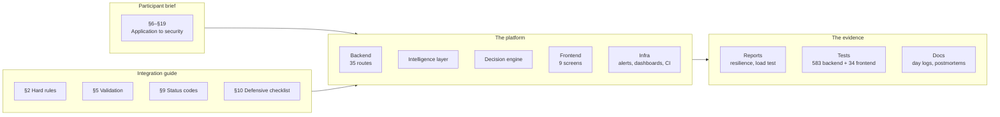

# Requirements traceability

Every requirement in the two organizer documents, mapped to the code that
implements it and the evidence that proves it.

**Sources**

| Document | File | Sections covered |
|---|---|---|
| BUP CSE Fest 2026 Participant-Facing Draft | [`docs/reference/BUP_CSE_FEST_2026_Participant_Facing_Hackathon_Draft.pdf`](reference/BUP_CSE_FEST_2026_Participant_Facing_Hackathon_Draft.pdf) — text extract at [`docs/reference/extracted/participant_brief.txt`](reference/extracted/participant_brief.txt) | §6–§19, §20, §24 |
| BUP Fuel Supply Simulator Integration and Interaction Guide | [`docs/reference/BUP_Fuel_Supply_Simulator_Integration_Guide_Final.pdf`](reference/BUP_Fuel_Supply_Simulator_Integration_Guide_Final.pdf) — text extract at [`docs/reference/extracted/integration_guide.txt`](reference/extracted/integration_guide.txt) | §2, §5, §9, §10 |

**Status values**

| Status | Meaning |
|---|---|
| **Done** | Implemented, and the evidence is a file in this repository that can be opened or a command that can be run |
| **Partial** | Implemented in substance, but something the requirement asks for is missing, or the evidence is weaker than the requirement implies |
| **Not done** | Not implemented, or implemented only in a form the requirement does not accept |

Every status below is backed by a named file, endpoint, screen, test or report.
Where the evidence is a number, the number is quoted from the file that
produced it. Where something could not be verified, it says **not verified**
rather than leaving a gap.

**A note on the numbers.** The horizon-score figures appear twice in the
repository with different magnitudes; see
[Discrepancies](#discrepancies) at the end of this document.

---

## How the requirements are covered

---

# (a) The participant brief — sections 6 to 19

## §6 Application requirement

> *"Every team must build a usable operator-facing application. A notebook
> alone is not considered a complete submission."*

The brief lists twelve things the application should include, as *"a meaningful
subset of"*. All twelve are present.

| # | Requirement | Implementation | Proof | Status |
|---|---|---|---|---|
| 6.1 | Current fuel inventory | `GET /api/state`, `GET /api/depots` | [`docs/screenshots/inventory.png`](screenshots/inventory.png) — the Inventory screen | **Done** |
| 6.2 | Depot and station status | `GET /api/depots`, `GET /api/stations` | [`docs/screenshots/network.png`](screenshots/network.png) — the Network screen | **Done** |
| 6.3 | Regional fuel demand | `GET /api/state` (regions), `GET /api/history/{station_id}` | [`docs/screenshots/network.png`](screenshots/network.png) | **Done** |
| 6.4 | Shortage alerts | `GET /api/alerts` | [`docs/screenshots/risk-alerts.png`](screenshots/risk-alerts.png) — the Risk & alerts screen | **Done** |
| 6.5 | Projected shortage risk | `GET /api/risk` | [`docs/screenshots/risk-alerts.png`](screenshots/risk-alerts.png) | **Done** |
| 6.6 | Incoming supply | `GET /api/supply-arrivals` | [`docs/screenshots/supply-events.png`](screenshots/supply-events.png) | **Done** |
| 6.7 | Disruptions | `GET /api/events` | [`docs/screenshots/supply-events.png`](screenshots/supply-events.png) | **Done** |
| 6.8 | Recommended allocations | `GET /api/recommendations` | [`docs/screenshots/recommendations.png`](screenshots/recommendations.png) | **Done** |
| 6.9 | Expected impact of decisions | `projection` on each recommendation | [`docs/screenshots/recommendations.png`](screenshots/recommendations.png) | **Done** |
| 6.10 | System alerts | `GET /api/alerts` | [`docs/screenshots/risk-alerts.png`](screenshots/risk-alerts.png) | **Done** |
| 6.11 | Decision history | `GET /api/decision-history` | [`docs/screenshots/decision-history.png`](screenshots/decision-history.png) | **Done** |
| 6.12 | Service health | `GET /api/service-health` | [`docs/screenshots/service-health.png`](screenshots/service-health.png) | **Done** |

**A web application is recommended** — it is a React + TypeScript single-page
app in `frontend/src/views/`, with **nine screens**: Overview, Network,
Inventory, Risk & alerts, Recommendations, Supply & events, Decision history,
Service health and Simulation.

**Supporting evidence.** 22 Vitest component tests and 12 Playwright
end-to-end tests. Every view has a loading state and an error state, and the
degraded-mode banner shows the age of the cached data — see
[`docs/architecture.md`](architecture.md) §5.

---

## §7 Intelligence requirement

> *"Every team must implement at least one meaningful intelligent
> capability."*

The brief offers five families. Four are implemented; the fifth (generative
AI) is not.

| Family | Capability | Implementation | Proof | Status |
|---|---|---|---|---|
| **Prediction** | Demand forecasting | `backend/app/intelligence/forecasting.py` — `LearnedPredictor` (scikit-learn), `BaselinePredictor` | [`docs/model-evaluation.md`](model-evaluation.md) — 78.1 L vs 118.1 L of horizon error | **Done** |
| **Prediction** | Shortage prediction | `backend/app/intelligence/risk.py` — `RiskEngine`, hours-to-stockout and stockout probability | [`docs/screenshots/risk-alerts.png`](screenshots/risk-alerts.png) | **Done** |
| **Prediction** | Stockout probability | `backend/app/intelligence/risk.py` — `stockout_probability` on `RiskAssessment` | `GET /api/risk` | **Done** |
| **Prediction** | Estimated supply arrival | `backend/app/intelligence/risk.py` — `InTransitShipment` | `GET /api/supply-arrivals` | **Done** |
| **Prediction** | Transport delay prediction | — | — | **Not done** |
| **Detection** | Anomalous demand | `backend/app/intelligence/detection.py` — `DemandAnomalyDetector` | `GET /api/anomalies`; a ×2.0 spike is detected **1 tick** after injection | **Done** |
| **Detection** | Abnormal inventory changes | `backend/app/intelligence/detection.py` — `InventoryAnomalyDetector` | `GET /api/anomalies` | **Done** |
| **Detection** | Supply-chain bottlenecks | `backend/app/intelligence/detection.py` — `BottleneckDetector` | `GET /api/anomalies` | **Done** |
| **Detection** | Emerging regional disruptions | `backend/app/intelligence/detection.py` — `AnomalyKind` | `GET /api/anomalies` | **Done** |
| **Decision intelligence** | Constrained optimization | `backend/app/decision/optimizer.py` — priority-greedy with the eight simulator rules pre-validated | [`docs/policy-comparison.md`](policy-comparison.md) — `service_level` 1.000000 against 0.656634 | **Done** |
| **Decision intelligence** | Heuristic allocation | `backend/app/decision/optimizer.py` | `GET /api/recommendations` | **Done** |
| **Decision intelligence** | Priority-based allocation | `backend/app/decision/optimizer.py` — urgency ordering by hours-to-stockout | [`docs/policy-comparison.md`](policy-comparison.md) | **Done** |
| **Decision intelligence** | Reinforcement learning | — | — | **Not done** — §8 of the brief marks RL **optional** |
| **Decision intelligence** | Mathematical optimization | — | — | **Not done** — the engine is a heuristic, not a solver |
| **Decision intelligence** | Hybrid policies | `backend/app/decision/fallback.py` — the rule-based fallback alongside the learned model | [`docs/postmortems/08-fallback-never-engaged-stale-forecast.md`](postmortems/08-fallback-never-engaged-stale-forecast.md) | **Done** |
| **Generative AI** | Incident explanation | — | — | **Not done** |
| **Generative AI** | Supply-chain state summarization | — | — | **Not done** |
| **Generative AI** | Operator investigation assistance | — | — | **Not done** |
| **Generative AI** | Human-readable decision explanations | `rationale` on every recommendation — **rule-generated, not LLM-generated** | `GET /api/recommendations` | **Partial** — the explanation exists and is deterministic, but no LLM produces it |

The brief notes: *"LLMs should support the operational system rather than
merely provide a chatbot around the application."* No LLM is used at all, so
this constraint is not violated — but the generative-AI family is not covered.

**Requirement as a whole: Done.** At least one meaningful capability is
required; the platform has eleven.

**The honest caveat on the model's edge.** The learned model is used when it
earns it. Over the forecast horizon it beats the rule-based baseline by
**34 %** (78.1 L against 118.1 L), and it wins **35 of 48** window/pair
comparisons. But the score that *gates* the model is the held-out one-step
comparison, not the horizon — see
[`docs/postmortems/07-benchmark-leaked-the-future.md`](postmortems/07-benchmark-leaked-the-future.md)
for why the horizon score was demoted to a diagnostic.

---

## §8 Reinforcement learning (optional)

> *"Reinforcement learning is optional."*

**Not done.** No RL is implemented, and no claim is made that the platform
would benefit from one. The brief's condition — *"if RL is used, teams should
demonstrate why it provides useful behavior compared with a reasonable
rule-based or heuristic approach"* — does not apply.

---

## §9 Decision support

> *"Important recommendations should be inspectable."*

The brief shows a worked example with six fields and then asks for more:
*"why an area is considered at risk, which signals influenced the
recommendation, relevant constraints, expected impact, confidence or
uncertainty, and alternative actions."*

| Field in the brief's example | Implementation | Status |
|---|---|---|
| Station | `Recommendation.station_id` | **Done** |
| Fuel | `Recommendation.fuel_type` | **Done** |
| Projected stockout (hours) | `Recommendation.hours_to_stockout` | **Done** |
| Current inventory | from `GET /api/state` | **Done** |
| Expected demand | `GET /api/forecast` | **Done** |
| Recommended allocation (from where, how much) | `Recommendation.source_depot_id`, `.quantity`, `.route_id` | **Done** |
| Expected result (risk before → after) | `Recommendation.projection` — `risk_level_before` / `risk_level_after` | **Done** |

| Field the brief asks for | Implementation | Status |
|---|---|---|
| Why an area is at risk | `Recommendation.signals` | **Done** |
| Which signals influenced the decision | `Recommendation.signals` | **Done** |
| Relevant constraints | `Recommendation.constraints` | **Done** |
| Expected impact | `Recommendation.projection` | **Done** |
| Confidence or uncertainty | `Recommendation.confidence` | **Done** |
| Alternative actions | `Recommendation.alternatives` | **Done** |

**"Human operators should remain able to inspect important decisions."**
`GET /api/recommendations/{recommendation_id}` returns the full record;
`GET /api/decision-history` returns the audit trail of every decision with
who made it and when. The explanation drawer is
[`docs/screenshots/risk-explanation-drawer.png`](screenshots/risk-explanation-drawer.png).

**The `Recommendation` dataclass** is in
[`backend/app/decision/models.py`](../backend/app/decision/models.py).

---

## §10 Crisis and event handling

> *"During the hackathon, organizers may introduce changes to the simulated
> environment."*

The brief names five scenarios. The crisis drill runs all five plus two more
the simulator supports.

| Scenario | What the brief says the system should show | Detection | Recovery | Status |
|---|---|---|---|---|
| **Shipment delay** | Warning, shortage impact, decision response, recovery | **2.0 s** | 0.0 s | **Done** |
| **Demand spike** | Risk change, forecast/detection response, allocation adaptation | **2.0 s** | 0.0 s | **Done** |
| **Depot constraint** | Constraint handling, reallocation, service impact | **2.0 s** | 0.0 s | **Done** |
| **Regional disruption** | Alternative allocation and recovery behavior | **4.0 s** | 0.0 s | **Done** |
| **Combined crisis** | End-to-end resilience and failure boundaries | **2.0 s** | 0.0 s | **Done** |

A **route disruption** is the drill's *"regional disruption"* case — the
simulator's `route_disruption` event sets routes to `DISRUPTED` and the
platform re-plans onto a backup route (for example Patiya → Mirpur). Two
further crisis types the simulator supports are also drilled: **station
outage** (2.0 s) and **supply shortfall** (2.0 s).

**Proof.** [`docs/resilience-report.md`](resilience-report.md) — the detection
time, the recovery time and the action taken are recorded for each scenario,
measured against the running stack by
[`scripts/crisis_drill.py`](../scripts/crisis_drill.py).

**"Teams should demonstrate how their system detects, evaluates, responds,
explains, and monitors recovery."** Each of those five verbs has a named
mechanism: detection is the risk engine's threshold crossing and the
anomaly detectors; evaluation is the risk projection; response is the
optimizer's re-plan; explanation is the `rationale` and the `signals`; and
monitoring of recovery is the drill's own poll loop plus the `sync` status on
`/health`.

---

## §11 Surprise hackathon events

> *"Some events may not be announced at the beginning of the hackathon."*

Six event types are named. All six are handled, though two are handled
without a dedicated drill scenario.

| # | Surprise event | How the platform handles it | Proof | Status |
|---|---|---|---|---|
| 1 | Fuel shipment delayed | `shipment_delay` event → `supply_arrivals` show `DELAYED` → the risk engine sees the delayed arrival | Drill scenario *"Shipment delay"*, detected in 2.0 s | **Done** |
| 2 | Demand suddenly increases | `demand_spike` event → `demand_multiplier` mutates → the demand detector fires | Drill scenario *"Demand spike"*, detected in 2.0 s | **Done** |
| 3 | Prediction service becomes unavailable | The evaluation fails → the stale result is dropped → the rule-based fallback policy takes over, with the confidence capped at 0.4 | Drill scenarios *"Prediction layer disabled"* and *"Prediction layer broken"*, both 0.0 s | **Done** |
| 4 | Incoming data contains missing or malformed fields | Every simulator response is validated against a closed Pydantic model before it reaches the platform; a malformed payload raises `SimulatorValidationError` and is counted | `backend/tests/test_simulator_client_errors.py::test_a_malformed_body_is_rejected_not_passed_on`, `::test_a_payload_with_an_extra_field_is_rejected`, `::test_a_payload_with_a_wrong_type_is_rejected` | **Done** — **no dedicated drill scenario** |
| 5 | API traffic increases significantly | The load test ramps to 50 users; the p99 at 50 users is **326.93 ms** | [`docs/load-test-report.md`](load-test-report.md) — the ramp table | **Done** |
| 6 | A dependency becomes slow or unavailable | The `latency` fault is detected in **12.4 s**; `unavailable` in **2.1 s**; the circuit breaker opens and the API degrades to cached state with an age | Drill scenarios *"Latency"*, *"Unavailable"*, *"Database stopped"*, *"Simulator connection-pool exhaustion"* | **Done** |

**Gap:** event 4 is proven by unit tests but was never drilled as a live
scenario — a malformed payload was never injected into the running simulator.
It is listed under [gaps](#gaps).

---

## §12 Application resilience

> *"Teams must define what happens when something goes wrong."*

Four rules. All four are implemented and each is proven by a named mechanism.

| Rule | Mechanism | Proof | Status |
|---|---|---|---|
| **ML model unavailable → fallback allocation policy** | `backend/app/decision/fallback.py`; the model is disabled by the kill-switch or the evaluation fails | `backend/tests/test_decision_fallback_lifecycle.py::test_a_failed_evaluation_drops_the_stale_result`; drill scenario *"Prediction layer broken"* | **Done** |
| **Invalid simulator response → reject input + raise alert** | Every response validated against a closed Pydantic model; `SimulatorValidationError` raised and counted in `SIMULATOR_VALIDATION_REJECTIONS` | `backend/tests/test_simulator_client_errors.py::test_a_malformed_body_is_rejected_not_passed_on` | **Done** — see the [§11](#11-surprise-hackathon-events) gap |
| **Prediction confidence too low → human review requested** | `backend/app/decision/optimizer.py` sets `needs_human_review=True` when `confidence < 0.6`; the auto-mode's bar is higher still (`WATCH`-level only, confidence ≥ 0.85, no human-review flag) | `backend/app/decision/optimizer.py`; `backend/app/decision/service.py::_auto_eligible` | **Done** |
| **Backend dependency unavailable → retry / cached state / degraded mode** | Bounded retry with backoff, a circuit breaker, the state cache with a degraded flag and an age, and the `/api/service-health` panel | [`docs/resilience-report.md`](resilience-report.md) — 4 dependency-failure scenarios | **Done** |

**The mechanisms the brief lists as encouraged** — fallback logic, graceful
degradation, retries, timeout handling, health checks, cached state,
validation, circuit breakers and rollback — are all present:

| Mechanism | Where |
|---|---|
| Fallback logic | `backend/app/decision/fallback.py` |
| Graceful degradation | `backend/app/state_cache.py` — the degraded flag and the cached-state age |
| Retries | `backend/app/simulator_client.py::_request`, `backend/app/db.py::write` |
| Timeout handling | `backend/app/simulator_client.py::_timeout_for` |
| Health checks | `GET /health`, `GET /ready`, `GET /api/service-health` |
| Cached state | `backend/app/state_cache.py` |
| Validation | Closed Pydantic models on every simulator response and every request body |
| Circuit breakers | `backend/app/circuit_breaker.py` |
| Rollback | [`docs/deployment.md`](deployment.md) — the immutable sha tag |

---

## §13 DevOps requirement

> *"Every system must be deployable."*

| Requirement | Implementation | Proof | Status |
|---|---|---|---|
| A reproducible way to launch the application | `docker-compose.yml` — two profiles, `core` and `monitoring` | `cp .env.example .env && docker compose up --build -d --wait` | **Done** |
| Source → Build → Test → Package → Deploy → Health Check → Running | The whole chain exists: git → GitHub Actions → images in GHCR → compose → `/health` | [`.github/workflows/ci.yml`](../.github/workflows/ci.yml), [`.github/workflows/release.yml`](../.github/workflows/release.yml) | **Done** |
| A CI/CD workflow (strongly encouraged) | Two workflows: `ci.yml` on push and pull request, `release.yml` on a version tag | The `ci.yml` jobs are lint, test, frontend, frontend e2e, docker-build, compose-config, compose-smoke and coverage | **Done** |

**The CI pipeline, job by job:**

| Job | What it does | Status |
|---|---|---|
| `lint` | ruff lint and format | **Done** |
| `test` | pytest | **Done** |
| `frontend` | typecheck + unit tests + build | **Done** |
| `frontend e2e` | Playwright against the whole stack | **Done** |
| `docker-build` | Both images built, with a live health check against a real simulator and Postgres | **Done** |
| `compose-config` | `docker compose config` | **Done** |
| `compose-smoke` | Copy the `.env`, `docker compose up --wait`, check `/health` for every component, check the state, run the integration suite | **Done** |
| `coverage` | The coverage floors | **Done** |

**A deployable, reproducible stack.** The compose smoke test in CI is the
proof: it builds the images, starts the stack the way a judge would, and
checks the health of every component.

---

## §14 Advanced DevOps (optional)

> *"These are optional. Do not introduce infrastructure complexity unless it
> improves your solution."*

| Item | Status |
|---|---|
| Kubernetes | **Not done** |
| Helm | **Not done** |
| Infrastructure as Code / Terraform | **Not done** |
| GitOps | **Not done** |
| Automated rollback | **Partial** — the rollback target is documented and the immutable sha tag is published, but the rollback itself is a manual `docker compose` action. See [`docs/deployment.md`](deployment.md) |
| Blue/green deployment | **Not done** |
| Canary deployment | **Not done** |
| Autoscaling | **Not done** |
| Distributed services | **Not done** — deliberately a modular monolith |
| Service discovery | **Not done** |
| Queue-based processing | **Not done** — the background sync is an `asyncio` task in the same process |

---

## §15 Observability requirement

> *"Teams must implement meaningful observability covering the
> application."*

Four layers are named. All four are implemented.

| Layer | What the brief lists | Implementation | Proof | Status |
|---|---|---|---|---|
| **Application** | Request rate, latency, error rate, service availability | `backend/app/metrics.py` — `HTTP_REQUESTS`, `HTTP_REQUEST_DURATION`; the middleware in `backend/app/main.py` | `infra/grafana/provisioning/dashboards/application.json` | **Done** |
| **System** | CPU, memory, resource utilization | The backend publishes its own cgroup fraction; node-exporter covers the host | `infra/grafana/provisioning/dashboards/system.json` | **Done** |
| **Intelligence** | Prediction error, model confidence, shortage-alert rate, decision frequency, fallback activation | `PREDICTION_ERROR_MAE`, `MODEL_CONFIDENCE`, `RISK_ASSESSMENTS`, `DECISIONS_PROPOSED`, `FALLBACK_ACTIVATIONS`, `DECISION_FALLBACK_ACTIVATIONS`, `NEEDS_HUMAN_REVIEW` | `infra/grafana/provisioning/dashboards/intelligence.json` | **Done** |
| **Logs** | Important actions, integration failures, decision events, recoveries | `backend/app/logging_config.py` — structured JSON with correlation IDs | The audit trail at `GET /api/audit` | **Done** |

**Distributed tracing is optional** — not implemented.

**Alerting.** `infra/prometheus/alerts.yml` holds **21 alert rules** in four
groups: `simulator`, `application`, `degraded` and `system`. Six of them were
**fired and watched**, not merely written.

**Dashboards.** Five, provisioned as code: Application, System, Intelligence,
Integration and Overview. Four were captured against the live stack in
[`docs/screenshots/resilience/`](screenshots/resilience/).

---

## §16 Health and status

> *"Judges should be able to understand whether the system itself is
> healthy."*

The brief shows an example with five components plus two figures. All of them
are present.

| In the brief's example | Implementation | Status |
|---|---|---|
| Backend API | `GET /api/service-health` → `components.backend` | **Done** |
| Database | `GET /api/service-health` → `components.database` | **Done** |
| Fuel Simulator | `GET /api/service-health` → `components.simulator` | **Done** |
| Prediction Service | `GET /api/service-health` → `components.prediction_service` | **Done** — reported as *degraded*, not *ok*, when the model is not the one answering |
| Decision Engine | `GET /api/service-health` → `components.decision_engine` | **Done** |
| p95 Latency | from the Prometheus registry | **Done** |
| Error Rate | from the Prometheus registry | **Done** |

`GET /health` is the liveness probe — it reports the backend, the simulator
and the database, and answers **503** when the platform is not healthy.
`GET /ready` is deliberately **narrower** than liveness: the backend is alive
as soon as the process is running, but it is only ready when it has a
database connection and a simulator client.

**The simulator's state is read from the sync cache, not from a live probe.**
The dashboard polls this endpoint every few seconds; a live probe would block
for the whole simulator timeout each time the simulator is slow, and the
panel would become the slowest thing on the page.

**The panel never says "ok" when the model is broken.** That is the one thing
the panel must not do, and it is pinned by
`backend/tests/test_dashboard_api.py::test_the_service_health_panel_does_not_block_on_the_simulator`.

---

## §17 Data

> *"The primary operational data will come from the organizer-provided
> simulation environment."*

| Requirement | Status |
|---|---|
| Primary data from the simulator | **Done** — every number the dashboard shows comes from the simulator's REST endpoints |
| Any external or generated data documented | **Done** — [`docs/architecture.md`](architecture.md) §3 lists the data sources |
| Public datasets, synthetic data, derived features, generated history, additional context | **Done** — the platform uses *derived features* only: the tick's position within the simulated day, hour-of-day factors, region demand factors and observed multipliers. No synthetic or external dataset is used |

**Not done:** the platform does not use public datasets, synthetic data or
generated historical data. It does not need to — the brief says teams are not
required to manufacture a fuel dataset.

---

## §18 Load testing

> *"Each team must load-test at least one meaningful application path."*

Three workloads were run, against the running stack.

| Measurement the brief lists | Dashboard read path | Recommendation read path | End-to-end decision request | Status |
|---|---|---|---|---|
| Average latency | 66.05 ms | 166.28 ms | 210.24 ms | **Done** |
| p50 latency | 53.24 ms | 124.36 ms | 149.77 ms | **Done** |
| p95 latency | 196.80 ms | 327.79 ms | 416.64 ms | **Done** |
| p99 latency | **286.13 ms** | **382.83 ms** | **985.85 ms** | **Done** |
| Throughput | 335.39 req/s | 133.18 req/s | 70.91 req/s | **Done** |
| Error rate | 0.00% | 0.00% | 0.00% | **Done** |
| Concurrency | 1 → 50 users | — | — | **Done** — the ramp table |
| Resource usage | CPU 0.060 cores peak, memory 102 MB peak | — | — | **Done** |

**The ramp** — the brief's emphasis is *"understanding the behavior and limits
of the implemented system rather than achieving an arbitrary benchmark"*, and
that is what the report does:

| Users | Requests | Throughput | p50 | p95 | p99 | Errors |
|---|---|---|---|---|---|---|
| 1 | 2,500 | 155.97 req/s | 2.06 ms | 20.77 ms | 86.74 ms | 0 |
| 5 | 6,022 | 285.11 req/s | 9.13 ms | 70.39 ms | 134.64 ms | 0 |
| 20 | 10,123 | 387.95 req/s | 34.18 ms | 130.27 ms | 195.41 ms | 0 |
| 50 | 13,055 | 417.62 req/s | 88.77 ms | 251.27 ms | 326.93 ms | 0 |

**Proof.** [`docs/load-test-report.md`](load-test-report.md), with the raw
results in [`scripts/loadtest/results/`](../scripts/loadtest/results/). The
harness is a host-side `httpx`/`asyncio` script — **no extra container** — with
a Locust file alongside it.

**The bottleneck the load test found** is documented in
[`docs/postmortems/03-oom-kill-prediction-evaluations.md`](postmortems/03-oom-kill-prediction-evaluations.md):
a Python-side aggregate over a 928,005-row table that OOM-killed the container
nine times. The p99 went from **30,029.78 ms** to **286.13 ms** and the
memory peak from **670 MB** to **102 MB**.

---

## §19 Security and engineering hygiene

> *"Teams should demonstrate basic software engineering hygiene."*

| Requirement | Implementation | Proof | Status |
|---|---|---|---|
| Do not hard-code secrets | Every credential is environment-driven; `.env` is gitignored and `.env.example` holds only defaults (`change-me-in-env`) | `git ls-files` lists only `.env.example`; `.gitignore` line 11 ignores `.env` | **Done** |
| Validate external input | Every simulator response is validated against a closed Pydantic model (`extra="forbid"`, closed enums); every request body is validated the same way; an unknown field is a 422 | `backend/app/simulator_client.py::_decode`; `backend/app/main.py` | **Done** |
| Handle failed requests appropriately | Every documented simulator error code has its own exception class; both error envelope shapes parse onto one hierarchy | `backend/app/simulator_errors.py` | **Done** |
| Document required configuration | `.env.example` lists every variable with its default and its meaning | [`.env.example`](../.env.example) | **Done** |
| Avoid exposing credentials | No secret in the source, the images, the compose file or the CI configuration; the CI uses `secrets.GITHUB_TOKEN` and nothing else | [`docs/architecture.md`](architecture.md) §6 | **Done** |
| Restrict sensitive operator actions | No allocation reaches the simulator without a human approval; the auto-mode is **off by default** and its bar is high | `backend/app/decision/service.py::_auto_eligible` | **Done** |

**"Teams are not expected to build enterprise-grade security within the
hackathon duration."** The platform does not implement authentication on its
own endpoints — it relies on the network boundary. That is a deliberate
choice, recorded under [gaps](#gaps).

---

# (b) The deliverables and the evaluation criteria

## §20 Required deliverables — the eleven

| # | Deliverable | Where | Proof | Status |
|---|---|---|---|---|
| 1 | **Working application** | `docker-compose.yml` | [`scripts/demo_dry_run.sh`](../scripts/demo_dry_run.sh) — every step executed and checked; the fresh-clone proof in [`docs/progress/day7.md`](progress/day7.md) | **Done** |
| 2 | **Source repository** | This repository | The commit history — one commit per day's work, each message explaining *why*; the daily log [`docs/progress/day1.md`](progress/day1.md) … [`day7.md`](progress/day7.md) | **Done** |
| 3 | **Simulator integration** | `backend/app/simulator_client.py`, `simulator_models.py`, `simulator_errors.py` | [`docs/simulator-notes.md`](simulator-notes.md) — the observed behaviour and the **10 discrepancies** with the guide; `backend/tests/test_simulator_contract.py` pins each one | **Done** |
| 4 | **Intelligence component** | `backend/app/intelligence/` | [`docs/model-evaluation.md`](model-evaluation.md) — the forecast accuracy over a six-day run, and the defects the evaluation exposed: the leaky horizon benchmark (§3.2), the rule-based baseline's own bug (§3.3), the dead horizon check (§3.5) and the fallback triggers (§6) | **Done** |
| 5 | **Operator interface** | `frontend/src/views/` — nine screens | [`docs/screenshots/`](screenshots/) — eleven screenshots; 22 Vitest and 12 Playwright tests | **Done** |
| 6 | **Architecture diagram** | [`docs/architecture.md`](architecture.md) §1 | The Mermaid diagram, plus the rendered image at [`docs/assets/architecture-mermaid.png`](assets/architecture-mermaid.png) | **Done** |
| 7 | **Deployment** | `docker-compose.yml`, `docker-compose.release.yml` | The CI compose smoke test; [`docs/deployment.md`](deployment.md) | **Done** |
| 8 | **Observability evidence** | `infra/prometheus/`, `infra/grafana/provisioning/` | 21 alert rules, 5 dashboards, the screenshots in [`docs/screenshots/resilience/`](screenshots/resilience/) | **Done** |
| 9 | **Resilience demonstration** | [`docs/resilience-report.md`](resilience-report.md), [`docs/fault-tests.md`](fault-tests.md) | [`scripts/crisis_drill.py`](../scripts/crisis_drill.py) — **17 of 17** scenarios recovered automatically, each with a measured detection and recovery time | **Done** |
| 10 | **Load-test evidence** | [`docs/load-test-report.md`](load-test-report.md) | The workload definition and the raw results in [`scripts/loadtest/results/`](../scripts/loadtest/results/) | **Done** |
| 11 | **Final demo** | [`docs/demo-script.md`](demo-script.md) | The **fourteen** steps of the brief's suggested story, each with the exact command or click and what to say while doing it; [`scripts/demo_dry_run.sh`](../scripts/demo_dry_run.sh) executes and checks them | **Done** |

**A twelfth, for completeness:** the brief asks for a *"Decision engine"* in
the typical architecture (§5) but does not list it as a deliverable. It is
built — `backend/app/decision/` — and documented in
[`docs/policy-comparison.md`](policy-comparison.md).

## §21 Recommended deliverables

| Item | Status |
|---|---|
| CI/CD | **Done** — two GitHub Actions workflows |
| Automated tests | **Done** — 583 backend, 22 Vitest, 12 Playwright |
| Experiment tracking | **Not done** — no MLflow, W&B or equivalent |
| Model versioning | **Partial** — a model records `trained_at` and its metadata, but there is no model registry and no way to roll back to a previous model |
| Decision audit history | **Done** — `GET /api/decision-history`, the `decision_records` table |
| Deployment versioning | **Done** — the release workflow publishes three tags: the version, the version plus sha, and `latest` |
| Simulation replay | **Partial** — the write paths are idempotent and a replayed sync cycle updates nothing, but there is no replay feature that re-runs a recorded scenario |
| Scenario configuration | **Done** — the platform injects events through `POST /api/simulation/crisis` |
| Automated fallback | **Done** — the rule-based fallback engages without a human |
| Rollback | **Partial** — documented and the target is immutable, but the rollback is a manual action |

## §22 Optional advanced work

| Item | Status |
|---|---|
| Reinforcement learning | **Not done** |
| Multi-agent decision systems | **Not done** |
| Optimization + ML hybrids | **Partial** — the learned model forecasts and the optimizer allocates; the two are separate stages, not a joint hybrid |
| Uncertainty-aware allocation | **Done** — every forecast carries a confidence band, and the decision engine reads the confidence |
| Counterfactual simulation | **Partial** — `POST /api/recommendations/{id}/simulate` replays the forecast against the fuel the shipment would deliver, locally. It does not ask the simulator what would happen |
| What-if analysis | **Partial** — the same `simulate` endpoint |
| Automated incident detection | **Done** — the anomaly and bottleneck detectors, and the degradation alarms |
| Policy rollback | **Partial** — the auto-mode can be switched off; the policy itself cannot be rolled back to a previous version |
| Drift detection | **Not done** — the model is rescored on every evaluation and the horizon score is published, but there is no drift alarm |
| Event-driven architecture | **Done** — the SSE stream drives the sync cycle |
| Streaming systems | **Done** — the SSE reader and the event-driven dispatcher |
| Kubernetes deployment | **Not done** |
| Autoscaling | **Not done** |
| Generative-AI operations assistants | **Not done** |

## §24 Evaluation criteria — the eight, with weights

| Criterion | Weight | What the platform does | Proof | Status |
|---|---|---|---|---|
| **Working Product & User Experience** | **20 %** | Nine screens, every one with a loading state and an error state; a degraded-mode banner that shows the age of the cached data; a responsive layout at 430 px | [`docs/screenshots/`](screenshots/) — eleven screenshots; 22 Vitest + 12 Playwright tests | **Done** |
| **Intelligence & Decision Quality** | **20 %** | A learned predictor scored honestly against a rule-based baseline, a risk engine with hours-to-stockout and stockout probability, three detectors, and a constraint-aware optimizer that pre-validates every simulator rule | [`docs/model-evaluation.md`](model-evaluation.md); [`docs/policy-comparison.md`](policy-comparison.md) — `service_level` 1.000000 against 0.656634 | **Done** — with the caveats in [§7](#7-intelligence-requirement) and in [`postmortems/07`](postmortems/07-benchmark-leaked-the-future.md) |
| **Architecture & Integration** | **15 %** | A modular monolith with four layers; all 22 simulator endpoints covered; **10 discrepancies** between the guide and the running image found, documented and pinned by tests | [`docs/architecture.md`](architecture.md); [`docs/simulator-notes.md`](simulator-notes.md); `backend/tests/test_simulator_contract.py` | **Done** |
| **DevOps & Engineering Quality** | **15 %** | Eight CI jobs including a compose smoke test that starts the whole stack the way a judge would; a release workflow with an immutable sha tag; 617 automated tests | [`.github/workflows/ci.yml`](../.github/workflows/ci.yml), [`docs/deployment.md`](deployment.md) | **Done** |
| **Resilience & Incident Response** | **15 %** | **17 of 17** scenarios recovered automatically with no backend restart; the four resilience rules of §12 each implemented; eight postmortems written | [`docs/resilience-report.md`](resilience-report.md); [`docs/postmortems/`](postmortems/) | **Done** |
| **Observability & Performance** | **10 %** | Four observability layers, 21 alert rules (six fired and watched), five dashboards, a p99 of 286.13 ms and an OOM-free container | [`docs/screenshots/resilience/`](screenshots/resilience/); [`docs/load-test-report.md`](load-test-report.md) | **Done** |
| **Demo & Problem Understanding** | **5 %** | The brief's fourteen-step story, executed and checked by the dry run; the demo script says what to say at each step | [`docs/demo-script.md`](demo-script.md); [`scripts/demo_dry_run.sh`](../scripts/demo_dry_run.sh) | **Done** |

**Total: 100 %.** All eight criteria are addressed by named, openable evidence.

**The honest note on "Intelligence & Decision Quality".** The criterion
assesses *"usefulness and quality of AI / ML / optimization / detection;
appropriate methodology"*. The methodology is documented and its weaknesses
are published rather than hidden — the horizon score was demoted to a
diagnostic because it was leaky, and the model that gates on a held-out
one-step comparison beats the baseline by **0.82–0.90** of its error at every
tick from 16 onwards. But the model is **not** better than the baseline on
every measure, and the platform says so.

---

# (c) The integration guide

## §2 Hard rules

Eight rules. All eight are followed.

| # | Rule | How the platform obeys it | Status |
|---|---|---|---|
| 1 | **The simulator is the world, not the brain.** It does not predict, optimize, recommend or decide. | All forecasting, risk, detection and allocation logic is in `backend/app/intelligence/` and `backend/app/decision/`. The simulator is only read from and written to. | **Done** |
| 2 | **REST is the source of truth. Treat SSE as a notification stream — always re-GET the affected resource after every event.** | `/api/state` reads the cache, never the simulator. `_handle_event` re-reads only the affected resource. The full refetch after a reconnect is pinned by `backend/tests/test_sync_service.py::test_stream_reconnect_triggers_a_full_rest_refetch`. | **Done** |
| 3 | **The world is deterministic.** Same scenario + seed + actions + events ⇒ byte-identical state. | The platform never writes to the world except through `POST /v1/allocations`, and every write carries an idempotency key. The admin `/step` endpoint drives deterministic single-tick advances. | **Done** |
| 4 | **The scenario is baked into the image. The active scenario cannot be switched at runtime.** | The platform does not attempt to switch it. Crisis events are injected through `POST /admin/events` as the guide describes. | **Done** |
| 5 | **One simulator instance per participant. Single-tenant local.** | One simulator client, one world. | **Done** |
| 6 | **Do not modify the simulator source to solve the challenge.** | The simulator's image is unmodified and the container is untouched. [`docs/resilience-report.md`](resilience-report.md) records *"The simulator itself unmodified"*. A read-only copy of the simulator's source is in `docs/reference/extracted/simulator_src/` for **reference only**. | **Done** |
| 7 | **`/admin/*` paths bypass all fault injection. To test fault handling, hit `/v1/*` paths only. `/v1/health` also bypasses faults.** | Every fault scenario in [`docs/fault-tests.md`](fault-tests.md) is injected with `POST /admin/faults` and observed through `/v1/*`. The platform's own liveness check uses `/v1/health`. | **Done** |
| 8 | **Only allocations can be written from `/v1/*`. Every other resource is read-only.** | The client's only two write methods are `create_allocation` and `cancel_allocation`. Every other method is a `GET`. | **Done** |

## §5 Validation rules — all nine

The guide's §5.2 gives the validation order, *"first failure wins"*. The
decision engine implements the same order, and the simulator rejects
accordingly.

| # | Rule | Trigger | Platform's exception class | Pre-validated? | Status |
|---|---|---|---|---|---|
| 1 | **Idempotency check** | Same key, same body → 201; same key, different body → 409 | `IdempotencyKeyMismatchError` | Yes — every recommendation carries its own idempotency key | **Done** |
| 2 | **NOT_FOUND (404)** | Depot, station or route id unknown | `EntityNotFoundError` | Yes — `backend/app/decision/validator.py` | **Done** |
| 3 | **ROUTE_MISMATCH (409)** | The route's (source, destination) ≠ the request's | `RouteMismatchError` | Yes — validator rule 1 | **Done** |
| 4 | **DEPOT_CLOSED (409)** | `depot.status` ∉ {OPEN, CONSTRAINED} | `DepotClosedError` | Yes — validator rule 2 | **Done** |
| 5 | **STATION_CLOSED (409)** | `station.status` ≠ OPEN | `StationClosedError` | Yes — validator rule 3 | **Done** |
| 6 | **ROUTE_DISRUPTED (409)** | `route.status` ≠ AVAILABLE | `RouteDisruptedError` | Yes — validator rule 4 | **Done** |
| 7 | **ROUTE_CAPACITY_EXCEEDED (409)** | `quantity` > `route.max_shipment` | `RouteCapacityExceededError` | Yes — validator rule 5 | **Done** |
| 8 | **INSUFFICIENT_INVENTORY (409)** | `depot.inventory[fuel]` < `quantity` | `InsufficientInventoryError` | Yes — validator rule 6 | **Done** |
| 9 | **DISPATCH_CAPACITY_EXCEEDED (409)** | In-flight + pending on this tick + `quantity` > `dispatch_capacity_per_tick` | `DispatchCapacityExceededError` | Yes — validator rule 7 | **Done** |
| 10 | **DESTINATION_CAPACITY_EXCEEDED (409)** | `station.inventory[fuel]` + `quantity` > `station.capacity[fuel]` | `DestinationCapacityExceededError` | Yes — validator rule 8 | **Done** |

**All nine are pre-validated before the platform proposes anything.** The
engine never proposes something that would come back as a 409 — the
`constraints` list on each recommendation records every check and whether it
passed. The `ROUTE_CAPACITY_EXCEEDED` case is handled by *splitting* a
deficit above the route's `max_shipment` into multiple shipments rather than
by refusing.

**The guide's numbering.** §5.2's list has the idempotency check as a
separate first item, followed by eight 409-style rules. The table above
numbers them the guide's way; the platform's `validator.py` implements the
eight rule checks in the guide's order.

**Cancellation.** `POST /v1/allocations/{id}/cancel` — 200 for a PENDING
allocation, 404 `ALLOCATION_NOT_FOUND`, 409 `CANNOT_CANCEL` for a non-PENDING
one. `CannotCancelError` is the platform's class for it.

## §9 Status codes

Fourteen status codes. Every one has a defined platform behaviour.

| HTTP | Code | Trigger | The platform's handling | Status |
|---|---|---|---|---|
| 200 | — | Idempotent replay of an existing allocation | The client returns the existing allocation. Note: the guide says 200, but the running image returns **201** — see [`docs/simulator-notes.md`](simulator-notes.md) D2 | **Done** |
| 201 | — | New allocation accepted | The allocation id is cached and returned | **Done** |
| 404 | `NOT_FOUND` | Depot, station or route id unknown | `EntityNotFoundError`; the ids are checked against `/v1/depots`, `/v1/stations`, `/v1/routes` | **Done** |
| 404 | `ALLOCATION_NOT_FOUND` | Cancel on an unknown allocation id | `AllocationNotFoundError` | **Done** |
| 409 | `IDEMPOTENCY_KEY_MISMATCH` | Same key, different body | `IdempotencyKeyMismatchError`; the first submission wins and a new key is used | **Done** |
| 409 | `ROUTE_MISMATCH` | The route connects different endpoints | `RouteMismatchError`; a matching route is chosen | **Done** |
| 409 | `DEPOT_CLOSED` | `depot.status` ∉ {OPEN, CONSTRAINED} | `DepotClosedError`; wait for the `depot_constraint` event to resolve | **Done** |
| 409 | `STATION_CLOSED` | `station.status` ≠ OPEN | `StationClosedError`; wait for the `station_outage` event to resolve | **Done** |
| 409 | `ROUTE_DISRUPTED` | `route.status` ≠ AVAILABLE | `RouteDisruptedError`; the engine falls back to the backup route | **Done** |
| 409 | `ROUTE_CAPACITY_EXCEEDED` | `quantity` > `route.max_shipment` | `RouteCapacityExceededError`; the deficit is split into smaller allocations | **Done** |
| 409 | `INSUFFICIENT_INVENTORY` | The depot does not have the fuel | `InsufficientInventoryError`; the platform waits for the next supply arrival | **Done** |
| 409 | `DISPATCH_CAPACITY_EXCEEDED` | The depot's per-tick dispatch allowance is exhausted | `DispatchCapacityExceededError`; the platform waits for the next tick | **Done** |
| 409 | `DESTINATION_CAPACITY_EXCEEDED` | The station's tank would overflow | `DestinationCapacityExceededError`; the quantity is capped at the tank's capacity | **Done** |
| 409 | `CANNOT_CANCEL` | Cancel on a non-PENDING allocation | `CannotCancelError`; the shipment is already in motion | **Done** |
| 422 | (Pydantic) | Bad enum, missing field, `duration_ticks=0`, `quantity` ≤ 0 | Every request body is validated client-side; an unknown field is a 422 | **Done** |
| 503 | `FAULT_INJECTED` | An active `unavailable`, `error_rate` or `stream_disconnect` fault | Bounded backoff and retry, then the circuit breaker opens and the API degrades to cached state with an age | **Done** |

**The two error envelope shapes.** The guide notes that `/v1/allocations`
errors come back as `{"detail": {"code": ...}}` while injected faults come
back as `{"error": {"code": ...}}` — *"note the difference: error vs
detail"*. `backend/app/simulator_errors.py::parse_error_detail` handles
**both** envelopes and returns the same `ErrorDetail`. A third shape,
FastAPI's `{"detail": [...]}`, is recognised and returns `None` rather than
being mis-parsed.

## §10 Defensive client checklist — the 13 endpoints

Every endpoint is implemented, and each has a dedicated method on the
simulator client.

| # | Endpoint | The platform's method | What it is used for | Status |
|---|---|---|---|---|
| 1 | `GET /v1/health` | `client.health()` | Liveness probe — bypasses faults | **Done** |
| 2 | `GET /v1/instance` | `client.get_instance()` | Current tick, `sim_time`, status, seed | **Done** |
| 3 | `GET /v1/depots` | `client.get_depots()` | Capacity, inventory, `dispatch_capacity_per_tick` | **Done** |
| 4 | `GET /v1/stations` | `client.get_stations()` | Inventory, `demand_multiplier`, capacity | **Done** |
| 5 | `GET /v1/routes` | `client.get_routes()` | Availability, `max_shipment`, `transit_ticks` | **Done** |
| 6 | `GET /v1/supply-arrivals` | `client.get_supply_arrivals()` | Upcoming deliveries | **Done** |
| 7 | `GET /v1/events` | `client.get_events()` | Past, active and scheduled crisis events | **Done** |
| 8 | `GET /v1/allocations` | `client.get_allocations()` | The shipment ledger | **Done** |
| 9 | `GET /v1/demand-history` | `client.get_demand_history()` | The time series for forecasting — `limit` clamped to [1, 2000] | **Done** |
| 10 | `GET /v1/metrics` | `client.get_metrics()` | `service_level` and `allocation_failures` | **Done** |
| 11 | `POST /v1/allocations` | `client.create_allocation()` | Submit a shipment — returns 201/200/404/409/503 | **Done** |
| 12 | `POST /v1/allocations/{id}/cancel` | `client.cancel_allocation()` | Refunds a PENDING allocation only | **Done** |
| 13 | `GET /v1/stream` | `client.stream()` | The SSE feed — queue size 200, 15 s keepalive | **Done** |

**Six more** the platform also uses, which the checklist does not list:
`GET /v1/regions`, `GET /v1/depots/{id}`, `GET /v1/stations/{id}`, and the
eight `/admin/*` endpoints used for self-testing. **22 of 22** simulator
endpoints are covered.

## §10 Defensive client checklist — the 6 SSE rules

| # | Rule | How the platform follows it | Status |
|---|---|---|---|
| 1 | **Treat SSE as advisory — re-GET REST state after every interesting event.** | `_handle_event` re-reads only the affected resource; `/api/state` reads the cache, never the simulator. Pinned by `backend/tests/test_sync_service.py::test_the_sse_reader_does_not_wait_for_the_sync`. | **Done** |
| 2 | **Watch `X-Simulator-Stale: true` on `/v1/*` GETs and invalidate any local cache.** | `STALE_HEADER = "X-Simulator-Stale"` is checked on every response; the flag is **sticky** so a snapshot built from several concurrent requests reports stale if *any* component was stale. It invalidates the cache and marks the API degraded. | **Done** |
| 3 | **If a `stream_disconnect` fault is active, `GET /v1/stream` returns 503 — back off and retry.** | The 503 is caught, the reader backs off and reconnects, and a full REST refetch follows. Pinned by `backend/tests/test_sync_service.py::test_stream_fault_503_is_a_reconnect_not_a_crash`. | **Done** |
| 4 | **If your queue falls >200 events behind, you will be silently dropped. Reconnect and refetch state.** | The reader no longer blocks on the sync, so it does not fall behind; and the stale-stream detector drops a stream that has fallen behind the world for longer than `SSE_STALE_GRACE` (45 s), then reconnects and refetches. | **Done** |
| 5 | **There is no `Last-Event-ID` replay. On reconnect, you only get events from that moment forward.** | Every reconnect is followed by a **full** REST refetch. Pinned by `backend/tests/test_sync_service.py::test_stream_reconnect_triggers_a_full_rest_refetch`. | **Done** |
| 6 | **A 15-second silence is normal (keepalive); do not treat it as a disconnect.** | The read timeout is **30 s**, deliberately longer than the simulator's 15 s keepalive, and only a real error reconnects. | **Done** |

**One addition the guide does not ask for.** The guide's rule 6 says a
15-second silence is normal. The platform also had to handle the opposite
failure — a stream that is *alive but lying*, still delivering buffered
events from a dead simulator's queue, each one resetting the read timeout. A
live socket proves nothing, so the platform compares the stream's tick against
its own independent REST view and drops a stream that has fallen behind. See
[`docs/postmortems/01-silent-dead-sse-feed.md`](postmortems/01-silent-dead-sse-feed.md).

---

# Gaps

Listed honestly, most significant first. Each is a real shortfall against the
requirement text, not a wish list.

| # | Gap | Against which requirement | Why it is a gap |
|---|---|---|---|
| 1 | **No generative AI anywhere.** No LLM produces the incident explanations, the state summaries or the decision rationales. | Brief §7 (Generative AI family), §22 | The brief says at least one meaningful capability is required, and eleven are implemented, so the *requirement* is met. But one of the five families offered in §7 is not covered at all. The rationales are rule-generated: deterministic and inspectable, which is the opposite of what an LLM gives you. |
| 2 | **No transport-delay prediction.** | Brief §7 (Prediction family) | One of the five listed prediction capabilities is not implemented. The risk engine uses the simulator's own `expected_arrival_tick` and `transit_ticks` rather than predicting a delay. |
| 3 | **The model is not better than the baseline on every measure.** | Brief §24, *Intelligence & Decision Quality* (20 %) | The horizon score says the model wins by 34 %, but the score that *gates* the model is the held-out one-step comparison, and the horizon score was demoted to a diagnostic because it was leaky. The platform publishes this honestly rather than claiming the stronger number. |
| 4 | **No transport-delay or reinforcement-learning capability, and no mathematical optimizer.** | Brief §7, §8, §22 | The allocator is a priority-greedy heuristic, not a solver. A judge asking "is this an optimizer?" would get "a well-engineered heuristic with all eight simulator rules pre-validated", not "an LP". |
| 5 | **The malformed-payload path was never drilled live.** | Brief §11 event 4, §12 rule 2 | It is proven by unit tests, but no scenario injected a malformed response into the running simulator. The scenario would need a fault the simulator does not offer, so it would need a proxy. |
| 6 | **No authentication on the platform's own API.** | Brief §19 *"restrict sensitive operator actions where appropriate"* | Every operator endpoint — including `approve`, which writes to the simulator — is open on the container's port. The *behaviour* is restricted (no allocation without a human; the auto-mode is off by default and its bar is high), but there is no authentication layer. The brief only asks for hygiene, not enterprise security, so this is a deliberate trade — but it is a trade, and it should be stated. |
| 7 | **No Kubernetes, Helm, Terraform, canary, blue/green, autoscaling or GitOps.** | Brief §14, §22 | All optional, and the brief explicitly says *"do not introduce infrastructure complexity unless it improves your solution"*. Listed for completeness. |
| 8 | **No experiment tracking and no model registry.** | Brief §21 | A model records `trained_at` and its metadata, but there is no registry and no way to roll back to a previous model. If a bad model were trained, the mitigation is to retrain. |
| 9 | **No drift detection.** | Brief §22 | The model is rescored on every evaluation and the horizon score is published, but nothing raises an alarm when the model's error grows over time. The kill-switch is the manual answer. |
| 10 | **`prediction_evaluations` grows without bound.** | — | Not a brief requirement, but it is the table that OOM-killed the container once. The aggregate is now computed in SQL so growth costs no latency or memory, but there is no retention job. Recorded in [`docs/progress/day6.md`](progress/day6.md) and in [`docs/postmortems/03`](postmortems/03-oom-kill-prediction-evaluations.md). |
| 11 | **The rollback is a manual action.** | Brief §21 (recommended: rollback) | The rollback *target* is well-defined — the immutable sha tag — and the procedure is documented, but nothing performs it automatically. |
| 12 | **Two sets of horizon-score numbers exist in the repository.** | — | See [Discrepancies](#discrepancies) below. This is a documentation defect, not a platform defect, but it is the one place where the platform's own numbers disagree with each other. |

---

# Discrepancies

One conflict was found while writing this document.

**D1 — the horizon-score leak is published with two different sets of
magnitudes.**

| Source | Leaky | Honest | Wins |
|---|---|---|---|
| [`docs/progress/day7.md`](progress/day7.md) | 64.6 L, **−60.7 %** against the baseline | 170.5 L, **+3.7 %** | leaky 37/48, honest 25/48 |
| The `HorizonValidator` docstring in [`backend/app/intelligence/forecasting.py`](../backend/app/intelligence/forecasting.py) | **4 341 L**, 13.7 % better | **5 035 L**, 0.1 % better | leaky 11/12, honest 4 |

Both were added in the same commit (`426b574`, 2026-11-25) and neither has
changed since. Working backwards from the published percentages, the two sets
imply **different baselines**: the `day7.md` figures imply a baseline that
moves between the two arms (~40 L against ~164 L), while the docstring's
figures imply one stable baseline (~5 030 L for both). The win counts also
count different populations — 48 window/pair comparisons against 12
station/fuel pairs.

**Resolution used here:** the `day7.md` figures are quoted, because they are
in the published progress log and in the commit message. The docstring's
figures are **not verified** against a stored probe output — no probe results
for this measurement are committed. **The qualitative conclusion is identical
in both:** the leaky score flattered the model, and removing the leak made
the model look worse.

This is written up in full in
[`docs/postmortems/07-benchmark-leaked-the-future.md`](postmortems/07-benchmark-leaked-the-future.md#discrepancies),
including the arithmetic.

**Checked and found consistent** — these are not discrepancies:

| Item | Value | Sources |
|---|---|---|
| The resilience scenario count | 17 of 17 | [`day6.md`](progress/day6.md), [`resilience-report.md`](resilience-report.md), the root README |
| The backend test count | 583 | [`day7.md`](progress/day7.md) — 554 at the previous commit |
| The frontend test counts | 22 Vitest, 12 Playwright | [`day7.md`](progress/day7.md) — verified by counting the test blocks |
| The simulator endpoint coverage | 24 of the guide's 25 documented paths | `backend/app/simulator_client.py` — every documented path has a method, except `GET /admin`, the HTML console, which a client has no reason to call |
| The number of guide discrepancies | 10 (D1–D10) | [`docs/simulator-notes.md`](simulator-notes.md) |
| The alert rule count | 21 | `infra/prometheus/alerts.yml` |
