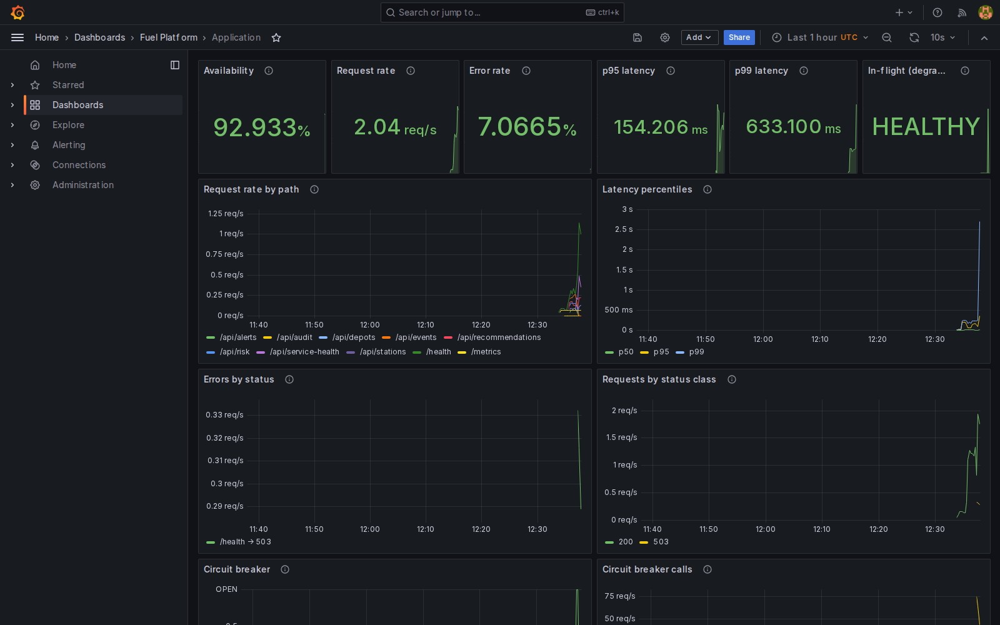
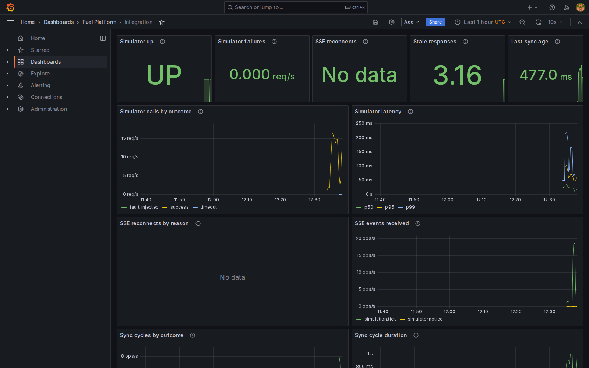
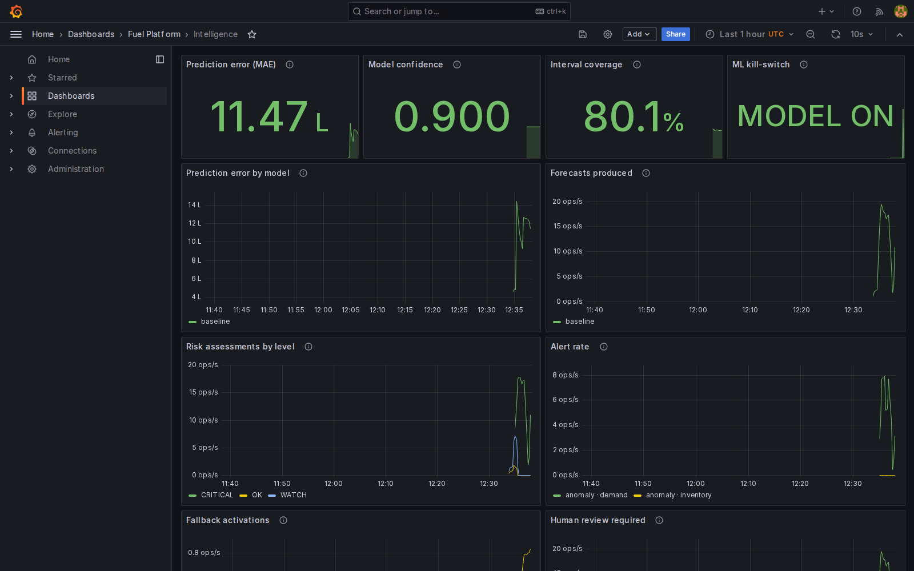
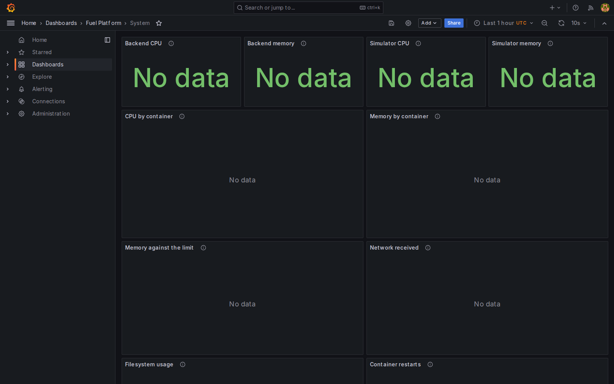

# Resilience report

**Generated:** 2026-11-24T12:38:25.542539+00:00  
**Backend:** `http://localhost:8001` · **Simulator:** `http://localhost:8100`  
**Scenarios run:** 14

Every number below was measured against the running stack by `scripts/crisis_drill.py`. The detection time is an **upper bound**: the drill polls every two seconds, so the real detection was no slower than the figure reported.

## Summary

| Scenario | Kind | Detected in | Recovery | Outcome | Served during the incident |
|---|---|---|---|---|---|
| **Demand spike** | crisis | 2.0s | 0.1s | RECOVERED | served all 5 dashboard endpoints |
| **Shipment delay** | crisis | 2.2s | 0.0s | RECOVERED | served all 5 dashboard endpoints |
| **Depot constraint** | crisis | 2.2s | 0.1s | RECOVERED | served all 5 dashboard endpoints |
| **Route disruption** | crisis | 0.0s | 0.0s | RECOVERED | served all 5 dashboard endpoints |
| **Station outage** | crisis | 2.2s | 0.0s | RECOVERED | served all 5 dashboard endpoints |
| **Supply shortfall** | crisis | 2.0s | 0.0s | RECOVERED | served all 5 dashboard endpoints |
| **Combined crisis** | combined crisis | 2.2s | 0.1s | RECOVERED | served all 5 dashboard endpoints |
| **Latency** | fault | 10.2s | 20.1s | RECOVERED | served all 5 dashboard endpoints |
| **Unavailable** | fault | 2.0s | 0.0s | RECOVERED | served all 5 dashboard endpoints |
| **Error rate** | fault | 0.0s | 0.0s | RECOVERED | served all 5 dashboard endpoints |
| **Stale data** | fault | 0.0s | 0.0s | RECOVERED | served all 5 dashboard endpoints |
| **Stream disconnect** | fault | 0.0s | 0.0s | RECOVERED | served all 5 dashboard endpoints |
| **Database stopped** | dependency failure | 0.5s | 2.0s | RECOVERED | served all 5 dashboard endpoints |
| **Prediction layer disabled** | dependency failure | 0.0s | 0.0s | RECOVERED | served all 5 dashboard endpoints |

**14 of 14 scenarios recovered automatically.** None of them required a restart of the backend.

## What each scenario proved

### Demand spike

*Demand at every station triples. The network runs dry faster than the plan says.*

- **Expected:** risk levels rise, the platform proposes larger and earlier allocations
- **Detected in:** 2.0s — the platform's event feed carries the demand_spike event (id 1, tick 240)
- **The platform recommended:** 20 proposed during the incident (CRITICAL=20); 0 on the fallback policy; most urgent: station-coxsbazar/DIESEL for 6,000 L
- **During the incident:** served all 5 dashboard endpoints
- **Recovered in:** 0.1s
- **Outcome:** RECOVERED
- **Notes:** injected demand_spike into the simulator

| Measurement | Value |
|---|---|
| baseline status | ok |
| baseline tick | 239 |
| risk during crisis | CRITICAL=12 |
| alerts during crisis | anomaly_demand=45, shortage_critical=55 |
| status after recovery | ok |

### Shipment delay

*Incoming diesel arrivals are delayed by eight ticks.*

- **Expected:** the supply timeline shows DELAYED arrivals, and cover shortens
- **Detected in:** 2.2s — the platform's event feed carries the shipment_delay event (id 2, tick 318)
- **The platform recommended:** 15 proposed during the incident (CRITICAL=15); 0 on the fallback policy; most urgent: station-coxsbazar/DIESEL for 6,000 L
- **During the incident:** served all 5 dashboard endpoints
- **Recovered in:** 0.0s
- **Outcome:** RECOVERED
- **Notes:** injected shipment_delay into the simulator

| Measurement | Value |
|---|---|
| baseline status | ok |
| baseline tick | 317 |
| risk during crisis | CRITICAL=12 |
| alerts during crisis | anomaly_demand=28, shortage_critical=72 |
| status after recovery | ok |

### Depot constraint

*Every depot is marked CONSTRAINED, which cuts its dispatch capacity.*

- **Expected:** the allocator proposes smaller shipments, and the constraint is named
- **Detected in:** 2.2s — the platform's event feed carries the depot_constraint event (id 3, tick 397)
- **The platform recommended:** 15 proposed during the incident (CRITICAL=15); 0 on the fallback policy; most urgent: station-coxsbazar/DIESEL for 6,000 L
- **During the incident:** served all 5 dashboard endpoints
- **Recovered in:** 0.1s
- **Outcome:** RECOVERED
- **Notes:** injected depot_constraint into the simulator

| Measurement | Value |
|---|---|
| baseline status | ok |
| baseline tick | 396 |
| risk during crisis | CRITICAL=12 |
| alerts during crisis | anomaly_demand=21, shortage_critical=79 |
| status after recovery | ok |

### Route disruption

*Every route is marked DISRUPTED.*

- **Expected:** the platform routes around the cut, or refuses to route through it
- **Detected in:** 0.0s — the platform's event feed carries the route_disruption event (id 4, tick 478)
- **The platform recommended:** 5 proposed during the incident (CRITICAL=5); 0 on the fallback policy; most urgent: station-coxsbazar/DIESEL for 6,000 L
- **During the incident:** served all 5 dashboard endpoints
- **Recovered in:** 0.0s
- **Outcome:** RECOVERED
- **Notes:** injected route_disruption into the simulator

| Measurement | Value |
|---|---|
| baseline status | ok |
| baseline tick | 477 |
| risk during crisis | CRITICAL=12 |
| alerts during crisis | anomaly_demand=24, shortage_critical=76 |
| status after recovery | ok |

### Station outage

*Every station is marked OUTAGE, so served demand drops to zero.*

- **Expected:** outage alerts are raised for the affected stations
- **Detected in:** 2.2s — the platform's event feed carries the station_outage event (id 5, tick 543)
- **The platform recommended:** 10 proposed during the incident (CRITICAL=10); 0 on the fallback policy; most urgent: station-coxsbazar/DIESEL for 6,000 L
- **During the incident:** served all 5 dashboard endpoints
- **Recovered in:** 0.0s
- **Outcome:** RECOVERED
- **Notes:** injected station_outage into the simulator

| Measurement | Value |
|---|---|
| baseline status | ok |
| baseline tick | 542 |
| risk during crisis | CRITICAL=12 |
| alerts during crisis | anomaly_demand=26, shortage_critical=74 |
| status after recovery | ok |

### Supply shortfall

*Incoming diesel arrivals are cut to 40% of their planned quantity.*

- **Expected:** the platform sees less fuel coming and reacts accordingly
- **Detected in:** 2.0s — the platform's event feed carries the supply_shortfall event (id 6, tick 623)
- **The platform recommended:** 20 proposed during the incident (CRITICAL=20); 0 on the fallback policy; most urgent: station-coxsbazar/DIESEL for 6,000 L
- **During the incident:** served all 5 dashboard endpoints
- **Recovered in:** 0.0s
- **Outcome:** RECOVERED
- **Notes:** injected supply_shortfall into the simulator

| Measurement | Value |
|---|---|
| baseline status | ok |
| baseline tick | 622 |
| risk during crisis | CRITICAL=12 |
| alerts during crisis | anomaly_demand=21, shortage_critical=79 |
| status after recovery | ok |

### Combined crisis

*A demand spike, a route disruption, a depot constraint and a shipment delay, all active at the same time.*

- **Expected:** the platform holds together: every endpoint still answers, and the recommendations account for all four
- **Detected in:** 2.2s — the platform's view showed all four crises at once
- **The platform recommended:** 20 proposed during the incident (CRITICAL=20); 0 on the fallback policy; most urgent: station-coxsbazar/DIESEL for 6,000 L
- **During the incident:** served all 5 dashboard endpoints
- **Recovered in:** 0.1s
- **Outcome:** RECOVERED
- **Notes:** injected demand_spike, route_disruption, depot_constraint, shipment_delay at the same time

| Measurement | Value |
|---|---|
| baseline status | ok |
| risk during crisis | CRITICAL=12 |
| alerts during crisis | anomaly_demand=32, shortage_critical=68 |
| status after recovery | ok |

### Latency

*The simulator delays every answer by twelve seconds.*

- **Expected:** the platform's own timeouts fire, and it stops waiting on the simulator
- **Detected in:** 10.2s — the circuit breaker opened
- **The platform recommended:** 5 proposed during the incident (CRITICAL=5); 0 on the fallback policy; most urgent: station-coxsbazar/DIESEL for 6,000 L
- **During the incident:** served all 5 dashboard endpoints
- **Recovered in:** 20.1s
- **Outcome:** RECOVERED
- **Notes:** injected the latency fault into the simulator

| Measurement | Value |
|---|---|
| baseline status | ok |
| breaker state | open |
| degraded mode | True |
| status after recovery | ok |

### Unavailable

*The simulator answers 503 to everything.*

- **Expected:** the platform goes degraded and keeps serving the last-known state
- **Detected in:** 2.0s — the platform went into degraded mode
- **The platform recommended:** 5 proposed during the incident (CRITICAL=5); 0 on the fallback policy; most urgent: station-coxsbazar/DIESEL for 6,000 L
- **During the incident:** served all 5 dashboard endpoints
- **Recovered in:** 0.0s
- **Outcome:** RECOVERED
- **Notes:** injected the unavailable fault into the simulator

| Measurement | Value |
|---|---|
| baseline status | ok |
| breaker state | closed |
| degraded mode | True |
| status after recovery | ok |

### Error rate

*Half the simulator's answers are 500.*

- **Expected:** the platform rides through the partial failure and keeps its cache
- **Detected in:** 0.0s — the platform went into degraded mode
- **The platform recommended:** no new proposals during the incident (1031 already in the store)
- **During the incident:** served all 5 dashboard endpoints
- **Recovered in:** 0.0s
- **Outcome:** RECOVERED
- **Notes:** injected the error_rate fault into the simulator

| Measurement | Value |
|---|---|
| baseline status | ok |
| breaker state | closed |
| degraded mode | True |
| status after recovery | ok |

### Stale data

*The simulator marks every response stale.*

- **Expected:** the cached copy is dropped rather than relabelled, and the staleness is shown
- **Detected in:** 0.0s — the platform went into degraded mode
- **The platform recommended:** no new proposals during the incident (1031 already in the store)
- **During the incident:** served all 5 dashboard endpoints
- **Recovered in:** 0.0s
- **Outcome:** RECOVERED
- **Notes:** injected the stale_data fault into the simulator

| Measurement | Value |
|---|---|
| baseline status | ok |
| breaker state | closed |
| degraded mode | True |
| status after recovery | ok |

### Stream disconnect

*The event stream answers 503 on connect.*

- **Expected:** the SSE listener reconnects with backoff, and the REST poller carries on
- **Detected in:** 0.0s — the sync stopped succeeding
- **The platform recommended:** no new proposals during the incident (1031 already in the store)
- **During the incident:** served all 5 dashboard endpoints
- **Recovered in:** 0.0s
- **Outcome:** RECOVERED
- **Notes:** injected the stream_disconnect fault into the simulator

| Measurement | Value |
|---|---|
| baseline status | ok |
| breaker state | closed |
| degraded mode | False |
| status after recovery | ok |

### Database stopped

*The Postgres container is stopped while the platform is serving.*

- **Expected:** the API keeps answering what it can, says the database is down, and recovers on its own
- **Detected in:** 0.5s — the health endpoint reported the database as down
- **The platform recommended:** 
- **During the incident:** served all 5 dashboard endpoints
- **Recovered in:** 2.0s
- **Outcome:** RECOVERED

| Measurement | Value |
|---|---|
| baseline status | ok |
| health during the outage | degraded |
| api still answers | served all 5 dashboard endpoints |
| health after the restart | ok |

### Prediction layer disabled

*The ML kill-switch is turned on, so the learned model stops being used and the platform falls back to the rule-based predictor.*

- **Expected:** every forecast comes from the rule-based predictor, is flagged for a human, and the decision layer uses the fallback policy
- **Detected in:** 0.0s — the kill-switch endpoint confirmed the change
- **The platform recommended:** 120 proposed during the incident (CRITICAL=120); 0 on the fallback policy; most urgent: station-coxsbazar/DIESEL for 6,000 L
- **During the incident:** served all 5 dashboard endpoints
- **Recovered in:** 0.0s
- **Outcome:** RECOVERED

| Measurement | Value |
|---|---|
| baseline status | ok |
| kill-switch accepted | True |
| active model | baseline |
| ml_kill_switch | True |
| active model after | baseline |
| ml_kill_switch after | False |

## Grafana, during the drill

### Application

### Integration

### Intelligence

### System

