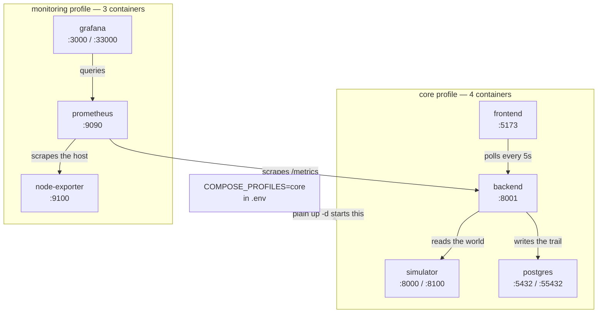
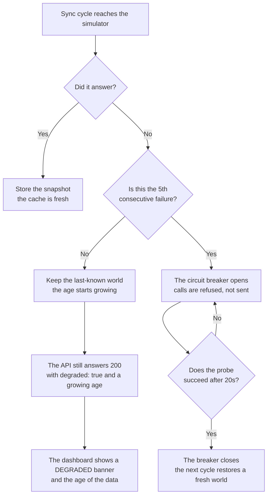
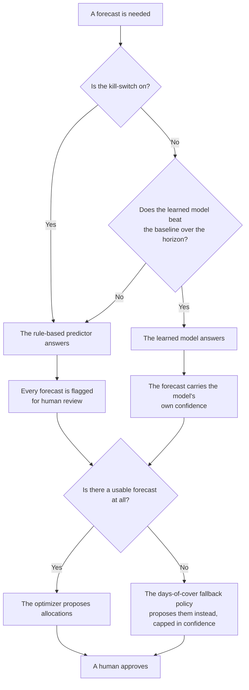

# The runbook

Operating the platform: starting it, stopping it, checking it, resetting it,
and what to do when each of its dependencies fails.

**Every command in this document appears in the repository.** Nothing here is
invented. Where a command comes from a script, the script is named; where it
comes from a document, that document is named.

---

## 0. Before anything else: the ports

The ports are **remapped in `.env`**, and the defaults in `.env.example` are
not necessarily the ones in use. Read the real ones first:

```bash
docker compose ps
```

| Service | Default in `.env.example` | What this repo's `.env` uses |
|---|---|---|
| Simulator | 8000 | **8100** |
| Backend | 8001 | **8001** |
| Postgres | 5432 | **55432** |
| Frontend (dashboard) | 5173 | **5173** |
| Prometheus | 9090 | **9090** |
| Grafana | 3000 | **33000** |

The commands below use `http://localhost:8001` for the backend and
`http://localhost:8100` for the simulator, which is what this repository's
`.env` says. **On a fresh clone from `.env.example`, the simulator is on
8000, not 8100.**

Set the two variables once, the way `docs/demo-script.md` does, so the
commands below can be copied as-is:

```bash
export BACKEND=http://localhost:8001
export SIM=http://localhost:8100     # or 8000 — check .env for SIMULATOR_PORT
```

Everything else in the repo reads the port from `.env` rather than assuming
it — `scripts/reset_demo.sh` sources `.env` and defaults to `8000`/`8001`,
and `scripts/dev_up.sh` reads `SIMULATOR_PORT` and `BACKEND_PORT` the same
way. The scripts are safe to run on either configuration.

> **Discrepancy.** The simulator's port is **8000** in `.env.example` and the
> README's quick start, and **8100** in this repository's `.env` and in
> `docs/resilience-report.md`. Both are correct for their own context; the
> live port is whichever `.env` holds. Check it before copying a command.

---

## 1. Start and stop

The stack is seven containers in two profiles. The core profile is the
platform; the monitoring profile is the observability stack on top of it.



### 1.1 The core profile — the platform alone

The **core** profile is four containers: `simulator`, `backend`, `postgres`,
`frontend`. `.env` sets `COMPOSE_PROFILES=core`, so a plain `docker compose
up` starts exactly those four.

```bash
docker compose up -d --wait
```

`--wait` blocks until the containers report healthy. Add `--build` on the
first run, or after a code change:

```bash
docker compose up -d --wait --build
```

The documented fresh-clone procedure is the same three commands:

```bash
cp .env.example .env
docker compose up --build -d --wait
curl -s $BACKEND/health | jq
```

> The fresh-clone test on Day 7 brought the stack up in **15 seconds** with
> all four containers healthy.

### 1.2 The monitoring profile — Prometheus, Grafana, node-exporter

The three observability services sit behind a **separate** profile, so they
cost nothing when you do not need them.

```bash
docker compose --profile monitoring up -d --wait
```

To run both profiles explicitly:

```bash
docker compose --profile core --profile monitoring up -d --wait
```

The monitoring services are `prometheus` (port 9090), `grafana` (3000, or
33000 here) and `node-exporter` (9100). The Grafana login is `admin` with
the password from `.env`.

> **Monitoring is off during load tests.** The Day 6 load-test runs used the
> **core profile only**, with Prometheus switched off, so the measurement was
> the platform's and not the observability stack's. Start the monitoring
> profile when you want to *look* at the platform, not when you want to
> *measure* it.

### 1.3 Stop

```bash
docker compose down
```

`docker compose down` stops the containers and removes them; it does **not**
remove the volumes, so the audit trail, the demand history and the decision
records survive. That is deliberate — the Day 7 closeout states: *"No volumes
were removed. The audit trail, the demand history and the decision records
survive for the judges to query."*

To remove the data as well, add `-v`:

```bash
docker compose down -v
```

### 1.4 The one-stop shop on a busy machine

This host runs several projects' Docker stacks at once. `stack_guard.sh`
exists because a crash-looping container, an unlimited container and an
unbounded log file between them make the desktop unresponsive.

```bash
scripts/stack_guard.sh status              # what is running, and how much memory it uses
scripts/stack_guard.sh stop-restart-loops   # stop containers that are crash-looping
scripts/stack_guard.sh stop-all             # stop every container on the host
scripts/stack_guard.sh harden               # a 1 GB limit and log rotation on all of them
scripts/stack_guard.sh start-fuel           # this stack, light
scripts/stack_guard.sh start-fuel --with-monitoring
```

`status` prints `free -h`, the load average, the container count and the
disk usage — it is the fastest way to see why the machine feels stuck.

`harden` writes `docs/host-tuning/daemon.json`. To apply it host-wide:

```bash
sudo cp docs/host-tuning/daemon.json /etc/docker/daemon.json && sudo systemctl restart docker
```
> **Warning, from the script itself:** *"restarting Docker stops every
> running container. Do this when nothing else needs to stay up."*

### 1.5 Memory limits — what the platform is allowed to use

Every service carries a hard ceiling, so a leak in one container cannot take
the host's RAM. The defaults are in `docker-compose.yml` and are not
overridden in this repository's `.env`:

| Service | Limit | CPU |
|---|---|---|
| `simulator` | 384m | 0.75 |
| `backend` | 384m | 1.0 |
| `postgres` | 256m | 0.75 |
| `frontend` | 64m | 0.25 |
| `prometheus` | 192m | — |
| `grafana` | 192m | — |
| `node-exporter` | 32m | 0.1 |

The README states the whole stack is capped at **1.5 GB** in total and
measures **~380 MB** in use for the core profile.

---

## 2. Health checks

### 2.1 The one command

```bash
curl -s $BACKEND/health | jq
```

`/health` is a **readiness** probe, not a liveness probe. It answers:

- `200` — the backend, the simulator and the database are all working.
- `503` — a dependency is down. This is why it doubles as the container
  healthcheck.

The body has three parts:

```json
{
  "status": "ok",
  "components": {
    "backend":   {"status": "ok"},
    "simulator": {"status": "ok", "simulation": {"tick": 2562}},
    "database":  {"status": "ok"}
  },
  "sync": {"degraded": false, "age_seconds": 2.5, "last_sync_age_seconds": 2.5}
}
```

`status` is `ok` only when the simulator's status is `ok` **or** `degraded`
*and* the database is `ok`. Anything else makes it `degraded` with a `503`.

### 2.2 Checking it properly, not just the status code

`scripts/check_health.py` exists because *"a smoke test that only checked the
status code would miss a 200 with a broken component in it, which is exactly
the failure a judge would hit."*

```bash
curl -fsS $BACKEND/health > /tmp/health.json
python3 scripts/check_health.py /tmp/health.json
```

It asserts `status == "ok"` and that `backend`, `simulator` and `database`
are each `ok`. It exits non-zero and prints `::error::` lines otherwise.

### 2.3 Checking that the state is a whole network

`/health` passing does not mean the platform has a world. `scripts/check_state.py`
checks the *content* of `/api/state`:

```bash
curl -fsS $BACKEND/api/state > /tmp/state.json
python3 scripts/check_state.py /tmp/state.json
```

It requires `stations`, `depots` and `routes` to be non-empty. A healthy
backend serving an empty world is still a failure.

### 2.4 The full smoke test

```bash
scripts/smoke_test.sh
```

It exercises every simulator endpoint, the simulator's admin reads, three
allocation writes (including an idempotent replay that must return `201` and
a bad route that must return `409`), and the backend's `/health`,
`/api/state` and `/metrics`. It prints a pass/fail count and exits non-zero
if anything failed.

### 2.5 The panel the dashboard renders

```bash
curl -s $BACKEND/api/service-health | jq '{prediction: .prediction, decision: .decision}'
```

This is the richer view — it adds the prediction service, the decision
engine, the ML kill-switch and the fallback reasons. It does **not** block on
the simulator.

### 2.6 Container-level checks

```bash
docker compose ps
docker compose logs --no-color backend
```

`docker compose ps` is also how you confirm the real published ports.

---

## 3. A clean reset

The platform and the simulator are two different things. **Resetting one does
not reset the other**, and the platform's reset clears things the
simulator's does not.

### 3.1 The quick reset — the script

```bash
scripts/reset_demo.sh --wait
```

| Flag | What it does |
|---|---|
| *(none)* | Reset and start the clock |
| `--no-run` | Reset and leave the simulation paused |
| `--wait` | Reset, wait for the platform to be healthy and for the world to have history, then train the model |

The script does five things, in order:

1. **Checks the stack is up** — the backend and the simulator must both
   answer, or it exits with the command to start them.
2. **`POST /admin/reset`** — clears the decision engine's in-memory working
   set, the counters, any injected prediction fault, and the kill-switch.
3. **`POST /admin/reset` on the simulator** — rewinds the world to tick 0
   and leaves it **paused**.
4. **Deletes the platform's own rows from Postgres** — `decision_records`,
   `recommendations`, `alerts`, `allocations`, `risk_assessments`,
   `demand_forecasts` and `prediction_evaluations`.
5. **`POST /admin/run`** — starts the clock (unless `--no-run`).

With `--wait` it additionally waits for 12 ticks of history, waits for the
platform's cache to catch up with the *simulator's* tick, and then trains
the model:

```bash
curl -s -X POST $BACKEND/api/model/train | jq '{trained, training_rows}'
```

**Every step is idempotent**, so running it twice is harmless.

> **Two details worth knowing.** The in-memory set is the important part of
> step 2: a reset that only cleared Postgres would leave the previous run's
> proposals in memory, and every one of them would fail to approve. And an
> injected prediction fault survives a simulator reset, because it lives in
> the backend — without step 2 the next run starts with the prediction layer
> already broken.
>
> The DELETE in step 4 uses `DELETE`, not `TRUNCATE`, because `TRUNCATE`
> needs an `ACCESS EXCLUSIVE` lock and the backend writes to those tables on
> every sync cycle. It sets `lock_timeout = '2s'` so a busy table is skipped
> in a second rather than hanging the demo.

### 3.2 The reset by hand

If you want to do it one call at a time:

```bash
# 1. clear the platform's own state
curl -s -X POST $BACKEND/admin/reset | jq

# 2. rewind the simulator's world (through the backend, so the cache is dropped too)
curl -s -X POST $BACKEND/api/simulation/reset

# 3. start the clock
curl -s -X POST $BACKEND/api/simulation/run
```

The simulator's own admin console is equivalent — and is the form the demo
script uses:

```bash
curl -s -X POST $SIM/admin/reset | jq
curl -s -X POST $SIM/admin/run   | jq
```

### 3.3 What `POST /admin/reset` clears, and what it does not

It clears the decision engine's in-memory working set, the counters, the
fallback reason, the kill-switch, any injected fault, and the cached
snapshot of the world.

It does **not** clear the audit trail in Postgres. The endpoint says so
itself: *"The audit trail in Postgres is not cleared: a reset is a demo
convenience, and destroying the record of what was decided would be a
strange thing for an operator's button to do."* If you want the tables
emptied, that is what `scripts/reset_demo.sh` does in its step 4.

---

## 4. The simulator's connection pool

The simulator keeps its state in SQLite behind a SQLAlchemy `QueuePool` of
**5 connections plus 10 overflow**, with a **30 s** `pool_timeout`. Every
request takes a connection out and holds it for the duration of the query, so
a burst of concurrent heavy reads takes all fifteen, and everything after
that blocks until the timeout and fails with:

```text
sqlalchemy.exc.TimeoutError: QueuePool limit of size 5 overflow 10 reached,
connection timed out, timeout 30.00
```

**The symptom is not a 500.** It is requests that stop answering. The
backend's own request timeout fires first, the circuit breaker opens after
five consecutive failures, the sync service marks the cache degraded, and the
API keeps serving the last-known world with its age and the reason.

### 4.1 The platform recovers on its own

Once the burst stops, the pool drains, the breaker's probe succeeds and it
closes, and the next sync cycle restores a fresh world. The drill measured
this at **18.1 s** to detect and **111.4 s** to recover, with **0 writes
lost**.

### 4.2 The restart-and-reset procedure — the fallback

Use this when the simulator does not come back on its own.

```bash
# 1. restart the simulator container
docker compose restart simulator

# 2. reset the world back to the baked-in scenario
curl -s -X POST $SIM/admin/reset

# 3. start the clock again — the reset leaves it paused
curl -s -X POST $SIM/admin/run
```

> **One consequence worth knowing.** `POST /admin/reset` restarts the
> simulator's clock at tick 0, so the platform's stored demand history
> belongs to a different timeline. The backend notices: it compares the
> stored maximum tick against the current one and drops the history when the
> clock went backwards, so the forecaster does not learn from two runs
> spliced together.

### 4.3 Confirming the recovery

```bash
curl -s $BACKEND/health | jq
curl -s $BACKEND/api/stations | jq
```

The simulator's component should be `ok` and `sync.degraded` should be
`false`. If the breaker was open, it closes on its own probe.

---

## 5. Degraded mode

The platform's answer to a dependency that stops answering: **keep serving,
but say so.** The decision path when a dependency fails.



### 5.1 What it looks like

| Situation | `degraded` | `age_seconds` | What the operator sees |
|---|---|---|---|
| The simulator is up and fresh | `false` | Small | Normal |
| The simulator says its data is stale | `false` | Small | A stale banner, but live data |
| The simulator is down | `true` | **Growing** | A DEGRADED banner, and the age |
| The platform has never synced | — | `null` | `503` — *"no simulator state available yet"* |

The `503` case is the important one: the platform would rather say *"no state
available yet"* than serve a number as if it were current.

### 5.2 Confirming you are in it

```bash
curl -s $BACKEND/health | jq '.sync'
curl -s $BACKEND/api/stations | jq
```

`/health`'s `sync.degraded` is `true`; `/api/stations` carries `degraded:
true` and an `age_seconds` that **grows**.

### 5.3 Confirming recovery

```bash
curl -s $BACKEND/health | jq
```

Recovery is `status: "ok"` and `sync.degraded: false`.

### 5.4 The whole procedure, automated

```bash
scripts/degraded_mode_drill.sh
```

It stops the simulator container, waits for the platform to notice, asserts
the API still answers `200` and that the payload is flagged degraded, then
starts the simulator again and waits for the recovery. It exits non-zero if
the platform does not degrade, or does not recover.

The drill's own observation is worth reading: `last-known state age: Ns` and
`stations still served: N`. The dashboard does not go blank, and it does not
present live-looking numbers as current.

### 5.5 The circuit breaker

The breaker opens after **5 consecutive failures** and probes after **20 s**.
While it is open, calls are refused **without being sent**, so the simulator
gets room to recover. The `CircuitBreakerOpen` alert fires when it has been
open for 2 minutes.

---

## 6. The ML kill-switch

The kill-switch stops the platform using the learned model **right now** —
without a redeploy, and without waiting for a confidence score to decay.

With it on:

- every forecast comes from the rule-based predictor;
- every forecast is flagged for human review;
- the decision layer uses the days-of-cover fallback policy.

It exists because a model can look healthy on every metric the platform
tracks and still be producing bad numbers for *this* network.

The kill-switch and the decision layer's own fallback are two different
mechanisms, and the platform distinguishes them.



### 6.1 Turning it on

```bash
curl -X POST $BACKEND/api/model/kill-switch \
  -H 'Content-Type: application/json' -d '{"enabled": true}'
```

The response confirms `ml_kill_switch: true` and names the active model.

### 6.2 Turning it off

```bash
curl -X POST $BACKEND/api/model/kill-switch \
  -H 'Content-Type: application/json' -d '{"enabled": false}'
```

**Turning the kill-switch off is not the same as the model coming back.**
The model has to earn its way back: it has to beat the rule-based baseline
over the forecast horizon. The drill recorded the learned model returning
"in service after 1 training attempt". If it does not come back on its own:

```bash
curl -s -X POST $BACKEND/api/model/train | jq '{trained, training_rows}'
```

### 6.3 Confirming the state

```bash
curl -s $BACKEND/api/model-status | jq '{active_model, fallback_active, fallback_reason}'
```

`/api/model-status` reports the injected fault as well as the kill-switch,
because *"the operator's first question about a platform that suddenly
stopped using the model is 'is the model broken, or did somebody turn it
off?' — and this is where the answer is."*

### 6.4 The kill-switch is not a fault

There are two different things, and the distinction matters:

| | Kill-switch | Injected fault |
|---|---|---|
| What it is | A **decision** — the model is healthy and has been told not to be used | A **fault** — the model is broken and the platform has to notice on its own |
| Endpoint | `POST /api/model/kill-switch` | `POST /api/model/fault` |
| Body | `{"enabled": true}` | `{"fault": "predict_error"}` |

Both end up in the same place — the rule-based predictor, with every forecast
flagged for a human — and the difference is in the **reason** the forecast
carries.

To inject a fault (the model raises on every forecast):

```bash
curl -s -X POST $BACKEND/api/model/fault \
  -H 'Content-Type: application/json' \
  -d '{"fault":"predict_error"}' | jq
```

`"evaluate_error"` breaks the whole intelligence evaluation instead, so the
decision layer falls back to the rule-based *policy*. Clear it with
`{"fault": null}`.

---

## 7. When a dependency fails

### 7.1 The database is down

**What happens.** The platform keeps serving its cached state, reports the
database as down, does not crash, and recovers on its own when the database
comes back.

The drill measured it at **0.1 s** to detect and **2.0 s** to recover, and
the dashboard served all 5 endpoints throughout.

**What you see:**

```bash
curl -s $BACKEND/health | jq
curl -s $BACKEND/health | jq
```

The database component reads `error` and the overall status is `degraded`.
Note the distinction the drill records explicitly: the *overall health
status* is `degraded` while the *cached-state* `degraded` boolean stays
`False`. Those are two different things and are not conflated.

**What to do.** Usually nothing:

```bash
docker compose start postgres
```

Wait for it to come back, then confirm:

```bash
curl -s $BACKEND/health | jq
```

The audit endpoint is the one that degrades hardest — it reads from the
database, so it answers `503` with *"could not read the audit trail: ..."*
while everything else keeps working.

### 7.2 The backend crashes

**What happens.** The container restarts. The frontend shows its error state
until the backend answers again.

**What to do.**

```bash
docker compose ps                                  # is it restarting?
docker compose logs --no-color backend             # why did it die?
docker compose up -d --wait backend
```

The two crashes the platform has actually suffered are both in the bug
catalog, and both are fixed:

| Cause | What you would see | Fix |
|---|---|---|
| The prediction-error aggregate read the whole table into Python | `OOMKilled: true`, `ExitCode: 137`, `RestartCount: 9` | The aggregate is computed in SQL. The "before" path is still in the repository behind `PREDICTION_ERROR_AGGREGATE_IN_DATABASE=false` |
| A deadlock between the sync write and an operator approval | `deadlock detected` in the log, and **writes lost** | All three write paths now go through `Database.write()`, which retries the whole unit of work with a bounded backoff. After the fix: 2 deadlocks, **0 writes lost**, 2 of 2 retries succeeded |

After a crash, check that the platform came back cleanly:

```bash
curl -s $BACKEND/health | jq
python3 scripts/check_health.py /tmp/health.json
```

### 7.3 Memory pressure on a 7 GB host

The host has **7.1 GiB** of RAM and 4.0 GiB of swap. The machine is shared
with other projects' stacks, and that is the whole reason for the memory
limits, the profiles and `stack_guard.sh`.

**Check the pressure:**

```bash
free -h
```

The Day 6 rule was explicit: **`free -h` before every scenario**, and the
drill stops before a scenario if available memory is below a floor. The load
test stopped on available memory below **1 GiB**. The Day 7 closeout recorded
the available memory never falling below **2.2 GB** across the day's loads.

**What each number means:**

| Reading | Meaning |
|---|---|
| `available` | What a new stack can actually claim. This is the number to watch. |
| `free` | Memory not used *and* not cached. Often low on a healthy machine — the kernel is using the rest for the page cache. |
| `swap` | Used swap means the host is already thrashing. Day 7's closeout showed 2.1 GiB of swap used. |

**What to do, in order:**

```bash
# 1. stop the containers that are crash-looping and burning CPU
scripts/stack_guard.sh stop-restart-loops

# 2. see what is running and how much memory it uses
scripts/stack_guard.sh status

# 3. give every container a limit, so one leak cannot take the host
scripts/stack_guard.sh harden

# 4. drop the monitoring profile — three containers, and their limits
docker compose --profile core --profile monitoring down
docker compose up -d --wait
```

**If the backend container itself is near its limit**, the
`ContainerHighMemory` alert fires when it is using more than **85 %** of its
384m limit. The backend is the one service that must always be up, so if it
is the thing under pressure, check the aggregate path first — the OOM kill
in §7.2 was exactly this.

**The load test's own memory rule**, from the Day 6 runner: it samples the
backend's CPU from its **own cgroup** (the same counter Docker enforces when
it decides to kill a container), checks `free -h` before every scenario, and
stops on a backend that stops answering its health check, errors above 20 %,
or available memory below 1 GiB.

### 7.4 The simulator is down

Covered in §4 and §5. The short version: `docker compose start simulator`,
wait, and confirm `sync.degraded` is `false`.

---

## 8. The Prometheus alerts

All 21 rules are in [`infra/prometheus/alerts.yml`](../infra/prometheus/alerts.yml).
They are code, not a UI configuration — *"a judge can read this file and see
exactly what the platform considers a failure worth waking someone for."*

Four are the ones the brief names explicitly: `SimulatorDown`,
`HighErrorRate`, `FallbackActive` and `StaleData`.

### 8.1 The simulator and its integration

| Alert | Severity | Fires when | Likely cause | Action |
|---|---|---|---|---|
| `SimulatorDown` | critical | `up{job="fuel-backend"} == 0` or `degraded_mode == 1`, for 1m | The backend cannot reach the simulator | Check §4 and §5. `docker compose start simulator`. The dashboard keeps working on last-known state |
| `CircuitBreakerOpen` | warning | `circuit_open{circuit="simulator"} == 1`, for 2m | The platform stopped calling the simulator to avoid exhausting its pool | Do nothing — calls are refused without being sent, so the simulator gets room. If it persists, the simulator's pool is still full: §4.2 |
| `SimulatorHighLatency` | warning | p95 of `simulator_request_duration_seconds` > 2 s, for 3m | The simulator is answering, but slowly | A warning, not a page — the platform is still inside its request timeout. Check for a host under load |
| `SimulatorMalformedData` | warning | `increase(simulator_validation_rejections_total[5m]) > 0` | A simulator response did not match its contract | The platform refuses malformed data rather than storing it, so this shows as a **gap** in the data, not as corrupted state. Check the backend log |

### 8.2 The backend

| Alert | Severity | Fires when | Likely cause | Action |
|---|---|---|---|---|
| `HighErrorRate` | critical | More than 5 % of requests are 5xx, for 2m | A failing dependency, or a bug | `docker compose logs --no-color backend`. The alert says to look for the correlation id of a failing request |
| `BackendDown` | critical | `up{job="fuel-backend"} == 0`, for 1m | The backend is down or not scrapeable | §7.2. `docker compose up -d --wait backend` |
| `HighLatency` | warning | p95 of `http_request_duration_seconds` > 1 s, for 3m | The backend cannot answer the dashboard's polling promptly | The dashboard polls ten endpoints every five seconds. Check the aggregate path — §7.2's OOM kill looked exactly like this |
| `BackendHighCPU` | warning | `rate(process_cpu_seconds_total[5m]) > 1.0`, for 10m | The platform is working hard against a failing dependency, or retrying hard | Sustained high CPU usually means a dependency is failing. Check `HighErrorRate` and the circuit breaker |
| `FileDescriptorLeak` | warning | `process_open_fds > 200`, for 10m | A connection leak | *"A descriptor count that climbs without bound is a connection leak. The simulator's connection pool is small, and leaking connections to it is how the platform ends up exhausting it."* Check `FileDescriptorLeak` → §4 |

### 8.3 Degraded operation

| Alert | Severity | Fires when | Likely cause | Action |
|---|---|---|---|---|
| `FallbackActive` | warning | `increase(fallback_activations_total[5m]) > 0` | The learned model could not be used | Forecasts came from the rule-based profile predictor and every forecast is flagged for human review. Check `GET /api/model-status` for the reason — §6 |
| `DecisionFallbackActive` | warning | `increase(decision_fallback_activations_total[5m]) > 0` | There is no usable forecast at all | Allocations are proposed by the days-of-cover policy instead of the model-driven optimizer, and are capped in confidence and need a human |
| `StaleData` | warning | `stale_data == 1`, for 2m | The simulator served data with the stale header | The cached copy is **dropped** rather than relabelled, so the dashboard shows the gap instead of passing off old numbers as new ones. Let the next cycle catch up |
| `SyncStalled` | warning | `last_sync_age_seconds > 60`, for 1m | The background sync has not reached the simulator recently | The dashboard is showing cached data over a minute old. Check the simulator and the breaker |
| `MLModelDisabled` | warning | `ml_model_disabled == 1` | **An operator turned the learned model off** | This is not a fault — it is a decision. §6.2. If you did not turn it on, `POST /admin/reset` clears it |

### 8.4 The machine

| Alert | Severity | Fires when | Likely cause | Action |
|---|---|---|---|---|
| `ContainerHighMemory` | warning | `container_memory_fraction > 0.85`, for 5m | The backend is close to the memory ceiling Docker enforces | It will be killed if it keeps growing. This is the orchestrator's own counter, read from the container's cgroup. §7.3 |
| `HostMemoryHigh` | warning | Host memory above 90 % used, for 5m | Other projects' stacks on the same machine | *"At this level the next stack to start will push the host into swap, which is what makes the desktop feel frozen."* §7.3 — stop the monitoring profile first |
| `HostDiskHigh` | warning | A filesystem above 85 % full, for 5m | Usually **not** this stack | *"A full disk stalls the Docker daemon itself, and every service on the machine with it. Every container here rotates its logs, so this is more likely to be something outside this stack."* `docker system df` |
| `HostLoadHigh` | warning | Load average above the core count, for 10m | The scheduler is the bottleneck, not any one service | *"Every measurement taken at this load level is not comparable with one taken on an idle machine."* Stop other stacks, then re-measure |

### 8.5 The observability stack

| Alert | Severity | Fires when | Likely cause | Action |
|---|---|---|---|---|
| `PrometheusNotScraping` | critical | `up{job="prometheus"} == 0`, for 2m | The observability stack is not working | *"The dashboards are blind."* `docker compose --profile monitoring restart prometheus` |
| `NodeExporterDown` | warning | `up{job="node"} == 0`, for 2m | node-exporter is not answering | The System dashboard has no host numbers. The backend's own metrics are still being scraped. `docker compose --profile monitoring restart node-exporter` |
| `PrometheusStorageHigh` | warning | `prometheus_tsdb_storage_blocks_bytes > 400 MB`, for 5m | The retention limit is approaching | Prometheus keeps **2 days and 500 MB** here. It is bounded on purpose — an unbounded Prometheus fills the disk, and a full disk stalls the Docker daemon for every stack on the machine |

---

## 9. A quick reference

```bash
# --- start and stop -------------------------------------------------------
docker compose up -d --wait                              # the platform (core)
docker compose --profile monitoring up -d --wait        # + Prometheus, Grafana, node-exporter
docker compose down                                     # stop (keeps the volumes)
docker compose down -v                                  # stop and delete the data
scripts/stack_guard.sh status                           # what is running, and the host's memory

# --- health ---------------------------------------------------------------
curl -s $BACKEND/health | jq
python3 scripts/check_health.py /tmp/health.json
python3 scripts/check_state.py /tmp/state.json
scripts/smoke_test.sh
docker compose ps

# --- reset ----------------------------------------------------------------
scripts/reset_demo.sh --wait
curl -s -X POST $BACKEND/admin/reset | jq
curl -s -X POST $SIM/admin/reset  | jq
curl -s -X POST $SIM/admin/run    | jq

# --- the simulator's connection pool --------------------------------------
docker compose restart simulator
curl -s -X POST $SIM/admin/reset
curl -s -X POST $SIM/admin/run

# --- degraded mode --------------------------------------------------------
scripts/degraded_mode_drill.sh
curl -s $BACKEND/api/stations | jq

# --- the ML kill-switch ---------------------------------------------------
curl -X POST $BACKEND/api/model/kill-switch \
  -H 'Content-Type: application/json' -d '{"enabled": true}'
curl -X POST $BACKEND/api/model/kill-switch \
  -H 'Content-Type: application/json' -d '{"enabled": false}'
curl -s $BACKEND/api/model-status | jq

# --- dependencies ---------------------------------------------------------
docker compose start postgres
docker compose up -d --wait backend
docker compose logs --no-color backend

# --- memory ---------------------------------------------------------------
free -h
scripts/stack_guard.sh stop-restart-loops
scripts/stack_guard.sh harden
```

---

## 10. Limitations of this runbook

1. **No command here has been executed as part of writing this document.**
   Every command was read out of the repository — the scripts, the compose
   file, the CI workflow, the API reference, the resilience report and the
   day-by-day progress logs. The procedures were exercised during the build
   (the drill ran 17 of 17 scenarios, the degraded-mode drill ran on Day 2),
   but this document was not re-verified against a live stack.

   Every endpoint the runbook names was checked against the FastAPI routes
   in `backend/app/main.py` — 12 of them, all real. The commands were
   checked against the repository's own text: eight of them differ from
   their attested form only in the port, in the `$BACKEND`/`$SIM`
   substitution, or in `true` versus `false`.

2. **The ports in the commands are this repository's `.env`, not the
   defaults.** On a fresh clone the simulator is on 8000, not 8100. See §0.

3. **The `scripts/check_health.py` and `scripts/check_state.py` scripts take
   a file path, not a URL.** The two-step form is the one the scripts
   themselves document:

   ```bash
   curl -fsS $BACKEND/health > /tmp/health.json
   python3 scripts/check_health.py /tmp/health.json
   ```

4. **There is no automated rollback.** `docs/deployment.md` documents the
   rollback *target* — the immutable sha tag — but performing the rollback
   is a manual `docker compose` action.

5. **The kill-switch does not restore the learned model.** Turning it off
   only permits the model to be used again; it has to earn its way back. §6.2.

6. **`docker compose down -v` destroys the audit trail.** The default
   `docker compose down` does not. If you are not certain, use the default.

7. **Some alert thresholds are judgment calls.** `HostMemoryHigh` fires at
   90 % and `HostDiskHigh` at 85 %, and the host is shared with other
   projects — an alert here may not be about this stack at all.

---

## Related documents

- [`docs/deployment.md`](deployment.md) — publishing, rollback, post-deploy checks
- [`docs/resilience-report.md`](resilience-report.md) — all 17 scenarios, measured
- [`docs/load-test-report.md`](load-test-report.md) — the load runs and their memory rules
- [`docs/demo-script.md`](demo-script.md) — the fourteen demo steps
- [`docs/api-reference.md`](api-reference.md) — all 35 routes
- [`docs/bug-catalog.md`](bug-catalog.md) — every defect, including the OOM kill and the deadlock
- [`docs/postmortems/`](postmortems/) — eight incidents in full
- [`docs/progress/day6.md`](progress/day6.md) — the resilience and load-test day
- [`docs/progress/day7.md`](progress/day7.md) — the release day
- [`infra/prometheus/alerts.yml`](../infra/prometheus/alerts.yml) — the alert rules as code
- [`docker-compose.yml`](../docker-compose.yml) — the profiles, limits and ports
- [`scripts/stack_guard.sh`](../scripts/stack_guard.sh) — the busy-machine tool
- [`scripts/reset_demo.sh`](../scripts/reset_demo.sh) — the quick reset
- [`scripts/degraded_mode_drill.sh`](../scripts/degraded_mode_drill.sh) — the degraded-mode drill
