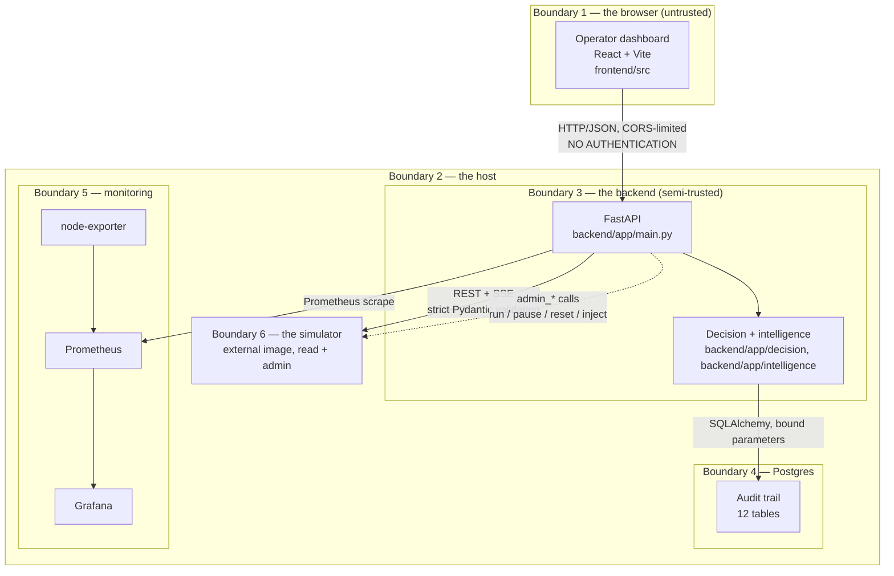
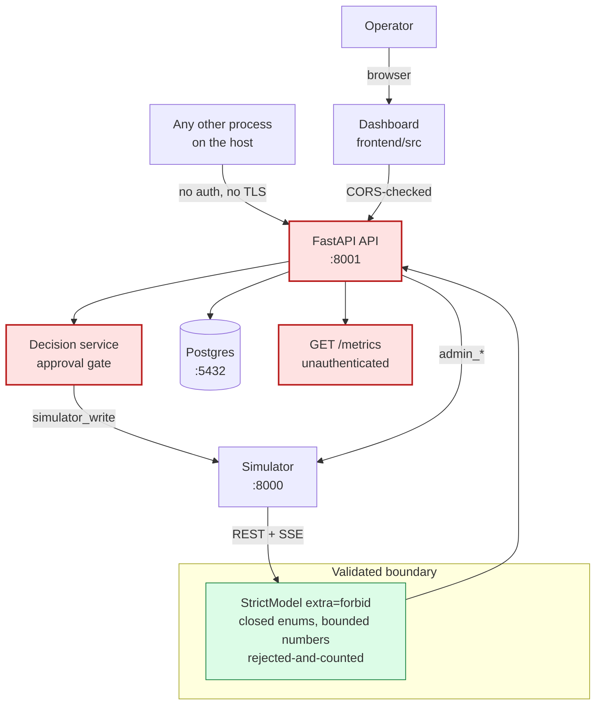

# Security and threat model

What this platform protects, what it deliberately does not, and where the
boundaries are. Every control claimed below was checked against the code in
this repository; the file and line are named so the claim can be re-verified.

**The short version.** This is a simulation. It runs on a judge's laptop, it
holds no real credentials, and it moves no real fuel. It has **no
authentication and no authorization** — that is the single most important fact
in this document, and it is stated here rather than left for someone to
discover. What the platform *does* have is a set of real controls on the
paths that matter for a simulation: no secrets in the repository, strict
validation on every byte that arrives from outside the process, a human
approval gate before anything is dispatched, and bounded blast radius on every
container.

---

## 1. Scope and assumptions

| Question | Answer |
|---|---|
| What is being defended? | A fictional fuel network, a simulation, and the credibility of the audit trail behind it |
| What is *not* being defended? | Anything of real value — there is none |
| Where does the code run? | Docker Compose on one host, typically a laptop |
| Who is the adversary? | An accidental or careless mistake, not a motivated attacker |
| What is the platform's own threat model? | "The simulator misbehaves, the database dies, an operator mis-clicks" — the failure modes in [the resilience report](resilience-report.md) |

The threat model that this codebase actually implements is a **reliability**
model, not a security model. It assumes the dependencies are honest and the
operator is well-intentioned, and it defends against their failure. This
document is therefore split into two halves:

* **Controls that exist** — verified in the code, with the file that proves it.
* **Controls that do not exist** — stated plainly, with the consequence.

---

## 2. Assets

What would be worth stealing, damaging, or lying about.

| # | Asset | Where it lives | Why it matters |
|---|---|---|---|
| A1 | The **audit trail** — every decision, event and alert | Postgres, tables `recommendations`, `decision_records`, `domain_events`, `alerts` ([`backend/app/models.py`](../backend/app/models.py)) | It is the platform's main claim to accountability. A doctored trail makes every other number in the project worthless |
| A2 | The **decision working set** — live proposals and their approvals | In-memory in `DecisionService._recommendations` ([`backend/app/decision/service.py`](../backend/app/decision/service.py)) | Someone could approve a bad allocation |
| A3 | **Database credentials** | `POSTGRES_PASSWORD`, in the environment and in `DATABASE_URL` ([`docker-compose.yml`](../docker-compose.yml)) | Would give full read/write on the audit trail |
| A4 | **Grafana credentials** | `GRAFANA_ADMIN_PASSWORD`, in the environment | Would give read access to the dashboards and the metrics |
| A5 | The **model and its state** — the learned demand model, the kill-switch | `backend/app/intelligence/forecasting.py`, in-process | A poisoned model produces bad recommendations that look good |
| A6 | **Simulator control** — `run`, `pause`, `step`, `reset`, fault injection | `POST /api/simulation/{action}` ([`backend/app/main.py`](../backend/app/main.py)) | A `reset` destroys the world the demo is running on |
| A7 | **Platform availability** | The backend container, bounded by `mem_limit` and `cpus` | The project runs on a 7 GB host shared with the judge's tooling |

Note what is **not** on this list: there is no personal data, no payment data,
no real inventory, and no real customer. There is nothing here whose
disclosure would harm a third party.

---

## 3. Trust boundaries



### The boundaries, and what crosses each

| # | Boundary | What crosses it | Control at the crossing |
|---|---|---|---|
| **B1** | Browser → backend | Every API call | **CORS allow-list only.** No authentication, no authorization ([`backend/app/main.py`](../backend/app/main.py), `CORSMiddleware` at line 192) |
| **B2** | Backend → Postgres | Every read and write | Bound parameters via SQLAlchemy; a bounded pool (`max_overflow=0`); deadlock retry ([`backend/app/db.py`](../backend/app/db.py)) |
| **B3** | Backend → simulator | Every REST read, the SSE stream, every allocation POST, every admin call | Strict Pydantic models with `extra="forbid"`; typed error hierarchy; circuit breaker ([`backend/app/simulator_models.py`](../backend/app/simulator_models.py), [`backend/app/simulator_client.py`](../backend/app/simulator_client.py)) |
| **B4** | Backend → monitoring | `/metrics` scrape, `GET /api/service-health` | `/metrics` is unauthenticated and excluded from the OpenAPI schema ([`backend/app/metrics.py`](../backend/app/metrics.py)) |
| **B5** | Host → containers | Volume mounts, port bindings | Every container has `mem_limit`, `cpus`, `pids_limit`; config files mounted `:ro`; the host root is mounted `:ro,rslave` for node-exporter only ([`docker-compose.yml`](../docker-compose.yml)) |

### The two boundaries that are *not* defended

**B1 — the browser boundary is open.** There is no login, no token, no
session, no API key. A search of the whole application tree for
`authenticat|authoriz|api_key|bearer|oauth|jwt|login` returns **zero hits**
outside `.venv/` and the CI registry login. Every caller that can reach the
API can approve an allocation, flip the model kill-switch, inject a fault,
or reset the entire simulation.

This is a deliberate decision, recorded in
[`docs/architecture.md`](architecture.md#6-security-notes): the dashboard and
the API are open on localhost, and a deployment outside a trusted network
would need an authenticating proxy in front.

**B3 is asymmetric.** The simulator is a *third-party image* the platform does
not build
([`asifmahmoud414/bup-fuel-supply-simulator:1.0.0`](../.env.example)). It is
treated as untrusted input — everything it returns is validated — but it is
also *trusted to administer itself*. The platform calls the simulator's
`/admin` endpoints (`run`, `pause`, `toggle`, `step`, `reset`, fault
injection) with no separate credential, because the simulator defines no
separate credential.

---

## 4. Controls that exist

Each row was verified in the code. "Verified" means the named file contains
the named behaviour.

### 4.1 Secrets

| # | Control | Where | Verified |
|---|---|---|---|
| **S1** | No secret is hard-coded. Every credential comes from the environment | [`backend/app/config.py`](../backend/app/config.py) (header comment, line 3), [`docker-compose.yml`](../docker-compose.yml) | Yes — `config.py` states "All values come from the environment (12-factor). No secret is hard-coded" |
| **S2** | `.env` is gitignored | [`.gitignore`](../.gitignore) line 11 | Yes — `git check-ignore -v .env` confirms the rule applies |
| **S3** | `.env` has never been committed | — | Yes — `git log --all -- .env` returns nothing |
| **S4** | Only `.env.example` is tracked, and it holds defaults, not credentials | [`.env.example`](../.env.example) | Yes — `git ls-files .env .env.example` lists only `.env.example` |
| **S5** | The default passwords are deliberately obviously fake | [`.env.example`](../.env.example) lines 52, 107 | Yes — `POSTGRES_PASSWORD=change-me-in-env`, `GRAFANA_ADMIN_PASSWORD=change-me-in-env`. A stack started without a `.env` is *loudly* insecure rather than quietly insecure |
| **S6** | The CI workflow uses `secrets.GITHUB_TOKEN` and nothing else | [`.github/workflows/release.yml`](../.github/workflows/release.yml) line 52 | Yes — one `password:` key in the whole file, and it is a GitHub-provided token |
| **S7** | No credential is embedded in a published image | [`backend/Dockerfile`](../backend/Dockerfile), [`frontend/Dockerfile`](../frontend/Dockerfile) | Yes — neither Dockerfile copies `.env`; `backend/Dockerfile` copies `app/`, `alembic.ini` and `migrations/` only |
| **S8** | The git history carries no hard-coded secret | — | Yes — a scan of `git log --all -p` for password/secret/token assignments, excluding `change-me`, `secrets.*` and `${...}` references, returns nothing |

### 4.2 Input validation

| # | Control | Where | Verified |
|---|---|---|---|
| **V1** | **Every simulator response is validated** against a closed model. Unknown fields are rejected, not ignored | [`backend/app/simulator_models.py`](../backend/app/simulator_models.py) | Yes — `StrictModel` sets `model_config = ConfigDict(extra="forbid")` (line 48); every documented response body has a model |
| **V2** | Enumerations are closed sets, so an unexpected status is a hard failure rather than a free-text string | [`backend/app/simulator_models.py`](../backend/app/simulator_models.py) | Yes — `FuelType`, `InstanceStatus`, `DepotStatus`, `StationStatus`, `RouteStatus`, `SupplyArrivalStatus`, `EventStatus`, `AllocationStatus`, `SimulatorEventType`, `FaultType` are `StrEnum`s |
| **V3** | Numeric fields carry bounds (`ge`, `le`, `gt`) | [`backend/app/simulator_models.py`](../backend/app/simulator_models.py) | Yes — e.g. `quantity: float = Field(gt=0)`, `service_level: float = Field(ge=0, le=1)`, `transit_ticks: int = Field(ge=0)` |
| **V4** | A malformed payload is **rejected and counted**, never passed downstream | [`backend/app/simulator_client.py`](../backend/app/simulator_client.py) `_decode` | Yes — on `ValidationError` it increments `SIMULATOR_VALIDATION_REJECTIONS`, logs, and raises `SimulatorValidationError` |
| **V5** | The one documented looser contract is deliberate and documented | [`backend/app/simulator_models.py`](../backend/app/simulator_models.py) | Yes — `AdminActionResponse` keeps `extra="allow"` because the integration guide does not specify those bodies; the module docstring says so |
| **V6** | String inputs are length-bounded | [`backend/app/main.py`](../backend/app/main.py) | Yes — `decided_by: str = Field(max_length=64)`, `reason: str = Field(max_length=500)`, `type: str = Field(min_length=1, max_length=40)` |
| **V7** | Query parameters are range-bounded | [`backend/app/main.py`](../backend/app/main.py) | Yes — `limit: int = Query(default=200, ge=1, le=1000)` on `/api/audit`; `ge=1, le=500` on `/api/decision-history`; `duration_ticks: int = Field(ge=1, le=200)` on the crisis body |
| **V8** | A non-JSON simulator body is rejected rather than parsed leniently | [`backend/app/simulator_client.py`](../backend/app/simulator_client.py) `_decode` | Yes — a `ValueError` from `response.json()` raises `SimulatorValidationError` |

**One honest correction.** [`docs/architecture.md`](architecture.md#6-security-notes)
states that "every request body is validated the same way. An unknown field is
a 422". That is **not** what the code does. The request models in
`backend/app/main.py` — `ApprovalRequest`, `RejectionRequest`,
`DecisionSettingsRequest`, `KillSwitchRequest`, `PredictionFaultRequest`,
`CrisisRequest` — are plain `BaseModel` subclasses, and Pydantic's default is
`extra="ignore"`. Verified directly:

```
>>> ApprovalRequest(decided_by="x", bogus_field="surprise").model_dump()
{'decided_by': 'x', 'submit': True}
```

An unknown field is **silently ignored**, not rejected. The *response* models
are strict (V1); the *request* models are not. The behaviour is harmless —
an ignored field cannot do anything — but the architecture document's claim
overstates it. Logged as a discrepancy rather than quietly fixed, because
this is a documentation task.

### 4.3 Operator-action restriction

| # | Control | Where | Verified |
|---|---|---|---|
| **O1** | **No allocation reaches the simulator without a human approval.** A proposal is not a dispatch | [`backend/app/decision/service.py`](../backend/app/decision/service.py) | Yes — `approve()` is the only path that calls `_submit()`, and `_submit()` is the only path that calls `self._client.create_allocation()` |
| **O2** | The what-if `simulate` writes nothing to the simulator | [`backend/app/decision/service.py`](../backend/app/decision/service.py) `simulate()` | Yes — it replays a stored projection and returns `"writes_to_simulator": False` |
| **O3** | A rejected proposal is recorded and never submitted | [`backend/app/decision/service.py`](../backend/app/decision/service.py) `reject()` | Yes — `reject()` sets the status and returns; it never calls the client |
| **O4** | The auto-approve mode is **off by default** | [`backend/app/decision/service.py`](../backend/app/decision/service.py) | Yes — `self._auto_mode = False` in `__init__`; `DecisionSettingsRequest.auto_mode` also defaults to `False` |
| **O5** | The auto-mode's bar is deliberately high, and `CRITICAL` is excluded | [`backend/app/decision/service.py`](../backend/app/decision/service.py) `_auto_eligible()` | Yes — requires `WATCH` level, confidence ≥ 0.85, no human-review flag, not from the fallback policy, and every constraint satisfied |
| **O6** | A proposal is immutable once decided | [`backend/app/decision/service.py`](../backend/app/decision/service.py) | Yes — `approve()` and `reject()` both refuse a recommendation whose status is not `PROPOSED` |
| **O7** | The idempotency key is **deterministic**, so a retried approval is a replay rather than a second shipment | [`backend/app/decision/optimizer.py`](../backend/app/decision/optimizer.py) | Yes — `rec-{station}-{fuel}-{tick}-{quantity}{-leg}` (line 407) |
| **O8** | A simulator 409 leaves the recommendation in a state the operator can act on, with a plain-language explanation | [`backend/app/decision/service.py`](../backend/app/decision/service.py) | Yes — every documented 409 code has an entry in `CONFLICT_EXPLANATIONS` |
| **O9** | An unreachable simulator leaves the recommendation `APPROVED`, not failed — retrying is safe because of O7 | [`backend/app/decision/service.py`](../backend/app/decision/service.py) | Yes — the `SimulatorConnectionError` branch sets `status = APPROVED` and says "the idempotency key makes a repeat safe" |

### 4.4 Simulation-only labelling

| # | Control | Where | Verified |
|---|---|---|---|
| **L1** | Every recommendation card carries the banner *"Simulated environment. Human review required."* | [`frontend/src/views/RecommendationsView.tsx`](../frontend/src/views/RecommendationsView.tsx) | Yes — `SIMULATION_BANNER` constant, line 20; pinned by a frontend test |
| **L2** | The simulation panel is labelled **SIMULATION ONLY** | [`frontend/src/views/SimulationView.tsx`](../frontend/src/views/SimulationView.tsx) | Yes — `banner-tag` at line 88, and a second "simulation only" marker at line 168; pinned by `frontend/src/components/components.test.tsx` |
| **L3** | The API marks the simulation endpoints explicitly | [`backend/app/main.py`](../backend/app/main.py) | Yes — `"simulation_only": True` on `/api/simulation` (line 1262), `/api/simulation/crisis` (line 1309) and `/api/simulation/{action}` (line 1358) |
| **L4** | The root endpoint declares the platform's own nature | [`backend/app/main.py`](../backend/app/main.py) | Yes — `GET /` returns a `simulation_only` flag and the limitation text |

### 4.5 Admin endpoints

| # | Control | Where | Verified |
|---|---|---|---|
| **A1** | The operator-action set is a **closed allow-list**, not a pass-through | [`backend/app/main.py`](../backend/app/main.py) | Yes — `actions = {...}` dict at line 1332; an unknown action returns 404 "unknown simulation action" |
| **A2** | The simulator's own admin surface is reached only through named client methods | [`backend/app/simulator_client.py`](../backend/app/simulator_client.py) | Yes — `admin_run`, `admin_pause`, `admin_toggle`, `admin_step`, `admin_reset`, `admin_inject_event`, `admin_inject_fault`, `admin_clear_faults` — there is no generic "call this path" method |
| **A3** | `POST /admin/reset` clears the **in-memory** working set as well as Postgres | [`backend/app/main.py`](../backend/app/main.py), [`backend/app/decision/service.py`](../backend/app/decision/service.py) `reset()` | Yes — and the docstring explains why: clearing only Postgres would leave stale proposals that fail to approve |
| **A4** | The model kill-switch exists and needs no redeploy | [`backend/app/main.py`](../backend/app/main.py) | Yes — `POST /api/model/kill-switch`; with it on, every forecast comes from the rule-based predictor and every forecast is flagged for human review |
| **A5** | The kill-switch is checked before everything else | [`backend/app/intelligence/forecasting.py`](../backend/app/intelligence/forecasting.py) | Yes — "The kill-switch is checked before everything else" (line 1473) |

### 4.6 Blast radius and availability

| # | Control | Where | Verified |
|---|---|---|---|
| **B1** | Every container has a memory ceiling, a CPU ceiling and a PID limit | [`docker-compose.yml`](../docker-compose.yml) | Yes — e.g. `mem_limit: ${BACKEND_MEM_LIMIT:-384m}`, `cpus: ${BACKEND_CPUS:-1.0}`, `pids_limit: 256` |
| **B2** | The whole stack is capped below the host's budget | [`.env.example`](../.env.example), [`scripts/stack_guard.sh`](../scripts/stack_guard.sh) | Yes — every service carries a limit; the guard script enforces the total |
| **B3** | The simulator's small connection pool cannot be exhausted by retries | [`backend/app/simulator_client.py`](../backend/app/simulator_client.py), [`backend/app/circuit_breaker.py`](../backend/app/circuit_breaker.py) | Yes — the breaker is checked *before* the request, and `SYNC_MAX_CONCURRENCY=3` bounds the fan-out against a pool of fifteen |
| **B4** | The Postgres pool cannot grow without limit | [`backend/app/db.py`](../backend/app/db.py) | Yes — `pool_size=db_pool_max_size` (default 10) with `max_overflow=0` |
| **B5** | A deadlock is retried as the SQL standard requires, rather than crashing the request | [`backend/app/db.py`](../backend/app/db.py) | Yes — `_is_deadlock()` checks SQLSTATE `40001`; the whole transaction is rolled back and retried, bounded by `DB_DEADLOCK_RETRIES=3` |
| **B6** | The database engine is never exposed beyond its own port mapping | [`docker-compose.yml`](../docker-compose.yml) | Yes — `POSTGRES_PORT` maps to 5432 and the service carries `max_connections=30` |
| **B7** | Log rotation is bounded, so logs cannot fill the disk | [`docker-compose.yml`](../docker-compose.yml) | Yes — every service uses the shared `*default-logging` anchor |
| **B8** | Prometheus retention is bounded in both time and size | [`docker-compose.yml`](../docker-compose.yml) | Yes — `--storage.tsdb.retention.time=2d` and `--storage.tsdb.retention.size=500MB` |
| **B9** | The container runs no database migration, so a rollback cannot undo a schema change | [`docs/deployment.md`](deployment.md) | Yes — recorded in the deployment procedure |

### 4.7 Audit trail

| # | Control | Where | Verified |
|---|---|---|---|
| **T1** | Decisions are written to Postgres, not held only in memory | [`backend/app/repository.py`](../backend/app/repository.py) `write_recommendation` | Yes — the in-memory store is explicitly a *working set*; Postgres is the audit trail ([`backend/app/decision/service.py`](../backend/app/decision/service.py)) |
| **T2** | The audit trail is searchable across all three trails in one query | [`backend/app/audit.py`](../backend/app/audit.py), `GET /api/audit` | Yes — decisions, events and alerts are presented as one stream |
| **T3** | A user-supplied search needle is **escaped** before it reaches a `LIKE` | [`backend/app/audit.py`](../backend/app/audit.py) `_like_pattern` | Yes — `%`, `_` and `\` are escaped and the query declares `escape="\\"` |
| **T4** | Every SQL statement uses bound parameters | [`backend/app/repository.py`](../backend/app/repository.py) | Yes — SQLAlchemy Core/ORM constructs (`pg_insert`, `select`, `on_conflict_do_update`); no f-string or `.format()` SQL anywhere in `backend/app/` |
| **T5** | Correlation IDs tie a request to its log lines | [`backend/app/logging_config.py`](../backend/app/logging_config.py) | Yes — a `ContextVar` carries `cid-{12 hex chars}` through the sync service and the request handler |
| **T6** | The audit trail survives a reset | [`backend/app/decision/service.py`](../backend/app/decision/service.py) `reset()` | Yes — "The audit trail is deliberately **not** touched: Postgres keeps the history, and `/api/decision-history` serves it" |

---

## 5. Threat table

| # | Threat | Impact | Mitigation | Residual risk |
|---|---|---|---|---|
| **T-01** | **Unauthorised approval of an allocation.** Anyone who can reach the API can approve a proposal. | A shipment is dispatched in the simulated network without a human looking at it | O1, O5, O7, O8 — approval is a separate call, the auto-mode is off and narrow, the key is deterministic, and every conflict is explained | **High.** The control that prevents this is *human presence*, not a technical control. An automated caller can approve at will |
| **T-02** | **Unauthorised reset of the simulation.** `POST /admin/reset` is open | The demo's world is destroyed mid-presentation | A3 — the reset clears state deliberately and logs it | **High.** No authentication on the endpoint |
| **T-03** | **Unauthorised fault injection.** `POST /api/model/fault` and `/api/simulation/crisis` are open | The model is made to fail, or a fake crisis is raised, and the platform's degradation is not real | A1 — the action set is a closed allow-list; the kill-switch and fault endpoints are separate from the decision path | **High.** A caller can induce the degraded modes at will |
| **T-04** | **Model kill-switch flipped by an outsider** | The learned model is disabled, or enabled when it should not be | A4, A5 — a single boolean, checked before everything else | **High.** One unauthenticated POST |
| **T-05** | **A malformed or hostile simulator payload poisons downstream state** | Wrong numbers in forecasts and decisions, silently | V1, V2, V3, V4 — closed models, closed enums, bounded numbers, rejected-and-counted | **Low.** This is the best-defended boundary in the system |
| **T-06** | **SQL injection through the audit search** | Read or modify the audit trail | T3, T4 — `LIKE` wildcards escaped with a declared escape character; every statement uses bound parameters | **Very low.** Verified by reading the code |
| **T-07** | **Credentials leak into the repository or an image** | Full read/write on the audit trail | S1–S8 | **Low.** The one thing this project is careful about. The only hard-coded credential pair in the tree is `fuel`/`fuel` for an ephemeral CI database and for the `config.py` default URL, which Compose overrides |
| **T-08** | **Credentials leak into the API responses** | The DB password is disclosed to any caller | — | **Medium.** Five endpoints interpolate the raw exception into the `detail` field (`/api/audit` line 1204, `/api/decision-history` line 1087, `/api/simulation/crisis` lines 1297 and 1305, `/api/simulation/{action}` line 1351). The URL itself is not in the message — a SQLAlchemy `OperationalError` string carries the server, port and user, not the password — but it is unnecessary internal detail in a response |
| **T-09** | **Credentials leak into the logs** | The DB password is written to stdout and captured by the log pipeline | — | **Medium.** There is **no redaction filter**. `JsonFormatter` writes any `extra=` field verbatim, and the simulator-validation path logs the whole rejected payload (`backend/app/simulator_client.py` `_decode`) |
| **T-10** | **Cross-origin request from a hostile page** | A page the operator visits in another tab can call the API — approve, reset, or inject | CORS — an explicit origin allow-list from `CORS_ALLOWED_ORIGINS`, `allow_credentials=False`, methods limited to `GET`/`POST`/`OPTIONS` | **Medium.** CORS stops a browser from *reading* a cross-origin response, but a `POST` with a simple content type is still *sent*. A hostile page can cause side effects even though it cannot read the replies |
| **T-11** | **Denial of service by request volume** | The backend is overwhelmed | B1–B4 — memory, CPU and PID ceilings; a bounded DB pool; a bounded simulator fan-out | **Medium.** There is **no rate limiting** and no per-caller quota. The ceilings bound the damage rather than preventing the attempt |
| **T-12** | **The audit trail's attribution is spoofable** | `decided_by` is a client-supplied string, so "alice" can be written by anyone | — | **Medium.** `decided_by: str = Field(default="operator", max_length=64)` is taken verbatim from the request body and stored. It is a label, not an identity |
| **T-13** | **The metrics endpoint discloses operational detail** | Request rates, paths, latencies and error counts are exposed | — | **Medium.** `GET /metrics` is unauthenticated. It is excluded from the OpenAPI schema (`include_in_schema=False`), which hides it from documentation but not from a request |
| **T-14** | **Monitoring stack exposed** | Grafana is reachable on 3000; node-exporter on 9100; Prometheus on 9090 | Grafana's own admin password from the environment; `GF_USERS_ALLOW_SIGN_UP: "false"` | **Medium.** The default password is `change-me-in-env`. node-exporter publishes host filesystem and CPU counters |
| **T-15** | **The container runs as root** | A container escape would start with root inside the container | — | **Low–Medium.** Neither [`backend/Dockerfile`](../backend/Dockerfile) nor [`frontend/Dockerfile`](../frontend/Dockerfile) has a `USER` instruction, so both run as root *inside* the container. The blast radius is bounded by the container's own limits and by the fact that the only host mount is node-exporter's read-only `/` |
| **T-16** | **XSS through the dashboard** | Script execution in the operator's browser | React's default escaping; **no `dangerouslySetInnerHTML` anywhere in `frontend/src/`** | **Low.** Verified by search |
| **T-17** | **Cross-site request forgery** | A hostile page submits an approval on the operator's behalf | CORS does not prevent the request being sent | **Medium.** This is T-10 seen from the write side. No CSRF token exists |
| **T-18** | **A stale or rewound simulator clock is served as fresh** | The operator acts on a world that no longer exists | The platform tracks freshness explicitly — `stale`, `degraded` and `age_seconds` on every response — and a rewound clock is treated as a new world, not a fresher one ([`backend/app/state_cache.py`](../backend/app/state_cache.py)) | **Low.** This is a correctness control with security value; see [the stale-snapshot postmortem](postmortems/02-stale-snapshot-after-reset.md) |
| **T-19** | **A crash destroys the audit trail** | The accountability record is lost | T1 — the trail is in Postgres with a persisted volume, not in process memory | **Low.** A backend restart does not lose it |
| **T-20** | **A replayed approval sends a second shipment** | Duplicate fuel in the simulated network | O7 — the idempotency key is derived from the station, fuel, tick and quantity | **Low.** Documented in [ADR 0007](adr/0007-deterministic-idempotency-keys.md) |

---

## 6. What is **not** protected

This section is the honest one. Each item was checked and confirmed absent.

### 6.1 No authentication

There is **no login, no session, no token, no API key** anywhere in the
application. Verified: `grep -rniE "authenticat|authoriz|api_key|bearer|oauth|jwt|login" backend/app/` returns **zero hits**, and the only match anywhere in the repository outside `.venv/` is the CI registry login in
[`.github/workflows/release.yml`](../.github/workflows/release.yml).

**Consequence:** every route is open to every caller that can reach the port —
including `POST /api/recommendations/{id}/approve`,
`POST /api/model/kill-switch`, `POST /api/model/fault`,
`POST /api/simulation/crisis` and `POST /admin/reset`.

**Why it is like this.** This is a simulation on a judge's laptop. Adding a
login screen would cost demo time and protect nothing real.
[`docs/architecture.md`](architecture.md#6-security-notes) records the
decision and names the remedy: a deployment outside a trusted network would
need an authenticating proxy in front.

**What would have to change for a real deployment:** an authenticating proxy
(a reverse proxy with TLS and an identity provider) is the smallest change and
does not touch the application. Putting authentication *in* the application
would mean a session store, a password policy, token expiry, and a login
screen — a significant change to a project whose main deliverable is the
fuel-network intelligence, not an identity system.

### 6.2 No authorization

There is no role, no permission, no capability check. A caller that can
reach the API can approve an allocation, change the auto-mode settings, or
reset the platform. `decided_by` is a free-text label the caller supplies —
it is not an identity and is not verified against anything.

### 6.3 No TLS

Every service speaks plain HTTP inside the Compose network and on the
published ports. The browser, the backend, the simulator and Postgres all
communicate in cleartext.

### 6.4 No rate limiting

No `slowapi`, no token bucket, no per-caller quota. The controls that exist
are ceilings: memory, CPU and PIDs per container, a bounded database pool
(`max_overflow=0`), and a bounded simulator fan-out. A caller can still
drive the backend to its memory ceiling, and the platform will be killed and
restarted rather than fall over.

### 6.5 No security headers

No `Content-Security-Policy`, `X-Content-Type-Options`, `X-Frame-Options` or
`Strict-Transport-Security`. Verified: a search for those header names across
`backend/` and `frontend/` returns nothing.

### 6.6 No secrets manager and no credential rotation

`.env` is the whole story. There is no Vault, no KMS, no rotation procedure,
and no redaction of the database URL in logs or error responses.

### 6.7 No audit-trail integrity guarantee

The trail is written to Postgres and is queryable, but there is no
append-only guarantee, no hash chain, no signature and no independent
tamper-evidence. A caller with database access — which, given 6.1 and 6.2,
means any caller who can reach the API and induce an error — can alter the
history. The trail is *evidence of what the platform did*, not evidence that
nothing else did.

### 6.8 The containers run as root

Neither Dockerfile has a `USER` instruction. The blast radius is small — the
only host mount in the whole stack is node-exporter's read-only `/` — but
"runs as root" is the default state, not a hardened one.

---

## 7. The boundary diagram, annotated



The red boxes are the open ones. The green box is the boundary the platform
actually defends, and it defends it well — because the simulator is the only
external party whose input the platform does not control, and it is treated
accordingly.

---

## 8. Summary table

| Area | Controls that exist | What is missing | Overall |
|---|---|---|---|
| Secrets | 8 verified — 12-factor config, `.env` ignored and never committed, no secret in history or images, obviously-fake defaults, CI uses only `secrets.GITHUB_TOKEN` | No secrets manager, no rotation, no redaction in logs or error bodies | **Good** for the scope |
| Input validation | 8 verified — closed response models, closed enums, bounded numbers, rejected-and-counted, escaped `LIKE`, bound parameters | Request bodies ignore unknown fields rather than rejecting them | **Good** |
| Operator actions | 9 verified — approval gate, closed allow-list, narrow auto-mode off by default, deterministic idempotency key, immutable decided proposals | No authentication or authorization on any of it | **Weak by design** |
| Labelling | 4 verified — banner on every card, SIMULATION ONLY on the panel, `simulation_only` in the API | — | **Good** |
| Blast radius | 9 verified — ceilings on every container, bounded pools, bounded fan-out, deadlock retry, bounded retention | No rate limiting — the ceilings bound the damage rather than preventing the attempt | **Good** |
| Audit trail | 6 verified — Postgres-backed, searchable across three trails, survives a reset, correlation IDs | No tamper-evidence, no append-only guarantee, spoofable attribution | **Adequate** |
| Transport | — | No TLS anywhere | **Absent** |
| Access control | — | No authentication, no authorization, no security headers | **Absent** |

---

## 9. If this were to be deployed for real

In priority order, and none of it is in this repository today:

1. **An authenticating reverse proxy in front of the backend**, with TLS.
   This is the single change that closes 6.1, 6.2, 6.3 and most of 6.5 at
   once, and it requires no change to the application.
2. **Stop interpolating exceptions into HTTP responses.** Return a stable
   error code and put the detail in the log, where the correlation ID can
   find it. Closes T-08.
3. **A redaction filter in `JsonFormatter`**, so a credential can never
   reach stdout even if a future code path puts one in an `extra=` field.
   Closes T-09.
4. **Rate limiting** on the mutating routes, at the proxy. Closes T-11.
5. **`decided_by` taken from the authenticated identity**, not the request
   body. Closes T-12.
6. **Restrict the published ports** to loopback, and put Grafana and
   node-exporter behind the proxy. Closes T-13 and T-14.
7. **A `USER` instruction in both Dockerfiles.** Closes T-15.
8. **Make the request models strict** — `model_config = ConfigDict(extra="forbid")`
   on the six request bodies — so the architecture document's claim becomes
   true. Closes V6's blind spot.

---

## 10. Verification commands

Every claim above is re-checkable with these. They are read-only.

```bash
# No authentication anywhere in the application.
grep -rniE "authenticat|authoriz|api_key|bearer|oauth|jwt|login" backend/app/ | wc -l

# No real secret in the git history. The only hits are the ephemeral CI
# database's throwaway password and the config.py default URL.
git log --all -p --no-color \
  | grep -iE "^\+.*(password|secret|token|api_key)\s*[:=]" \
  | grep -viE "change-me|secrets\.|\\$\{"

# .env is ignored and was never committed.
git check-ignore -v .env
git log --all --oneline -- .env

# The response models are strict.
grep -n 'extra="forbid"' backend/app/simulator_models.py

# No f-string SQL anywhere.
grep -rnE "text\(\s*f[\"']" backend/app/

# No rate limiting, no security headers.
grep -rniE "ratelimit|slowapi" backend/app/
grep -rniE "content-security-policy|x-frame-options" backend/ frontend/

# The auto-mode is off by default.
grep -n "_auto_mode = False" backend/app/decision/service.py

# The idempotency key is deterministic.
grep -n "idempotency_key = (" backend/app/decision/optimizer.py

# No dangerouslySetInnerHTML in the dashboard.
grep -rn "dangerouslySetInnerHTML" frontend/src/

# Every container has a ceiling.
grep -c "mem_limit:" docker-compose.yml
```

---

## 11. Related documents

| Document | What it holds |
|---|---|
| [`architecture.md`](architecture.md) | The system diagram, the assumptions, the security notes and the limitations |
| [`resilience-report.md`](resilience-report.md) | The 17 dependency and crisis scenarios — the threat model this platform actually implements |
| [`bug-catalog.md`](bug-catalog.md) | Every defect found during the project, with the test that pins it |
| [`postmortems/`](postmortems/) | Eight incidents written up in full |
| [`decision-engine.md`](decision-engine.md) | The approval gate, the auto-mode guards and the idempotency key |
| [`runbook.md`](runbook.md) | The kill-switch, the database outage procedure and the degraded-mode drill |
| [`observability-guide.md`](observability-guide.md) | Every metric, dashboard and alert — and the resource budget per container |
| [`api-reference.md`](api-reference.md) | All 35 routes, their parameters and their status codes |
| [`adr/0007-deterministic-idempotency-keys.md`](adr/0007-deterministic-idempotency-keys.md) | Why the idempotency key is derived the way it is |
| [`adr/0011-no-loki-audit-in-postgres.md`](adr/0011-no-loki-audit-in-postgres.md) | Why the audit trail lives in Postgres |
